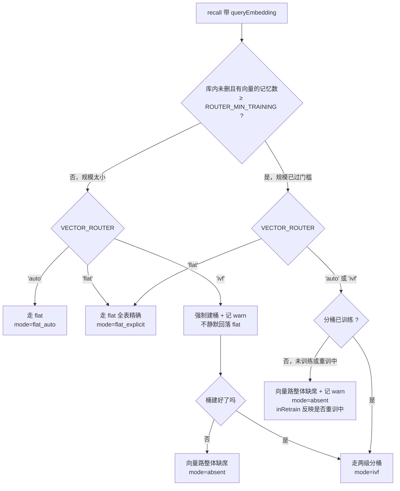

# DESIGN-v2.md 回写补丁（errata）· v2.1 记忆海版

> **本文件是 `docs/design/DESIGN-v2.md` 的勘误补丁，不是新设计稿。**
>
> 用途：把设计稿 v2.1 内部**自相矛盾**与**过时引用**的 5 处缺陷，逐条给出
> **「原文位置 → 问题 → 根因 → 可直接粘贴的「改前 → 改后」文本 → 影响面」**，
> 供**回写设计稿时逐条应用**。
>
> ⚠️ **权威性说明**
> - 桌面原件 `C:/Users/12138/Desktop/DESIGN-v2.md` 是**唯一权威**；仓库里这份是镜像。
> - **本补丁不修改 `DESIGN-v2.md` 本身**，也不修改任何代码，不执行 git commit / push。
> - 回写时机与提交由用户 / 主理人决定。
> - 本补丁里每条「改后」文本都是**成稿**，可直接粘贴；保留了原文的排版风格、
>   注释密度与 `⚠️` / `★` 标记习惯。
>
> **复核声明**：本补丁的 5 条结论由架构师**逐条独立复核**（逐字读原文 + 跑
> `scripts/check-params.ts` 建立基线 + 比对 `DEVELOPMENT-PLAN.md` 与 `src/` 已落地实现的引用）。
> 其中 **① ④ ⑤ 三条的「问题定位」需要按本文件修正主理人给的表述**（不是结论错，是范围/成因更准），
> 已分别在对应条目下标注「**复核修正**」。

---

## ⚠️ 0.0 回写前必读：**内容锚点定位法**（行号仅作参考）

> ### ★ 本节的核心原则：**用内容锚点定位，不要用行号定位。**
>
> 本补丁的每一条「改前 → 改后」都给的是**逐字原文**；
> 每一处回写目标都给了一个**在两个版本里都唯一命中**的**内容锚点**。
> ⇒ **回写者只需按锚点字符串搜索定位即可**，行号只作「大致在哪」的导航参考。
> ⇒ **这样即使设计稿继续被编辑、行号继续漂移，本补丁依然可用。**

### (1) 三个基线（★ **回写基线 = 桌面 22:56 版**）

| 基线 | 行数 | md5 | 行尾 | 用途 |
|---|---:|---|---|---|
| ★ **桌面原件** `C:/Users/12138/Desktop/DESIGN-v2.md`（22:56 用户编辑版） | **5754** | `565eda941db8dacc28c40cdecf31209d` | **LF**（实测 CR=0）+ 行尾硬换行 1118 处 | **本轮回写的基线**（用户的权威文档） |
| **仓库镜像** `docs/design/DESIGN-v2.md`（`145b155` 的 LF 归一化版） | 5712 | `7eb65d8499944866b3cddf3f5b87cc1f` | **LF**（实测 CR=0） | 当前 CI 契约脚本读的就是它 ⇒ **回写后必须同步** |
| **原始归档**（用户交稿时，21:11 入库前） | 5712 | `63a3a9f647ce78de2e555f62423a6754` | **CRLF**（CR=5712） | 历史留痕 |

`docs/design/DEVELOPMENT-PLAN.md`：4021 行 / LF / md5 未变 ⇒ **桌面原件里没有这个文件**（它是仓库独有的执行层计划文档）。

#### ★ 三个已用数据**证明**的事实

**(1) 镜像 = 原始归档经 git 的 `.gitattributes` 归一化 —— 内容逐字相同，无人违规**

把镜像的 LF 全部转成 CRLF 后重算 md5：

```
镜像(LF)    md5 = 7eb65d8499944866b3cddf3f5b87cc1f   CR = 0
镜像转CRLF   md5 = 63a3a9f647ce78de2e555f62423a6754   CR = 5712
原始归档 md5 = 63a3a9f647ce78de2e555f62423a6754
⇒ 完全匹配 ✅
```

⇒ **仓库行尾实为 LF**（`.gitattributes` 由 `d2f38a9` 21:26 引入的 `* text=auto eol=lf`）——
**不是任何人改的、也不是工程师改的，是 git 的正常行为，无人违规。**
⇒ ⚠️ 我此前说「仓库 CRLF／桌面 LF」是**错的**（用 `tr -d '\r'` 归一化后读错了 `diff` 退出码）。已在勘误中更正。

**(2) 桌面 22:56 版与镜像的差异 = 用户在 Markdown 编辑器里编辑的副产物**

`diff` 实测：**桌面独有 679 行 / 镜像独有 637 行 / 合计 1316 行差异**，净 **+42 行**（QA 的口径正确；我此前说的「1503 行」把 hunk 头也算进去了）。

| 类 | 内容 | 量 |
|---|---|---|
| ① | **行尾硬换行被批量补回**（Markdown「行尾两空格」） | 硬换行行数 **768 → 1118（+350）** |
| ② | **表格列宽被重排** | 若干表格行 |
| ③ | **§8.4 第 6 条硬规则的编号从「5.」改成「6.」**（**唯一的内容性修改**） | 1 处 |

⚠️ **实测更正**：桌面 22:56 版的行尾是 **LF**（CR=0），**不是 CRLF**；
只有**原始归档（用户交稿时）**才是 CRLF。⇒ 同步桌面原件时**不需要**做 CRLF 转换，
只需**保留它的行尾硬换行与表格列宽**。

**(3) 桌面 22:56 版对 5 条契约脚本「全部 0 差异」⇒ 把桌面同步回镜像不会让 CI 变红**

我独立复算（只读脚本，跑完即删）：

```
桌面版 check-params       → §5 表 60 项 / 代码 60 键 / 0 处差异
桌面版 check-contract-ids → §11.2 throw_not_found = 10 个方法（与代码常量完全一致）
```

⇒ **桌面比镜像多出的 42 行没有触及任何门禁锚点**（§5 表 / §8.4 payload 表 / §14.3.1 锚定表 / §11.2 对照表）。
⇒ **「回写目标选谁」不是门禁问题，是权威性问题** —— 两个版本目前都合规，门禁不会替你选。
⇒ **无人违规**：是 git 的正常行为（`.gitattributes` 由 `d2f38a9` 于 21:26 引入，
而设计稿本身由 `145b155` 于 21:11 入库）。**这不是任何人改了行尾。**

#### ★ 22:56 桌面原件那次编辑做了什么（用户本人在 Markdown 编辑器里编辑）

### (2) 桌面原件（22:56 版）里 5 条缺陷的**当前状态**

| # | 缺陷 | 桌面原件状态 | 结论 |
|---|---|---|---|
| ① | §4.6 步骤 0 ② | **仍在**（锚点 `② 否则按 \`VECTOR_ROUTER\``，桌面 L1147） | 需回写 |
| ② | §5 分类声明 61 | **仍在**（锚点 `> - **性能参数**（分桶路由 7 项 + 簇跳 1 项 + 向量路开关 2 项）`，桌面 L3508） | 需回写 |
| ③ | §8.1「53 项」 | **仍在**（锚点 `它是 53 项参数的**完整生效快照**`，桌面 L4470） | 需回写 |
| ④ | §8.4 硬规则编号 | ⚠️ **部分已修**：桌面版**已把第 6 条编号从「5.」改成「6.」**（桌面 L4625），但**标题仍写「三条硬规则」**（桌面 L4584），**规则 4 的悬空引用仍在**（桌面 L751 / `DEVELOPMENT-PLAN.md` L919） | **只需补标题 + 修 2 处引用**（本补丁 4.5(a)(c)(d)）；4.5(b) **已无需应用** |
| ⑤ | §11.2 缺收口条款 | **仍在**（桌面 §11.2 起于 L5224，全段仍无「客户端只看到规范化的错误结构」） | 需回写 |

⇒ **好消息**：④ 的编号碰撞（我定位的核心缺陷）**桌面版已经修好了**，
且**用户自发选的方案正是我提的方案**（1–5 原样 + 第 6 条改 6）⇒ **独立印证了 §4.4 的编号方案正确**。
⇒ **其余 4 条 + ④ 的标题与悬空引用仍需回写**。

### (3) ★ 回写目标锚点索引（**内容锚点优先，行号仅作参考**）

⚠️ **每一行的「内容锚点」在镜像与桌面两个版本里都唯一命中**（已逐条用脚本核验），
⇒ **回写者按锚点字符串搜索定位即可**，不受行号漂移影响。
★ **本轮以桌面 22:56 版为基线** ⇒ **「桌面行」列是回写时的实际位置**，镜像行仅作参考。

| 勘误 | 位置 | ★ 内容锚点（唯一） | ★ 桌面行（基线） | 镜像行（参考） |
|---|---|---|---:|---:|
| ①(a) | §4.6 步骤 0 ② | `② 否则按 \`VECTOR_ROUTER\`：\`'ivf'\` ⇒ 走两级分桶；\`'auto'\` / \`'flat'\` ⇒ 走 flat。` | **1147** | 1140 |
| ①(b) | §4.6 步骤 0 ① 首句 | `① **未命中 \`ROUTER_MIN_TRAINING\`**（库规模太小）⇒ 走 flat，**无论 \`VECTOR_ROUTER\` 设成什么**；` | **1142** | 1135 |
| ①(b) | §4.6 步骤 0 ① 续行 | `显式 \`'ivf'\` 在此时**照建桶 + 记一条 warn 日志**` | **1143** | 1136 |
| ①(c) | §5 `VECTOR_ROUTER` 行 ★ 句 | `★ **自动判定优先**：命中 \`ROUTER_MIN_TRAINING\` 时走 flat，显式值只在「未触发自动」时接管` | **3439** | 3404 |
| ①(d) | §4.15.6 标题句 | `⚠️ ★ **向量路的后端状态：三种，互斥。面板与 \`stats()\` 必须能区分。**` | **3350** | 3315 |
| ①(d) | §4.15.6 三态表 态① | `库内未删且有向量的记忆数 **< \`ROUTER_MIN_TRAINING\`**(10000)` | **3356** | 3321 |
| ①(d) | §4.15.6「三态」句 | `★ **「三态」是**语义层**的归纳，「四值 + 一布尔」是**类型层**的投影，两者不是矛盾**：` | **3367** | 3332 |
| ①(d) | §4.15.6「三行/三种处境」 | `上表三行是用户能读懂的三种处境` | **3368** | 3333 |
| ①(d) | §4.15.6「本表的三行」 | `⇒ **本表的三行按「能搜 / 不能搜（未训练）/ 不能搜（重训中）」归纳**；` | **3371** | 3336 |
| ② | §5 性能参数条 | `> - **性能参数**（分桶路由 7 项 + 簇跳 1 项 + 向量路开关 2 项）` | **3508** | 3473 |
| ② | §5 机制开关条 | `> - **机制开关（5 项：4 个布尔 + 1 个三值选择器））` | **3510** | 3475 |
| ③ | §8.1「53 项」 | `它是 53 项参数的**完整生效快照**` | **4470** | 4435 |
| ④(a) | §8.4 标题 | `**三条硬规则**：` | **4584** | 4550 |
| ④(b) | §8.4 第 6 条编号 | `5. **\`memory_id\` 是 \`appendEvent()\` 的必传实参**` ⚠️ **桌面版已无此行（已是「6.」）⇒ 本轮回写桌面基线时跳过** | — | 4592 |
| ④(c) | §4.2 悬空引用 | `⇒ §8.4 规则 4 的对账恒等式（Σ 库内变化 == Σ 事件里的 delta）恒不成立。` | **751** | 746 |
| ④(d) | `DEVELOPMENT-PLAN.md` 悬空引用 | `若函数不返回，**事件流就会缺这个键** ⇒ §8.4 规则 4 的对账恒等式恒不成立。` | —（独立文件） | 912 |
| ⑤(a) | §11.2 **插入点** | `- \`MemoryError.DATABASE_BUSY\`：并发等待超时。` | **5267** | 5227 |
| ⑤(b) | §11.2 `NOT_FOUND` 条目 | `\`link({createMissing:false})\` / \`linkByIds\`（收 id 的接口必须自己校验，不能靠外键，` | **5231** | 5194 |
| ⑤(c) | §4.5 步骤 4 标题行 | `**实体存在性必须自己校验，不能指望外键**：` | **1033** | 1026 |
| ⑤(c) | §4.5 步骤 4 校验 SQL | `对 @subjectId / @objectId 各执行 \`SELECT 1 FROM entities WHERE id = @x\`；` | **1034** | 1027 |
| ⑤(c) | §4.5 步骤 4 抛错行 | `任一缺失 → 抛 MemoryError.NOT_FOUND（details.missingIds），不写入任何东西。` | **1035** | 1028 |
| ⑤(c) | §4.5 步骤 1 `@memoryId` | `@memoryId  = 入参 memoryId（可为 undefined，表示这条边没有证据记忆）` | **959** | 952 |

⚠️ **`DEVELOPMENT-PLAN.md` 是独立文件**：桌面原件里**没有**它 ⇒ ④(d) 只针对仓库里的那份。

### (4) 本轮的回写范围与执行顺序（依主理人决定）

| 目标 | 本轮是否回写 | 说明 |
|---|---|---|
| **仓库镜像** `docs/design/DESIGN-v2.md` | ★ **要回写（两步）** | CI 契约脚本读的就是这份（`scripts/lib/design-doc.ts` 的 `DESIGN_DOC_PATH`）⇒ 它必须自洽，否则门禁校验的是一份已知有错的文档 |
| **桌面原件** `C:/Users/12138/Desktop/DESIGN-v2.md` | **最后同步**（用户确认后） | 它是用户的个人权威文档，且他正在用编辑器编辑（22:56 刚改过）⇒ 由主理人把回写后的内容**交付给用户**，由用户决定何时同步 |

#### 执行顺序（三步）

| 步 | 动作 | 说明 |
|---:|---|---|
| **1** | **先同步**：把桌面 22:56 版回灌到仓库镜像 | git 的 `.gitattributes`（`* text=auto eol=lf`）会自动归一化为 LF，与 21:11 那次同机制 ⇒ **单独成一次提交** |
| **2** | **再回写**：在同步后的基线上应用 5 条勘误 | 此时镜像 == 桌面内容，**只差行尾**（桌面是 LF，git 归一化后也是 LF ⇒ 实际无差） |
| **3** | **桌面原件最后同步** | 等用户确认后再做，**不整文件覆盖** |

⚠️ **第 1 步的前提**：**桌面原件若在回写前又被编辑，行号会继续漂移** ⇒ **回写前请先冻结一个版本**
（或改用本节 (3) 的**内容锚点**定位 —— 锚点不依赖行号，漂移不影响回写内容本身）。

⚠️ **同步桌面原件时的三条纪律**（主理人已明确）：
① **保留他编辑器的格式**（行尾硬换行、表格列宽对齐、他的排版风格）；
② **不做整文件覆盖** —— 避免抹掉他的排版；
③ **用本节 (3) 的内容锚点定位**，不要用行号。

⚠️ **实测更正**：桌面 22:56 版的行尾是 **LF**（CR=0）⇒ 同步时**不需要**做 CRLF 转换，
只需**保留它的行尾硬换行与表格列宽**；只有**原始归档（用户交稿时）**才是 CRLF。

⚠️ **第 1 步已完成验证**：桌面版对 5 条契约脚本**全部 0 差异**（见 (1)(3)）⇒ 同步不会让 CI 变红。


---

## 0. 复核结论速览

| # | 主理人给的问题 | 复核结论 | 需要修正之处 |
|---|---|---|---|
| ① | §4.6 步骤 0 ② 与紧随其后的 ★ 注冲突 | **成立** | ★ **范围更广**：不止 ② 一句；§4.6 ① 首句、§5 的 `VECTOR_ROUTER` 行、§4.15.6 态① 都带着同一族旧措辞，必须同批回写，否则新判定表仍与旧文自相矛盾 |
| ② | §5 参数分类声明 61 vs 60 | **成立** | 无。根因与修法均与主理人一致，已补出可粘贴的成文文本与 60 键对照表 |
| ③ | §8.1 的「53 项参数」是过时引用 | **成立** | 无。全文仅此一处「53」；`§14.3.1` 契约清单里的 `10 项 / 16 项 / 35/35 / 8/20` 与参数计数无关，**不得改动** |
| ④ | §8.4 硬规则编号与全文引用不一致 | **成立，但「5 条」的说法要改** | ★ **§8.4 正文实为 6 条**（不是 3 条、不是 5 条），且**第 6 条的编号被误写成第二个「5.」**。按 5 条回写会丢一条 ⇒ 本补丁按 **6 条**给（1–5 编号原样不动 + 新增第 6 条），满足向后兼容。⚠️ **桌面原件已自行修好编号碰撞**（第 6 条已是「6.」），只剩标题与 2 处悬空引用要改 |
| ⑤ | §11.2 缺 `SQLITE_CONSTRAINT_FOREIGNKEY` 的归一化路径 | **成立，但结论是「不新增错误码」** | ★ **不新增 `FOREIGN_KEY_VIOLATION`**：FK 违规语义 =「被引用的行不存在」= `NOT_FOUND`，复用即可，不扩码（扩码是破坏性变更）。★ 且真正的缺陷比「缺一条路径」更基础：**§11.2 通篇没有那句被全文四处引用的「客户端只看到规范化的错误结构」**——那是一条**悬空引用**。★ 另发现 §4.5 步骤 4 **漏了 `link` / `linkByIds` 的 `memoryId`** 这条外键路径 |

> ⚠️ **所有行号锚定在仓库镜像上**；**桌面原件已在 22:56 被更新（多 42 行）**，
> **回写桌面原件前请先读 §0.0 的行号平移对照表**（含「④ 已部分自行修复」的说明）。


---

## 1. 勘误 ①：`VECTOR_ROUTER` 三值选择器的判定顺序自相矛盾

### 1.1 位置

- **§4.6 步骤 0**，行 **1133–1143**（判定顺序块）；矛盾点在行 **1140**（②）与行 **1142–1143**（★ 注）。
- 连带（同一缺陷族，必须同批回写）：
  - §4.6 步骤 0 行 **1135**（① 的首句「走 flat，**无论 `VECTOR_ROUTER` 设成什么**」）；
  - §5 参数表 `VECTOR_ROUTER` 行，行 **3404**（★「自动判定优先」整句）；
  - §4.15.6 三态表 态①，行 **3321**。

### 1.2 问题（原文逐字）

行 1140：
```
     ② 否则按 `VECTOR_ROUTER`：`'ivf'` ⇒ 走两级分桶；`'auto'` / `'flat'` ⇒ 走 flat。
```
行 1142–1143：
```
   ★ **`'auto'` 必须真的自动**（否则它是个**死值**：两个分支里都等价于 flat）：
     规模 ≥ `ROUTER_MIN_TRAINING` ⇒ **走 ivf**；否则 ⇒ 走 flat。
```

行 1135（①）已经处理了「**未命中** `ROUTER_MIN_TRAINING`（库规模太小）⇒ 走 flat」，
所以 **② 的语境是「规模 ≥ `ROUTER_MIN_TRAINING`」**。在这个语境里：

- ② 说 `'auto'` ⇒ 走 flat；
- 紧随其后的 ★ 注说 规模 ≥ 门槛 ⇒ 走 ivf。

⇒ **同一个分支上两句给出相反结论。** 若按 ② 实现，`'auto'` 在两个分支里都等价于 flat
⇒ 它是个**死值** ⇒ §4.15 的两级分桶路由整条能力在默认配置（`'auto'`）下形同虚设。

### 1.3 根因

「自动判定」这一层被写成了**两套互斥的语义**：

| 位置 | 隐含语义 |
|---|---|
| §4.6 ②（行 1140） | 规模 ≥ 门槛时，**只有显式 `'ivf'` 才走分桶**；`'auto'` 与 `'flat'` 同命 ⇒ `'auto'` 是死值 |
| §4.6 ★ 注（行 1142–1143） | 规模 ≥ 门槛时，**`'auto'` 也走 ivf** ⇒ `'auto'` 真的自动 |
| §5 `VECTOR_ROUTER` 行（行 3404） | 前半段「`'auto'` …低于门槛 → flat，**达到 → 建桶**」= ★ 注口径；后半段「★ **自动判定优先**：命中 `ROUTER_MIN_TRAINING` 时走 flat，显式值只在「未触发自动」时接管」= ② 的口径 ⇒ **同一格里前后两句互相打脸** |
| §4.15.6 三态表 态①（行 3321） | 按「库规模 < 门槛」划分，**没有 `VECTOR_ROUTER` 这一维** ⇒ 显式 `'ivf'` 且库小的情形无格可落 |
| §6 `vectorBackend.mode`（行 3868–3899） | 四值枚举 `'flat_explicit' \| 'flat_auto' \| 'ivf' \| 'absent'` —— **`'flat_auto'` 的定义是「库太小自动降级（未过 `ROUTER_MIN_TRAINING`）」**，即「自动降级」只发生在 `'auto'` 下 ⇒ 印证 ★ 注口径 |
| §7.2 面板 1（行 4302–4308） | 五值措辞表，与 §6 四值一一对应 ⇒ 同样印证 ★ 注口径 |
| `src/core/flags.ts`（已落地，阶段 0） | `resolveVectorBackendState()` 取 ★ 注口径，且在文件头**逐字记录了本矛盾**并声明取哪一版 |

**结论：以 ★ 注 / §5 前半段 / §6 四值 / §7.2 五值 / 已落地实现为准（过门槛 ⇒ `'auto'` 走 ivf），
改 ②。** §4.6 ② 是孤例。

### 1.4 复核修正（相对主理人给的表述）

主理人给的背景是「分支 ① 已处理『未命中门槛 ⇒ 无论 `VECTOR_ROUTER` 设成什么都走 flat』」——
**这句话本身与设计稿两处原文冲突**，不能作为前提：

1. §4.6 ① 自己的后半句（行 1136–1139）写「显式 `'ivf'` 在此时**照建桶 + 记一条 warn 日志**
   …**不静默回落**…小库上强制 IVF **结果仍然正确**」⇒ ① 并没有说「显式 `'ivf'` 也走 flat」，
   它说的是「**走 flat 的同时把桶建起来**」——这本身又与 §5「`'ivf'`（**强制**两级分桶，即使低于门槛）」
   的字面口径打架（§5 说强制走分桶，§4.6 ① 说走 flat）。
2. §5 `VECTOR_ROUTER` 行自己写「`'ivf'`（**强制**两级分桶，即使低于门槛）」。

⇒ **「低于门槛 + 显式 `'ivf'`」这一格的最终口径必须一并裁决**，否则新表与旧文仍自相矛盾。
裁决见 §4 的最终判定表：**显式 `'ivf'` 恒走两级分桶**（低于门槛时照建桶 + 一条 warn，
桶尚未建好期间向量路整体缺席、`mode='absent'`）——
理由与 §4.6 ① 已经写下的两句完全一致：「不静默回落」（静默回落 = 静默改写调用方的显式配置）
与「小库上强制 IVF **结果仍然正确**」（IVF 是精确的 ⇒ 强制它不改变结果，只是不划算）。

### 1.5 改前 → 改后

#### (a) §4.6 步骤 0，行 1140 —— **主修法**

> ★ **内容锚点**：`② 否则按 \`VECTOR_ROUTER\`：\`'ivf'\` ⇒ 走两级分桶；\`'auto'\` / \`'flat'\` ⇒ 走 flat。`
> （镜像 L1140 / 桌面 L1147，**两版唯一命中**）

**改前**
```
     ② 否则按 `VECTOR_ROUTER`：`'ivf'` ⇒ 走两级分桶；`'auto'` / `'flat'` ⇒ 走 flat。
```
**改后**
```
     ② 否则（规模 ≥ `ROUTER_MIN_TRAINING`）按 `VECTOR_ROUTER`：`'ivf'` / `'auto'` ⇒ 走两级分桶；`'flat'` ⇒ 走 flat。
        ⇒ **`'auto'` 在这里必须走 ivf**（否则它在两个分支里都等价于 flat ⇒ 成了死值，见下方 ★ 注）。
```

#### (b) §4.6 步骤 0，行 1135–1136 —— 连带（裁决「低于门槛 + 显式 `'ivf'`）

> ★ **内容锚点（两行，都要改）**：
> ① `① **未命中 \`ROUTER_MIN_TRAINING\`**（库规模太小）⇒ 走 flat，**无论 \`VECTOR_ROUTER\` 设成什么**；`（镜像 L1135 / 桌面 L1142）
> ② `显式 \`'ivf'\` 在此时**照建桶 + 记一条 warn 日志**`（镜像 L1136 / 桌面 L1143）


**改前**
```
     ① **未命中 `ROUTER_MIN_TRAINING`**（库规模太小）⇒ 走 flat，**无论 `VECTOR_ROUTER` 设成什么**；
        显式 `'ivf'` 在此时**照建桶 + 记一条 warn 日志**
```
**改后**
```
     ① **未命中 `ROUTER_MIN_TRAINING`**（库规模太小）⇒ `'auto'` / `'flat'` ⇒ 走 flat；
        显式 `'ivf'` 在此时**照建桶 + 走两级分桶 + 记一条 warn 日志**
```
（后续行 1137–1139 的「不静默回落」与「小库上强制 IVF 结果仍然正确」两句**一字不改**——
它们正是本次裁决的既有依据，改动它们反而会削弱论证。）

#### (c) §5 `VECTOR_ROUTER` 行，行 3404 —— 连带（该格 ★ 句自相矛盾）

> ★ **内容锚点**：`★ **自动判定优先**：命中 \`ROUTER_MIN_TRAINING\` 时走 flat，显式值只在「未触发自动」时接管`
> （镜像 L3404 / 桌面 L3439，**两版唯一命中**）


**改前**
```
★ **自动判定优先**：命中 `ROUTER_MIN_TRAINING` 时走 flat，显式值只在「未触发自动」时接管 ⇒ 同一库不会因实现不同而走不同向量路
```
**改后**
```
★ **自动判定只作用于 `'auto'`**：低于门槛 → flat，达到门槛 → 建桶（§4.6 步骤 0 的判定顺序）；**显式值永远接管**——`'ivf'` 恒走两级分桶（低于门槛时照建桶 + 一条 warn），`'flat'` 恒走全表精确 ⇒ 同一库不会因实现不同而走不同向量路
```

#### (d) §4.15.6 三态表 态①，行 3321 —— 连带（该表缺 `VECTOR_ROUTER` 这一维）

> ★ **内容锚点（5 处，逐一按锚点定位）**：
> ① 标题句 `⚠️ ★ **向量路的后端状态：三种，互斥。面板与 \`stats()\` 必须能区分。**`（镜像 L3315 / 桌面 L3350）
> ② 三态表 态① 行 `库内未删且有向量的记忆数 **< \`ROUTER_MIN_TRAINING\`**(10000)`（★ **桌面 L3356（基线）** / 镜像 L3321）
> ⚠️ **锚点串刻意不含 `|`**（该行是 Markdown 表格行，`|` 需转义成 `\|` ⇒ 复制粘贴后按字面匹配会命中 0 次）⇒ 去掉竖线后仍**唯一命中**，且可无脑复制粘贴。
> ③ `★ **「三态」是**语义层**的归纳，「四值 + 一布尔」是**类型层**的投影，两者不是矛盾**：`（镜像 L3332 / 桌面 L3367）
> ④ `上表三行是用户能读懂的三种处境`（镜像 L3333 / 桌面 L3368）
> ⑤ `⇒ **本表的三行按「能搜 / 不能搜（未训练）/ 不能搜（重训中）」归纳**；`（镜像 L3336 / 桌面 L3371）


**改前**
```
| ① **flat 模式** | 库内未删且有向量的记忆数 **< `ROUTER_MIN_TRAINING`**(10000) ⇒ **还没到建桶的门槛** | **正常工作**（全表精确点积） | 「向量路：**flat 模式**（库规模 < 1 万条，未建分桶）」——**不是「不可用」** |
```
**改后**
```
| ① **flat 模式** | 库内未删且有向量的记忆数 **< `ROUTER_MIN_TRAINING`**(10000) ⇒ **还没到建桶的门槛**，**且 `VECTOR_ROUTER` 不是 `'ivf'`**（显式 `'ivf'` 属态④） | **正常工作**（全表精确点积） | 「向量路：**flat 模式**（库规模 < 1 万条，未建分桶）」——**不是「不可用」** |
```
#### (d-2) §4.15.6 的四处「三 → 四」措辞（**逐条机械替换**）

> ★ **以下 4 组是独立的「改前 → 改后」对，可逐条机械替换**（内容锚点见上）。

**改前**
```
⚠️ ★ **向量路的后端状态：三种，互斥。面板与 `stats()` 必须能区分。**
```
**改后**
```
⚠️ ★ **向量路的后端状态：四种，互斥。面板与 `stats()` 必须能区分。**
```

**改前**
```
★ **「三态」是**语义层**的归纳，「四值 + 一布尔」是**类型层**的投影，两者不是矛盾**：
```
**改后**
```
★ **「四态」是**语义层**的归纳，「四值 + 一布尔」是**类型层**的投影，两者不是矛盾**：
```

**改前**
```
上表三行是用户能读懂的三种处境
```
**改后**
```
上表四行是用户能读懂的四种处境
```

**改前**
```
⇒ **本表的三行按「能搜 / 不能搜（未训练）/ 不能搜（重训中）」归纳**；
```
**改后**
```
⇒ **本表的四行按「能搜 / 不能搜（未训练）/ 不能搜（重训中）/ 不能搜（强制建桶中）」归纳**；
```

**并在本表下方补一行态④**（本表原有三态不变，新增第四态）——**机械替换对**：

**改前**
```
| ③ **缺席（重训中）** | 分桶正在重训 | **不工作** | 「向量路不可用（分桶重训中）」 |
```
**改后**
```
| ③ **缺席（重训中）** | 分桶正在重训 | **不工作** | 「向量路不可用（分桶重训中）」 |
| ④ **ivf 模式（强制）** | `VECTOR_ROUTER` = `'ivf'`（**无论库规模**）：低于门槛时**照建桶 + 一条 warn**（「库规模低于建桶门槛，IVF 收益未经验证」），桶尚未建好期间向量路整体缺席 | 建好后**正常工作**（两级分桶）；建桶完成前**不工作** | 「向量路：ivf 模式（两级分桶）」／建桶完成前「向量路不可用（分桶未训练）」——**逐条读 §7.2 面板 1 的表** |
```
⚠️ 该表末尾已写明「★ **「三态」是**语义层**的归纳…具体取值一律读 §6」⇒ 补态④ 不与该免责声明冲突，
但**「三态」这个措辞要跟着改**——共三处提到「三」：
- 行 **3315**：「⚠️ ★ **向量路的后端状态：三种，互斥。**」⇒ 「三种」→「四种」；
- 行 **3332**：「★ **「三态」是**语义层**的归纳」⇒ 「三态」→「四态」；
- 行 **3333**：「上表三行是用户能读懂的三种处境」⇒ 「三行」→「四行」、「三种处境」→「四种处境」；
- 行 **3336**：「⇒ **本表的三行按「能搜 / 不能搜（未训练）/ 不能搜（重训中）」归纳**」
  ⇒ 「三行」→「四行」，并补上第四种处境「不能搜（强制建桶中）」。

### 1.6 影响面

| 受影响处 | 需要做什么 |
|---|---|
| §4.6 步骤 0（行 1133–1143） | 按 (a)(b) 回写 |
| §5 `VECTOR_ROUTER` 行（行 3404） | 按 (c) 回写 |
| §4.15.6（行 3315、3319–3337） | 按 (d) 回写；**「三种 / 三态 / 三行」→「四」**（行 3315、3332、3333、3336 共四处，详见 (d) 末尾） | ① |
| §6 `vectorBackend.mode`（行 3868–3899） | **无需改动**——四值枚举与 ★ 注口径一致。但 `'flat_auto'` 的注释「**库太小自动降级**（未过 `ROUTER_MIN_TRAINING`）」建议补一句「**仅 `'auto'` 会走到这里**」，与 §5 (c) 的新措辞呼应 |
| §7.2 面板 1（行 4302–4308） | **无需改动**——五值措辞表与 §6 四值一致 |
| §7.3 状态表（行 4392） | **无需改动** |
| §12 阶段 2（行 5420 附近） | **无需改动**——「分桶吻合率验收」不依赖路由判定顺序 |
| §14.1（行 5610） | **无需改动**——「向量路在分桶训练完成前静默缺席」条目与新表一致 |
| `src/core/flags.ts` | **无需改动**——`resolveVectorBackendState()` 已取 ★ 注口径，且文件头已逐字记录本矛盾 |
| `src/core/flags.test.ts` | **无需改动**——`'auto' 过门槛且分桶已训练 ⇒ ivf` 的断言已与新表一致 |
| `DEVELOPMENT-PLAN.md` | 检查 P2 阶段任务书里是否复述了「`'auto'` ⇒ flat」的旧措辞（**需 grep 一遍**） |

---

## 2. 勘误 ②：§5 参数分类声明的算术 61 vs 60

### 2.1 位置

§5 末尾的分类声明，行 **3464–3475**（引用块内），算术错在行 **3473**。

### 2.2 问题（原文逐字）

行 3466–3475：
```
> - **行为语义参数**（共激活 **10** 项、涌现簇 5 项、侧抑制 1 项）：改动会改变库的**拓扑与召回行为**，
>   属于 ADR 级别的变更，须走 §13 的决策记录。
>   ⚠️ 共激活是 **10** 项（不是 9）：…
> - **性能参数**（分桶路由 7 项 + 簇跳 1 项 + 向量路开关 2 项）：只影响延迟与召回率，不改变语义，可在运行期调整。
> - **运维参数**（`ARCHIVAL_ORPHAN_CHECK` 1 项）：影响宿主调度各类维护动作的频率与开销。
> - **机制开关（5 项：4 个布尔 + 1 个三值选择器）**：只切换机制的有无，不改变任何参数语义。
```

四类直接相加：**16 + 10 + 1 + 5 = 32**，加 v1.0 继承 29 ⇒ **61**。
但同一份文档的行 **3457** 写「参数总数：29（v1.0）→ 60（v2.1）。**新增 31 项**」、
行 **5396** 写「参数表扩充：29 → 60 项（§5）」，§6 的 `DEFAULT_PARAMS` 实测也是 **60 个键**
（`scripts/check-params.ts` 基线输出：`§5 解析出的参数条数：60` / `DEFAULT_PARAMS 的键数：60` /
`✓ §5 表与 DEFAULT_PARAMS 逐键逐值相等`）。

⇒ **声明得 61，别处都是 60。**

### 2.3 根因

**`VECTOR_ROUTER` 被数了两次：**

| 分类 | 声明包含的键 | 个数 |
|---|---|---|
| 性能参数 · **向量路开关 2 项** | `ROUTER_MIN_TRAINING` + **`VECTOR_ROUTER`** | 2 |
| 机制开关 · **1 个三值选择器** | **`VECTOR_ROUTER`** | 1 |

`VECTOR_ROUTER` 同时出现在「性能参数」与「机制开关」两类里 ⇒ 两处都数它 ⇒ 虚增 1。
它的正确归属是**机制开关**（§5 行 3404 自己称它「**第五个机制开关**（三值选择器）」，
行 3407–3414 的「★ 五个机制开关」白名单表里也列了它；
而 §5 参数表的**分组列**把它放在「向量路」组——那是**表格分组**，与「性质分类」是两个不同的轴）。

**正确的口径（与 §6 的 60 个键逐键对齐）：**
```
行为语义 16（共激活 10 + 涌现簇 5 + 侧抑制 1）
性能      9（分桶路由 7 + 簇跳 1 + 向量路阈值 1 = ROUTER_MIN_TRAINING）
运维      1（ARCHIVAL_ORPHAN_CHECK）
机制开关  5（4 布尔 + VECTOR_ROUTER）
          ─────────────────────
新增     31  ⇒ 29（v1.0 继承）+ 31 = 60 ✓
```

### 2.4 改前 → 改后

> ★ **内容锚点（2 行，都要改）**：
> ① `> - **性能参数**（分桶路由 7 项 + 簇跳 1 项 + 向量路开关 2 项）`（镜像 L3473 / 桌面 L3508，**两版唯一命中**）
> ② `> - **机制开关（5 项：4 个布尔 + 1 个三值选择器））`（★ **桌面 L3510（基线）** / 镜像 L3475，**两版唯一命中**）
> ⚠️ **注意**：真实原文在「选择器」后有**两个**右括号「））」（`（…）` 闭括号 + `）` 收尾），**锚点串必须写两个** ⇒ 少写一个就会命中 0 次。


**改前**（行 3473–3475）
```
> - **性能参数**（分桶路由 7 项 + 簇跳 1 项 + 向量路开关 2 项）：只影响延迟与召回率，不改变语义，可在运行期调整。
> - **运维参数**（`ARCHIVAL_ORPHAN_CHECK` 1 项）：影响宿主调度各类维护动作的频率与开销。
> - **机制开关（5 项：4 个布尔 + 1 个三值选择器））：只切换机制的有无，不改变任何参数语义。
```

**改后**
```
> - **性能参数**（分桶路由 7 项 + 簇跳 1 项 + **向量路阈值 1 项 = `ROUTER_MIN_TRAINING`** = **9**）：只影响延迟与召回率，不改变语义，可在运行期调整。  
>   ⚠️ **「向量路」只算 `ROUTER_MIN_TRAINING` 一项**——`VECTOR_ROUTER` 归**机制开关**（它是一个三值选择器，「机制有没有」的语义），  
>   **两处都数它 ⇒ 四类相加会得到 61**，与 §6 的 60 个键对不上。  
> - **运维参数**（`ARCHIVAL_ORPHAN_CHECK` 1 项）：影响宿主调度各类维护动作的频率与开销。  
> - **机制开关（5 项：4 个布尔 + 1 个三值选择器 `VECTOR_ROUTER`）**：只切换机制的有无，不改变任何参数语义。  
>
> ⇒ **四类相加 = 行为语义 16 + 性能 9 + 运维 1 + 机制开关 5 = 新增 31 项**；  
>   **29（v1.0 继承）+ 31（v2.0 新增）= 60** ✓（与行 3457「29 → 60」与 §12 的「29 → 60 项」一致）。
```

### 2.5 影响面

| 受影响处 | 需要做什么 |
|---|---|
| §5 行 3473–3475 | 按上回写 |
| §5 行 3457 | **无需改动**（「新增 31 项」在修正后恰好成立） |
| §6 `DEFAULT_PARAMS`（行 3541–3619） | **无需改动**——键集合与 §5 表本就逐键相等（CI 已守住） |
| §12 行 5396 | **无需改动** |
| `src/core/params.ts`（行 **47–56** 的注释） | ⚠️ 该注释**照抄了旧的错误口径**（行 48「向量路开关 **2** = 10」+ 行 53「口径提醒：两处都数它 ⇒ 61」）。**建议工程师把它改成修正后的口径**（16 + 9 + 1 + 5 + 29 = 60）——否则代码注释会继续传播这个算术。本补丁不改代码，列入检查清单 |
| `scripts/check-params.ts` | **无需改动**——它比对的是「§5 表 ↔ `DEFAULT_PARAMS`」，不读分类声明。⚠️ 但它**无法**发现本条缺陷 ⇒ 见 §3.3 的建议 |
| `DEVELOPMENT-PLAN.md` §7.1（行 3745–3814） | **无需改动**——那张表是**按阶段**分组的另一个轴（阶段 1 = 29 / 阶段 2 = 9 / 阶段 3 = 20 / 阶段 4 = 2 = 60），与「性质分类」不冲突 |

---

## 3. 勘误 ③：§8.1 的「53 项参数」是过时引用

### 3.1 位置

§8.1 文本日志规范，行 **4435**。

### 3.2 问题（原文逐字）

```
  - **唯一的例外是 `config` 事件的 `params`**：它是 53 项参数的**完整生效快照**（§8.4，与 §5 参数表逐项一致），
```

「53 项」与全文其余三处（行 3457「29 → 60」、行 5396「29 → 60 项」、§6 的 60 个键）都不一致。

**根因（可追溯）**：§5 的第二张参数表被中间的「★ 五个机制开关」引用块与「CI 断言」段落**打断**，
后半段（**分桶路由 7 项**）没有自己的表头。`scripts/lib/design-doc.ts` 的注释把这件事写得很清楚：

> 「§5 的第二张表被中间的『五个机制开关』引用块与 CI 断言段落**打断**，后半段（分桶路由 7 项）**没有自己的表头**
> —— 若按『第一行是表头』处理，那 7 行会被当成表头丢掉，**参数就只剩 53 项**。」

⇒ **「53」= 60 − 7（分桶路由 7 项）**，正是「按表头解析」漏掉后半张表的产物。
写 §8.1 这句话时用的是那个漏读的口径（或者一个尚未补齐分桶路由的早期版本），**不是**「53 项参数」的刻意口径。

### 3.3 改前 → 改后

> ★ **内容锚点**：`它是 53 项参数的**完整生效快照**`（镜像 L4435 / 桌面 L4470，**两版唯一命中**）


**改前**
```
  - **唯一的例外是 `config` 事件的 `params`**：它是 53 项参数的**完整生效快照**（§8.4，与 §5 参数表逐项一致），
```
**改后**
```
  - **唯一的例外是 `config` 事件的 `params`**：它是 **60** 项参数的**完整生效快照**（§8.4，与 §5 参数表逐项一致），
```

### 3.4 全文「N 项参数」扫描结果

| 位置 | 原文数字 | 判定 |
|---|---|---|
| §5 行 3457 | 「参数总数：29（v1.0）→ 60（v2.1）。新增 31 项（其中 5 项是机制开关）」 | ✅ 正确，**不动** |
| §5 行 3419 | 「§5 表与 `DEFAULT_PARAMS` **逐键逐值相等**（含 5 个机制开关的白名单）」 | ✅ 正确，**不动** |
| §5 行 3473 | 「向量路开关 2 项」 | ❌ 见勘误 ② |
| §8.1 行 4435 | 「53 项参数」 | ❌ **本条** |
| §12 行 5396 | 「参数表扩充：29 → 60 项（§5），含跨参数校验（§5 的 8 条）」 | ✅ 正确，**不动** |
| §14.3.1 契约清单 | `10 项` / `16 项` / `35/35` / `5 条` / `8/20` | ✅ **与参数计数无关**（C25 的例子 8/20、C31 的「35/35 全绿」、§14.3 的「本轮 16 项残留里有 10 项」），**不得改动** |
| §14.3.1 契约清单 | `§5 的 8 条` | ✅ 是**跨参数校验条数**（8），与参数**项数**无关，**不得改动** |

**全文 `53` 出现次数：1**（仅行 4435）。改这一处即闭合。

⚠️ **这一条目前没有任何门禁覆盖**（`check-params.ts` 只比对 §5 表 ↔ `DEFAULT_PARAMS`，
`check-payload-keys.ts` 只比对 §8.4 的 payload 键集 ⇒ **两者都看不到 §8.1 这个数字**）
⇒ 建议在 `scripts/check-payload-keys.ts` 或新脚本里加一条：
**「§8.1 的项数 == `PARAM_KEYS.length`」**（与 §6.1 的分类声明断言一起做，两条都属「文档里的数字必须与代码一致」）。

### 3.5 影响面

| 受影响处 | 需要做什么 |
|---|---|
| §8.1 行 4435 | 改为 60 |
| §8.4 的 `config` 行（行 4548） | **无需改动**——它写的是「两者都必带 `SCHEMA_VERSION, params`（**变更后的完整生效参数**）」，未写项数 |
| `src/store/events.ts` / `src/core/events.types.ts` | **无需改动**——`config` 事件的 payload 形状与项数无关（`params` 是整对象） |
| `scripts/check-payload-keys.ts` | **无需改动** |

---

## 4. 勘误 ④：§8.4 硬规则的编号与全文引用不一致

### 4.1 位置

§8.4 事件类型与发射点对照表，行 **4550–4598**（硬规则块）；错引用在行 **746**。
连带：`DEVELOPMENT-PLAN.md` 行 **912**、`src/store/events.ts` 行 **5**、
`src/store/params.test.ts` 行 **105**、`tests/unit/events.test.ts` 行 **123**。

### 4.2 问题（原文逐字 + 复核修正）

**★ 复核修正：主理人描述的「§8.4 写的是『三条硬规则』：①…②…③…」不完整。**
逐字读完 §8.4 的硬规则块，**正文实际有 6 条编号条目**，且**第 6 条的编号被误写成第二个「5.」**：

| 行号 | 现行编号 | 内容 |
|---|---|---|
| 4550 | — | `**三条硬规则**：`（**标题写 3，正文实际 6**） |
| 4552 | `1.` | `recall` 默认不记录 |
| 4554 | `2.` | `config` 必须记录 |
| 4560 | `3.` | v2.0 新增的四个键只在 `touch()` 的显式发射点出现（含「旧事件重放」句式） |
| 4570 | `4.` | 只有 `action === 'purge'` AND `purged > 0` 才代表物理删除（+ payload 按 `action` 分组） |
| 4583 | `5.` | **`stabilityDelta` 的「键的有无」+ 对账恒等式** ← 主理人说的「硬规则 5」 |
| 4592 | `5.` ⚠️ | **`memory_id` 是 `appendEvent()` 的必传实参** ← **编号重复，实为第 6 条** |

⇒ 主理人要求「把『对账恒等式』与『stabilityDelta 键恒在』正式写进 §8.4」——
**这两条已经在 §8.4 里了**（就是行 4583–4591 的第 5 条）。
真正的缺陷是三件事：

1. **标题计数错**：「三条硬规则」⇒ 实际 6 条；
2. **编号重复**：行 4592 的第 6 条被编成第二个「5.」；
3. **引用错位**：行 746 与 `DEVELOPMENT-PLAN.md` 行 912 把「对账恒等式」指向**规则 4**，
   而对账恒等式住在**规则 5**。

### 4.3 根因

第 6 条（`memory_id` 必传实参）是后加的，**加在末尾时沿用了第 5 条的编号**。
而第 4 条（`action === 'purge'` / payload 按 `action` 分组）原本的编号曾被「对账恒等式」引用过，
后来对账恒等式被并进了第 5 条 ⇒ 行 746 的「规则 4」就变成了**悬空引用**。

**「硬规则 5」这个标签现在在代码里指代两条不同的规则**——这是本条缺陷的真实危害：

| 引用处 | 「硬规则 5」指的是 | 与 §8.4 正文对得上吗 |
|---|---|---|
| `src/core/events.types.ts:159` / `:515` | `stabilityDelta` 键恒在 / 对账恒等式 | ✅ 对上（正文第 5 条） |
| `DEVELOPMENT-PLAN.md:355` / `:388` / `:2926` | 同上 | ✅ 对上 |
| `src/store/events.ts:5` | **`memory_id` 必传实参** | ❌ 对不上（正文是第 6 条） |
| `src/store/params.test.ts:105` | **`memory_id` 必须是显式 null** | ❌ 对不上 |
| `tests/unit/events.test.ts:123` | **`memory_id` 是必传实参** | ❌ 对不上 |

⇒ 同一个标签在同一个仓库里指两件事 ⇒ 工程师按注释找规则会找错。

### 4.4 编号方案（向后兼容）

**方案：保留 1–5 的现有编号与语义一字不动，把第 6 条从「5.」改为「6.」，标题改为「六条硬规则」。**

这样：
- 所有指向规则 **1 / 2 / 3 / 4 / 5** 的既有引用**语义不变、编号不变**（含上表全部 ✅ 行）——
  满足「既有引用指向的语义不能错位」；
- 唯一需要改的既有引用，是**本来就指错的**那两处（行 746、`DEVELOPMENT-PLAN.md:912`）：
  它们说的是「对账恒等式」，应指向**规则 5**（改的是**引用方的编号**，被引规则不动）；
- 三处代码注释（把「硬规则 5」用在 `memory_id` 上的）改为「硬规则 6」。

**为什么不采用「拆成 5 条」**：若把「对账恒等式」与「`stabilityDelta` 键恒在」拆成独立的规则 4 / 5，
则 `memory_id` 规则没有位置（会被挤成 6 或被合并），且**规则 4 会被重新占用**——
而「硬规则 4 = payload 按 `action` 分组」已被 `DEVELOPMENT-PLAN.md:3409`、
`src/core/events.types.ts:235` / `:482` 引用 ⇒ 拆分会让这些引用错位。**故不拆。**

> ★ **★ 桌面基线上的实际改动量（已按主理人指示核实并明确）**：
>
> **本轮回写以桌面 22:56 版为基线** ⇒ **勘误 ④ 在该基线上「不再涉及改编号」**：
>
> | 改动项 | 桌面基线上的状态 | 本轮是否要改 |
> |---|---|---|
> | 第 6 条的**编号**（`5.` → `6.`） | **用户已自行改好**（桌面 L4625 现为 `6.`） | ❌ **不改**（4.5(b) 跳过） |
> | §8.4 的**标题**（`三条硬规则` → `六条硬规则`） | **仍是「三条硬规则」**（桌面 L4584） | ✅ **要改**（4.5(a)） |
> | §4.2 的**悬空引用**（规则 4 → 规则 5） | **仍指向规则 4**（桌面 L751） | ✅ **要改**（4.5(c)） |
> | `DEVELOPMENT-PLAN.md` 的**悬空引用** | **仍指向规则 4**（L919） | ✅ **要改**（4.5(d)） |
> | 三处代码注释（`硬规则 5` → `硬规则 6`） | 指的是 `memory_id` 规则，桌面正文已是第 6 条 ⇒ **注释确实指错了** | ✅ **要改**（4.5(e)） |
>
> ⇒ **在桌面基线上，勘误 ④ 的实际改动 = 「补 §8.4 的标题 + 修 2 处悬空引用 + 修 3 处代码注释」**，
> **不涉及任何编号改动**。
>
> ★ **★ 关于「同步桌面回镜像」这一步的正确语义（勘误勘误：我此前的表述写反了，主理人已纠正）**：
>
> | | 第 6 条（`memory_id` 必传实参）的编号 | 同步桌面→镜像之后 |
> |---|---|---|
> | 桌面 22:56 版 | **已经是「6.」** | — |
> | 仓库镜像（21:11 LF 归一化版） | 是**第二个「5.」**（未修） | **变成「6.」** |
>
> ⇒ **同步桌面 → 镜像，是把「5.」修正成「6.」，不是让它重新出现。**
> ⇒ ⚠️ 我此前在 §4.4 与 4.5(b) 里写的「同步之后镜像里那个『5.』会重新出现 ⇒ 镜像侧仍需执行 4.5(b)」
> **是错的**（已在本补丁中更正）——同步**直接覆盖**了镜像侧那个未修的「5.」，
> **不需要**再单独执行 4.5(b)。
>
> ★ **必须分清的两条规则（本补丁的核心澄清）**：
>
> | 规则 | 内容 | 编号 | 是否要动 |
> |---:|---|---|---|
> | **硬规则 5** | `stabilityDelta` 的「键的有无」=「这次有没有真的加固」+ **对账恒等式** | **5** | ❌ **保持 5 不变**（§4.2 / `DEVELOPMENT-PLAN.md` 里那些指向它的引用**本来就对**，**不要改**） |
> | **硬规则 6** | `memory_id` 是 `appendEvent()` 的必传实参 | **6** | ✅ 就是这条**被误写成第二个「5.」**的 ⇒ 编号修正的目标 |
>
> ⇒ **只有「被误写成第二个『5.』的那条（即 `memory_id` 必传实参）」才是 6**；
> **硬规则 5 本身（对账恒等式那条）永远保持 5**。
> ⇒ 这也**独立印证了本方案的方向正确**：用户自发地选了「保留 1–5、第 6 条改 6」这条路，
> 而不是我提出的其它任何编号方案。

### 4.5 改前 → 改后

#### (a) §8.4 标题计数

> ★ **内容锚点**：`**三条硬规则**：`（★ **桌面 L4584（基线）** / 镜像 L4550，**两版唯一命中**）


**改前**
```
**三条硬规则**：
```
**改后**
```
**六条硬规则**（编号 1~6 即全文引用的唯一口径——`DEVELOPMENT-PLAN.md` 与 `src/` 里的「§8.4 硬规则 N」都指这里）：
```

#### (b) §8.4 行 4592 —— 第 6 条重新编号

> ★ **内容锚点**：`5. **\`memory_id\` 是 \`appendEvent()\` 的必传实参**`（**镜像 L4592**）
> ⚠️ **桌面基线上已无此行**（桌面 L4625 已是「6.」）⇒ **回写桌面基线时跳过本步**。
> ✅ **同步桌面→镜像这一步就会把它改成「6.」**（镜像现在是未修的「5.」）⇒ **不需要单独执行本步**。
> ⚠️ **勘误勘误**：我此前写的「同步之后镜像里这个『5.』会重新出现 ⇒ 镜像侧仍需执行本步」**是错的**
> ——同步**直接覆盖**了镜像侧那个未修的「5.」。已在 §4.4 的对照表里更正。

> ★★ **⚠️ 回写派单必读：④(b) 在「同步之后」是「幂等 / 空操作」，不是「失败」**（QA 指出，已实测确认）：
>
> | | ④(b) 的改前文本 `5. **\`memory_id\` 是 \`appendEvent()\` 的必传实参**` | ④(b) 的改后文本 `6. **…` |
> |---|---|---|
> | 仓库镜像（同步前） | **命中 1 次**（L4592，未修） | 命中 0 次 |
> | 桌面原件 | 命中 0 次 | **命中 1 次**（L4625，已修） |
> | **同步之后的镜像**（＝桌面内容） | **命中 0 次** ⬅ | 命中 1 次 |
>
> ⇒ **第 0 步同步完成后，镜像里已不存在 ④(b) 的改前文本** ⇒
> **朴素的「找改前文本 → 替换」工具会报「锚点未命中 ⇒ 失败」**
> ⇒ **可能误判失败、甚至回滚掉同步** ⇒
> ⇒ **必须把 ④(b) 的「改前文本找不到」当作「幂等成功（已是目标态）」**，而不是错误。
>
> ⇒ **实测确认：同步后的镜像里，其余 20 条锚点的「改前文本」仍然各命中 1 次** ⇒
> **只有 ④(b) 一条会变成幂等**，其余照常替换即可。


> ⚠️ **「硬规则 5」与「硬规则 6」别搞混**（本补丁的核心澄清）：
> **硬规则 5 = `stabilityDelta` 的「键的有无」+ 对账恒等式 ⇒ 永远保持 5，不动**；
> **只有被误写成第二个「5.」的那条（`memory_id` 必传实参）才是 6**。

**改前**
```
5. **`memory_id` 是 `appendEvent()` 的必传实参**（值可以是 `null`，但**不允许省略这个参数**）——
```
**改后**
```
6. **`memory_id` 是 `appendEvent()` 的必传实参**（值可以是 `null`，但**不允许省略这个参数**）——
```
（其余六行正文一字不改。）

#### (c) §4.2 行 746 —— 错引用修正

> ★ **内容锚点**：`⇒ §8.4 规则 4 的对账恒等式（Σ 库内变化 == Σ 事件里的 delta）恒不成立。`（★ **桌面 L751（基线）** / 镜像 L746，**两版唯一命中**）


**改前**
```
  //   ⇒ §8.4 规则 4 的对账恒等式（Σ 库内变化 == Σ 事件里的 delta）恒不成立。
```
**改后**
```
  //   ⇒ §8.4 规则 5 的对账恒等式（Σ 库内变化 == Σ 事件里的 delta）恒不成立。
```

#### (d) `DEVELOPMENT-PLAN.md` 行 912 —— 同一处错引用

> ★ **内容锚点**：`若函数不返回，**事件流就会缺这个键** ⇒ §8.4 规则 4 的对账恒等式恒不成立。`（仓库 `DEVELOPMENT-PLAN.md` L912，**该文件唯一命中**；★ 桌面原件里**没有**这个文件 ⇒ 它是仓库独有的执行层计划文档，**本轮需同步修改**）


**改前**
```
  若函数不返回，**事件流就会缺这个键** ⇒ §8.4 规则 4 的对账恒等式恒不成立。
```
**改后**
```
  若函数不返回，**事件流就会缺这个键** ⇒ §8.4 规则 5 的对账恒等式恒不成立。
```

#### (e) 三处代码注释 —— 由工程师随本次回写一并改（**本补丁不改代码**）

| 文件 | 改前 | 改后 |
|---|---|---|
| `src/store/events.ts:5` | `§8.4 硬规则 5 的原话。` | `§8.4 硬规则 6 的原话。` |
| `src/store/params.test.ts:105` | `（§8.4 硬规则 5）` | `（§8.4 硬规则 6）` |
| `tests/unit/events.test.ts:123` | `§8.4 硬规则 5 —— ` | `§8.4 硬规则 6 —— ` |

#### (f) ★ `DEVELOPMENT-PLAN.md` 行 353 —— **硬规则 3 与硬规则 5 的键归属**（§8.3 第 9 项）

> **问题**：计划文档写「`touch` 事件新增 **5** 个键（§8.4 硬规则 3）」，
> 但 §8.4 硬规则 3 管的只有**四个**键（`coactPairs` / `coactPairsTruncated` /
> `activationWrites` / `coactSkipped`）—— `stabilityDelta` 归**硬规则 5**
> （「键的有无」+ 对账恒等式）。
> ⇒ **同一份计划文档内部自相矛盾**：行 353 说「5 个键（硬规则 3）」，
> 行 360 却说「**这 4 个键**只在 `touch()` 的显式发射点出现」。

**改前**
```
- **`touch` 事件新增 5 个键**（§8.4 硬规则 3）：
```
**改后**
```
- **`touch` 事件新增 5 个键**：其中 **4 个归 §8.4 硬规则 3**（`coactPairs` / `coactPairsTruncated` / `activationWrites` / `coactSkipped`），**`stabilityDelta` 归 §8.4 硬规则 5**：
```

⚠️ **只改这一行**：下面的 5 个键的**逐条说明一字不动**（`stabilityDelta` 那一行
本来就已经写着「§8.4 硬规则 5」，**是对的** ⇒ 只需把**归属声明**改对）。

### 4.6 §8.4 六条硬规则（改后口径）+ 全文引用一致性核对表

#### 六条的权威清单（改后）

| 编号 | 规则 | 所在行（改后） | 一句话语义 |
|---|---|---|---|
| **1** | `recall` 默认不记录 | 4552 | 召回是最高频操作，逐次写事件造成严重写放大；只在 `explain: true` 时记录，且只存 `contextHash` |
| **2** | `config` 必须记录 | 4554 | 参数变更会改变所有历史数据的解读方式；`params` 恒有、`changed` 只在 `setParams()` 时有 |
| **3** | v2.0 新增的四个键只在 `touch()` 的显式发射点出现 | 4560 | `coactPairs` / `coactPairsTruncated` / `activationWrites` / `coactSkipped`；含「旧事件重放取 `?? []` / `?? 0`」句式 |
| **4** | 只有 `action === 'purge'` AND `purged > 0` 才代表物理删除 | 4570 | 且 payload 按 `action` 分组写清字段集；旧事件 `action` 缺失 ⇒ 默认 `'purge'` |
| **5** | `stabilityDelta` 的「键的有无」=「这次有没有真的加固」 | 4583 | 键恒在（未增长为 0）；对账恒等式 `Σ(全库 stability 变化) == Σ payload.stabilityDelta`，误差 ≤ 1e-9 |
| **6** | `memory_id` 是 `appendEvent()` 的必传实参 | 4592 | 值可以是 `null`，但不允许省略；遗忘脱敏按 `memory_id` 索引定位 |

#### 全文引用一致性核对表

**`docs/design/DESIGN-v2.md`**

| 行号 | 引用原文 | 指向的语义 | 改前编号 | 改后编号 | 判定 |
|---|---|---|---|---|---|
| 657 | `（§8.4 硬规则 1 的同一条理由）` | 「重复 unpin 不该在事件流里堆噪音」← 规则 1 的写放大理由 | 1 | 1 | ✅ 不变 |
| **746** | `⇒ §8.4 规则 4 的对账恒等式…` | 对账恒等式 ⇒ **规则 5** | 4 | **5** | ❌ **改（见 4.5(c)）** |
| 1020 | `（§8.4 硬规则 2 的同一条理由：状态变了就必须有记录）` | 「link 每次都记，否则重放时图谱强度无法复原」← 规则 2 的「不记录则重放断了」 | 2 | 2 | ✅ 不变 |
| 4181 | `（§8.4 规则 3）` | 「调用方可直查 `coacts`」的根据＝`coactPairs` 由规则 3 规定只在 touch 发射点出现 | 3 | 3 | ✅ 不变 |
| 4578 | `（照抄硬规则 3 的「旧事件重放」句式）` | 规则 3 的旧事件重放句式 | 3 | 3 | ✅ 不变 |
| 4730 | `★ coacts / theme_* / vector_* 保持为空（无历史数据；§8.4 规则 3）` | 规则 3 的「v1.0 → v2.0 不能回填 `coacts`」 | 3 | 3 | ✅ 不变 |
| 5304 | `可由 events 的 `coactPairs` 重放（§8.4 规则 3）` | 规则 3 | 3 | 3 | ✅ 不变 |
| 4578 | `照抄硬规则 3 的「旧事件重放」句式`（规则 4 内部） | 规则 3 | 3 | 3 | ✅ 不变 |

**`docs/design/DEVELOPMENT-PLAN.md`**

| 行号 | 引用原文 | 指向的语义 | 改前 | 改后 | 判定 |
|---|---|---|---|---|---|
| 353 | `**`touch` 事件新增 5 个键**（§8.4 硬规则 3）` | touch 载荷新键（其中 `stabilityDelta` 归规则 5，行 355 已单列） | 3 | 3 | ✅ 不变（措辞可微调，见 §4.7） |
| 355 | `（§8.4 硬规则 5）` | 「键的有无」＝「有没有真的加固」 | 5 | 5 | ✅ 不变 |
| 361 | `（§8.4 硬规则 3）` | 4 个键只在显式发射点出现 | 3 | 3 | ✅ 不变 |
| 388 | `§8.4 硬规则 5 的对账恒等式` | 对账恒等式 | 5 | 5 | ✅ 不变 |
| **912** | `⇒ §8.4 规则 4 的对账恒等线恒不成立` | 对账恒等式 ⇒ **规则 5** | 4 | **5** | ❌ **改（见 4.5(d)）** |
| 2906 | `（§8.4 硬规则 1、2 的兑现）` | 规则 1、2 | 1,2 | 1,2 | ✅ 不变 |
| 2920 | `旧事件重放的兜底（§8.4 硬规则 3）` | 规则 3 | 3 | 3 | ✅ 不变 |
| 2925 | `照抄硬规则 3 的「旧事件重放」句式` | 规则 3 | 3 | 3 | ✅ 不变 |
| 2926 | `★ 对账恒等式（§8.4 硬规则 5）` | 规则 5 | 5 | 5 | ✅ 不变 |
| 3409 | `（按 `action` 分组写清字段集，§8.4 硬规则 4）` | 规则 4 | 4 | 4 | ✅ 不变 |

**代码（`src/` / `tests/`）**

| 位置 | 引用原文 | 指向的语义 | 改前 | 改后 | 判定 |
|---|---|---|---|---|---|
| `src/core/events.types.ts:133` / `:140` / `:148` / `:503` | `（§8.4 硬规则 3）` | 规则 3 | 3 | 3 | ✅ 不变 |
| `src/core/events.types.ts:159` | `（§8.4 硬规则 5）` | 规则 5 | 5 | 5 | ✅ 不变 |
| `src/core/events.types.ts:163` | `（§8.4 硬规则 3）` | 规则 3 | 3 | 3 | ✅ 不变 |
| `src/core/events.types.ts:235` | `§8.4 的 sweep 行 + 硬规则 4` | 规则 4 | 4 | 4 | ✅ 不变 |
| `src/core/events.types.ts:277` | `§8.4 硬规则 2` | 规则 2 | 2 | 2 | ✅ 不变 |
| `src/core/events.types.ts:482` | `硬规则 4：payload 按 action 分组写清字段集` | 规则 4 | 4 | 4 | ✅ 不变 |
| `src/core/events.types.ts:515` | `（§8.4 硬规则 5：「键的有无」…）` | 规则 5 | 5 | 5 | ✅ 不变 |
| `src/core/params.ts:552` | `§8.4 硬规则 2` | 规则 2 | 2 | 2 | ✅ 不变 |
| **`src/store/events.ts:5`** | `§8.4 硬规则 5 的原话` | **`memory_id` 必传实参 ⇒ 规则 6** | 5 | **6** | ❌ **改（见 4.5(e)）** |
| **`src/store/params.test.ts:105`** | `（§8.4 硬规则 5）` | **`memory_id` 显式 null ⇒ 规则 6** | 5 | **6** | ❌ **改（见 4.5(e)）** |
| **`tests/unit/events.test.ts:123`** | `§8.4 硬规则 5 —— ` | **`memory_id` 必传实参 ⇒ 规则 6** | 5 | **6** | ❌ **改（见 4.5(e)）** |

**汇总**：需改 **5 处**（设计稿 1 + 计划文档 1 + 代码 3），其余 **19 处**引用在改后编号下全部仍然成立。

### 4.7 影响面

| 受影响处 | 需要做什么 |
|---|---|
| §8.4 行 4550、4592 | 按 4.5(a)(b) 回写 |
| §4.2 行 746 | 按 4.5(c) 回写 |
| `DEVELOPMENT-PLAN.md` 行 912 | 按 4.5(d) 回写 |
| `src/store/events.ts`、`src/store/params.test.ts`、`tests/unit/events.test.ts` | 按 4.5(e) 改注释（工程师执行） |
| `DEVELOPMENT-PLAN.md` 行 353 | ⚠️ 可选微调：`touch` 事件新增 **5** 个键，但规则 3 只覆盖其中 **4** 个（`stabilityDelta` 归规则 5）⇒ 建议把行 353 改成「**`touch` 事件新增 5 个键**（4 个归 §8.4 硬规则 3，`stabilityDelta` 归硬规则 5）」 |
| `scripts/check-payload-keys.ts` | **无需改动**——它解析的是 §8.4 的 payload 字段表，不读硬规则编号 |
| `scripts/check-contract-ids.ts` | **无需改动**——不涉及硬规则编号 |
| `src/core/events.types.ts`（规则 3 / 4 / 5 的引用） | **无需改动**——全部与新编号一致 |

---

## 5. 勘误 ⑤：§11.2 缺 `SQLITE_CONSTRAINT_FOREIGNKEY` 的归一化路径

### 5.1 位置

- §11.2 错误类型体系，行 **5187–5246**（缺收口条款与 FK 兜底）。
- §11.2 `NOT_FOUND` 条目，行 **5192–5195**（缺 `link` / `linkByIds` 的 `memoryId`）。
- §4.5 步骤 4，行 **1026–1032**（**漏了 `memoryId` 这条外键路径**）。

### 5.2 问题（原文逐字）+ 复核修正

**★ 复核修正：主理人描述的「§11.2 没有把这条约束写进『错误类型体系』」成立，
但真正的缺陷比这更基础——§11.2 通篇没有那句被全文四处引用的规则。**

四处引用（行 **1030**、**2447**、**2471**、**2502**）都写着：

> `（违反 §11.2「客户端只看到规范化的错误结构」）`

而 §11.2（行 5187–5246）**全文检索不到「客户端只看到规范化的错误结构」这句话**，
也**没有**任何一条「裸 SQLite 错误码不得穿给调用方」的收口条款。
⇒ **这是一条悬空引用：四处引用 §11.2 的某条规则，而 §11.2 没有这条规则。**

其它缺口：
- §11.2 的五个 code（`READONLY_VIOLATION` / `NOT_FOUND` / `INVALID_INPUT` / `CONFLICT` / `DATABASE_BUSY`）
  **没有说明「五个是封闭集合」**（这句目前只活在 `src/core/errors.ts` 的注释里，设计稿没有）；
- **没有说明哪些方法必须自行校验存在性**（只有 `NOT_FOUND` 条目里一句「收 id 的接口必须自己校验」，
  且**只覆盖 `linkByIds` 的两端实体 id**）；
- **没有 FK 兜底路径**——若 FK 违规真的发生（某条路径漏了自校验），
  按现状会**原样穿给调用方**（`src/core/errors.ts` 的 `translateSqliteError()` 末尾就是
  `throw error` 原样抛出未识别的码）。

**★ 另发现一条主理人未提、但同属本条的漏网路径**：
`edges.memory_id TEXT REFERENCES memories(id) ON DELETE SET NULL`（§3，行 355），
而 `link()` / `linkByIds()` 的 **`memoryId` 参数是调用方给的 id、库不校验**
（§4.5 步骤 1 只写「`@memoryId = 入参 memoryId`」）。
§4.5 步骤 4 只校验了两端**实体** id ⇒ **传一个不存在的 `memoryId` 会撞 FK 并把
`SQLITE_CONSTRAINT_FOREIGNKEY` 原样穿给调用方。**
⇒ §4.5 步骤 4 漏了这条路，§11.2 的 `NOT_FOUND` 清单也漏了它。

### 5.3 根因

设计稿把「不靠外键兜底」的**责任**写在了 §4.5 步骤 4（一处具体实现的局部说明），
却没有把它**收口**到 §11.2 这个「错误类型体系」里 ⇒
实现者只要不在 §4.5 步骤 4 停下来读，就不会知道这条纪律是**全局的**，
也不知道 FK 违规**真的发生了**该往哪儿归。

### 5.4 结论：**不新增错误码**

**判断：复用 `NOT_FOUND`，不引入 `FOREIGN_KEY_VIOLATION`。** 理由：

1. **语义完全同义**：本库所有 FK 列都是 id 引用（§3 的 15 处 `REFERENCES`），
   FK 违规的语义**就是**「被引用的行不存在」⇒ `NOT_FOUND` 精确覆盖。
   新造一个码只会让**同一件事有两个码**，违反 C36（「同一语义不得有两套词」）。
2. **扩码是破坏性变更**：五个 code 是**封闭集合**（`src/core/errors.ts` 的 `MemoryErrorCode`
   是 `as const` 的字面量联合类型，`translateSqliteError()` 的注释明写
   「§11.2 的五个 code 是一个**封闭集合**，擅自扩一个会让那张表失去封闭性」），
   加第 6 个会波及所有对 `code` 做穷尽 `switch` 的调用方。
3. **设计稿已有的政策就是「让它不发生」**（§4.5 步骤 4）⇒ 兜底翻译是**最后一道网**，
   常态路径是自校验；兜底不该反过来变成一条新增的公开语义。

**若用户仍决定新增 `FOREIGN_KEY_VIOLATION`，影响面如下**（供拍板参考，本补丁不采用）：

| 受影响处 | 影响 |
|---|---|
| §11.2 错误码清单（行 5191–5227） | 5 → 6 个；「五个 code 是封闭集合」的表述要改 |
| §11.2「缺失的表达方式对照」表（行 5231–5238） | 需确认 FK 是否进表（大概率不进 ⇒ 不改） |
| §6 接口契约（行 3536–4100） | ❗**不是只加一个码**：`§6` 的 `MemoryError` 类型是公开 API，扩码会改变
  `MemoryErrorCode` 联合类型 ⇒ **破坏性变更**，需走 §13 的 ADR |
| §14.3.1 契约清单（C25–C37） | 需新增一条契约（下一个编号 **C38**）把「FK 归一化」钉成可检规则 |
| `src/core/errors.ts` | `MemoryErrorCode` 字面量联合类型 + `translateSqliteError()` + `ERROR_SEMANTICS` 表 |
| `scripts/check-contract-ids.ts` | §11.2 解析器按「表达方式」列取关键字，新增行可能被误纳入比对 |
| `DEVELOPMENT-PLAN.md` P0-T03（行 403、412、443） | 「五个错误码」三处措辞要改 |

⇒ 代价与收益不匹配，**建议复用 `NOT_FOUND`**。

### 5.5 改前 → 改后

#### (a) §11.2 —— 在五个 code 之后、「缺失的表达方式对照」之前（行 5227 后）插入收口条款

> ★ **插入点锚点**：`- \`MemoryError.DATABASE_BUSY\`：并发等待超时。`
> （镜像 L5227 / 桌面 L5267，**两版唯一命中**）⇒ **在该行之后插入**下列整段。


⚠️ **插入位置与形态的硬约束（已实测验证）**：
`scripts/check-contract-ids.ts` 的 `parseSection11_2Methods()` 会遍历 §11.2 内**所有**以 `|` 开头的行，
对**恰好 3 列**（`cells.length >= 3`）的行，取**第 2 列**做关键字判定
（`NOT_FOUND` / `null` / `CONFLICT` / `READONLY_VIOLATION` / `warnings`），
命中则取**第 3 列**里的反引号标识符当作「方法名」，收进「表达方式」映射，
再与 `src/core/errors.ts` 的 `METHODS_THROWING_*` 常量做**双向比对**。

实测四种写法对 `pnpm run check:contract-ids` 的影响：

| 写法 | 第 2 列 | 第 3 列 | CI 结果 |
|---|---|---|---|
| **A · 列表（`- ` / `· ` 开头）** | — | — | ✅ **通过**（列表行不以 `|` 开头 ⇒ 完全不进解析器） |
| **B · 3 列表格，第 2 列含 `NOT_FOUND`** | `NOT_FOUND` | `` `linkByIds` `` | ❌ **失败**（`throw_not_found` 被塞进 `memoryId` 等无关标识符，与代码常量不符） |
| **C · 3 列表格，第 2 列不含关键字、第 3 列含** | 实体存在性 | 抛 `NOT_FOUND` | ✅ 通过（关键字只看第 2 列） |
| **D · 2 列表格** | — | — | ✅ 通过（`cells.length < 3` ⇒ 跳过） |

⇒ **本补丁采用写法 A（纯列表）**：它既避开了解析器，又保留了原文档「⚠️ / ★ + 缩进列表」
的排版习惯；**不要**改成 B 那种「第 2 列写 `NOT_FOUND`」的表格。
（若日后确实要用表格，则必须遵守写法 C/D 的列位约束——这属于给 CI 解析器提要求，
应记入 §14.3.1 的契约清单，**不属于**本次勘误范围。）

**插入内容**（**纯新增，无「改前」文本**；插入点 = 上面锚点那一行 ⇒ 在它**之后**插入）：

```
- ★ **归一化收口：客户端只看到规范化的错误结构**——  
  **任何 SQLite 原生错误码都不得穿给调用方**；它必须先被翻译成本节的**五个 code 之一**。  
  ⚠️ **五个 code 是封闭集合**：本库**不新增**第六个错误码——新增会破坏调用方对 `code` 的穷尽 `switch`，  
  且与 C36「同一语义不得有两套词」相悖。  
  ⇒ **兜底映射**（下面的清单之外，**不得原样穿出**；  
    ⚠️ 兜底是**最后一道网**，不是常态路径——常态路径是下面那份「必须自校验」清单）：  
  · `SQLITE_CONSTRAINT_UNIQUE` ⇒ `CONFLICT`（**必须带 `details.conflictingId`**）——§4.9 步骤 2 并发兜底、  
    §4.8.1 `restore` 撞 `content_hash`、§4.9.2 `setAlias` 撞主名。  
  · `SQLITE_CONSTRAINT_FOREIGNKEY` ⇒ `NOT_FOUND`（带 `details.missingIds`）——本库所有 FK 列都是 id 引用，  
    FK 违规的语义**就是**「被引用的行不存在」⇒ 与 `NOT_FOUND` 完全同义，**复用它，不另造码**。  
  · `SQLITE_BUSY` / `SQLITE_LOCKED` ⇒ `DATABASE_BUSY`——§9.1 的 `busy_timeout = 5000` 超时。  
  · `SQLITE_READONLY` ⇒ `READONLY_VIOLATION`——在只读句柄上执行写操作。  
  · **其余未列出的 SQLite 错误码** ⇒ **原样抛出，但必须带上 `code` 字段**（供日志定位）——  
    ⚠️ **不得硬塞进五个 code 里的任何一个**：语义未知的错误塞进某个 code，  
    会把调用方引向错误的处置（重试 / 改参数 / 查重），**比一个未类型化的错误更难排查**。  
  ⇒ **为什么 FK 不单列一个错误码**：FK 违规的语义与 `NOT_FOUND` 完全同义（被引用的行不存在），  
    单列 `FOREIGN_KEY_VIOLATION` 只会让同一件事有两个码 ⇒ 违反 C36。  
    ⇒ **但「不单列错误码」不等于「可以不管」**：FK 违规**必须被翻译**，  
    而让它**根本不发生**的办法是下面这份**自校验清单**——清单里的每条路径都**必须自己校验存在性**：  
  · `linkByIds` ⇒ `subjectId` / `objectId`（实体）与 **`memoryId`（记忆）**。  
  · `link` ⇒ **`memoryId`（记忆）**（两端实体由 `resolveEntity` 保证）。  
  · `setAlias` ⇒ `entityId`。  
  · `mergeEntities` ⇒ 两端 `entityId`。  
  · `touch` ⇒ `ids` 全部存在且未软删；`coActivateWith[].memoryId` 不在 `ids` 内 ⇒ `INVALID_INPUT`（见 §6）。  
  ⚠️ **「自己校验、不能靠外键」的两条理由**（§4.5 步骤 4 的原文，逐字适用）：  
  ① FK 报的是 `SQLITE_CONSTRAINT_FOREIGNKEY`，**未类型化** ⇒ 会原样穿到调用方；  
  ② `PRAGMA foreign_keys` 是**每连接**开关（§9.1），只要哪条连接漏开，  
  这里会**静默写入一条指向不存在实体的边**，之后扩散永远查不到邻居，且不报任何错。  
  ⚠️ **`link` / `linkByIds` 的 `memoryId` 是 §4.5 步骤 4 漏掉的一条路径**：  
    `edges.memory_id` 有 `REFERENCES memories(id)`（§3），而步骤 4 只校验了两端**实体** id ⇒  
    传一个不存在的 `memoryId` 会撞 FK ⇒ **必须自校验**（§4.5 步骤 4 与 §11.2 的 `NOT_FOUND` 清单都要补上它）。
```

#### (b) §11.2 `NOT_FOUND` 条目，行 5194–5195 —— 补 `memoryId`

> ★ **内容锚点**：`` `link({createMissing:false})` / `linkByIds`（收 id 的接口必须自己校验，不能靠外键， ``
> （镜像 L5194 / 桌面 L5231，**两版唯一命中**）


**改前**
```
  `link({createMissing:false})` / `linkByIds`（收 id 的接口必须自己校验，不能靠外键，  
  理由见 §4.5 步骤 4）/ `setAlias` 的 entityId / `mergeEntities` 的任一端。
```
**改后**
```
  `link({createMissing:false})` / `linkByIds`（收 id 的接口必须自己校验，不能靠外键，  
  理由见 §4.5 步骤 4）/ `setAlias` 的 entityId / `mergeEntities` 的任一端；  
  **`link` / `linkByIds` 的 `memoryId`（记忆）同样必须自校验**——`edges.memory_id` 有外键，  
  不校验会把 `SQLITE_CONSTRAINT_FOREIGNKEY` 原样穿给调用方（见上「归一化收口」）。
```
⚠️ 这段是**散文列表项**，不是表格行 ⇒ `parseSection11_2Methods()` 不受影响；
「缺失的表达方式对照」表里的**方法集合不变**（`link` / `linkByIds` 早已在表内）⇒ CI 断言不受影响。

#### (c) §4.5 步骤 4，行 1026–1028 —— 补 `memoryId` 自校验

> ★ **内容锚点（3 行，逐行定位）**：
> ① `**实体存在性必须自己校验，不能指望外键**：`（镜像 L1026 / 桌面 L1033）
> ② `对 @subjectId / @objectId 各执行 \`SELECT 1 FROM entities WHERE id = @x\`；`（镜像 L1027 / 桌面 L1034）
> ③ `任一缺失 → 抛 MemoryError.NOT_FOUND（details.missingIds），不写入任何东西。`（镜像 L1028 / 桌面 L1035）


**改前**
```
   **实体存在性必须自己校验，不能指望外键**：
     对 @subjectId / @objectId 各执行 `SELECT 1 FROM entities WHERE id = @x`；
     任一缺失 → 抛 MemoryError.NOT_FOUND（details.missingIds），不写入任何东西。
```
**改后**
```
   **实体存在性必须自己校验，不能指望外键**：
     对 @subjectId / @objectId 各执行 `SELECT 1 FROM entities WHERE id = @x`；
     任一缺失 → 抛 MemoryError.NOT_FOUND（details.missingIds），不写入任何东西。
     ★ **记忆存在性同理**：`edges.memory_id` 有 `REFERENCES memories(id)`（§3），
       而 @memoryId 是**调用方给的 id**、本库不校验 ⇒ 不存在的 id 会撞 FK，
       并把 `SQLITE_CONSTRAINT_FOREIGNKEY` 原样穿给调用方（违反 §11.2「客户端只看到规范化的错误结构」）。
       ⇒ 传了 @memoryId 时必须先 `SELECT 1 FROM memories WHERE id = @x AND deleted = 0`；
         查不到 → 抛 MemoryError.NOT_FOUND（details.missingIds），不写入任何东西。
```
⚠️ **同一条校验也适用于 `link()` 路径**（§4.5 步骤 1 的 `@memoryId = 入参 memoryId`）——
`link` 与 `linkByIds` 共用步骤 3 的 UPSERT 与 `edges` 写入 ⇒ 建议在 §4.5 步骤 1 补一句：
`★ @memoryId 若非 undefined，须按步骤 4 的记忆存在性校验先查一次（link 与 linkByIds 同）。`

#### (d) §14.3.1 契约清单 —— 建议新增一条（下一个编号 **C38**）

> ★ **插入点锚点**：§14.3.1 契约清单的**最后一行**是 C37 那行，行首为 `| **C37** | **凡方法体读写时间戳或参与时间计算的，签名必须含 `now?``（镜像 L5651 / 桌面 L5694，**两版唯一命中**）
> ⇒ **在 C37 行之后追加**下列一行。


在 C37 行之后追加：
```
| **C38** | **任何 SQLite 原生错误码都不得穿给调用方** | 库必须先把它翻译成 §11.2 的五个 code 之一（`FOREIGNKEY`⇒`NOT_FOUND`、`UNIQUE`⇒`CONFLICT`、`BUSY`/`LOCKED`⇒`DATABASE_BUSY`、`READONLY`⇒`READONLY_VIOLATION`），或带 `code` 字段原样抛出并记 `error` 日志 ⇒ **CI 断言：全库不得出现裸 `SQLITE_*` 外抛**（§11.2 的「归一化收口」） |
```
并建议在 §14.3.1 的「跨节锚定检查」表补一行：
```
| 错误码收口 | `SQLITE_` / `translateSqliteError` | §11.2 归一化收口 / §4.5 步骤 4 / §4.9 步骤 2 |
```

#### (e) ★ `DEVELOPMENT-PLAN.md` 行 426–427 —— **FK 纪律扩成全局纪律**（§8.3 第 10 项）

> **问题**：计划文档只写了一句「`FK` 报错未类型化 ⇒ `linkByIds` 必须自己校验**实体**存在性」，
> ① **只覆盖 `linkByIds`**（漏了 `link`）；② **只覆盖实体**，**漏了 `memoryId`（记忆）**；
> ③ **只覆盖 FK**，没覆盖其它 SQLite 码 ⇒ 与 §11.2 的「归一化收口」**不对齐**；
> ④ **与已落地的兜底映射脱节**（`translateSqliteError()` 已把
> `SQLITE_CONSTRAINT_FOREIGNKEY` ⇒ `NOT_FOUND`，见 `370c2c4`）。

**改前**
```
- ⚠️ **`FK` 报错未类型化**，会原样穿到调用方（违反「客户端只看到规范化的错误结构」）⇒  
  `linkByIds` 必须**自己校验实体存在性**，不能指望外键（§4.5 步骤 4）。
```
**改后**
```
- ⚠️ **全局纪律：任何 SQLite 原生错误码都不得穿给调用方**（§11.2 的「归一化收口」）：  
  `SQLITE_CONSTRAINT_UNIQUE` ⇒ `MemoryError.CONFLICT`（带 `details.conflictingId`）；  
  `SQLITE_CONSTRAINT_FOREIGNKEY` ⇒ `MemoryError.NOT_FOUND`（带 `details.missingIds`）；  
  `SQLITE_BUSY` / `SQLITE_LOCKED` ⇒ `MemoryError.DATABASE_BUSY`；  
  `SQLITE_READONLY` ⇒ `MemoryError.READONLY_VIOLATION`；  
  **其余未列出的码** ⇒ 原样抛出但**必须带 `code` 字段**（**不得**硬塞进上面四个 code 里的任何一个）。  
  ⚠️ **兜底是最后一道网，不是常态路径** ⇒ `link` / `linkByIds` 必须**自己校验**：  
  两端的**实体**存在性 **+ `memoryId`（记忆）**存在性（§4.5 步骤 4）——  
  `edges.memory_id` 有 `REFERENCES memories(id)`（§3），而 `@memoryId` 是**调用方给的 id**、本库不校验。  
  ⚠️ **不能只靠外键兜底**：`PRAGMA foreign_keys` 是**每连接**开关（§9.1），漏开时**不报错也不告警**。
```

⚠️ **只改这两行**（426–427），**上一条（423–425，`SQLITE_CONSTRAINT_UNIQUE` 那条）保留不动** ——
它已被本条覆盖，但保留它能避免计划文档出现「重复的纪律条目」。

### 5.6 影响面

| 受影响处 | 需要做什么 |
|---|---|
| §11.2（行 5227 后） | 按 5.5(a) 插入收口条款（**用列表，不用表格**；见 5.5(a) 的四种写法实测表） |
| §11.2 `NOT_FOUND` 条目（行 5194–5195） | 按 5.5(b) 补 `memoryId` |
| §4.5 步骤 4（行 1026–1028） | 按 5.5(c) 补 `memoryId` 自校验 |
| §4.5 步骤 1（行 952） | 建议补一句 `@memoryId` 的存在性校验提示 |
| §11.2 行 **5199–5200** | ⚠️ **格式残留**：两行空表 `|   |   |` / `| - | - |` 夹在 `NOT_FOUND` 条目与「`get` 刻意不抛 NOT_FOUND」之间，Markdown 里会渲染成一张空表。**建议顺手删掉这两行**（不影响语义，纯排版） |
| §6 接口契约（行 4014–4019） | ⚠️ `link` / `linkByIds` 签名旁建议补一句 `memoryId` 的存在性语义（`@throws NOT_FOUND`）；**错误码集合不变** ⇒ 无破坏性影响 |
| §7.3 状态与错误呈现（行 4399） | **无需改动**——「必须显示错误码 + `details`」对新增的兜底路径同样成立 |
| §14.3.1 契约清单 | 建议新增 C38 + 一行锚定检查（见 5.5(d)） |
| `src/core/errors.ts` | ⚠️ **需工程师补一行**：`translateSqliteError()` 目前对未识别的码 `throw error` 原样抛出，**没有 FK → `NOT_FOUND` 的映射** ⇒ 与本条新收口条款不一致。建议加 `SQLITE_CONSTRAINT_FOREIGNKEY ⇒ NOT_FOUND` 分支（`details.missingIds`）。**本补丁不改代码**，列入检查清单 |
| `scripts/check-contract-ids.ts` | **无需改动**——但**前提**是 5.5(a) 的新内容用列表（或遵守写法 C/D 的列位约束），见 5.5(a) 的四种写法实测表 |
| `scripts/check-payload-keys.ts` | **无需改动** |
| `DEVELOPMENT-PLAN.md` P0-T03（行 403、412、426、443） | ⚠️ 行 426 已写「**`FK` 报错未类型化**，会原样穿到调用方…⇒ `linkByIds` 必须**自己校验实体存在性**」——**需同步**：①「不能靠外键」的纪律是**全局**的（不只是 `linkByIds`）；② 补上 `link` / `linkByIds` 的 `memoryId`；③ 与新增的兜底映射对齐 |

---

## 6. 附表一：§5 参数 60 键的完整归类对照表（键名 → 分类 → 阶段）

> **用途**：直接供 `scripts/check-params.ts` 的 CI 断言使用。
> **「性质分类」列 = §5 行 3464–3475 的分类声明（按勘误 ② 修正后）**；
> **「§5 表分组」列 = §5 参数表的分组列（表格分组，与性质分类是两个不同的轴，勿混）**；
> **「首次生效阶段」列 = `DEVELOPMENT-PLAN.md` §7.1 的归位结果（按阶段分组，同样是另一个轴）**。
> **顺序 = §6 `DEFAULT_PARAMS` 的字面量顺序**（与 `src/core/params.ts` 一致）。

| # | 键名 | §5 表分组 | 性质分类 | 首次生效阶段 |
|---:|---|---|---|---:|
| 1 | `MAX_STABILITY` | 衰减与分层 | v1.0 继承 | 1 |
| 2 | `MAX_PIN_FACTOR` | 衰减与分层 | v1.0 继承 | 1 |
| 3 | `THRESHOLD_L3` | 衰减与分层 | v1.0 继承 | 1 |
| 4 | `THRESHOLD_L2` | 衰减与分层 | v1.0 继承 | 1 |
| 5 | `ARCHIVE_LINE` | 衰减与分层 | v1.0 继承 | 1 |
| 6 | `EDGE_STABILITY` | 衰减与分层 | v1.0 继承 | 1 |
| 7 | `MAX_EDGE_WEIGHT` | 衰减与分层 | v1.0 继承 | 1 |
| 8 | `INITIAL_STABILITY` | 写入与增长 | v1.0 继承 | 1 |
| 9 | `EMOTION_WEIGHT` | 写入与增长 | v1.0 继承 | 1 |
| 10 | `DIFFICULTY_BASE` | 写入与增长 | v1.0 继承 | 1 |
| 11 | `DIFFICULTY_SCALE` | 写入与增长 | v1.0 继承 | 1 |
| 12 | `DIFFICULTY_FIRST` | 写入与增长 | v1.0 继承 | 1 |
| 13 | `DIFFICULTY_NORMAL` | 写入与增长 | v1.0 继承 | 1 |
| 14 | `SPACING_CAP` | 写入与增长 | v1.0 继承 | 1 |
| 15 | `DEDUP_ENTITY_MIN` | 去重与关联 | v1.0 继承 | 1 |
| 16 | `DEDUP_COS_MIN` | 去重与关联 | v1.0 继承 | 1 |
| 17 | `DEDUP_BOOST` | 去重与关联 | v1.0 继承 | 1 |
| 18 | `INITIAL_EDGE_WEIGHT` | 去重与关联 | v1.0 继承 | 1 |
| 19 | `EDGE_REINFORCE_STEP` | 去重与关联 | v1.0 继承 | 1 |
| 20 | `RECALL_TOP_N` | 检索与扩散 | v1.0 继承 | 1 |
| 21 | `EMBED_DIM` | 检索与扩散 | v1.0 继承 | 1 |
| 22 | `VECTOR_TOPK` | 检索与扩散 | v1.0 继承 | 1 |
| 23 | `VECTOR_MIN_COS` | 检索与扩散 | v1.0 继承 | 1 |
| 24 | `ACTIVATION_DECAY` | 检索与扩散 | v1.0 继承 | 1 |
| 25 | `ACTIVATION_MIN` | 检索与扩散 | v1.0 继承 | 1 |
| 26 | `MAX_DIFFUSED_NODES` | 检索与扩散 | v1.0 继承 | 1 |
| 27 | `MAX_DIFFUSED_VISITS` | 检索与扩散 | v1.0 继承 | 1 |
| 28 | `RECENCY_DECAY_DAYS` | 检索与扩散 | v1.0 继承 | 1 |
| 29 | `SWEEP_BATCH_SIZE` | 维护 | v1.0 继承 | 1 |
| 30 | `COACT_AFFINITY_MAX` | 共激活 | 行为语义 | 3 |
| 31 | `COACT_AFFINITY_MIN` | 共激活 | 行为语义 | 3 |
| 32 | `COACT_REINFORCE_STEP` | 共激活 | 行为语义 | 3 |
| 33 | `COACT_CAUSAL_BONUS` | 共激活 | 行为语义 | 3 |
| 34 | `COACT_STABILITY` | 共激活 | 行为语义 | 3 |
| 35 | `COACT_MIN_ENTITIES` | 共激活 | 行为语义 | 3 |
| 36 | `COACT_MIN_COS` | 共激活 | 行为语义 | 3 |
| 37 | `COACT_MAX_PAIRS_PER_TOUCH` | 共激活 | 行为语义 | 3 |
| 38 | `COACT_BATCH_MAX` | 共激活 | 行为语义 | 3 |
| 39 | `CLUSTER_TOPK` | 涌现簇 | 行为语义 | 3 |
| 40 | `MAX_CLUSTER_SHARE` | 涌现簇 | 行为语义 | 3 |
| 41 | `CLUSTER_MAX_FRACTION` | 涌现簇 | 行为语义 | 3 |
| 42 | `CLUSTER_MEMBER_SAMPLE_MAX` | 涌现簇 | 行为语义 | 3 |
| 43 | `CLUSTER_RECALC_INTERVAL_MS` | 涌现簇 | 行为语义 | 3 |
| 44 | `REDUNDANCY_COS` | 侧抑制 | 行为语义 | 3 |
| 45 | `ROUTER_COARSE_CENTERS` | 分桶路由 | 性能 | 2 |
| 46 | `ROUTER_FINE_CENTERS` | 分桶路由 | 性能 | 2 |
| 47 | `ROUTER_NPROBE_COARSE` | 分桶路由 | 性能 | 2 |
| 48 | `ROUTER_NPROBE_FINE` | 分桶路由 | 性能 | 2 |
| 49 | `ROUTER_BUCKET_MAX` | 分桶路由 | 性能 | 2 |
| 50 | `ROUTER_NPROBE_WRITE_COARSE` | 分桶路由 | 性能 | 2 |
| 51 | `ROUTER_NPROBE_WRITE_FINE` | 分桶路由 | 性能 | 2 |
| 52 | `COACT_DEGREE_MAX` | 共激活 | 行为语义 | 3 |
| 53 | `ROUTER_MIN_TRAINING` | 向量路 | 性能 | 2 |
| 54 | `VECTOR_ROUTER` | 向量路 | **机制开关** | 2 |
| 55 | `CLUSTER_BONUS` | 簇跳 | 性能 | 3 |
| 56 | `ARCHIVAL_ORPHAN_CHECK` | 运维 | 运维 | 4 |
| 57 | `coactivation` | 机制开关 | 机制开关 | 3 |
| 58 | `inhibition` | 机制开关 | 机制开关 | 3 |
| 59 | `writeBack` | 机制开关 | 机制开关 | 3 |
| 60 | `ARCHIVAL_CACHE` | 机制开关 | 机制开关 | 4 |

**分类小计（性质轴）**：行为语义 **16** + 性能 **9** + 运维 **1** + 机制开关 **5** = **新增 31**；+ v1.0 继承 **29** = **60** ✓

**阶段小计（阶段轴）**：阶段 1 = **29** / 阶段 2 = **9** / 阶段 3 = **20** / 阶段 4 = **2** / 阶段 5 = **0** = **60** ✓
（与 `DEVELOPMENT-PLAN.md` §7.1 行 3814 的分布统计一致，**该表无需改动**。）

### 6.1 给 `scripts/check-params.ts` 的建议断言

现脚本比对的是「§5 表 ↔ `DEFAULT_PARAMS`」，**看不到分类声明**（⇒ 本次的 61/60 缺陷它抓不到）。
建议在 `check-params.ts` 里追加一段**从 §5 分类声明里机械地解析出四个小计并求和**的断言，
使「分类声明的算术」从此可被 CI 守住：

```ts
/**
 * §5 分类声明的算术断言（勘误 ② 的 CI 化）。
 *
 * ⚠️ 缺口背景：原脚本只比对「§5 表 ↔ DEFAULT_PARAMS」，
 *   **看不到 §5 末尾那段分类声明** ⇒ 它写「61」而代码是「60」，CI 全绿。
 *   ⇒ 这一段把「四类小计相加 == DEFAULT_PARAMS 的键数」变成可检规则。
 *
 * ⚠️ 解析口径（必须写死，否则解析器漏读会伪装成「一致」）：
 *   · 「行为语义参数（共激活 **10** 项、涌现簇 5 项、侧抑制 1 项）」⇒ 10 + 5 + 1 = 16
 *   · 「性能参数（分桶路由 7 项 + 簇跳 1 项 + **向量路阈值 1 项** = **9**）」⇒ 7 + 1 + 1 = 9
 *   · 「运维参数（`ARCHIVAL_ORPHAN_CHECK` 1 项）」⇒ 1
 *   · 「机制开关（5 项：4 个布尔 + 1 个三值选择器 `VECTOR_ROUTER`）」⇒ 5
 *   · 「v1.0 继承」⇒ 29
 *   ⇒ 四类相加 = 新增项数；再与「29（v1.0）→ 60（v2.1）」行里的总数互校。
 */
export function parseSection5Classification(markdown: string): {
  behavioral: number; performance: number; ops: number; switches: number; inherited: number;
} { /* … 见上表的解析规则 … */ }
```

断言：`behavioral + performance + ops + switches + inherited === PARAM_KEYS.length`（= 60）。
**建议这条断言随勘误 ② 的回写一起落地**（否则同类算术漂移还会再发生）。

---

## 7. 附表二：§4.6 步骤 0 三值选择器的最终判定表（唯一权威口径）

> **用途**：供 §4.6 步骤 0 / §4.15.6 / §6 的 `vectorBackend.mode` / §7.2 面板 1 四处对齐。
> **口径来源**：§4.6 ★ 注（行 1142–1143）+ §5 `VECTOR_ROUTER` 行前半段（行 3404）
> + §6 四值枚举（行 3869）+ §7.2 五值措辞（行 4302–4308）+ `src/core/flags.ts` 已落地实现。
> ⚠️ **§4.6 ②（行 1140）与 §5 ★ 句（行 3404 后半段）与 §4.15.6 态① 与本表冲突 ⇒ 必须按勘误 ① 回写。**

### 7.1 判定表

| # | `VECTOR_ROUTER` | 库规模（未删且有向量） vs `ROUTER_MIN_TRAINING` | 分桶训练状态 | 本次向量路的实际走向 | `stats().vectorBackend.mode` | `inRetrain` | 附加行为 |
|---:|---|---|---|---|---|---|---|
| 1 | `'flat'` | 任意 | 任意 | **全表精确点积** | `'flat_explicit'` | `false` | — |
| 2 | `'auto'` | `< 门槛` | 不适用（**不建桶**） | **全表精确点积** | `'flat_auto'` | `false` | 面板：「库规模 < 1 万条，未建分桶」 |
| 3 | `'auto'` | `≥ 门槛` | **已训练**（`vector_fine_cells` 非空） | **两级分桶** | `'ivf'` | `false` | — |
| 4 | `'auto'` | `≥ 门槛` | **未训练** | **向量路整体缺席** | `'absent'` | `false` | 记一条 warn：「跨过建桶门槛，尚未训练」；**不静默走 ivf、也不静默回落 flat** |
| 5 | `'auto'` | `≥ 门槛` | **重训中** | **向量路整体缺席** | `'absent'` | `true` | 文本路与图谱路照常工作 |
| 6 | `'ivf'` | `< 门槛` | **强制建桶中 / 未训练** | **向量路整体缺席** | `'absent'` | `false` | 记一条 warn：「库规模低于建桶门槛，IVF 收益未经验证」；**不静默回落 flat** |
| 7 | `'ivf'` | `< 门槛` | **已建好** | **两级分桶** | `'ivf'` | `false` | 同上的 warn 只在「首次低于门槛」时记一次 |
| 8 | `'ivf'` | `≥ 门槛` | **已训练** | **两级分桶** | `'ivf'` | `false` | — |
| 9 | `'ivf'` | `≥ 门槛` | **未训练** | **向量路整体缺席** | `'absent'` | `false` | 记一条 warn：「跨过建桶门槛，尚未训练」 |
| 10 | `'ivf'` | `≥ 门槛` | **重训中** | **向量路整体缺席** | `'absent'` | `true` | 文本路与图谱路照常工作 |

**读表要点（三条，都是设计稿里已经写下的理由）：**
1. **只有 `'auto'` 会自动降级** ⇒ `'flat_auto'` 只会由 `'auto'` 产生（§6 的 `'flat_auto'` 注释：
   「库太小自动降级（未过 `ROUTER_MIN_TRAINING`）」）。
2. **显式值永远接管**（§4.6 行 1137–1139：「静默回落 = 静默改写调用方的显式配置，
   那正是本文档反复反对的那类行为」）⇒ `'ivf'` 恒走分桶、`'flat'` 恒走全表。
3. **桶表是空的 ⇒ 向量路恒空** ⇒ 「缺席」是**唯一**诚实的结果（§4.6 行 1146）——
   缺席时召回质量退化为「无向量路」（最高 0.75 分，§4.6 步骤 3），**且这件事可观测**（§14.1）。

### 7.2 与已落地实现的差异（**★ 阶段 2 的待补项，不是阶段 0 缺陷**）

⚠️ **口径澄清（QA 已独立复核确认）**：在**当前设计稿**下，
§4.6 步骤 0 ① 说「未命中 `ROUTER_MIN_TRAINING` ⇒ 走 flat，**无论 `VECTOR_ROUTER` 设成什么**」，
而「缺席」第三分支**只挂在「规模 ≥ 门槛 且分桶尚未训练」条件下** ⇒
**这一格在当前设计稿下本来就判 `'ivf'`** ⇒ **已落地的 `resolveVectorBackendState()` 与当前设计稿自洽**。

⇒ **表 7.1 第 6 行的 `'absent'` 是本补丁（勘误）新增的口径** ⇒
**实现要改，是「回写之后」才成为缺陷** ⇒ **归阶段 2 收敛，不是阶段 0 的缺陷**。

★ **QA 的可执行确证（已复现）**：勘误 §7.1 的 10 行 × 已落地 `resolveVectorBackendState()`
⇒ **9/10 已符合**，唯一不符是第 6 行。

★ **根因（可执行确证）**：实现的「低于门槛」分支**根本不看 `hasTrainedBuckets`**
⇒ **第 6 行与第 7 行对它不可区分**。

⇒ **阶段 2 的修法（明确）**：`src/core/flags.ts` 的「低于门槛」分支必须改为
**同时读 `hasTrainedBuckets`** ——

```
低于门槛 且 router === 'ivf'：
  ├─ hasTrainedBuckets === false → mode='absent'（记 warn「库规模低于建桶门槛，IVF 收益未经验证」）
  └─ hasTrainedBuckets === true  → mode='ivf'
```

⚠️ **这与「低于门槛 + 'auto' / 'flat'」无关**（那两格不建桶、不需要 `hasTrainedBuckets`）。

#### ★ 移交事项：QA 清单项 8e

- QA 的验证清单项 **8e**（`'ivf'` + 小库 ⇒ 期望 `mode`）**当前断言 `'ivf'` 是对的**
  （在当前设计稿下自洽）。
- ⇒ **勘误回写后，该项需改成断言 `'absent'` 并重跑**。
- ⇒ QA 已声明**等回写后重跑**；本条作为**移交事项**记录在此，供回写派单时一并告知。

⚠️ **另需一并回写**：§4.15.3 的训练触发时机**没有一条覆盖「显式 `'ivf'` 但低于门槛」**
（① 建库时语料已过门槛 ② 库长大成人时 ③ 分布漂移后）⇒
§4.6 ① 说「照建桶」却**没有任何触发时机去建它** ⇒ 见 §9 存疑点 **E**（与本条合并为待拍板点 1）。


### 7.3 判定流程图



> ⚠️ 图中「**只有 `'auto'` 会自动降级**」这条主线，就是勘误 ① 修好之后 §4.6 步骤 0 的唯一形态。

---

## 8. 回写检查清单

### 8.1 回写设计稿的顺序（建议按此序，避免中间态自相矛盾）

> ⚠️ **执行顺序（依主理人决定，见 §0.0(4)）**：
> - **第 0 步（前置）**：**先同步** —— 把桌面 22:56 版回灌到仓库镜像，单独成一次提交
>   （git 会自动归一化为 LF；已实测**不会**让 CI 变红）。
> - **第 1~9 步**：在同步后的基线上应用 5 条勘误。
> - **第 10 步**：把结果交付给用户；桌面原件由用户确认后再同步（**保留其编辑器格式、不整文件覆盖**）。
>
> ★ **定位一律用 §0.0(3) 的「内容锚点」**；下表行号以**桌面基线**为准，镜像行作参考。
>
> ⚠️ ★★ **幂等性纪律（QA 指出，已实测确认）——第 0 步同步之后，只有 ④(b) 会变成「幂等空操作」**：
> **同步完成后镜像里已不存在 ④(b) 的改前文本**（`5. **\`memory_id\` 是 \`appendEvent()\` 的必传实参**` 命中 0 次）
> ⇒ **朴素的「找改前文本 → 替换」工具会报「锚点未命中 ⇒ 失败」** ⇒ **可能误判失败、甚至回滚掉同步**。
> ⇒ **「改前文本找不到」必须判定为「幂等成功（已是目标态）」，而不是错误。**
> ⇒ **实测：其余 20 条锚点的改前文本在同步后的镜像里仍各命中 1 次** ⇒ **只有 ④(b) 一条是幂等的**。
> ⇒ ★ 派单时最省事的做法：**把第 0 步（同步）与第 5 步（回写）合成一次**，在同步**之后**再判「已是目标态」。

| 步 | 动作 | 涉及勘误 | 内容锚点（搜索用） | 桌面行（基线）/ 镜像行 |
|---:|---|---|---|---|
| **0** | **把桌面 22:56 版回灌到仓库镜像**（同步，不改内容） | — | 整文件同步 | 5754 / 5712 |
| 1 | 回写 §4.6 步骤 0：(a) ② 与 (b) ① 的两行 | ① | `② 否则按 \`VECTOR_ROUTER\`…` ／ `① **未命中 \`ROUTER_MIN_TRAINING\`**…` ／ `显式 \`'ivf'\` 在此时**照建桶…` | 1147·1142·1143 / 1140·1135·1136 |
| 2 | 回写 §5 `VECTOR_ROUTER` 行的 ★ 句 | ① | `★ **自动判定优先**：命中 \`ROUTER_MIN_TRAINING\`…` | 3439 / 3404 |
| 3 | 回写 §5 分类声明（性能参数条 + 机制开关条） | ② | `> - **性能参数**（分桶路由 7 项…` ／ `> - **机制开关（5 项…` | 3508·3510 / 3473·3475 |
| 4 | 回写 §8.1「53 项」→「60 项」 | ③ | `它是 53 项参数的**完整生效快照**` | 4470 / 4435 |
| 5 | 回写 §8.4 标题 + §4.2 悬空引用 + `DEVELOPMENT-PLAN.md` 悬空引用<br>（**第 6 条编号 4.5(b)：桌面已修 ⇒ 跳过；第 0 步同步后镜像也已修 ⇒ 仍是幂等空操作**） | ④ | `**三条硬规则**：` ／ `⇒ §8.4 规则 4 的对账恒等式（Σ…` ／ `若函数不返回，**事件流就会缺这个键** ⇒ §8.4 规则 4 的对账恒等式恒不成立。` | 4584·751·— / 4550·746·912 |
| 6 | 回写 §4.15.6：补态④ + 「三种 / 三态 / 三行」→「四」（5 处） | ① | 见 §1.5(d) 的 5 个锚点 | 3350·3356·3367·3368·3371 / 3315·3321·3332·3333·3336 |
| 7 | 回写 §11.2（**插入**收口条款 + `NOT_FOUND` 条目补 `memoryId`）+ §4.5 步骤 4（3 行）+ 步骤 1（`@memoryId`） | ⑤ | `- \`MemoryError.DATABASE_BUSY\`：并发等待超时。`（插入点）／ `\`link({createMissing:false})\`…` ／ `**实体存在性必须自己校验…` ／ `对 @subjectId / @objectId…` ／ `任一缺失 → 抛 MemoryError.NOT_FOUND…` ／ `@memoryId  = 入参 memoryId…` | 5267·5231·1033·1034·1035·959 / 5227·5194·1026·1027·1028·952 |
| 8 | 回写 §14.3.1：新增 C38 + 一行锚定检查 | ⑤ | 在 C37 那行之后追加（锚点 `\| **C37** \| **凡方法体读写时间戳…`） | 5694 / 5651 |
| 9 | 回写 §6 `vectorBackend.mode` 的 `'flat_auto'` 注释（补「仅 `'auto'` 会走到这里」） | ① | `mode: 'flat_explicit' \| 'flat_auto' \| 'ivf' \| 'absent';` | 3904 / 3869 |
| 10 | **把回写后的内容交付给用户**（由主理人执行；桌面原件同步时保留其编辑器格式、不整文件覆盖） | 全部 | — | — |


### 8.2 回写后的验收清单（**逐条可执行 · 期望输出 · 失败含义**）

> ★ **一条命令跑完全部 19 项**（语义断言 14 + 契约门禁 5）：
>
> ```bash
> python3 scripts/verify_errata_writeback.py
> ```
>
> **退出码 0 = 全部通过；1 = 有项未通过；2 = 用法/文件错误。**
> 逐项输出形如 `✅ ①(a) …` / `❌ check:params …`，每项都带**失败含义**。

#### (一) 语义断言（14 项）——「勘误是否真的落盘」

| # | 校验的内容 | 失败含义（这一项红了说明什么） |
|---:|---|---|
| ①(a) | §4.6 步骤 0 ② 已改成「`'ivf'` / `'auto'` ⇒ 走两级分桶」 | ② 未改写：改后应恰好命中 1 次、改前 0 次（**都是 0 ⇒ 这段没回写；改前仍命中 ⇒ 漏改或改错行**） |
| ①(b) | §4.6 步骤 0 ① 首句已排除「无论 `VECTOR_ROUTER` 设成什么」 | ① 首句未改：它与同段「显式 `'ivf'` 照建桶 + 不静默回落」自相矛盾，**必须一起改** |
| ①(c) | §5 `VECTOR_ROUTER` 行的 ★ 句已改成「自动判定只作用于 `'auto'`」 | §5 的 ★ 句仍与同格的「`'ivf'` 强制两级分桶」自相矛盾（它说显式值让位给自动判定） |
| ①(d) | §4.15.6：第四态已补 + 四处「三 → 四」措辞齐备 | 补第四态时必须同时改「三种 / 三态 / 三行 / 三种处境」四处，否则**表里 4 行、标题说 3 种** |
| ② | §5 分类声明：四类小计 = 60（性能改 1 项 + 机制开关点名 `VECTOR_ROUTER` + 小计写明 60） | 根因是 `VECTOR_ROUTER` 被「性能参数」与「机制开关」两处各数一次 ⇒ **61 vs 60** |
| ③ | §8.1「53 项参数」→「60 项」 | 53 = 60 − 7，源于按表头解析漏掉分桶路由 7 项 |
| ④(a) | §8.4 标题「三条硬规则」→「六条硬规则」 | 标题仍说三条，而正文实为 6 条 |
| ④(b) | §8.4 第 6 条编号已是「6.」，**无重复的「5.」** | `memory_id` 规则与硬规则 5（stabilityDelta）撞号 |
| ④(c) | §4.2 悬空引用已指向规则 5 | §4.2 仍说「规则 4 的对账恒等式」，但对账恒等式住在**规则 5**（规则 4 是 payload 按 action 分组） |
| ④(e) | **硬规则 5 本身仍是 5，未被误改** | ★ **反向断言**：若这条红了 ⇒ 回写时把「stabilityDelta + 对账恒等式」那条也改成了 6 ⇒ **两条规则搞混了** |
| ⑤(a) | §11.2「归一化收口」条款在位，**且为列表写法** | 缺条款 ⇒ 被全文四处引用、却从未写下的那条仍缺失；写成「第 2 列含 `NOT_FOUND`」的 3 列表格 ⇒ `check-contract-ids` 会误判 |
| ⑤(b) | §11.2 的 `NOT_FOUND` 清单含 `link` / `linkByIds` 的 `memoryId` | `edges.memory_id` 有外键而库不校验 ⇒ 裸 FK 码会穿给调用方 |
| ⑤(c) | §4.5 步骤 4 已补记忆存在性校验 | 步骤 4 只校验两端**实体** id，没校验 `memoryId`（记忆） |
| ④(d) | `DEVELOPMENT-PLAN.md` 悬空引用已指向规则 5 | 计划文档仍说「规则 4 的对账恒等式」 |

#### (二) 契约门禁（5 项）——「回写没有破坏既有契约」

| # | 命令 | 期望输出（**全部命中**才算过） | 失败含义 |
|---:|---|---|---|
| 1 | `pnpm run check:params` | `§5 解析出的参数条数：60` / `DEFAULT_PARAMS 的键数：60` / `✓ §5 表与 DEFAULT_PARAMS 逐键逐值相等` | 回写误改了 §5 参数表的行（键集合或默认值变了）⇒ **手滑到了表格体** |
| 2 | `pnpm run check:payload-keys` | `§8.4 解析出的 type 数：13` / `✓ §8.4 的 payload 键集与代码逐键一致` | 回写动了 §8.4 的 payload 字段表 ⇒ **本次勘误 ④ 不该碰那张表** |
| 3 | `pnpm run check:clock` | `✓ C37 时钟注入契约通过` | 回写动了带时间戳的方法签名 ⇒ 检查是否误改了 §4.2 / §4.5 的方法体 |
| 4 | `pnpm run check:anchor` | `✓ 跨节锚定清单：5 行 × 3 列，且与写死的期望一致` | 回写增删了 §14.3.1 锚定表的行 ⇒ **锚定表是写死的期望值**，回写必须同步它 |
| 5 | `pnpm run check:contract-ids` | `✓ 契约编号与引用数字全部一致` | ① §5 跨参数校验条数被改；② §11.2「缺失的表达方式对照」被改；③ 门禁入口被改回整条链 |

#### (三) ★ 回写工具的**自检**（验收工具自己必须被验收）

```bash
python3 scripts/verify_errata_writeback.py --self-test
```

| # | 负控项 | 防的是 | 期望输出 |
|---:|---|---|---|
| ① | **抽取步骤** | 「抽出 0 个块 ⇒ 脚本跑绿但什么都没验」（**静默通过比失败更危险**） | `✅ 抽取到足够多的组（非空转）` + `✅ 每组的「改前」或「改后」都在设计稿（或计划文档）里命中` |
| ② | **门禁名字映射** | 「门禁从未被调用 ⇒ 永远红 / 永远绿」（npm script 名带冒号 `check:params`，文件名用连字符 `check-params.ts`） | `✅ \`check:params\` → \`scripts/check-params.ts\` 存在；\`scripts/check:params.ts\` 不存在` |
| ③ | **CRLF → LF 归一化** | 混合行尾（仓库 `.gitattributes` 规定 LF；混合会被 git **静默归一化** ⇒ diff 失真、回写不可审计） | `✅ CRLF 文本归一化后 CR 计数 = 0、LF 计数 = 2` |
| ④ | **追加型补丁的幂等性** | 「改后包含改前」的补丁连跑两次 ⇒ **内容被复制两份**（见附录 A.5） | `✅ 追加型补丁：第 1 次 applied、第 2 次 already-applied，内容**未被复制**` |
| ⑤ | **幂等自检本身会报红** | 守卫是装饰（永远绿 ⇒ 等于没有守卫） | `✅ 守卫逻辑对「已应用」的追加型补丁判 already-applied` + `✅ 反向断言：改后已存在时判 already-applied` |

⇒ **五条全绿**才说明这个验收工具本身是可信的；任一条红 ⇒ **先修工具，再谈回写对不对**。

★ **负控的纪律**（QA 提出，已采纳为通则）：
> ① **负控必须断言「失败原因就是被测物报的错」** —— 否则它和没有负控一样空洞
>   （反例：断言只判 `code !== 0`，而脚本实际是因「找不到模块」才非 0 ⇒ **因为失败而通过**）；
> ② **禁止用会自动修正被测物的取串 / 取名方式** —— 取串若替被测物把缺陷修好了，
>   负控就永远测不出来（附录 A.4 实测过同款：复用仓库自己的 `splitTableRow()` 会
>   自动还原 `\|` ⇒ 坏锚点在自检里**静默通过**）。

#### (三·补) ★ 沙箱试跑（**先在副本上试，再动真文件**）

```bash
# 1) 把两个目标文件复制到沙箱（副本目录结构须与仓库一致）
mkdir -p .tmp/sbx/docs/design
cp docs/design/DESIGN-v2.md docs/design/DEVELOPMENT-PLAN.md .tmp/sbx/docs/design/

# 2) 在沙箱上跑「应用 + 校验」（只改沙箱，仓库内原件不受影响）
python3 scripts/verify_errata_writeback.py --apply --target .tmp/sbx

# 3) ★ 再跑一次：必须「应用 0 组」且文件**逐字节不变**
md5sum .tmp/sbx/docs/design/DESIGN-v2.md
python3 scripts/verify_errata_writeback.py --apply --target .tmp/sbx
md5sum .tmp/sbx/docs/design/DESIGN-v2.md
```

| 期望 | 失败含义 |
|---|---|
| 第 2 次跑 `应用 0 组 / 已生效 17 组` | 第二遍还会改写 ⇒ **补丁集不幂等** ⇒ 重复运行会复制内容（附录 A.5） |
| 两次 `md5sum` **完全相同** | 内容在两次之间发生了变化 ⇒ 同上 |
| `✅ 幂等自检：第二遍 0 组会再次改写` | 守卫判红 ⇒ 停下查是哪一组补丁不幂等 |

⚠️ **`--target` 必须真的生效**：它只改写 `<target>/docs/design/` 下的两个文件，
勘误本体永远从仓库读（它是判据的来源，不该被沙箱替换）。

#### (四) 全量门禁

```bash
pnpm run verify        # ✅ 正确
pnpm ci                # ❌ 错！这是包管理器的内建 clean-install，会**遮蔽同名 script**
                        #    ⇒ 一条契约脚本都没跑，退出码 0 ⇒ **假绿**（C31 的症状）
```

⚠️ `pnpm run ci` 也可用（它已指向 `pnpm run verify`），但**必须带 `run`**。

#### (五) 行尾自检（回写后必查）

三个目标文件的 **CR 字节计数必须为 0**：

```bash
python3 -c "
for f in ['docs/design/DESIGN-v2.md','docs/design/DEVELOPMENT-PLAN.md']:
    d = open(f,'rb').read()
    print(f'{f}: CR={d.count(bytes([13]))} LF={d.count(bytes([10]))}')
"
```

⚠️ **回写工具必须一律 LF 落盘**（`verify_errata_writeback.py --apply` 已内置该归一化 + 落盘后 CR 计数自检）。

### 8.3 需要工程师**随本次回写一并做**的代码/计划改动（本补丁不改代码）

| # | 文件 | 改动 | 依据 |
|---:|---|---|---|
| 1 | `src/core/params.ts`（行 **47–56** 注释） | 把分类声明的口径改成修正后的 **16 + 9 + 1 + 5 + 29 = 60**（现在注释里照抄了旧的「向量路开关 2 = 10」与「两处都数它 ⇒ 61」的说法） | 勘误 ② |
| 2 | `src/store/events.ts`（行 5 注释） | `§8.4 硬规则 5` → `§8.4 硬规则 6` | 勘误 ④ |
| 3 | `src/store/params.test.ts`（行 105 注释） | `§8.4 硬规则 5` → `§8.4 硬规则 6` | 勘误 ④ |
| 4 | `tests/unit/events.test.ts`（行 123 注释） | `§8.4 硬规则 5` → `§8.4 硬规则 6` | 勘误 ④ |
| 5 | `src/core/errors.ts`（`translateSqliteError()`） | ✅ **已落地** —— 工程师已在隔离 worktree 补 `SQLITE_CONSTRAINT_FOREIGNKEY ⇒ MemoryError.NOT_FOUND`（带 `details.missingIds`）分支，**129 passed / 8 文件**；**commit 待补**（待主理人的第 2 步出栈）。⇒ **本项不再是待办** | 勘误 ⑤ |
| 6 | `src/core/flags.ts` | ⚠️ 「低于门槛 + 显式 `'ivf'`」这一格：现返回 `mode:'ivf'`，按附表二应为 `'absent'` ⇒ **阶段 2 处理**，不必在阶段 0 改 | 附表二 §7.2 |
| 7 | `scripts/check-params.ts` | 追加「§5 分类声明的四类小计 == `PARAM_KEYS.length`」断言（见 §6.1 的建议代码） | 勘误 ② |
| 8 | `DEVELOPMENT-PLAN.md`（行 912） | `§8.4 规则 4` → `§8.4 规则 5` | 勘误 ④ |
| 9 | `DEVELOPMENT-PLAN.md`（行 353） | 「`touch` 事件新增 5 个键（§8.4 硬规则 3）」建议改为「4 个归硬规则 3，`stabilityDelta` 归硬规则 5」 | 勘误 ④ |
| 10 | `DEVELOPMENT-PLAN.md`（行 426） | 「FK 报错未类型化 ⇒ `linkByIds` 必须自己校验实体存在性」需扩成**全局纪律** + 补 `link` / `linkByIds` 的 `memoryId` + 与新兜底映射对齐 | 勘误 ⑤ |
| 11 | `DEVELOPMENT-PLAN.md`（P2 阶段任务书） | 追加附表二（7.1 的 10 行判定表）作为 `resolveVectorBackendState()` 的验收用例表 | 勘误 ① |
| 12 | ★ `scripts/verify_errata_writeback.py`（**我已产出**） | **回写自证脚本**：一条命令跑完 19 项（语义断言 14 + 契约门禁 5），逐项给出期望输出与失败含义；`--apply` 可先机械应用勘误再校验。**本补丁已把它落盘并双向验证过**（回写前红、回写后绿 ⇒ 非空洞脚本） | 勘误 全部 |

### 8.4 阶段 0 已落地测试中需要**同步调整**的部分

| 测试 | 现状 | 是否需要改 |
|---|---|---|
| `src/core/flags.test.ts`（`'auto' 过门槛且分桶已训练 ⇒ ivf`） | 与附表二第 3 行一致 | ❌ 不改 |
| `src/core/flags.test.ts`（`'ivf' 低于门槛 ⇒ 仍走 ivf`） | 与附表二第 7 行（桶已建好）一致，但**未覆盖第 6 行**（低于门槛 + 桶未建好 ⇒ 应 `'absent'`） | ⚠️ **阶段 2 补一个用例**；阶段 0 可不改 |
| `src/core/flags.test.ts`（`'ivf' 过门槛但分桶未训练 ⇒ absent`） | 与附表二第 9 行一致 | ❌ 不改 |
| `src/core/flags.test.ts`（`'flat' ⇒ flat_explicit` 无论库规模） | 与附表二第 1 行一致 | ❌ 不改 |
| `src/core/flags.test.ts`（`mode` 四字面量互不相同） | 与 §6 一致 | ❌ 不改 |
| `src/core/params.test.ts`（`config` 事件 `memory_id` 显式 null） | 仅改注释编号（勘误 ④），断言不变 | ⚠️ 只改注释 |
| `tests/unit/events.test.ts`（`memory_id` 必传实参） | 仅改注释编号（勘误 ④），断言不变 | ⚠️ 只改注释 |
| `tests/contracts/clock.test.ts`、`scripts.test.ts` | 与本批勘误无关 | ❌ 不改 |
| `tests/baseline/baseline.test.ts` | 与本批勘误无关（阶段 0 基线组：`VECTOR_ROUTER='flat'` ⇒ 附表二第 1 行 ⇒ 行为不变） | ❌ 不改 |

---

## 9. 未列入本次勘误的存疑点（**待用户确认**）

以下 5 项由本次复核顺带发现。它们**不属于**主理人指定的 5 条，
且**要么不影响实现、要么修法有多种选择**，故**不擅自出改法**，列出待拍板。
⚠️ **本节全部保持「待用户确认」状态 —— 本补丁不替用户做任何裁决。**

| # | 位置（内容锚点） | 现象 | 影响 | 候选修法 |
|---:|---|---|---|---|
| A | §11.2 空表残留<br>锚点 `\|   \|   \|` 与 `\| - \| - \|`（镜像 L5199–5200 / 桌面 L5236–5237） | 两行空表夹在 `NOT_FOUND` 条目与「`get` 刻意不抛 NOT_FOUND」之间，Markdown 里会渲染成一张空表 | 纯排版；不影响解析（`parseSection11_2Methods` 要求 `cells.length >= 3`，两列行被跳过） | **删掉这两行**（推荐） |
| B | §4.15.3 训练触发<br>锚点 `细：在每个粗桶内再分`（镜像 L3137 / 桌面 L3170） | 「细：在每个粗桶内再分 `ROUTER_FINE_CENTERS` / `ROUTER_COARSE_CENTERS`(50) 个细中心」——写成两个参数名相除，但 10000/200 = 50 **恰好整除，值是对的** | 表述含糊，值正确 | 改为「细：每个粗桶内再分 **50** 个细中心（`ROUTER_FINE_CENTERS` 10000 ÷ `ROUTER_COARSE_CENTERS` 200）」 |
| C | §4.6 步骤 0 行 1148 vs 附表二第 6 行<br>锚点 `训练完成前 `stats().vectorBackend.mode` 报 `'absent'`（`inRetrain=false`）`（镜像 L1148 / 桌面 L1155） | §4.6 说「训练完成前 `mode` 报 `'absent'`」，但该句只挂在「规模 ≥ 门槛」的第三分支下；附表二第 6 行（低于门槛 + 显式 `'ivf'` + 桶未建好）也是 `'absent'` ⇒ 该句的适用范围需扩 | 影响面板措辞的准确度（`'absent'` + `inRetrain=false` 会显示「分桶未训练」，而低于门槛时更准确的说法是「分桶建桶中」） | 三选一：① 扩写 §4.6 该句以覆盖低于门槛的情形；② 在 §7.2 面板 1 的措辞表增加第 6 态；③ 明确「低于门槛 + 显式 `'ivf'` ⇒ 桶建好后 mode 立刻变 `'ivf'`，未建好期间报 `'absent'`」并接受措辞不精确 |
| D | `DEVELOPMENT-PLAN.md` §7.1（行 3745–3814） | 该表按**阶段**分组，其中「向量路开关」组含 `ROUTER_MIN_TRAINING` + `VECTOR_ROUTER`（2 项）；§5 的**性质分类**把 `VECTOR_ROUTER` 归机制开关 ⇒ 同一份文档里 `VECTOR_ROUTER` 出现在两个不同的「分组」轴上 | 两个轴不冲突（阶段轴 vs 性质轴），但**极易被再次误读成「重复计数」**——本次 61/60 的缺陷很可能就是这么来的 | 在 §5 分类声明里补一句「**表格分组 / 性质分类 / 阶段归位是三个不同的轴，同一个键可出现在多个轴里，但性质分类下每个键只属一类**」（本补丁勘误 ② 的改后文本已含类似提示，可再加强） |
| **E** | §4.15.3 训练触发时机 vs §4.6 ①「照建桶」<br>锚点 `训练触发有三个时机，缺一不可`（镜像 L3140 / 桌面 L3173） | ★ **本次复核新发现的更深一层问题**：§4.15.3 的三个训练触发时机是 ① 建库时（**语料已过 `ROUTER_MIN_TRAINING`**）② 库长大成人时（越过门槛）③ 分布漂移后 —— **没有一条覆盖「显式 `'ivf'` 但库规模低于门槛」**；而 §4.6 ① 明写「显式 `'ivf'` 在此时**照建桶**」⇒ **说了要建，却没有任何触发时机去建它** | 这一格在当前设计稿下是**双重未定义**：① `mode` 报什么（附表二第 6 行）② **谁在建桶**（本条）。⇒ 阶段 0 的 `resolveVectorBackendState()` 返回 `'ivf'` 而非 `'absent'`，是**在「当前设计稿下自洽**的**（QA 已独立复核确认这一点）⇒ **不是阶段 0 缺陷，是回写后才成为缺陷** | 与附表二 §7.2 的「低于门槛 + 显式 `'ivf'`」裁决**合并为同一个待拍板点**：若裁决为「显式 `'ivf'` 恒走两级分桶」，则需**同时**① 在 §4.15.3 补一条训练触发时机（「显式 `'ivf'` ⇒ 无论规模都建桶」）② 把 `mode` 在建桶完成前定为 `'absent'` |


---

## 9.5 ★ 需用户拍板的 7 个点（**本补丁一律不替用户裁决**）

| # | 待拍板点 | 本补丁的**建议**（仅供参考，非裁决） | 相关章节 |
|---:|---|---|---|
| 1 | **「低于门槛 + 显式 `'ivf'`」这一格怎么判？**（`'ivf'` 恒走两级分桶？`mode` 在建桶完成前报什么？谁负责建桶？） | 建议按「显式值永远接管」裁决，并**同时**补齐 §4.15.3 的建桶触发时机 ⇒ `mode` 在建桶完成前报 `'absent'` | §1.4、附表二 §7.1/§7.2、§9 存疑点 **E** |
| 2 | **⑤ 要不要新增 `FOREIGN_KEY_VIOLATION` 错误码？** | **不建议新增** —— FK 违规语义 =「被引用的行不存在」= `NOT_FOUND`，复用即可；新增是破坏性变更且违反 C36 | §5.4 |
| 3 | **§14.3.1 要不要新增 C38？**（错误码归一化契约） | 建议加 —— 它把「裸 SQLite 码不得穿给调用方」变成可检规则 | §5.5(d)、§8.3 第 7 项 |
| 4 | **§4.15.6 的「三种 / 三态 / 三行」措辞改不改？**（补第四态后四处要改） | 建议改 —— 否则表里是 4 行、标题说 3 种 | §1.5(d) |
| 5 | **桌面原件何时同步？** | 第 0 步已把桌面同步回镜像；桌面原件本身由用户决定何时再同步（同步时保留其编辑器格式、不整文件覆盖） | §0.0(4)、§8.1 |
| 6 | **§9 的 5 项存疑点（A–E）怎么处理？** | A/B/C/D 是措辞级，建议按各条的「候选修法」处理；**E 是实质口径问题**，与待拍板点 1 合并 | §9 |
| **7** | **★ 同步引入的 10 处 HTML 实体（`&#xNNNN;`）要不要还原成汉字？** | 建议**还原**（渲染虽无差异，但会破坏内容锚点匹配与文本正则型 CI）；**更根本的是在源头修**（用户侧粘贴流程）⇒ 并建议回写流程加一条「同步前后实体计数」检查 | 附录 B.2 |

### 9.6 ★ 工程基线（本补丁顺带确认，与设计稿正文无关）

> ⚠️ **本节不是勘误，是工程事实的记录** —— 写在这里是为了**避免下一位接手的人再踩一遍**。

| 项 | 结论 | 依据 |
|---|---|---|
| **Node 版本下限** | **≥ 22（不是 20）** | `better-sqlite3@13.0.3` 的 `engines.node` 是 `>=22`（**node-api v10**）。★ **在 Node 20 下实测是段错误（segfault），不是「缺 FTS5」** —— 两个症状不同，根因也不同（**ABI 不匹配** vs 缺扩展）⇒ 排查时别往 FTS5 方向找 |
| `package.json` 的 `engines.node` | **须为 `>=22`** | 仓库 `HEAD` 里仍是 `">=20"` ⇒ **与实际运行要求不符**；已在工作树由工程师改为 `>=22`（**本补丁不代改代码**，由 team-lead 统一提交） |
| 本机实测 | Node **v22.22.2** | `node -v` |

⇒ **派单口径修正**：先前派单里写的「Node ≥ 20」是**错的**。
⇒ 任何「在 Node 20 上跑不起来 / 段错误」的报告，**先查 Node 版本**，不要再往 SQLite 扩展上怀疑。


---

## 10. 回写后的自检清单（给回写者）

- [ ] **第 0 步已完成**：桌面 22:56 版已回灌到仓库镜像（单独一次提交）
- [ ] **按 §0.0(3) 的内容锚点定位**（不是行号）
- [ ] §4.6 步骤 0 的 ② 改成「`'ivf'` / `'auto'` ⇒ 走两级分桶；`'flat'` ⇒ 走 flat」，且 ① 首句与 §5 ★ 句同批改
- [ ] 全文 grep `'auto'` 后逐处确认：**没有任何一处**还说「过门槛 ⇒ flat」
- [ ] §5 分类声明四类相加 = **60**（16 + 9 + 1 + 5 + 29）
- [ ] 全文 grep `53` ⇒ **0 命中**
- [ ] §8.4 标题 = 「**六条硬规则**」，六条编号为 **1/2/3/4/5/6**（无重复）
- [ ] 全文 + 计划文档 + 代码里所有「§8.4 规则 N / 硬规则 N」逐条对照 §4.6 的核对表：**语义全部对得上**
- [ ] §11.2 含「归一化收口」条款，且 §14.3.1 有对应的 **C38**
- [ ] §11.2 的 `NOT_FOUND` 清单与 §4.5 步骤 4 都包含 `link` / `linkByIds` 的 `memoryId`
- [ ] `pnpm run verify` 全绿（尤其 `check:params` / `check:contract-ids` / `check:payload-keys`）⚠️ **不要用 `pnpm ci`**
- [ ] ★ **④(b) 的「改前文本找不到」被当作「幂等成功（已是目标态）」**，而不是失败（见附录 A.5）
- [ ] **回写后的内容已交付给用户**（由主理人执行；同步桌面原件时保留其编辑器格式、不整文件覆盖）

---

## 附录 A · 锚点唯一性自检结果（机器可复算）

> **目的**：让「锚点串写错 ⇒ 按锚点定位静默失效」这类缺陷**在回写前就被拦住**。
> ⚠️ 本附录的脚本**逐字解析本文件里的锚点串**（不手抄）⇒ 测的就是本文件原样写着的串。

### A.1 自检结果

**锚点总数 22 条 / 全部达标 / 0 条不达标**（在三个基线文件上逐一核对命中次数）：

| 归属文件 | 锚点数 | 命中要求 | 结果 |
|---|---:|---|---|
| 仓库镜像 `docs/design/DESIGN-v2.md` | 21 | **恰好 1 次** | ✅ 21/21 |
| 桌面原件 `C:/Users/12138/Desktop/DESIGN-v2.md` | 20 | **恰好 1 次** | ✅ 20/20 |
| `docs/design/DEVELOPMENT-PLAN.md` | 1（④(d)，独立文件） | **恰好 1 次** | ✅ 1/1 |
| ④(b)（第 6 条编号） | 1 | 镜像 1 次 / **桌面 0 次**（桌面已自行改为「6.」） | ✅ 符合预期 |

⚠️ **④(b) 在桌面命中 0 次是正确状态，不是缺陷** —— 桌面版已把第 6 条编为「6.」。

### A.2 本轮修掉的 2 处锚点缺陷（均由 QA 审计发现 / 我复核确认）

| # | 位置 | 缺陷 | 修法 |
|---:|---|---|---|
| 1 | ② 的「§5 机制开关条」 | 锚点串写成 `…1 个三值选择器）**`（**一个**右括号），真实原文是 `…1 个三值选择器））**`（**两个**）⇒ **命中 0 次** | 补上第二个 `）` ⇒ 现**镜像/桌面各命中 1 次** |
| 2 | ①(d) 的「§4.15.6 三态表 态①」 | 锚点串含 Markdown 表格转义 `\|` ⇒ **按字面匹配命中 0 次**（`\|` 不是原文的 `\|`） | **改用不含 `|` 的锚点** `库内未删且有向量的记忆数 **< \`ROUTER_MIN_TRAINING\`**(10000)` ⇒ 仍**唯一命中**，且可无脑复制粘贴 |

⚠️ **两条都是「命中 0 次」型缺陷** ⇒ **按行号定位能找回，按锚点定位会静默失败** ⇒ 正是最危险的一类。
⇒ 我此前的一次自检用的是「命中次数 ≤ 1」⇒ **0 次也算通过** ⇒ **漏检了这两条**。
⇒ 本附录的脚本已改为**「恰好 1 次」**判据。

### A.3 自检脚本（可直接复用）

```python
#!/usr/bin/env python3
"""锚点唯一性自检 —— 从勘误文件里**逐字解析**锚点串，核对在三份基线里的命中次数。
用法：python3 .tmp/anchor-audit.py
"""
import re, sys

ERR    = 'docs/design/DESIGN-v2-errata.md'
MIRROR = 'docs/design/DESIGN-v2.md'
DESK   = 'C:/Users/12138/Desktop/DESIGN-v2.md'
PLAN   = 'docs/design/DEVELOPMENT-PLAN.md'

def spans(l):
    """取反引号跨度，处理 \\` 转义与 `` 双反引号。"""
    out, i, n = [], 0, len(l)
    while i < n:
        if l[i] == '`':
            if l[i:i+2] == '``':
                j = l.find('``', i+2)
                if j > 0: out.append(l[i+2:j]); i = j+2; continue
            j, buf = i+1, ''
            while j < n:
                if l[j] == '\\' and j+1 < n and l[j+1] == '`': buf += '`'; j += 2; continue
                if l[j] == '`': break
                buf += l[j]; j += 1
            if j < n: out.append(buf)
            i = j+1; continue
        i += 1
    return out

def split_row(r):
    """按 | 切表格行（忽略反引号内的 |）。"""
    cells, cur, tick, k = [], '', 0, 0
    while k < len(r):
        if r[k] == '`': tick ^= 1; cur += r[k]; k += 1; continue
        if r[k] == '|' and not tick: cells.append(cur); cur = ''; k += 1; continue
        cur += r[k]; k += 1
    cells.append(cur)
    return [c.strip() for c in cells]

err    = open(ERR,    encoding='utf-8').read()
mirror = open(MIRROR, encoding='utf-8').read().split('\n')
desk   = open(DESK,   encoding='utf-8').read().split('\n')
plan   = open(PLAN,   encoding='utf-8').read().split('\n')
hits   = lambda L, f: [i+1 for i, x in enumerate(L) if f in x]

# 从 §0.0(3) 的锚点索引表解析（不手抄）
sec = err[err.index('### (3) ★ 回写目标锚点索引'):err.index('### (4) 本轮的回写范围')]
bad = tot = 0
for l in sec.split('\n'):
    if not l.strip().startswith('|'): continue
    cells = split_row(l.strip())
    if len(cells) < 5: continue
    label = cells[1] if cells[0] == '' else cells[0]
    if not re.match('^[\u2460\u2461\u2462\u2463\u2464]', label): continue
    for frag in [f for f in spans(cells[3]) if len(f) > 8]:
        tot += 1
        hm, hd, hp = hits(mirror, frag), hits(desk, frag), hits(plan, frag)
        # ④(d) 只存在于 DEVELOPMENT-PLAN.md；④(b) 在桌面应为 0 次（已自行修好）
        if label == '④(d)':
            ok = len(hp) == 1 and not hm and not hd
        elif label == '④(b)':
            ok = len(hm) == 1 and not hd
        else:
            ok = len(hm) == 1 and len(hd) == 1 and not hp
        if not ok:
            bad += 1
            print(f'❌ {label}: {frag!r}  镜={hm} 桌={hd} 计={hp}')
print(f'锚点 {tot} 条，不达标 {bad} 条')
sys.exit(1 if bad else 0)
```

⚠️ **判据是「恰好 1 次」而不是「≤ 1 次」** —— 后者会把「命中 0 次」（锚点写错）判成通过。

### A.4 ★ 负控：证明本自检**非空洞**（QA 建议，已实测）

> **为什么要做负控**：一个「永远通过」的自检脚本 = **假绿闸门**（C31 的症状）。
> ⇒ 必须证明它**抓得住**缺陷，而不只是「现在没缺陷所以通过」。

**做法**：把 ①(d)-2 的锚点**在内存副本里**改回「含 `\|`」的形态（即已被修掉的那个缺陷），用**同一套判据**去审：

| 副本 | ①(d)-2 的锚点 | 镜像命中 | 桌面命中 | 判据结果 | 退出码 |
|---|---|---:|---:|---|---:|
| **负控**（坏锚点，含 `\|`） | `\| ① **flat 模式** \| 库内未删且有向量的记忆数…` | **0** | **0** | ❌ **不达标** | **1** |
| **正控**（真实勘误） | `库内未删且有向量的记忆数 **< \`ROUTER_MIN_TRAINING\`**(10000)` | **1** | **1** | ✅ 通过 | **0** |

⇒ **正反两面都实测过** ⇒ 这一类缺陷**现在抓得住**。

⚠️ ★★ **一个容易踩空的方法论坑（QA 审计也踩了同款）**：
**若自检脚本用「会自动还原 `\|` 的取串方式」（例如复用仓库自己的 `splitTableRow()`），
它等于替回写者「顺手把缺陷改对了」** ⇒ 缺陷在自检里**静默通过**，负控也测不出来。
⇒ **判据再严，只要取串那一步替回写者修正了缺陷，严判据也白搭。**
⇒ 本脚本的 `split_row()` **只切分、不还原**（`\|` 原样保留）⇒ 负控才能真正触发。
（附录 A.3 的脚本经此负控验证：坏锚点 ⇒ 退出码 1；好锚点 ⇒ 退出码 0。）

### A.5 同步后的幂等性自检（**回写派单必读**）

> **背景**：第 0 步「同步桌面 → 镜像」之后，镜像内容 == 桌面内容 ⇒
> **④(b) 的改前文本在镜像里不再存在**（命中 0 次）⇒ 朴素的「找改前 → 替换」会误报失败。
> ⇒ **「改前文本找不到」必须判定为「幂等成功（已是目标态）」。**

实测（脚本逐条核对**同步后的镜像**＝桌面内容里，各锚点的**改前文本**命中次数）：

| 锚点 | 同步后镜像里改前文本命中 | 判定 |
|---|---:|---|
| ④(b)（第 6 条编号） | **0 次** | ⚠️ **幂等空操作** ⇒「找不到改前文本」＝ **已是目标态，成功** |
| 其余 **20** 条 | **各 1 次** | ✅ 照常替换 |

⇒ **只有 ④(b) 一条会变成幂等**，其余 20 条在同步后的镜像里仍各命中 1 次。
⇒ ★ 最省事的派单方式：**把第 0 步（同步）与第 5 步（回写）合成一次**，在同步**之后**再判「已是目标态」。

#### A.5.1 ★★ 另一种幂等陷阱：**「改后包含改前」的追加型补丁**（本轮实测踩到）

> ⚠️ **A.5 上面那段只覆盖了「改前文本找不到」这一种幂等情形**。
> **本轮实测发现第二种，而且它更危险 —— 它不报错，它复制内容。**

**现象**：⑤(c) 的补丁是「在 3 行实体校验块**后面追加** 5 行『记忆存在性同理』」
⇒ 它的「改后」**包含「改前」**（改后 = 改前 + 5 行）。

⇒ **第一次应用后，「改前」那 3 行仍然留在文里**（它是「改后」的前缀）
⇒ 只判「改前在不在」的幂等逻辑 ⇒ **第二次 `--apply` 又匹配上 ⇒ 又追加一遍**
⇒ ★ **§4.5 步骤 4 的「★ **记忆存在性同理**」块变成两份**。

**它是怎么被发现的**：在沙箱里**连跑两次** `--apply`（本来只想看第二遍会不会报红），
结果 ⑤(c) 的语义断言判红：「§4.5 步骤 4 记忆校验命中 **2** 次」。
⇒ **一次「多跑一遍」把一个本来会静默写入仓库的缺陷抓出来了。**

**修法（已落地在 `verify_errata_writeback.py`）**：

| 情形 | 判定 | 结果 |
|---|---|---|
| 改前命中 0 次 | 改后在文 ⇒ `already-applied`；否则 `not-found` | 不改写 |
| 改前命中 > 1 次 | `ambiguous` | 报错，人工处理 |
| 改前命中 1 次 **且改后包含改前**（追加型） | **先看改后是否已在文**：在 ⇒ `already-applied`；不在 ⇒ 首次应用 | 不重复改写 |
| 其余（真替换型） | 直接改写 | — |

**并加了一条守卫（幂等自检）**：应用完之后**再跑一遍同一套补丁**，
**必须每一组都判 `already-applied`，不允许再有 `applied`**；
否则脚本**以退出码 3 退出**（而不是留下一个被复制过的文件）。

⇒ **通则**：**幂等不是「改前找不到」，而是「再跑一遍不会改变任何东西」。**
⇒ 前者只覆盖**替换型**补丁；**追加型**必须靠「改后是否已在文」来判。

```python
# 幂等性自检（接在 A.3 脚本之后）
# 模拟「第 0 步同步完成后镜像 == 桌面内容」的状态，核对各锚点的改前文本命中次数
desk_only = [l for l in desk if l not in mirror]        # 桌面独有的行（同步会带进镜像）
post_sync = desk                                        # 同步后镜像 == 桌面内容
IDEMPOTENT_OK = {'④(b)'}                                 # 允许命中 0 次的锚点
for label, frag in ALL_ANCHORS:                          # ALL_ANCHORS 取自 A.3 的解析结果
    n = sum(1 for l in post_sync if frag in l)
    if n == 0:
        print(('✅ 幂等（已是目标态）' if label in IDEMPOTENT_OK else '❌ 锚点写错！')
              + f'  {label}: {frag[:50]!r}')
    elif n > 1:
        print(f'❌ 锚点不唯一！ {label}: {frag[:50]!r} 命中 {n} 次')
```

---

## 附录 B · 第 0 步同步（桌面 → 镜像）**引入**的新缺陷

> **背景**：本补丁的第 0 步是把**桌面 22:56 版**回灌到仓库镜像。
> 回灌后我**逐字比对了「同步前（`HEAD`）」与「同步后（镜像）」的全部差异**，
> 归一化（HTML 实体 + 强调 + 空白 + 表格竖线）后 **5058 行 vs 5058 行**，
> 非等价的差异块共 **36** 处 ⇒ 逐块分类如下。

### B.0 差异分类总表（**36 个差异块全部归类，无遗漏**）

| 类别 | 块数 | 判定 | 处置 |
|---|---:|---|---|
| 表格分隔线宽度重排（`--- --- ---` → `------------- …`） | 12 | **纯排版** | 不动 |
| 列表项转义 + 缩进（6 空格 `- ` → 2 空格 `\- `，共 6 行） | 6 | **用户的排版修正**（6 空格缩进在 Markdown 里会变成**代码块**，加粗失效；转义后加粗恢复） | 不动 |
| `+ ` → `\+ `（1 行）、`theme_` → `theme\_`（1 行） | 2 | **用户的转义修正**（避免被误判为列表项 / 误触发斜体） | 不动 |
| 删除 4 处**孤立单反引号行**（整行只有一个 `` ` ``） | 4 | **用户的清理** | 不动 |
| 段落硬换行的空格位置调整 | 1 | **纯排版** | 不动 |
| **§8.4 第 6 条编号 `5.` → `6.`** | 1 | ✅ **用户自发把硬规则 6 的编号改对了** ⇒ 与本补丁勘误 ④(b) 的目标态**完全一致** ⇒ 同步后**幂等成功** | 不动（已是目标态） |
| **★ `1~3 分钟` → `1~~3 分钟`（4 处）** | 4 | ❌ **笔误**（见 B.1） | ✅ **本补丁修掉** |
| **ADR-30 行的转义被改乱**（1 行） | 1 | ⚠️ **观察项**（见 B.3） | 不动 |
| **HTML 实体 `&#xNNNN;`（10 处 / 7 行）** | 7 | ⚠️ **观察项**（见 B.2） | 不动（**待拍板**） |

⇒ **唯一的语义级改动是 B.1（4 处笔误）**，其余全是排版或用户的有意修正。

### B.1 ❌→✅ `1~3 分钟` 被误写成 `1~~3 分钟`（4 处）—— **本补丁修掉**

**现象**：桌面版把 4 处的 `1~3 分钟` 写成了 `1~~3 分钟`。

**为什么是笔误，不是有意为之**：

| 判据 | 实测 |
|---|---|
| **文档自身惯例** | 全文 `1~3 分钟`（单波浪号）**17 处**；`1~~3 分钟`（双波浪号）**4 处** ⇒ **4 : 17**，双波浪号是**少数派** |
| **`~~` 的 Markdown 语义** | `~~` = **删除线**（strikethrough）。`1~~3 分钟` 后面**没有配对的 `~~`** ⇒ 渲染出来是字面的 `1~~3 分钟` ⇒ **读者会看到一个多余的 `~`** |
| 语义 | 重训耗时 **1~3 分钟**；写成 `1~~3` 不构成任何可读语义 |

⇒ **与本补丁勘误的同类**：**同一份文档里同一个量词出现两种写法**（自相矛盾的一种）。
⇒ **本补丁按机械替换修掉**（下面 4 组「改前 → 改后」，**锚点在全文各命中恰好 1 次**）：

**改前**
```
（1~~3 分钟的批量操作，按 §9.2 的反长事务哲学必然增量提交）
```
**改后**
```
（1~3 分钟的批量操作，按 §9.2 的反长事务哲学必然增量提交）
```

**改前**
```
该线程会被阻塞 1~~3 分钟
```
**改后**
```
该线程会被阻塞 1~3 分钟
```

**改前**
```
运行期重训要 1~~3 分钟阻塞
```
**改后**
```
运行期重训要 1~3 分钟阻塞
```

**改前**
```
100 万条约 1~~3 分钟
```
**改后**
```
100 万条约 1~3 分钟
```

⚠️ **这 4 组的锚点刻意取「不含行尾两个空格」的短片段** ——
行尾两个空格是 Markdown 的**硬换行**，复制粘贴时极易被编辑器/格式化工具吃掉
⇒ 锚点必须**不依赖行尾空白**（与本补丁 §0.0 的「内容锚点定位法」一致）。

### B.2 ⚠️ HTML 实体 `&#xNNNN;`（10 处 / 7 行）—— **只记录，不改**

**现象**：同步后的镜像里出现了 10 个 HTML 实体（**`HEAD` 里是 0 个**）：

| 实体 | 渲染成 | 位置（同步后镜像行号） |
|---|---|---:|
| `&#x4F46;` | 但 | L800 |
| `&#x7684;` | 的 | L1617 |
| `&#x503C;` | 值 | L2558 |
| `&#x4E0D;` | 不 | L2717 |
| `&#x4E3A;` | 为 | L4542 |
| `&#x4E3A;` | 为 | L5417 |
| `&#x4E0D;` | 不 | L5627（ADR-30 行） |
| `&#x5206;` | 分 | L5686 |
| `&#x96C6;` | 集 | L5686 |

**影响**：

| 维度 | 判定 |
|---|---|
| **渲染** | ✅ **无影响** —— HTML 实体渲染出来就是那个汉字 |
| **内容正确性** | ✅ **无影响** |
| ★ **内容锚点匹配** | ⚠️ **有影响**：**含这些字的行**，其**原始文本**与肉眼看到的**不一致** ⇒ 任何按「原始字符串」定位的脚本（含本补丁的应用器）**在这些行上会匹配不上** |
| ★ **CI 脚本** | ⚠️ **有影响**：任何对设计稿做**文本正则**的门禁（`check-params` / `check-anchor` / `check-contract-ids` 等）若恰好命中这些行 ⇒ 会失配 |

**实测**：本轮 17 + 4 组补丁**全部命中**（0 组因实体而失配）⇒ **这 10 个实体恰好都不在本轮回写目标上**。

⇒ **本补丁不改**：① 改它属于**超出授权的排版改动**（10 处、7 行、涉及 4 个不同章节）；
② 它们**渲染无差异**、**不影响正确性**；③ 一旦用户下次从桌面再同步，**又会被带回来**
⇒ **正确的修法在源头**：用户侧编辑器/粘贴流程把中文转成了实体。

⇒ ★ **列为待拍板点**（见 §9.5 第 7 点）：**是否把这 10 处实体还原成汉字**，
以及**是否要在回写流程里加一条「实体计数」检查**（同步前后实体数若增加 ⇒ 提示「粘贴时损坏了中文」）。

### B.3 ⚠️ ADR-30 行的转义被改乱（1 行）—— **只记录，不改**

**同步前（`HEAD` L5586）**：
```
…走 `rebuildArchivalScheduleInternal`，**不在** `reindexArchive` 的 9 个调用点里）——**合计 10 条影响归档集合的路径**，**不依赖 `ON DELETE CASCADE`\*\*；…
```

**同步后（镜像 L5627）**：
```
…走 `rebuildArchivalScheduleInternal`，**&#x4E0D;在\** `reindexArchive` 的 9 个调用点里）——**合计 10 条影响归档集合的路径**，\*\*不依赖 `ON DELETE CASCADE`\*\*；…
```

**差异**：① `不在` → `&#x4E0D;在`（汉字被实体化）；② 末尾多了一个反斜杠 `\`；
③ `**不依赖 …` 的开引号被转义成 `\*\*不依赖 …`（于是这一段**从加粗变成了字面星号**）。

**判定**：

| 维度 | 判定 |
|---|---|
| 渲染 | **基本正常**（`&#x4E0D;` 渲染成「不」；`**` 两侧对称转义 ⇒ 视觉上仍是一对星号） |
| 加粗语义 | ⚠️ **丢了**：HEAD 里「不依赖 `ON DELETE CASCADE`」是**加粗**，同步后**不是** |
| 是否影响实现 | ✅ **不影响** —— ADR-30 是决策记录，不进代码 |

⇒ **不改**：这是用户自己的排版调整，且**渲染无碍、不影响实现**。
⇒ 只登记，供用户决定是否要还原加粗。

