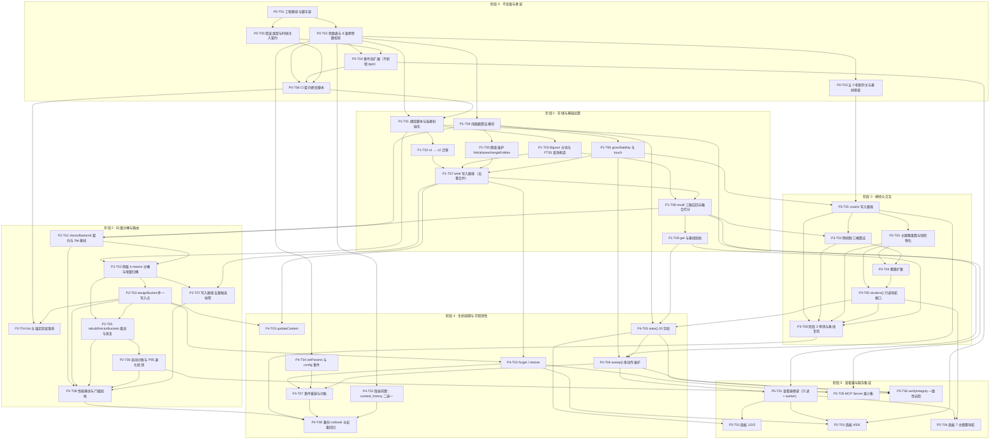

# 通用记忆库 v2.1（记忆海版）· 开发步骤计划

> **唯一依据**：`C:/Users/12138/Desktop/DESIGN-v2.md`（v2.1 记忆海版，5712 行）。  
> 本文档**不发明需求**，只把设计文档拆成可执行的开发步骤。  
> 每个任务的「关键实现要点」都注明出处小节（如 §4.13.3 / §9.3.2 ③ / ADR-21）。
>
> **三个版本号口径（全文统一，不得混淆）**：

|   |   |   |   |   |
| - | - | - | - | - |

> | 口径            | 值        | 含义                           | 出处          |
> | ------------- | -------- | ---------------------------- | ----------- |
> | 交付版本号         | **v2.1** | 对用户的承诺（文档头 / §12 版本号口径说明）    | 文档头、§12     |
> | schema 版本号    | **2**    | 写入 `PRAGMA user_version` 的常量 | §9.1、ADR-22 |
> | 特性标记「v2.0 新增」 | 非版本承诺    | =「v2.1 相对 v1.0 新增的这一批能力」     | §12 版本号口径说明 |
>
> ⇒ 全文出现的「v2.0 新增」一律读作「v2.1 相对 v1.0 的新增」。  
> v2.0 是**从未发布的设计稿**，不占版本号（ADR-22）。

---

## 1. 项目定位速览

- **这是什么**：一个**可复用的通用记忆库**（TypeScript + better-sqlite3，单文件 SQLite，纯同步 API）。  
  把「多模态记忆 / 多层记忆 / 图谱记忆 / 遗忘曲线 / 神经元交互」五件事合成**同一个**库的五个现象，  
  而不是五个模块（§0、§1）。
- **心智模型**：**三属性 + 两引擎 + 一涌现层**（§2、ADR-11 定盘星）。  
  三属性 = 内容 / 结构 / 强度；两引擎 = 遗忘曲线（时间驱动）/ 神经元交互（网络驱动）；  
  一涌现层 = 主题簇（由共激活图算出）。⚠️「四属性 + 一引擎」是已作废的旧措辞。
- **v2.1 相对 v1.0 的根本变化**（三条，全部是架构级）：
  1. **规模目标 10 万 → 100 万条**（文档头）⇒ 直接导致向量路 flat 扫描不可用（500~1500ms）。
  2. **第五概念「神经元交互」**：共激活表 `coacts`（记忆↔记忆）+ 侧抑制 + 簇跳（§4.11/§4.13/§4.14）。
  3. **向量路从 flat 全表扫描改为「主库内两级 k-means 分桶 IVF」**（ADR-33）——  
     桶归属与主表**同事务**、桶内**全量精确点积**、**零原生依赖**；被推翻的 ANN sidecar 路线见 ADR-16 / ADR-25 / ADR-33。
- **主题簇由共激活涌现**（ADR-12）：簇 = `affinity_eff ≥ COACT_AFFINITY_MIN` 的边构成的**连通分量**，  
  落库只是**缓存**（删表重建必须完全一致，§4.12.2）。
- **被推翻的 ADR**（不要在代码里找它们的痕迹）：ADR-6 撤销「flat-only」、ADR-14 作废「共激活加项」、  
  ADR-16 / ADR-33 撤销 ANN 路线、ADR-25 随之作废、ADR-22 迁移形态改为纯增量（§13）。
- **本库不做什么**（边界声明见 §14）：多租户、内置 NER、自动调参、多模态理解、异步 API、  
  原生向量索引扩展、跨设备同步、独立向量数据库、人工簇标注、在线聚类落库、按正文长度选版本。
- **一句话交付物**：`MemoryStore` 一个类、**23 个公开方法**（16 写 + 7 读 + 1 构造）、**60 项参数**、  
  **13 种 `events.type`（不新增 type）**、单文件 `ocean.db` + `logs/` 目录、Electron 只读查看器、MCP Server。

---

## 2. 技术栈与工程基线

### 2.1 落地栈（从 DESIGN-v2.md 推断，非文档明文，但每条都有出处）

| 层     | 选型                                                                            | 依据                                 |
| ----- | ----------------------------------------------------------------------------- | ---------------------------------- |
| 语言    | **TypeScript**（全同步 API）                                                       | §6「TypeScript 同步 API」、ADR-5        |
| 存储    | **SQLite** via `better-sqlite3`（单文件 `ocean.db`）                               | §3、§6 开头、§9.1、ADR-7                |
| 全文检索  | **SQLite FTS5**（`unicode61 remove_diacritics 0`，external content 挂 `mem_fts`） | §3 DDL、§10                         |
| 中文分词  | **自实现 bigram 预切分**（不引分词库）                                                     | §10.1 / §10.2（`tokenize()` 全篇给出实现） |
| 向量    | **纯 TS 两级 k-means 分桶（IVF）**，Float32 小端 + L2 归一化                               | §4.15.3、ADR-33                     |
| 原生依赖  | **零**（保住 v1.0「零外部依赖」边界）                                                       | ADR-16 / ADR-33                    |
| 模型    | **库内无模型**：向量由调用方给（`WriteInput.embedding` 或同步注入的 `MemoryConfig.embedder`）      | ADR-10                             |
| 实体抽取  | **调用方给**（`WriteInput.entities`），库只做别名归一                                       | ADR-2                              |
| 桌面查看器 | **Electron 只读观察器**（`{ readonly: true, fileMustExist: true }`）                 | §7.1                               |
| MCP   | **MCP Server**，暴露最小集                                                          | §12 阶段 5                           |
| 并发    | **单写者**；WAL + `busy_timeout=5000`；多线程/多进程经进程锁调度                               | §9.1、§0.2.3 ⑦、ADR-5/ADR-7          |

### 2.2 ⚠️ 文档未指定、需团队决策的选型点

> 以下每一项在 DESIGN-v2.md 里**没有**明文规定。它们不是「实现细节」，是**必须先定下来的工程基线**——  
> 定不下来会导致返工（尤其是 Node 版本与 FTS5 编译选项，直接决定 better-sqlite3 能不能用）。

| #    | 决策点                              | 选项                                  | 默认建议                                                                                                                   | 不定会怎样                                |
| ---- | -------------------------------- | ----------------------------------- | ---------------------------------------------------------------------------------------------------------------------- | ------------------------------------ |
| D-01 | **测试框架**                         | vitest / jest / node:test           | **vitest**（原生 ESM + TS 快，watch 友好；本项目全同步 API，vitest 的线程池足够）                                                            | CI 脚本写法、golden 集装载方式全部待定             |
| D-02 | **构建工具**                         | tsup / tsc 直出 / esbuild / rollup    | **tsc + tsup 二选一**：库产物用 **tsup**（产出 CJS+ESM+d.ts），测试与 bench 走 **tsx**                                                  | 打包格式与 d.ts 生成方式待定                    |
| D-03 | **包管理**                          | pnpm / npm / yarn                   | **pnpm**（better-sqlite3 需要编译脚本，`onlyBuiltDependencies` 处理更干净）                                                          | 依赖安装与 CI 缓存策略待定                      |
| D-04 | **lint / format**                | eslint + prettier / biome           | **biome**（单工具、速度够、与 TS 4.x 兼容），保留 `eslint` 作为可选项                                                                       | 与 §12.1 的「静态扫描脚本」如何共存待定              |
| D-05 | **Node 版本下限**                    | ≥18 / ≥20 / ≥22                     | **≥20**（原生 fetch、`node:test` 稳定、`structuredClone`）；better-sqlite3 需 node-gyp，**≥20 的预编译包覆盖更全**                         | better-sqlite3 安装失败时无兜底              |
| D-06 | **better-sqlite3 的 SQLite 编译选项** | 预编译包默认 vs 自编译                       | **必须确认预编译包带 FTS5**（§3 的 `mem_fts` 与 §10 全靠它）。若无 → 走 `node-gyp` 自编译并**在 CI 里固化**                                        | 建库直接失败（`no such module: fts5`）       |
| D-07 | **包名 / 目录名**                     | —                                   | `memory-ocean`（与文档「记忆海版」一致），库目录 `memory-ocean/`                                                                        | 导入路径、发布名待定                           |
| D-08 | **golden 集格式**                   | JSON / JSONL / snapshot             | **JSONL**（每行一条 query→id 序列，便于 diff 与增量追加）                                                                              | §12.1 ② 的分档采集脚本无从下手                  |
| D-09 | **日志实现**                         | 自研 append + 缓冲 / pino / winston     | **自研**（§8.1 的格式与拍平规则是自定义的，第三方库反而要绕）                                                                                    | §8.3 的分级 flush / 进程级兜底无法保证           |
| D-10 | **v1.0 参考实现从哪来**                 | 仓库内已有 v1.0 / 需重写最小参考 / 从 golden 集反推 | **见 §3「阶段 0」的关键排序说明**：本仓库只有 DESIGN-v2.md，**v1.0 代码不在库内** ⇒ 阶段 0 只能建立「开关骨架 + golden 格式 + CI 断言」，**逐位一致的比对基线在阶段 1 末才产生** | 「关掉开关 = 与 v1.0 逐位一致」这条 ADR-21 基线无法验证 |

### 2.3 硬性工程约束（来自文档，实现时必须遵守）

1. **全同步**：任何方法不得返回 Promise（ADR-5）。异步只在**最外层**包装（§6 开头）。
2. **单文件**：`ocean.db` 是唯一事实源，**无 sidecar 索引目录**（§9.3.1）；备份对象 = 一个 db 文件 + `logs/`。
3. **零原生依赖**：除 better-sqlite3 外不引入任何 native 模块（ADR-33 的收益之一）。
4. **每个承诺都要能指到唯一代码路径**（§14.3 边界原则 1）——  
   指不到的要么补实现，要么**删承诺**（并回写文档）。
5. **不存状态就不该有动作**（§14.3 边界原则 2）：没有 `layer` 列、没有 `pinned` 列、没有「归档」动作。
6. **物理破坏性操作只有三处**（§14.3 边界原则 3）：  
   `forget({hard:true})` / `sweep({purgeDeletedDays})` / `restore({mergeInto})`。  
   ⇒ `mergeEntities` **不**在其中（它删的是 entities 行，记忆本体与正文原封不动）。
7. **事件流不得新增 type**（ADR-15）：13 种 type 固定，新增能力只能扩 payload 键。
8. **正文只在 `events.payload.contentText` 一个键**（§8.2）：仅 `write` / `merge`(3c) / `manual_fix` 三类可写。

---

## 3. 阶段总览表

> §12 的阶段划分是**骨架**；下表把它展开为可执行的阶段目标与验收门禁。  
> **验收门禁分两栏**：硬断言 = 「算错了」⇒ 失败即 bug（集合包含 / 恒等式 / 逐位相同）；  
> 软阈值 = 「调参」⇒ 超了要判断是代码问题还是参数问题（统计阈值 / 性能门槛）。

| 阶段              | 目标                         | 一句话交付物                                                                                               | 关键文件产出                                                                                                                                                                   | 前置阶段 | **硬断言**（算错）                                                                                                                                                                                                                                                                                                                                       | **软阈值**（调参）                                                                                                                                                                | 预估任务数                                                                                                                 |                                                                                                      |       |
| --------------- | -------------------------- | ---------------------------------------------------------------------------------------------------- | ------------------------------------------------------------------------------------------------------------------------------------------------------------------------ | ---- | ------------------------------------------------------------------------------------------------------------------------------------------------------------------------------------------------------------------------------------------------------------------------------------------------------------------------------------------------- | -------------------------------------------------------------------------------------------------------------------------------------------------------------------------- | --------------------------------------------------------------------------------------------------------------------- | ---------------------------------------------------------------------------------------------------- | ----- |
| **0 不变量与骨架**    | 先立不变量、再建机制                 | 四个机制开关 + 60 项参数 + 8 条跨参数校验 + 事件 payload 扩展 + 全部 CI 断言脚本                                              | `src/core/{params,flags,errors,clock}.ts`、`src/store/events.ts`、`scripts/check-*.ts`、`tests/contracts/`                                                                  | —    | §5 表 ↔ `DEFAULT_PARAMS` 逐键逐值相等；8 条跨参数校验逐条有单测；`setParams` 失败时**一个参数都不落库**；`events.type` 仍为 13 种；touch payload 5 个新键齐备；C37 静态扫描进 CI                                                                                                                                                                                                                 | （本阶段无性能门槛）                                                                                                                                                                 | **6**                                                                                                                 |                                                                                                      |       |
| **1 存储与基础运算**   | schema + 纯函数 + 记忆本体读写      | 建库脚本 + 迁移 + 纯函数算法模块 + `write/recall/touch/get/pin/unpin/link/linkByIds/setAlias/mergeEntities` 十方法   | `schema/001_schema_v2.sql`、`schema/002_migration_v1_to_v2.sql`、`src/core/{decay,scoring,tokenize,entities}.ts`、`src/store/{write,recall,touch,get,pin,link,entities}.ts` | 0    | 五项权重和 == `score`（误差 ≤1e-9）；`intensity ∈ (0,1]` 且 `min(1,…)` 钳制存在；同日守卫 `intervalDays < 1` 不增长；任何路径 `stability ≤ MAX_STABILITY`；FTS 只能走触发器同步（禁 `DELETE FROM mem_fts`）                                                                                                                                                                               | 分层时长算术事实（默认 `INITIAL_STABILITY=1` 天 ⇒ L3 ≈ 8.6 小时、归档 ≈ 3 天）——**说明项，非验收项**                                                                                                  | **9**                                                                                                                 |                                                                                                      |       |
| **2 向量分桶与路由**   | 性能前提：把 flat 扫 100 万条变成扫几千条 | `VectorBackend` 契约 + flat 基线后端 + 主库内两级 k-means 分桶 + 同事务挂桶 + 启动对账 + 重训                                | `src/vector/{backend,flat,ivf,kmeans,bucketAssign}.ts`、`src/store/write.ts` 的桶挂接分支                                                                                       | 1    | 桶归属与主表**同事务**（回滚测试：桶行与记忆行同时回滚）；换桶**先 DELETE 后 INSERT**；重训三步顺序不可颠倒（崩溃可恢复）；启动对账**三条判据齐过**；四条 embedding 赋值路径**全部**调 `assignBucket/unassignBucket`；桶内**全量精确点积**（不近似）；`mode` 四值互斥 + `inRetrain` 作用域                                                                                                                                                    | **吻合率 ≥ 0.98**（探针边界效应，⚠️ 不可写成「完全相同」）；recall P99 ≤ 200ms / 写入 P99 ≤ 5ms / 向量路 P99 ≤ 20ms 且占比 ≤ 20%（**必须 100 万条规模**）；训练期峰值内存 ≥ 3.5GB；**前置测量**：flat 路线向量路耗时占比 ≥ 80%（证据，非验收条件） | **8**                                                                                                                 |                                                                                                      |       |
| **3 神经元交互**     | 第五概念落地                     | `coacts` 写入（两机制）+ 三桶侧抑制 + 主题簇物化 + 簇跳 + `clusters()`/`inhibitionTrace()`                              | `src/neuron/{coacts,inhibit,cluster,clusterhop}.ts`、`src/store/{clusters,inhibition}.ts`                                                                                 | 2    | `recall()` **绝不**写 `coacts`；抑制前后 `memories` 表哈希**完全相同**；`Hit.score == rankScore ==` 五项加权和；**三桶分离**（溢出候选不进 `suppressed`）；\`hits.length ≥ min(2,                                                                                                                                                                                                    | C                                                                                                                                                                          | )`；`poolHomogeneous`**池级前置固定**；排序全序`(score DESC, id ASC)`；簇删表重建**完全一致**；簇跳**必须从 `coacts\` 驱&#x52A8;**；两腿合并**取 max 不累加 | 覆盖率 ≥ 0.5 / 平均簇大小 ≥ 3 的密度门槛（⚠️ 基于 `COACT_MIN_ENTITIES=1` 测得，**需按新参数重跑**，**不可当验收线**）；簇 60 天归零是观测现象非断言 | **6** |
| **4 生命周期与可观测性** | 遗忘 / 撤销 / 观测 / 维护 / 回归     | `forget/restore/updateContent/setParams/stats/sweep/close/rebuildArchivalSchedule` 八方法 + 重放工具 + 权重回归 | `src/store/{forget,restore,updateContent,setParams,stats,sweep,maintain}.ts`、`src/tools/replay.ts`、`bench/`                                                              | 3    | 迁移后 `events` **恰好 +1 条**；`Σ(全库 stability 变化) == Σ events.stabilityDelta`（误差 ≤1e-9）；硬删后 `payload.contentText == '[redacted]'`；硬删后 `memories`/`content_history`/`vector_cell_members` **无残留**；软删**不重写** `deleted_at`；`restore` 冲突抛 `CONFLICT` 带 `conflictingId`；`archivalOrphans` **恒为 0**；sweep 汇总事件 `memory_id` 为 `null`；`vacuumed` 反映**实际执行**非入参 | `mergeRate` / `touchRate7d` 等为观测指标（不设阈值）；五项权重的真实查询回归结论（改权重是**设计变更**，须走 ADR，§4.6 步骤 3）                                                                                      | **8**                                                                                                                 |                                                                                                      |       |
| **5 查看器与服务集成**  | 只读观察 + 外部集成                | Electron 7 面板全量 + MCP 最小集 + `verifyIntegrity`                                                        | `viewer/`（main / preload / renderer）、`mcp/`、`src/store/maintain.ts` 的 `verifyIntegrity`                                                                                  | 4    | 只读句柄**不写任何业务数据**（16 个写方法逐一断言抛 `READONLY_VIOLATION`）；`appendEvent` 在只读实例**短路不抛错**；面板**必须显示错误码 + details**（不得自造措辞）；面板 1 向量路措辞**逐条**对齐四值枚举（不得自行归并）；**面板 6 版本历史必须存在**（§4.9 兜底的唯一入口）；面板 7 成员顺序与 `clusters().memberIds` **完全一致**；**所有库调用在 worker/子进程**；MCP **不暴露**三个阻塞维护方法                                                                              | 面板 3 柱状图**并列**显示 `rawBm25` / `cos`（不设数值门槛）                                                                                                                                 | **6**                                                                                                                 |                                                                                                      |       |
|                 |                            |                                                                                                      |                                                                                                                                                                          |      |                                                                                                                                                                                                                                                                                                                                                   |                                                                                                                                                                            |                                                                                                                       |                                                                                                      |       |
|                 |                            |                                                                                                      |                                                                                                                                                                          |      |                                                                                                                                                                                                                                                                                                                                                   |                                                                                                                                                                            |                                                                                                                       |                                                                                                      |       |

### 3.1 阶段间的方法归位核对（§12 方法覆盖表，必须逐行对齐）

§12 的方法覆盖表规定：**行级小计之和必须等于 23**。本计划的任务必须让下表每一格都能指到一个任务。

| 阶段 | 公开方法                                                                                             | 小计     | 本计划中的承载任务                                                    |
| -- | ------------------------------------------------------------------------------------------------ | ------ | ------------------------------------------------------------ |
| 0  | 不新增方法                                                                                            | 0      | —（P0-T02 起的全部为内部设施）                                          |
| 1  | `write` `recall` `touch` `get` `pin` `unpin` `link` `linkByIds` `setAlias` `mergeEntities`       | 10     | P1-T05 ~ P1-T09                                              |
| 2  | `rebuildVectorBuckets`                                                                           | 1      | P2-T05                                                       |
| 3  | `clusters` `inhibitionTrace` `recluster`                                                         | 3      | P3-T03（recluster）/ P3-T05（clusters）/ P3-T02（inhibitionTrace） |
| 4  | `forget` `restore` `updateContent` `setParams` `stats` `sweep` `close` `rebuildArchivalSchedule` | 8      | P4-T01 ~ P4-T06                                              |
| 5  | `verifyIntegrity`                                                                                | 1      | P5-T06                                                       |
|    | **合计**                                                                                           | **23** | §6 `MemoryStore` = 24 个成员（23 方法 + 构造函数）                      |

> ⚠️ §12 已明示两条归位纪律，本计划照抄执行：
>
> - **两个只读导航方法（`clusters` / `inhibitionTrace`）归阶段 3 而非阶段 1**——  
>   主题簇要靠共激活数据算（共激活是阶段 3 的能力），放阶段 1 会得到永远返回空数组的方法。
> - `recluster` 归阶段 3、`rebuildArchivalSchedule` 归阶段 4——两者都是**阻塞 1~3 分钟**的维护方法，  
>   不早于依赖它们的机制交付。

### 3.2 全局排序约束（跨阶段，早期必须知道）

```
阶段 0 ──▶ 阶段 1 ──▶ 阶段 2 ──▶ 阶段 3 ──▶ 阶段 4 ──▶ 阶段 5
              │          │          │
              │          │          └── 阶段 4 的「五项权重真实查询回归」必须等阶段 2（分桶）
              │          │              与阶段 3（联想路）都落地后才做（§12.1 ①）
              │          │
              │          └── 阶段 4 的归档缓存回填要等阶段 2 的 embedding 路径稳定
              │              （否则回填时桶归属还在漂）
              │
              └── 阶段 1 的「关开关 = 与 v1.0 逐位一致」基线，必须等阶段 2/3/4 落地后
                  **重新验证一次**（机制是逐阶段加上去的，每加一层都要重跑基线）
```

> ★ §12.1 ① 已把「权重回归必须在分桶路由与联想路落地之后做」的**理由**写死：  
> 回归的对象是「**这组权重配这组候选集**」；候选集变了，同一组权重的表现就变了。  
> ⚠️ **不是**因为「medianBm25 变了」——`bm25List` 只收 `raw_bm25` 非空的候选（只收文本路命中的），  
> 而文本路（FTS5）独立于向量后端，也独立于联想路 ⇒ **median 基准逐位不变** ⇒ 每条候选的五因子分逐位不变。  
> ⇒ 分桶与联想路改变的是「**谁参与竞争**」，不是「分数怎么算」。


> **理由写错比结论写错更危险**——后来者会照着错理由去论证「那分桶一定会让分数不可比」。

---

## 4. 逐阶段详细开发步骤

> **任务编号规则**：`P<阶段>-T<序号>`。P0 = 阶段 0，P1 = 阶段 1，依此类推。  
> 每个任务给出：目标 / 文件路径 / 前置依赖 / 关键实现要点 / 验收标准 / 常见坑。

---


### 阶段 0 · 不变量与骨架

> §12 原文：「本阶段**不实现任何新机制**，只建开关与不变量测试。  
> 没有这个阶段，后面每个机制的『没改坏别的东西』都无法证明。」

#### P0-T01 · 工程基线与项目脚手架

**目标**：把「能编译、能跑测试、能 lint」的地基铺好，让后续每个任务的验收都有一条最短的命令。

**文件**：

- `package.json`（`better-sqlite3` + `vitest` + `tsx` + `tsup` + `biome`；`engines.node >= 20`）
- `tsconfig.json` / `tsconfig.build.json`（`strict: true`、`exactOptionalPropertyTypes: true`）
- `vitest.config.ts`、`biome.json`、`.gitignore`、`.npmrc`
- `src/index.ts`（仅导出类型与 `MemoryStore`，此时可为空壳）

**前置依赖**：无。

**关键实现要点**：

- `tsconfig` 必须开 `exactOptionalPropertyTypes`——§6 大量接口用 `?:` 表达「缺省表示一切按预期落库」  
  （如 `warnings?`），严格可选属性检查能在编译期挡住「显式传 `undefined` 与不传」混淆。
- `better-sqlite3` 的类型需 `@types/better-sqlite3`；**先跑一个 smoke test**：  
  打开内存库 → 建一张带 FTS5 虚拟表的表 → 插入 → 全文检索 → 断言命中。  
  ⚠️ 这一步要在 D-06（编译选项）定下来之前先做，否则整周都在错误的依赖上写代码。

**验收标准**：

- **硬断言**：`npm test` 在空测试套件下退出码 0；`tsc --noEmit` 零错误；  
  smoke test 断言 `SELECT count(*) FROM mem_fts` 与 `memories` 行数一致（FTS5 触发器链可用）。
- **软阈值**：无。

**常见坑**：

- ⚠️ better-sqlite3 是**同步原生模块**，在 vitest 里必须跑在 `pool: 'forks'`（默认 threads 池会偶发  
  `ERR_DLOPEN_FAILED` / 段错误）。这个坑在 CI 上表现为「本地过、CI 挂」，且极难定位——**在 P0-T01 就锁死**。
- ⚠️ 别在 `package.json` 里写 `"type": "module"` 却不处理 better-sqlite3 的 CJS 互操作——  
  `import Database from 'better-sqlite3'` 在 ESM 下需要 `createRequire` 或 `default` 互操作包装。

---

#### P0-T02 · 参数表与跨参数校验（60 项 / 8 条）

**目标**：把 §5 的 60 项参数落成代码里**唯一的真相** `DEFAULT_PARAMS`，并实现 8 条跨参数校验。

**文件**：

- `src/core/params.ts`（`DEFAULT_PARAMS`、`ParamKey`、`setParams` 的校验器）
- `src/core/params.test.ts`

**前置依赖**：P0-T01。

**关键实现要点**：

- `DEFAULT_PARAMS` **逐字抄 §6 的代码块**（3541~3619 行），含全部 60 项。  
  ⚠️ §6 的 `DEFAULT_PARAMS` 代码块里有 5 个**小写机制开关**（`coactivation` / `inhibition` /  
  `writeBack` / `ARCHIVAL_CACHE`）——前三个小写、第四个大写，各有理由，**不要统一大小写**。
- **60 项的构成**（§5 末的分类声明，用来做自查）：  
  行为语义参数 = 共激活 **10** 项 + 涌现簇 **5** 项 + 侧抑制 **1** 项；  
  性能参数 = 分桶路由 **7** 项 + 簇跳 **1** 项 + **向量路阈值 1 项**（`ROUTER_MIN_TRAINING`）；  
  运维参数 = `ARCHIVAL_ORPHAN_CHECK` **1** 项；  
  机制开关 = **5** 项（4 布尔 + 1 三值选择器 `VECTOR_ROUTER`）；  
  v1.0 继承 = **29** 项。合计 60。  
  ⚠️ **「向量路」只算 `ROUTER_MIN_TRAINING` 一项** —— `VECTOR_ROUTER` 归**机制开关**
  （它是一个三值选择器，「机制有没有」的语义）。**两处都数它 ⇒ 四类直接相加会得到 61**，
  与 §6 的 60 个键对不上 ⇒ **以键的个数为准**（29 + 31 = 60，新增 31 项含 5 个机制开关）。
- **8 条跨参数校验**（§5，编号 1~~8，⚠️ 文档已把原文重复的「2、2、3、3」去重为连续 1~~8）：
  | # | 条件                                                                                                           | 默认值下的方向                           |
  | - | ------------------------------------------------------------------------------------------------------------ | --------------------------------- |
  | 1 | `0 < REDUNDANCY_COS ≤ DEDUP_COS_MIN`                                                                         | 0.90 ≤ 0.92 ✓（**方向是 `≤` 不是 `<`**） |
  | 2 | `COACT_AFFINITY_MAX > COACT_REINFORCE_STEP + COACT_CAUSAL_BONUS`                                             | 1.0 > 0.45 ✓（**严格大于**）            |
  | 3 | `COACT_REINFORCE_STEP ≥ COACT_AFFINITY_MIN`                                                                  | 0.20 ≥ 0.15 ✓                     |
  | 4 | `COACT_MIN_ENTITIES >= 1`、`COACT_MIN_COS ∈ (0,1]`                                                            | —                                 |
  | 5 | `COACT_MAX_PAIRS_PER_TOUCH >= 1`、`COACT_BATCH_MAX >= 1`                                                      | —                                 |
  | 6 | `ROUTER_NPROBE_COARSE ≥ 1` 且 `ROUTER_NPROBE_FINE ≥ 1`                                                        | —                                 |
  | 7 | `ROUTER_COARSE_CENTERS ≥ ROUTER_NPROBE_COARSE` 且 `ROUTER_FINE_CENTERS ≥ ROUTER_NPROBE_FINE`（**写入路径两个探针数同理**） | —                                 |
  | 8 | `COACT_AFFINITY_MAX = 1.0` 与 §3 的 CHECK 约束**必须同步**                                                           | 改上界要同时改 DDL                       |
- ⚠️ **刻意不做的联动校验**：`COACT_MIN_COS` 与 `REDUNDANCY_COS` **不联动**；  
  `COACT_MIN_ENTITIES` 与 `DEDUP_ENTITY_MIN` **不联动**（§4.11.5、§5）。  
  ⇒ **不要**在实现里「顺手」加这两条联动——会把两个独立旋钮绑死（§11.4 的前提正是「人能独立调旋钮」）。
- 校验失败抛 `MemoryError.INVALID_INPUT`，且 `details` **必须带建议值**：
  ```ts
  details = { REDUNDANCY_COS: { current: 0.90, maxAllowed: 0.85,
              reason: 'must be <= DEDUP_COS_MIN（抑制不得比合并更严）' } }
  ```
- `EMBED_DIM` 是**只读**参数：`setParams` 传入它抛 `INVALID_INPUT`（类型上 `Omit<..., 'EMBED_DIM'>` 排除，  
  运行期再兜一道——§6 明确「两层都要」）。
- `VECTOR_OVERFETCH_FACTOR` **硬编码 3**、**不开放为参数**（C26）⇒ 必须在代码注释里写明「硬编码 3」。
- `setParams` 的形状必须是：**先全量校验 → 再单事务写入 → 同事务记 `config` 事件**  
  ⇒ 任一不满足即抛 `INVALID_INPUT` 且**一个参数都不落库**（§5）。

**验收标准**：

- **硬断言**：
  - §5 表 ↔ `DEFAULT_PARAMS` **逐键逐值相等**（键集合相同、值相同、默认值相同）——  
    这是 §5 的 **G26 验收断言**，由 `scripts/check-params.ts` 在 CI 里机械执行。
  - 8 条跨参数校验**逐条**有单测：构造非法组合 ⇒ 抛 `INVALID_INPUT` ⇒ **库内参数一个都没变**。
  - `setParams({ EMBED_DIM: 1024 })` ⇒ 抛 `INVALID_INPUT`，参数未变。
  - `setParams({ REDUNDANCY_COS: 0.95 })` ⇒ 抛 `INVALID_INPUT`，`details.REDUNDANCY_COS.maxAllowed === 0.92`。
  - `setParams` 成功后**恰好写一条** `events(type='config')`，payload 含 `SCHEMA_VERSION` 与**完整** `params`。
- **软阈值**：无。

**常见坑**：

- ⚠️ **漏掉 `MAX_PIN_FACTOR` 键** ⇒ §4.1 的 `factor <= MAX_PIN_FACTOR` 与 `undefined` 比较**恒为 false**  
  ⇒ `pin()` 对任何输入都抛 `INVALID_INPUT`（§6 注释已点名此坑）。
- ⚠️ **漏掉 `MAX_DIFFUSED_NODES` 键** ⇒ §4.7 的「取前 N 条」变成 `undefined` ⇒ 扩散结果恒空。
- ⚠️ 第 2 条校验若写成 `>=`：`MAX == base` 也会顶格 ⇒ **必须是严格大于**。
- ⚠️ 第 1 条若写成严格小于：参数空间塌缩到 (0.90, 0.92)，不到 0.02 宽 ⇒ 任何一次调参都可能落进非法区直接抛错。

---

#### P0-T03 · 五个机制开关与基线不变量骨架

**目标**：把 ADR-21 的四个机制开关 + `VECTOR_ROUTER` 三值选择器做成**运行时可切换**的内部设施，  
并建立「关掉开关 = 与 v1.0 逐位一致」的**验证骨架**（golden 集格式 + 采集器 + 比对器）。

**文件**：

- `src/core/flags.ts`（`FeatureFlags` 读取、`resolveFlags(params)`）
- `tests/golden/`（golden 集格式与采集脚本，格式待 D-08 定）
- `tests/baseline/`（基线比对框架）
- `scripts/capture-golden.ts`

**前置依赖**：P0-T02。

**关键实现要点**：

- 开关的**准确行为**（§5 的机制级开关表，逐字）：
  | 名称               | 默认     | 关闭后的行为                                                              |
  | ---------------- | ------ | ------------------------------------------------------------------- |
  | `coactivation`   | true   | `touch` 不写 `coacts`；联想路不执行；§4.14 簇跳不执行；主题簇不计算也不使用                   |
  | `inhibition`     | true   | 无侧抑制（候选带不重排，直接按 base 分取 topN）                                       |
  | `writeBack`      | true   | 关闭「扩散唤起 → 采纳 → 回写」的**联动**部分（`touch` 自身的 `growStability` 加固**不受影响**） |
  | `ARCHIVAL_CACHE` | true   | `countArchived()` 退回逐行精筛（结果相同、路径不同）                                 |
  | `VECTOR_ROUTER`  | 'auto' | 三值选择器，不是布尔：`'auto'` / `'ivf'` / `'flat'`                            |
- ★ **基线条件（完整）**：「与 v1.0 逐位一致」= **四个布尔开关全关** + **`VECTOR_ROUTER='flat'`**
  - `ARCHIVAL_CACHE` 任意（关掉 = 走慢路但结果相同）。  
    ⚠️ **`'auto'` 不构成基线条件**（它的实际走向随库规模变）——  
    ⚠️ **默认 `VECTOR_ROUTER='auto'` ⇒ 默认配置下「四开关全关」并不等于 v1.0 行为**。
- ⚠️ `ARCHIVAL_CACHE` **也必须**纳入基线组：虽然它的**结果**与逐行精筛逐位相同，但**实现路径不同**——  
  不纳入的话，「逐位一致」这句话在字面上就不成立（§5 基线组说明）。
- 开关的**读取时机**：必须在**每次调用时**读（运行时可切换），不能在 `open()` 时快照。

**验收标准**：

- **硬断言**：
  - 四个布尔开关 + 三值选择器都能在运行时切换并**立即生效**（改后调用 `stats()`/下一次 `recall()` 行为不同）。
  - `VECTOR_ROUTER` 三个取值都能被设置，且 `'auto'` 与 `'flat'` 的行为**可区分**（库规模跨过  
    `ROUTER_MIN_TRAINING` 时 `'auto'` 走 ivf、`'flat'` 仍走 flat）。
  - golden 采集器 / 比对器可运行：在同一 DB 副本 + 同一注入时钟下，  
    「四开关全关 + `VECTOR_ROUTER='flat'`」与「单开一个开关」两次运行的 `write/recall/touch/get/stats`  
    输出**逐位相同**。
  - ⚠️ **本阶段只能建立骨架**：真正的「与 v1.0 逐位一致」需要 v1.0 参考实现或 golden 基线，  
    而 **v1.0 代码不在本仓库**（见 D-10）⇒ **本阶段的验收是「比对机制可用」，不是「基线已达成」**。  
    真正的基线达成点在 **P1-T09 末**（记忆本体十方法齐备后），并在 P3-T06、P4-T07 再验两次。
- **软阈值**：无。

**常见坑**：

- ⚠️ 把 `VECTOR_ROUTER` 当布尔用（写 `if (VECTOR_ROUTER)`）⇒ `'auto'` 与 `'flat'` 都为真 ⇒  
  **永远走 ivf**，直接击穿 P99 门槛并违反 §4.6 步骤 0 的「自动优先」判定顺序。
- ⚠️ 把 `ARCHIVAL_CACHE` 漏出基线组 ⇒ 「逐位一致」在字面意义上不成立（路径不同）。
- ⚠️ 把 `writeBack=false` 误实现成「`touch` 不加固」⇒ 那是 v1.0 既有行为，不在 `writeBack` 的管辖范围。

---

#### P0-T04 · 事件流扩展（扩 payload 键，不新增 type）

**目标**：按 ADR-15 把共激活相关数据**塞进既有 `touch` 事件的 payload**，新增 0 个 `events.type`。

**文件**：

- `src/store/events.ts`（`appendEvent()`、payload 键集定义、只读短路逻辑）
- `src/core/events.types.ts`（13 种 type 的 payload 类型）
- `tests/unit/events.test.ts`

**前置依赖**：P0-T02、P0-T03。

**关键实现要点**：

- **`events.type` 保持 13 种，逐字不动**（§3 CHECK 约束）：  
  `write` / `merge` / `restore` / `manual_fix` / `alias` / `touch` / `recall` / `link` / `pin` / `unpin` / `forget` / `sweep` / `config`。  
  ⚠️ §3 已写明：**加新 type 必须同改三处**（CHECK 约束 / §8.4 表 / §8.1 动作对照表）——  
  而 §3 的 CHECK **无法 ALTER** ⇒ 改 type = 重建 events 表 + 重建全部索引与触发器 ⇒ **不新增 type**。
- **`touch` 事件新增 5 个键**：其中 **4 个归 §8.4 硬规则 3**（`coactPairs` / `coactPairsTruncated` / `activationWrites` / `coactSkipped`），**`stabilityDelta` 归 §8.4 硬规则 5**：
  - `stabilityDelta`：本次 stability 的实际增量（天，`after − before`；未增长时为 **0**，**键恒在**）。  
    ★ **「键的有无」就是「这次有没有真的加固」的标志**（§8.4 硬规则 5）。
  - `coactPairs`：本次写入的共激活对，每项 `{a, b, affinityAfter}`。
  - `coactPairsTruncated`：因上界被丢弃的对数（`0` = 没截断）。
  - `activationWrites`：扩散唤起且被采纳的因果写入，每项 `{diffusedId, seedId, affinityAfter, activatedAt}`。
  - `coactSkipped`：因日守卫或种子无效而**未写入**的关联，每项 `{a, b, reason, hadActivationEvidence}`。
- ⚠️ **这 4 个键只在 `touch()` 的显式发射点出现，`exact_repeat` 路径不出现**  
  （§8.4 硬规则 3）。`stabilityDelta` 则**两个发射点都有**。
- ⚠️ **旧事件重放**：v1.0 的历史事件里这四个键**不存在** ⇒ 重放器一律取 `?? []` / `?? 0`。  
  ⇒ **这也是「v1.0 → v2.1 不能回填 `coacts`」的原因**：数据不存在，不是「不想回填」。
- **`memory_id` 是 `appendEvent()` 的必传实参**（值可为 `null`，但**不允许省略这个参数**）——  
  ⚠️ 漏写该列 ⇒ 遗忘脱敏（§4.8 步骤 ② 按 `events.memory_id` 索引定位）**永远脱敏不到**该条事件 ⇒  
  「用户说了忘掉，而原文静静躺在库里」，**不报错、不告警**。
- **`appendEvent()` 在只读实例必须短路而不是抛错**（§7.1 第 4 条）：  
  判 `this.readonly` ⇒ 跳过写入 + 记一条 **warn** 日志（说明「只读模式下事件未落库」），**业务返回值照常**。  
  ⚠️ 判断**必须收在 `appendEvent()` 内部**，不能让每个调用点各自记得判。
- `sweep` 事件的 `action` 字段区分四个维护动作：`'purge'` / `'rebuildArchive'` / `'rebuildBuckets'` / `'recluster'`  
  —— **用同一个 `events.type`，不新增 type**（ADR-15）。
- **`logs/` 的键值口径 = 该事件 payload 去掉 `contentText`**（§8.1）——  
  日志**不另立第二套字段清单** ⇒ 两份清单必然各自演化，最后没人说得清哪个准。

**验收标准**：

- **硬断言**：
  - `events.type` 的取值集合**恰好**是 §3 的 13 种（`SELECT DISTINCT type FROM events` 与常量表相等）。
  - `touch` 事件的 payload **键集**与 §8.4 的 touch 行一致（缺键即报错）——由 `scripts/check-payload-keys.ts` 执行。
  - `merge` 事件按来源分两套字段集：3c 全量 / `restore_merge` 子集（**无** `intervalDays` / `boostApplied` /  
    正文四项）——断言两套的存在与缺席。
  - `appendEvent` 的 `memory_id` 参数在 TypeScript 层是**必传**（值可为 `null`）⇒ 编译期可检。
  - 只读句柄上调用 `appendEvent` ⇒ **不抛错**、**不写库**、产生一条 warn 日志。
- **软阈值**：无。

**常见坑**：

- ⚠️ **把 `stabilityDelta` 写成可选** ⇒ §8.4 硬规则 5 的对账恒等式（`Σ 库内变化 == Σ 事件 delta`）恒不成立。  
  ⚠️ **调用方不得用 `boosted` 反推 delta**（一个是布尔、一个是数值）——`growStability` 必须直接返回 delta（§4.2）。
- ⚠️ `merge` 的 `restore_merge` 变体**刻意少四项**，不是漏写——填 `0`/`false` 等于伪造一条  
  「发生过间隔重复」的假记录，重放会据此算错衰减（§4.8.1 4e）。
- ⚠️ `sweep` 汇总事件的 `memory_id` 必须是**显式 null**，不能挂某条记忆上——  
  挂上去会让该记忆的脱敏范围覆盖这条汇总（§4.10 步骤 4）。

---

#### P0-T05 · 错误类型体系与时钟注入契约

**目标**：把 §11.2 的 `MemoryError` 五类错误与 §11.1 的时钟注入表变成**可被 CI 检查的契约**。

**文件**：

- `src/core/errors.ts`（`MemoryError` 及五个 code）
- `src/core/clock.ts`（`now` 解析器）
- `scripts/check-clock.ts`（C37 静态扫描）
- `tests/contracts/clock.test.ts`

**前置依赖**：P0-T01。

**关键实现要点**：

- **五个错误码**：`READONLY_VIOLATION` / `NOT_FOUND` / `INVALID_INPUT` / `CONFLICT` / `DATABASE_BUSY`。
- ★ **「缺失」的表达方式必须一眼看完**（§11.2 对照表）：
  - 写接口（目标必须存在才成功）⇒ **抛 `NOT_FOUND`**：  
    `forget` / `restore` / `updateContent` / `pin` / `unpin` / `touch` /  
    `link({createMissing:false})` / `linkByIds` / `setAlias` / `mergeEntities`。
  - 读接口（查不到是常态）⇒ **返回 `null`**：只有 `get`。
  - 唯一性冲突 ⇒ `CONFLICT`，**必须带 `details.conflictingId`**（或 `conflictingEntityId`），  
    否则调用方无法决定下一步（三个来源：`restore` 撞 hash / `updateContent` 撞 hash / `setAlias` 撞主名）。
  - **`ALIAS_CONFLICT` 刻意不是异常**，而是 `write()` 返回值的 `warnings`（§11.2 末）——  
    别名冲突时**记忆本身已经写成功**，只有附属的别名映射没落库；抛异常会让调用方重试 `write()`，  
    结果是同一事实被写两遍。
- ⚠️ **裸的 SQLite 错误码绝不能抛给调用方**（§4.9 步骤 2 并发兜底）：  
  必须捕获 `SQLITE_CONSTRAINT_UNIQUE` 转成 `MemoryError.CONFLICT`（带 `details.conflictingId`）。  
  同源同处理：§4.8.1 的 `restore` 撞唯一索引。
- ⚠️ **全局纪律：任何 SQLite 原生错误码都不得穿给调用方**（§11.2 的「归一化收口」）：  
  `SQLITE_CONSTRAINT_UNIQUE` ⇒ `MemoryError.CONFLICT`（带 `details.conflictingId`）；  
  `SQLITE_CONSTRAINT_FOREIGNKEY` ⇒ `MemoryError.NOT_FOUND`（带 `details.missingIds`）；  
  `SQLITE_BUSY` / `SQLITE_LOCKED` ⇒ `MemoryError.DATABASE_BUSY`；  
  `SQLITE_READONLY` ⇒ `MemoryError.READONLY_VIOLATION`；  
  **其余未列出的码** ⇒ 原样抛出但**必须带 `code` 字段**（**不得**硬塞进上面四个 code 里的任何一个）。  
  ⚠️ **兜底是最后一道网，不是常态路径** ⇒ `link` / `linkByIds` 必须**自己校验**：  
  两端的**实体**存在性 **+ `memoryId`（记忆）**存在性（§4.5 步骤 4）——  
  `edges.memory_id` 有 `REFERENCES memories(id)`（§3），而 `@memoryId` 是**调用方给的 id**、本库不校验。  
  ⚠️ **不能只靠外键兜底**：`PRAGMA foreign_keys` 是**每连接**开关（§9.1），漏开时**不报错也不告警**。
- **时钟注入表（§11.1）**：`now?: number` 的方法有  
  `write` / `recall` / `touch` / `link` / `updateContent` / `forget` / `sweep` / `stats` / `get` /  
  `clusters` / `inhibitionTrace`。  
  **不接收 `now`** 且理由必须写明的方法：`pin` / `unpin` / `restore` / `setParams` / `setAlias` / `mergeEntities`  
  —— 它们不写任何时间派生字段。
- ★ **C37（可被 CI 拦住的规则）**：**凡方法体读写时间戳或参与时间计算的，签名必须含 `now?`；  
  不接收 `now` 的方法必须显式列出并写明理由**。  
  ⇒ **CI 静态扫描**：命中 `Date.now()` / `new Date()` / `performance.now()` 的实现文件，  
  若所在方法签名无 `now?` 且该方法未在 §11.1 豁免清单里 ⇒ **失败**。  
  ⚠️ **分母必须是写死的期望值**（如「允许 `Date.now()` 的文件数 = 3」），  
  **不能用「本次实际命中几个」当分母**（C31 的同一条纪律在扫描场景的翻版）。

**验收标准**：

- **硬断言**：
  - 五个错误码都存在，`details` 结构符合 §11.2。
  - `get()` 对不存在的 id 返回 `null`（**不抛**），对软删记录**照常返回**（`deleted: true`）。
  - `pin` / `unpin` / `touch` 对**软删**记录抛 `NOT_FOUND`（不给「绕过遗忘悄悄复活」的入口）。
  - `scripts/check-clock.ts` 在 CI 里运行，**分母写死**；故意在某个方法里加一行 `Date.now()` ⇒ CI 必须失败。
  - §11.1 豁免清单里的 6 个方法**确实不含** `now?`，且在代码里有注释写明理由。
- **软阈值**：无。

**常见坑**：

- ⚠️ 把 `get` 写成抛 `NOT_FOUND` ⇒ 每次单条读取都要包 try-catch（§11.2 已明确反对）。
- ⚠️ `NOT_FOUND` 的 `details.missingIds` 差集要算对：`touch(ids)` 必须**先校验全集**，  
  取回的集合与传入的 ids 不等 ⇒ 抛 `NOT_FOUND` ⇒ **一条都不加固**（§4.2 步骤 0）。  
  ⚠️ 原因：`m` 取不到时 `m.difficulty` 抛的是 **TypeError**——一个未类型化的崩溃，  
  而不是「这条记忆不在了」这个调用方能处理的语义。

---

#### P0-T06 · CI 契约断言脚本骨架

**目标**：把 C25~C37 里**可机械检查**的部分做成脚本，让「文档与代码不一致」在 CI 里当场失败。

**文件**：

- `scripts/check-params.ts`（§5 ↔ `DEFAULT_PARAMS`）
- `scripts/check-payload-keys.ts`（§8.4 payload 键集）
- `scripts/check-clock.ts`（C37，见 P0-T05）
- `scripts/check-anchor.ts`（跨节锚定检查）
- `scripts/check-contract-ids.ts`（§5 的 8 条与 §12 的引用数字一致）
- `package.json` 的 `scripts.ci` 串起全部

**前置依赖**：P0-T02、P0-T04、P0-T05。

**关键实现要点**：

- **跨节锚定检查表**（§14.3.1 末，**每行必须只有 3 列**：规则 / 动作关键词 / 管辖路径）：
  | 规则           | 动作关键词                                                     | 管辖路径                                                                            |
  | ------------ | --------------------------------------------------------- | ------------------------------------------------------------------------------- |
  | 桶归属同步        | `vector_cell_members` / `assignBucket` / `unassignBucket` | §4.9 步骤 2 / §4.9 步骤 3c ② / §4.9 步骤 4 / §4.9.1 步骤 4（**四条 embedding 赋值路径一条都不能漏**） |
  | 探针覆盖         | 吻合率 / 只漏不错                                                | §4.15.3 选型表 / §4.15.4 ②③ / §4.6 步骤 2c / §4.9 步骤 3a2 / ADR-16 / ADR-17           |
  | reinforce 边界 | 不建共激活边 / `'reinforce'` / `coacts`                         | §4.2 / §4.6 步骤 4 / §6 / §8.4 / §0.2.2 / §0.2.3                                  |
  | 向量路缺席        | `mode` / `absent` / `inRetrain`                           | §4.6 步骤 0d / §4.6 步骤 2c / §4.15.6 / §6 / §7.2 面板 1 / §7.3 状态表 / §0.2.3 ④        |
  | 切分触发量        | 原始分量占比 / `maxRawComponentRatio`                           | §4.12.4 ③ / §6 / §3 `cluster_snapshot_meta` / §7.2 面板 7                         |
  ⚠️ **这类错误比缺行更危险**：缺行会报错，而**错列会静默地校验通过**（§14.3.1 末的说明）。  
  ⇒ 脚本里这五行的路径**写死为常量**，不接受配置。
- **C25 的典型用例**：`ROUTER_NPROBE_WRITE_*` 在 §5 与 §6 必须是同一组值（§5 = 8/20，§6 = 8/20）。
- **C26 的典型用例**：`VECTOR_OVERFETCH_FACTOR` 本版**硬编码 3**、不开放为参数  
  ⇒ 必须在正文/代码注释写明「硬编码 3」。
- **C31 的纪律**：任何「N/N 全绿」里的 N 必须是**外部写死的期望值**，不是实际跑出来的条数  
  ⇒ 闸门脚本误删 5 条函数仍显示「35/35 全绿」是它的典型症状。

**验收标准**：

- **硬断言**：
  - `npm run ci` 串起全部脚本，任一失败 ⇒ 退出码非 0。
  - 每条 C25~C37 中**可机械检查**的项都有对应脚本或单测，并在本任务的 README 里登记对照表。
  - 故意破坏一处（改一个参数默认值）⇒ `check-params.ts` 失败并指出**是哪个键**。
- **软阈值**：无。

**常见坑**：

- ⚠️ 检查脚本自己用「实际命中数」当分母 ⇒ 脚本被删一半仍全绿（C31）。
- ⚠️ 把「条数」这类**会被交叉引用与断言的量**随手改：  
  §5 的跨参数校验是 **8 条**（不是 12），§12 的方法覆盖表小计是 **23**——  
  清单增删必须**同步改引用处的数字**（§5 末「条数纪律」，C25）。

---

---


### 阶段 1 · 存储与基础运算

> §12 阶段 1 原文承接 v1.0 阶段 1：Schema 初始化 + tokenize/buildMatchQuery +  
> 记忆本体的读写（`write` / `recall` / `touch` / `get` / `pin` / `unpin`）+ 自动化单测覆盖。

#### P1-T01 · Schema 建库脚本与连接初始化

**目标**：把 §3 的 DDL 逐字落成建库脚本，并建立**两套**（写 / 只读）PRAGMA 初始化。

**文件**：

- `schema/001_schema_v2.sql`（§3 的**全部** `@schema` 块，逐字）
- `src/db/connection.ts`（连接初始化：PRAGMA A/B 两套 + `page_size`）
- `src/db/migrate.ts`（`user_version` 两段式校验与迁移）
- `src/core/schema.ts`（`SCHEMA_VERSION = 2`）
- `tests/unit/schema.test.ts`

**前置依赖**：P0-T01、P0-T02。

**关键实现要点**：

- **建库脚本必须包含的表**（§3）：  
  `memories` / `entities` / `entity_aliases` / `memory_entities` / `edges` / `content_history` /  
  `events` / `mem_fts`（+ 三个触发器）/ `coacts` / `theme_clusters` / `theme_cluster_members` /  
  `cluster_snapshot_meta` / `meta` / `vector_coarse_cells` / `vector_fine_cells` /  
  `vector_cell_members` / `archival_schedule`  
  ⇒ **v2 相对 v1 新增九张表**（§9.1）：`coacts` / `theme_clusters` / `theme_cluster_members` /  
  `cluster_snapshot_meta` / `meta` / `vector_coarse_cells` / `vector_fine_cells` /  
  `vector_cell_members` / `archival_schedule`。  
  ⚠️ **`cluster_snapshot_meta`（单行快照元信息表）与 `meta`（通用就绪标记表）是两张不同的表，不要混为一谈**。
- **PRAGMA 必须分两套，不能合成一套**（§9.1）：
  - **A 写连接**：`journal_mode=WAL` / `synchronous=NORMAL` / `busy_timeout=5000` /  
    `foreign_keys=ON` / `cache_size=-64000`（64MB）/ `wal_autocheckpoint=1000` /  
    `mmap_size=268435456` / `temp_store=MEMORY`
  - **B 只读连接**：`busy_timeout=5000` / `foreign_keys=ON` / `cache_size=-16000`；  
    **`journal_mode` / `synchronous` 一律不设**
  - ⚠️ **只读连接不设 `journal_mode`** 的两个理由：① 它是**写库**的 PRAGMA，在 `readonly:true` 句柄上  
    执行会抛 `SQLITE_READONLY`（查看器正是用只读句柄打开的，照「一套统一初始化」去做会在 `open()` 当场失败）；  
    ② WAL 是**持久化在库文件里**的属性，写连接设过一次之后一直有效。
- ⚠️ **`page_size = 8192` 只能在建库前设一次**（对已有库无效，需 VACUUM 重建）⇒  
  它属于**建库脚本**，**不属于 `open()` 的连接初始化**——放在初始化块里是「设了但没生效」的假动作。  
  选 8192 的理由：embedding 行 768 维 float32 ≈ 3KB，默认 4096 字节页下约 1 行/页，打包差。
- ⚠️ **`cache_size` 是负数 = KB**（`-64000` = 64MB）；写正数是「页数」，极易写错量级。  
  默认仅 ~2MB，对 100 万条 / ~4GB 的库**严重欠缓存** ⇒ 每次查询都可能落盘，直接对冲 P99 ≤ 200ms 门槛。
- ⚠️ **`foreign_keys` 是每连接开关，且 SQLite 默认关闭**——这是 §9.1「最容易出事的一条」。  
  漏开时**不报错、不警告**，只是所有外键检查与级联动作全部不执行（孤儿行、悬空边）。  
  ⇒ **任何构造 `MemoryStore` 的路径都必须设它**，只读连接与测试临时库同样不例外。
- ⚠️ **禁止在连接初始化设置块里写 `user_version`**：① 只读连接执行写 PRAGMA 会直接失败；  
  ② 每次 open 都把版本号重置为 1，将来迁移时会永久覆盖已升级的版本号。
- **`memories` 用 `rowid INTEGER PRIMARY KEY AUTOINCREMENT`**（对外暴露业务 uuid `id TEXT UNIQUE`）——  
  为彻底避免 `VACUUM` 重排隐式 rowid 导致 FTS5 外部内容表错位。
- ⚠️ **不要给 `embedding` 建任何索引**（包括 `WHERE embedding IS NOT NULL` 的部分索引）——  
  向量路要的是「窗口内全部行」，索引省不掉一次全扫；BLOB 无法参与范围查询，建了只换来写放大。  
  **这是引入向量后最容易顺手加错的一项**。
- ⚠️ **FK 级联在事务内 `PRAGMA foreign_keys = ON` 是静默无效的**（§3 注释）⇒  
  建库脚本里那行 `PRAGMA foreign_keys = ON;` **只对执行本脚本的那条连接有效**，  
  **不要把整段 DDL 包进 BEGIN...COMMIT**（会被无声忽略）。

**验收标准**：

- **硬断言**：
  - 空目录 `open()` ⇒ 建库成功；`PRAGMA user_version` == **2**。
  - `PRAGMA foreign_keys` 在**写连接与只读连接**上都返回 **1**。
  - `PRAGMA journal_mode` 在写连接上 == `wal`；在只读连接上**不执行**该 PRAGMA（断言无异常）。
  - `PRAGMA cache_size` 在写连接上 == `-64000`（负数 = KB）。
  - 建库后 `sqlite_master` 里 **v2 的九张新表齐全**（期望 **9 行**，不等于 9 ⇒ 抛错）。
  - `mem_fts` 的三个触发器存在；插入一条记忆后 `SELECT count(*) FROM mem_fts` == 1；  
    UPDATE `content_tokens` 后 FTS 同步（旧 token 查不到、新 token 查到）。
  - `PRAGMA integrity_check` == `ok`；`PRAGMA foreign_key_check` 为空。
- **软阈值**：无。

**常见坑**：

- ⚠️ `page_size` 放错位置 ⇒ 建库后改不动，且**看起来设置了但没生效**（对已有库无效）。
- ⚠️ 只读连接执行 `journal_mode=WAL` ⇒ `open()` 当场抛 `SQLITE_READONLY` ⇒ 查看器完全打不开。
- ⚠️ `cache_size` 写成 `-64`（以为是 64MB，实际 64KB）⇒ 性能塌方且不报错。
- ⚠️ 建库脚本整段包事务 ⇒ `foreign_keys` 静默失效 ⇒ 后面 `forget(hard)` 留下孤儿行且不报错。

---

#### P1-T02 · v1 → v2 迁移（纯增量，§9.1）

**目标**：把 `user_version = 1` 的库**真迁移**到 v2（不是只写「将来」）。

**文件**：

- `schema/002_migration_v1_to_v2.sql`
- `src/db/migrate.ts`（两段式判定 + 阶段 A / 阶段 B）
- `tests/integration/migrate.test.ts`

**前置依赖**：P1-T01。

**关键实现要点**：

- **运行时只读校验（两段式）**，每次 `open()` 后读 `PRAGMA user_version`：
  - `== 1` ⇒ 走迁移；`== 2` ⇒ **再查 `sqlite_master`** 确认 v2 的九张新表齐全  
    （期望 **9 行**；不等于 9 ⇒ 抛错，`details = { expected: 9, actual: n, missing: [...] }`，  
    错误信息须写明「这是 v2.0 草案库，需重建或手工迁移」）；
  - 其余 ⇒ 抛错。
  - ⚠️ **不得用「少建几张就补建」自愈**（§9.1 禁止「猜测式兼容」）；且 v2.0 草案库结构与 v2.1 不同  
    （草案是 `vector_cells` 单表），**补建也补不对**。
- **阶段 A（同一个事务内，在建立业务连接之前）**：
  ```sql
  BEGIN IMMEDIATE;
  ALTER TABLE memories ADD COLUMN embedding BLOB
    CHECK (embedding IS NULL OR length(embedding) % 4 = 0);  -- 与 §3 逐字一致
  -- 建齐九张新表 + 全部索引与触发器（DDL 逐字取 §3）
  PRAGMA user_version = 2;
  COMMIT;
  ```
  - ⚠️ **ALTER 必须带上与 §3 完全相同的 CHECK 约束** ⇒ 否则新建库与迁移库的 schema **分叉**  
    （同样的列名、不同的约束），而运行时会校验是按 schema 版本号放行的 ⇒ 分叉不会被发现，只在脏数据写入时才暴露。
  - ⚠️ **建表必须用 `CREATE TABLE IF NOT EXISTS`** ⇒ 迁移可重复执行；  
    ⚠️ **`ALTER TABLE ADD COLUMN` 在 SQLite 没有 `IF NOT EXISTS` 形式** ⇒ 重跑迁移会炸  
    `duplicate column name: embedding` ⇒ **ALTER 用 `PRAGMA table_info(memories)` 守卫**。
  - ⚠️ **建表带 FK 时不需要先开 `foreign_keys`**（`ON DELETE CASCADE` 写在 schema 里）；  
    受开关影响的是**执行 DML 的那条连接** ⇒ 阶段 B 是纯 INSERT，安全。
- **阶段 B：分批回填 `archival_schedule`**（rowid 游标，可中断可重跑）。
  - ⚠️ **不写任何 events** ⇒ §12.1 ③「events 恰好 +1 条」仍成立。
  - ⚠️ **纯 INSERT，不依赖 `ON DELETE CASCADE`**；**分批而非单事务**（100 万行单事务 ⇒ WAL 暴涨 + 持写锁数分钟）。
  - **就绪标记**：`meta` 的 `'archival_schedule_ready'`。  
    ⇒ **正确性从不依赖回填是否跑完**：ready=0 时 `countArchived()` 走逐行精筛（§9.4.5 降级路径已存在）  
    ⇒ 慢但正确 ⇒ 可中断可重跑。  
    ⇒ **护栏必须区分「未就绪」与「真漏了」**：ready=0 时 `stats().archivalMissing` 报 **null**  
    （不是 0、也不是 >0）——否则它必然非 0 ⇒ 护栏会误报。
- **旧数据不回填 `embedding`**：`embedding IS NULL` 是合法状态。  
  ⚠️ **不做一次性全量回填**：它需要 embedder，构造期未必配置；强做会把 `open()` 变成几万次模型调用，  
  启动时间不可控，中途失败后的状态也难描述 ⇒ 宁可就地降级。
- **迁移不可逆**：v1 的代码打开 v2 的库会因版本不符抛错——这是**正确行为**。
- **成功后按 v2 继续工作，不要抛错**——迁移成功还报错等于逼调用方手工改库。
- **不一致时一律抛 `MemoryError.INVALID_INPUT`**（`details = { expected, actual }`），不做猜测式兼容。
- ⚠️ **为什么不升到 3**：版本号是给用户的**承诺**，不是内部计数器。v2.0 从未发布 ⇒ 没有「已部署的 v2」需要区分。

**验收标准**：

- **硬断言**：
  - 构造一个 v1 库（`user_version=1`、无九张新表、无 `embedding` 列）⇒ `open()` 成功迁移 ⇒  
    `user_version == 2`、九张新表齐全、`memories.embedding` 列的 CHECK 与 §3 **逐字一致**（查 `sqlite_master` 的 SQL 文本）。
  - **迁移后 `events` 表恰好 +1 条**（`type='config'`，含 `SCHEMA_VERSION` 与完整 `params`）——§12.1 ③。
  - 迁移后 `memories` 全字段、`edges` 权重、行数 **零差异**；`coacts` **0 行**。
  - 迁移**可重复执行**（跑两次不炸第二次）⇒ 验证 `IF NOT EXISTS` + `PRAGMA table_info` 守卫生效。
  - 迁移中断后重跑 ⇒ 结果与一次跑完**一致**（阶段 B 可重入）。
  - `user_version = 99` ⇒ 抛 `INVALID_INPUT`，`details.expected/actual` 正确。
  - `user_version = 2` 但**缺一张新表** ⇒ 抛错，且**不自动补建**（断言表仍缺）。
- **软阈值**：无。

**常见坑**：

- ⚠️ **迁移块自己执行的 DML 依赖了 CASCADE** ⇒ `PRAGMA foreign_keys` 没开时留孤儿。
- ⚠️ 阶段 B 用 `LIMIT/OFFSET` 分页 ⇒ OFFSET 是 O(n) 扫描，翻到第 100 页要重扫前 100 页 ⇒ **必须用 rowid 游标**。
- ⚠️ 把迁移写成「抛错（或触发迁移流程）」这种括号二选一 ⇒ 实现者只会写出一个什么也不做的 `if` 分支。

---

#### P1-T03 · 文本路：中文 Bigram 分词与 FTS5 查询构造

**目标**：把 §10.2 的四个纯函数逐字落成代码。

**文件**：

- `src/core/tokenize.ts`（`toHalfWidth` / `normalize` / `tokenize` / `escapeFts5` / `escapeLike` / `buildMatchQuery`）
- `tests/unit/tokenize.test.ts`

**前置依赖**：P1-T01。

**关键实现要点**：

- **`toHalfWidth`**：全角 ASCII `U+FF01-FF5E → U+0021-007E`；`U+3000` → 普通空格。  
  |  |  |  
  | --- | --- |  
  ⚠️ **为什么必须在分词前做**：正则 `[\u4e00-\u9fa5]+|[a-zA-Z0-9_]+` 两个分支都不匹配全角字母数字，  
  不转换就等于**静默丢弃**——`tokenize("ＡＢＣ")` 返回空串，而 `normalize` 又把它的 hash 算得与 `"abc"` 相同。  
  ⇒ 一条 `write("ＡＢＣ")` 的记忆既**搜不到**，又会在后续 `write("abc")` 时被判为完全重复，  
  把所有等价写法都吸收进这条检索不到的记忆里。**不报错、不告警。**
- **`normalize`** = 去首尾空白 → 全角转半角 → 小写。**只用于计算 `content_hash`**；  
  落库的 `content` 一律保留原文。
- **`tokenize`** = 中文 2 字滑窗 + 英文数字保留整词 + 全角转半角 + 大写转小写。  
  ⚠️ `content_tokens` 是**半角化后**的切分结果，与 `content`（原文，可能含全角/大写）**不是逐字符对应的关系**。
- **`buildMatchQuery` 的三个分支**（判定顺序不可换）：
  1. `tokens.length === 0` ⇒ 双 `null`（文本路整体不执行）。
  2. 单 token 且长度为 1：
     - 单个**汉字** ⇒ `{ matchSql: null, fallbackLike: escapeLike(ch) }`（LIKE 兜底）。
     - 单个**拉丁字母/数字** ⇒ **双 `null`**（`LIKE '%a%'` 会扫全表且区分度为零 ⇒ 返回几万条噪声不如返回空）。
  3. `tokens.length ≤ 3` ⇒ `AND` 精确收敛；`> 3` ⇒ `OR` 宽松召回 + BM25 排位。
  - token 数**截断到前 30 个**（SQLite 变量与查询表达式上限防护）。
- ⚠️ **`escapeFts5` 的实现**（文档给的伪代码是「替换内部双引号，整体包裹双引号」）：
  ```ts
  return `"${token.replace(/"/g, '""')}"`;
  ```
  ⚠️ 这是「包裹 + 转义」两件事，**只转义不包裹会让 FTS5 把 token 当作多个词**。
- ⚠️ **`buildMatchQuery` 内部会 tokenize 一次** ⇒ **§4.9 步骤 3a 的去重查询串不得复用它**  
  （二次分词：对 2 字 token 恰好幂等、对其它长度会切出意外 token ⇒ 去重条件变成不可预测的东西）。

**验收标准**：

- **硬断言**：
  - `toHalfWidth("ＡＢＣ")` == `"ABC"`；`toHalfWidth("\u3000")` == `" "`。
  - `normalize("  ＡＢＣ  ")` == `"abc"`。
  - `tokenize("猫粮")` == `"猫粮"`；`tokenize("config")` == `"config"`；`tokenize("1.2.3")` == `"1 2 3"`。
  - `buildMatchQuery("猫")` ⇒ `{ matchSql: null, fallbackLike: "猫" }`。
  - `buildMatchQuery("a")` ⇒ `{ matchSql: null, fallbackLike: null }`。
  - `buildMatchQuery("猫粮")` ⇒ `matchSql` 含 `AND`；`buildMatchQuery("她喜欢猫粮并且用PG15")` ⇒ 含 `OR`。
  - `escapeLike("50%")` ⇒ `"50\\%"`；`escapeFts5('a"b')` ⇒ `'"a""b"'`。
  - 端到端：`write("ＡＢＣ")` 后 `recall("abc")` **能命中**（全角转半角生效），  
    且 `write("abc")` 判为**完全重复**（hash 相同）。
- **软阈值**：无。

**常见坑**：

- ⚠️ `tokenize` 里**先小写再匹配正则**会改变 `[a-zA-Z0-9_]+` 的语义（`toHalfWidth` 只做全角转换，  
  小写在后面统一做即可）。
- ⚠️ 中文单字查询退化是**设计取舍不是 bug**（§10.3）：只能走 `LIKE '%字%'` 兜底，  
  该路径**无相关性排序**（统一 `normBm25 = 1.0`），质量弱于正常路径。

---

#### P1-T04 · 纯函数算法模块（衰减 / 强度 / 层级 / 边权）

**目标**：把 §4.1 / §4.2 / §4.4 / §4.5 的公式落成**纯函数**，供写入路径与召回路径共用。

**文件**：

- `src/core/decay.ts`（`effectiveStability` / `intensity` / `layerOf` / `edgeWeight` / `archiveAt`）
- `src/core/entities.ts`（`resolveEntity`）
- `tests/unit/decay.test.ts`

**前置依赖**：P0-T02、P1-T01。

**关键实现要点**：

- **强度衰减（§4.1，三行公式）**：
  ```
  effectiveStability(m) = m.stability × m.pin_factor          // 时间常数 τ
  Δt                    = max(0, now - m.last_access)          // 防时钟回拨
  intensity(m, now)     = min(1, exp(-Δt / (effectiveStability × 86400000)))
  ```
  ⚠️ **两重防护缺一不可**：① `Δt = max(0, ...)`；② 结果 `min(1, ...)`。  
  缺任一 ⇒ 时钟回拨或注入过去时刻会让 `intensity > 1`，直接污染 §4.6 的 `0.30 × intensity` 与层级判定。  
  ⚠️ §4.6 步骤 2 的召回 SQL **必须照抄这两重钳制**（文档原话：「若只写 `exp(-Δt/τ)` 而漏掉 max/min，  
  时钟回拨或注入过去时刻会让 intensity > 1」）。
- ⚠️ **量纲口径**：`effectiveStability` 是**时间常数 τ**，不是半衰期。  
  `intensity = exp(-t/τ)` 在 `t = τ` 时衰减到 `1/e ≈ 36.8%`；**真正的半衰期 = τ × ln2 ≈ 0.693τ**。  
  凡出现「半衰期」必同时给出换算，不允许混用（§4.1）。
- **层级判定（§4.4）**：`intensity > 0.7 → L3`；`> 0.3 → L2`；`> 0.05 → L1`；`≤ 0.05 → archived`。  
  ⚠️ **层级不落库**，是读取时现算的派生值。
- **边权重衰减（§4.5）**：`edgeWeight(e, now) = e.weight × exp(-Δt / (EDGE_STABILITY × 86400000))`，  
  `EDGE_STABILITY` = 30 天（τ）⇒ 实际半衰期 ≈ 20.8 天。
- **归档时刻公式（§9.4.1）**：
  ```
  archive_at = last_access + stability × pin_factor × ln(1/ARCHIVE_LINE) × 86400000
  ```
  ★ **自洽校验**：最远归档时刻 = `180 × 5 × ln(20)` 天 = **2696 天**，与 §4.6 的 `@coarseCutoffPinned`  
  （2696 天）**完全吻合** ⇒ 这个公式与粗筛推导同源，可直接引用。
- **`resolveEntity`（§4.5 末尾，唯一实现）**：
  ```ts
  export function resolveEntity(db: Database, name: string): string | null {
    const byName = db.prepare('SELECT id FROM entities WHERE name = ?').get(name);
    if (byName) return byName.id;
    const byAlias = db.prepare('SELECT entity_id FROM entity_aliases WHERE alias = ?').get(name);
    return byAlias?.entity_id ?? null;
  }
  ```
  ⚠️ **只收拢 ①②、不收拢 ③**：「查不到怎么办」在三处语义**恰好相反**——  
  `link` 按 `createMissing` 建或抛；`recall` 仅参与文本路、**不进图谱路**（**查询路径禁止写库**）；  
  `write` 视为新实体并 UPSERT。  
  ⚠️ **recall 尤其危险**：统一 ③ 等于让一次**查询**创建实体（§7.1 的只读约束针对事件写入的短路，拦不住主表 INSERT）。  
  ⚠️ **不要给它加 `createMissing` 参数**——加了就得在每个调用点判断该不该传 true。  
  ⚠️ **实体名按精确匹配查找**，不做 trim / 大小写 / 全角处理 ⇒ **调用方负责提供稳定的实体名形式**。

**验收标准**：

- **硬断言**：
  - `intensity` 恒 ∈ `(0, 1]`（对 `now < last_access` 的注入时钟也成立）。
  - `effectiveStability` 与 `pin_factor` 相乘（`pin_factor` 在**分母内**、拉长 τ），不写回 `stability`。
  - `archiveAt` 在 `stability=MAX_STABILITY` 且 `pin_factor=MAX_PIN_FACTOR` 时 == `now + 2696 天`（误差 ≤ 1ms）。
  - `resolveEntity` **不写库**（调用前后 `entities` 行数不变）；主名优先于别名（同名时返回主名的 id）。
  - `resolveEntity` 未命中返回 `null`（**不建实体、不抛错**）。
- **软阈值**：无。

**常见坑**：

- ⚠️ **`intensity` 少写 `min(1, ...)`** ⇒ 层级判定错乱 + `0.30 × intensity` 越界。
- ⚠️ 把 `effectiveStability` 叫「半衰期」并在别处按半衰期用 ⇒ 衰减速率差 1.44 倍。
- ⚠️ 归档公式漏掉 `pin_factor` ⇒ 被 pin 的记忆归档时刻算错（早 5 倍）。

---

#### P1-T05 · 图谱维护：link / linkByIds / setAlias / mergeEntities

**目标**：实现 §4.5 的边创建全流程与 §4.9.2 的两个显式修复入口。

**文件**：

- `src/store/link.ts`（`link` / `linkByIds`）
- `src/store/entities.ts`（`setAlias` / `mergeEntities`）
- `tests/unit/link.test.ts`、`tests/unit/entities.test.ts`

**前置依赖**：P1-T04。

**关键实现要点**：

- **`link` 的四步不可颠倒**：
  1. **名称 → entity_id 解析**（`resolveEntity`）；两端各解析一次，**结果先落在两个「可能为 null」的变量里**。  
     ⚠️ **不要写成 `@subjectId = resolveEntity(...) ?? 步骤2建出的id`**——步骤 1 就引用了步骤 2 的产物，  
     步骤 2 此时还没执行。正确形状是「步骤 1 解析出两个 Raw，步骤 2 建实体后回填」。
  2. **缺失实体处理**：`options.createMissing !== false`（默认）⇒ 自动建实体（`type='concept'`），  
     用 `INSERT ... ON CONFLICT(name) DO UPDATE SET name=excluded.name RETURNING id`——  
     ⚠️ **ON CONFLICT 分支不是多余的**：两个端点同名、或并发下已被别人建过时，裸 INSERT 会撞  
     `entities.name` 的 UNIQUE；这里要的是「拿到 id」而不是「必须新建」。  
     ⚠️ 走 DO UPDATE 分支拿到的既有实体 id，**不应**算进 `@autoCreatedEntities`。  
     `createMissing === false` ⇒ 抛 `NOT_FOUND`，**不产生任何写入**（整条 link 失败、事务回滚）。  
     ⚠️ **禁止「一边自动建、一边抛错」的混合策略**。
  3. **自环校验**（**必须在步骤 2 回填完 id 之后、步骤 3 写入之前**）：  
     `@subjectId === @objectId` ⇒ 抛 `INVALID_INPUT`（`details = { subjectId, predicate }`）。  
     ⚠️ **不能按名称比较**：`link('张三','关联','老张')` 两个名字不同但解析后是同一个 entity_id ⇒ 按名称判永远漏。  
     ⚠️ **抛错会回滚步骤 2 已建的实体**——前提是建实体与写边**在同一事务**：  
     若实现时把建实体单独提交（为了拿 id 提前 COMMIT），回滚失效 ⇒ 留下孤儿实体。
  4. **边的 UPSERT**：`ON CONFLICT(subject_id, predicate, object_id) DO UPDATE SET
     weight = min(@MAX_EDGE_WEIGHT, edges.weight + @EDGE_REINFORCE_STEP),
     last_active = @now, memory_id = COALESCE(@memoryId, edges.memory_id) RETURNING weight;`  
     ⚠️ **取回实际落库值，不要在外面再算一遍 `min()`**——算错一处，事件里的 `weightAfter` 就与实际权重不符。  
     ⚠️ **每次 link 都记事件**，不能只在「自动建了实体」的分支里记——  
     否则「重复 link 强化了权重」完全不留痕，重放时图谱强度无法复原。
- ⚠️ **`last_active` 必须无条件刷新**，不能因为 `weight` 已满格就跳过——  
  已封顶的边若不刷新 `last_active`，仍会随时间跌回阈值以下 ⇒ **「用得越多死得越快」**，与规则意图相反。
- **`linkByIds` 跳过步骤 1 与步骤 2 的建实体**，但**照常执行**：`@now`/`@memoryId` 赋值、**自环校验**、  
  步骤 3 的 UPSERT 与事件记录（`@autoCreatedEntities` 恒为 `[]`）。  
  ⚠️ **实体存在性必须自己校验**（各 `SELECT 1 FROM entities WHERE id = @x`），  
  不能指望外键——FK 报的是未类型化的 `SQLITE_CONSTRAINT_FOREIGNKEY`，会原样穿到调用方；  
  且 `PRAGMA foreign_keys` 漏开时会**静默写入悬空边**。
- **`setAlias`（§4.9.2）**：
  - 校验 alias 不得是任何既有主名 ⇒ 命中抛 `CONFLICT`（`details.conflictingEntityId`）。  
    ⚠️ **这一处刻意不用 `resolveEntity()`**：那三处是「解析成 id」，这里要的是「检测冲突并抛错」，语义恰好相反。  
    若误收拢，`setAlias` 会把「命中」当成功返回，冲突检测**静默失效**。
  - 写入用 `ON CONFLICT(alias) DO UPDATE SET entity_id = excluded.entity_id`——  
    ⚠️ **与 §4.9 步骤 1c 的写路径（`DO NOTHING`）不统一是刻意的**：写路径批量补别名，不该覆盖别人的正确映射；  
    维护路径人明确要求改，必须生效。**两处不能统一，统一哪一边都是错的。**
- **`mergeEntities`（§4.9.2）**：
  - 步骤 1：迁 `memory_entities`（先插后删，PK 是 `(memory_id, entity_id)`）。
  - 步骤 2：迁 `edges`，逐条判冲突。冲突时 **`e2.weight = min(MAX_EDGE_WEIGHT, e2.weight + e.weight)`——  
    取和，不取大；`e2.last_active = max(...)`；`e2.memory_id = COALESCE(e2.memory_id, e.memory_id)`；  
    然后 `DELETE FROM edges WHERE id = e.id`。  
    ⚠️ 取和的理由：取大等于凭空砍掉一半关系强度——两条各 0.8 的边合并后应得 1.6，  
    若取大只剩 0.8，可能直接跌破 `ACTIVATION_MIN` 让扩散**永久失效\*\*（沉默的功能消失）。
  - 步骤 2b：清理自环，`DELETE FROM edges WHERE subject_id = @targetId AND object_id = @targetId`。  
    ⚠️ **不要写成 `WHERE subject_id = object_id`**——那会把全库所有自环清掉（包括与本次合并无关的），属误伤。
  - 步骤 3：迁别名 + **把被合并实体的主名降级为别名**（否则旧名字此后召回不到）。
  - 步骤 4：`DELETE FROM entities WHERE id = @sourceId`。
  - 步骤 5：记 `events(type='alias', payload={ action:'merge', sourceId, targetId, movedMemories, mergedEdges, droppedSelfLoops, aliasAdded })`。

**验收标准**：

- **硬断言**：
  - `link` 重复同一三元组 ⇒ **不产生重复边**，而是强化（`weight` 按 `EDGE_REINFORCE_STEP` 增长并被 `MAX_EDGE_WEIGHT` 截断）。
  - `link('张三','关联','张三')` ⇒ 抛 `INVALID_INPUT`；**且库内没有留下任何实体行**（回滚生效）。
  - `link('张三','关联','老张')`（老张是张三的别名）⇒ 抛 `INVALID_INPUT`（按 id 判自环，不是按名）。
  - `link(..., { createMissing: false })` 对不存在的实体 ⇒ 抛 `NOT_FOUND` 且**零写入**。
  - `linkByIds` 对不存在的 entityId ⇒ 抛 `NOT_FOUND`（**不是**裸的 FK 错误码）。
  - 每次 `link` 都产生**一条** `link` 事件（含 `weightAfter`、`autoCreatedEntities`）。
  - `setAlias` 撞既有主名 ⇒ 抛 `CONFLICT`；`setAlias` 撞既有别名 ⇒ **覆盖成功**（DO UPDATE）。
  - `mergeEntities` 后：源实体的记忆全部改指目标；边权**取和**；**仅目标实体身上的自环被清**；  
    源实体的主名成为目标的别名；源实体行被删；记忆正文**一行未动**。
  - `mergeEntities(x, x)` ⇒ 幂等返回；任一端不存在 ⇒ `NOT_FOUND`。
- **软阈值**：无。

**常见坑**：

- ⚠️ **`edges` 表不冗余存储实体名字**（§4.5 末）——名称变更不影响边。
- ⚠️ **`entities.aliases` JSON 冗余列已从 §3 删除**，不要重建——  
  保留它意味着每次别名变更要在 `setAlias`/`mergeEntities`/`write` 三处同步，而 `write` 实际已漏掉同步。
- ⚠️ `mergeEntities` **不删除任何 `memories` 行**（§14.3 边界原则 3 已专门澄清）——  
  它是**图谱层的破坏性操作**，但不属于「记忆内容的销毁」，**不在三处物理删除之列**。

---

#### P1-T06 · growStability 与 touch（唯一的 stability 写入点）

**目标**：实现 §4.2 的 `growStability` 单一写入点与 `touch(ids)` 的完整事务形状。

**文件**：

- `src/core/stability.ts`（`growStability`）
- `src/store/touch.ts`
- `tests/unit/touch.test.ts`

**前置依赖**：P1-T04、P0-T04。

**关键实现要点**：

- ★ **全库唯一的 `stability` 写入点**（§4.2）：
  ```ts
  function growStability(db, m, baseGrowth, useSpacing, now = Date.now())
    : { intervalDays: number; boosted: boolean; stabilityDelta: number }
  ```
  三个约束**全封在这里**，调用方无从绕过：  
  ① **同日守卫**：`intervalDays < 1.0` 不增长；② `MAX_STABILITY` 上限钳制；  
  ③ `last_access` / `access_count` 一并更新，不留给调用方。  
  **数据库写回也在函数内完成** ⇒ 调用方不会漏 UPDATE（漏写不报错，只会让加固静默失效——最难查的一类 bug）。
- ⚠️ **`stabilityDelta` 必须返回**（v2.1 裁决）：调用点算不出 `before`（它是函数内局部变量）⇒  
  若函数不返回，**事件流就会缺这个键** ⇒ §8.4 规则 5 的对账恒等式恒不成立。  
  ⚠️ **调用方不得用 `boosted` 反推 delta**（一个是布尔、一个是数值）。未增长时为 0，**键恒在**。
- **间隔重复加成**：`spacing = useSpacing ? min(SPACING_CAP, 1 + log2(intervalDays)) : 1`。  
  ⚠️ `useSpacing` 的语义：`touch = true`；**合并 = false**（合并只是「又提了一次」，不是一次间隔重复，  
  不该拿间隔加成）。
- **`touch(ids)` 的事务形状（顺序不可换）**：  
  0\. **校验**：`SELECT id FROM memories WHERE id IN (@ids) AND deleted = 0`；  
  取回集合与传入 ids 不等 ⇒ 抛 `NOT_FOUND`（`details.missingIds = 差集`）⇒  
  **一条都不加固、也不进入后续步骤**（已提交的事务整体回滚）。
  1. 逐条 `growStability`（**难度加成必须在循环内按各自的 `m.difficulty` 算**）：  
     `difficultyBonus = DIFFICULTY_BASE + DIFFICULTY_SCALE × (1 - m.difficulty)`。  
     ⚠️ 在循环外算一次再复用 = 给整批套同一个倍率 ⇒ **静默算错，结果仍像正常值**。
  2. **R-EDGE-TOUCH**（§4.5）：先统计 `SELECT memory_id, COUNT(*) FROM edges WHERE memory_id IN (@ids) GROUP BY memory_id`，  
     再更新（**一条语句覆盖全部 ids**）：`SET weight = min(@MAX_EDGE_WEIGHT, weight + @EDGE_REINFORCE_STEP), last_active = @now`。  
     ⚠️ **参数一律写 `@名字`**——裸写的名字会被 SQLite 逐字当成**列名**，执行时报 `no such column`。  
     ⚠️ **先取计数再 UPDATE**（顺序写死，避免后人顺手给 WHERE 补 `weight < MAX` 过滤，导致 payload 与实际强化条数对不上）。
  3. 记 `events(type='touch', memory_id=id, payload={ id, reason:'explicit', intervalDays, boostApplied, edgesReinforced })`。  
     ⚠️ **字段名是 `boostApplied`，取的是 `boosted`**；`edgesReinforced` 无证据边时记 **0**，不要省略该键。
- ⚠️ **三条路径的 `reason` 取值不同**：`touch()` 是 `'explicit'`；§4.9 步骤 2 的完全重复路径是 `'exact_repeat'`；  
  **`recall({ reinforce: true })` 走的是 `'reinforce'`**（**不是 `'explicit'`**——  
  理由不同、来源标记必须能区分，否则事后复盘分不清「调用方真的采纳了这批记忆」与「调用方只是开了 reinforce 开关」）。
- ⚠️ **`recall({ reinforce: true })` 只加固、不建共激活边**（§4.11.2 裁决）——  
  否则每次 reinforce 都把本次 top-N 焊成一个团，触发 §0.2 明令禁止的「topN 自我强化」。  
  ⇒ 这是**预期行为**，不是副作用。

**验收标准**：

- **硬断言**：
  - 连续两次 `touch` 在**同一天**（注入时钟）⇒ `stability` **不变**，`boostApplied === false`，  
    但 `access_count` +1、`last_access` 更新、`stabilityDelta === 0` 且**键存在**。
  - 间隔 ≥ 1 天 ⇒ `stability` 按 `difficultyBonus × spacing` 增长，且**被 `MAX_STABILITY` 截断**。
  - 任何路径（含合并、emotion）写入的 `stability` **≤ `MAX_STABILITY`**。
  - `touch` 含一个不存在的 id ⇒ 抛 `NOT_FOUND` 且 `details.missingIds` 正确；**库里没有任何一条被加固**。
  - `touch` 含一个软删 id ⇒ 抛 `NOT_FOUND`（不给「绕过遗忘悄悄复活」的入口）。
  - `touch` 后证据边的 `weight` 增长、`last_active` 刷新；事件里 `edgesReinforced` **等于实际强化条数**。
  - `memory_id IS NULL` 的边**永不被** touch 强化（它们是「断言」而非「记忆」）。
  - **全库只有 `growStability` 写 `stability`**：用静态扫描断言 `UPDATE memories SET stability` 只出现在该函数内。
- **软阈值**：无。

**常见坑**：

- ⚠️ **`growStability` 收拢的由来**（§4.2 原文）：两条路径各写各的公式，连出过三次同类事故——  
  合并路径漏套 `MAX_STABILITY` 成了绕过上限的后门、合并路径绕过同日守卫（webhook 重投 10 次能涨 13.8 倍）、  
  两条路径的间隔语义不一致导致同一行为有两种结果。
- ⚠️ 批量 touch 时难度加成在循环外算 ⇒ 静默算错。
- ⚠️ 边强化的写放大是**本规则唯一的成本**（每条记忆平均 10 条证据边 × 每次 reinforce 5 条 = 50 行 UPDATE）。  
  **缓解不靠采样或频率限制**——那会把「用得多就保鲜」变成概率事件。

---

#### P1-T07 · write 写入路径（去重与合并）

**目标**：实现 §4.9 的四步写入流程（全库唯一能改变正文/向量/稳定度/历史的代码路径，§9.3.0.1）。

**文件**：

- `src/store/write.ts`
- `src/store/merge.ts`（§4.9 步骤 3c 的原子合并序列，**独立文件以保证「唯一路径」可检**）
- `tests/unit/write.test.ts`、`tests/unit/merge.test.ts`

**前置依赖**：P1-T05、P1-T06。

**关键实现要点**：

- **步骤 1a：实体别名归一与 UPSERT**：  
  对 `input.entities` 的每个名称调 `resolveEntity`：  
  返回 id ⇒ 直接采用（**不新建、不改主名**）；返回 null ⇒ 用该名称作主名走  
  `INSERT INTO entities(id, name, type, created_at) VALUES(<新 uuid>, @name, 'concept', @now)
   ON CONFLICT(name) DO UPDATE SET name=excluded.name RETURNING id;`  
  ⚠️ **四列全部显式给出**（`id` 是 TEXT PRIMARY KEY 无自增兜底、`type` 当前恒为 `'concept'`、`created_at` 取 `@now`）。  
  ⚠️ **ON CONFLICT(name) 只在「该名称已是某个 entities.name」时才复用既有行**。  
  若 a 命中的是**别名表**（该名称不是任何实体主名），直接 UPSERT 会插入一条新实体 ⇒ **别名归一当场失效**。  
  ⇒ `@linkedEntityIds` = a 返回的 id 与 b 新建的 id 汇总，按 id 去重。  
  ⚠️ **刻意不叫 `@entityIds`**——那是 §4.6 recall 的入参，同名不同义。
- **步骤 1c：`input.entityAliases` 同步**：  
  ⚠️ **必须先查再插，不能只靠 `DO NOTHING`**——DO NOTHING 会把两种完全不同的情况一起吞掉：  
  ① alias 已存在且指向本实体 ⇒ 幂等跳过，正确；② alias 已存在但**指向另一个 entity_id** ⇒  
  本次归一根本没生效，调用方却以为成功了（这正是 §4.9.2 开头说的「静默错挂」）。  
  冲突时**两个通道都要**：返回值 `warnings` 追加 `{ code:'ALIAS_CONFLICT', alias, currentEntityId, intendedEntityId }`  
  **且**按 §8.1 记一条磁盘日志。  
  ⇒ **磁盘日志给人排障，`warnings` 才是调用方能看见的**；只记日志等于静默。
- **步骤 2：归一化与完全重复检测**：  
  `@normText = normalize(input.content)`；`@newHash = sha1(@normText)`。  
  ⚠️ **落库用原文**（保留大小写与全角），只有 hash 用归一化形式。  
  ⚠️ **`@newVec` 是本次写入使用的向量的唯一产生处**：  
  `input.embedding` 直接给 → 校验（**维度 == `EMBED_DIM`、无 NaN/Inf、模长 > 1e-8**）→ L2 归一化成 Float32Array；  
  没给但配了 `embedder` → 调 `embedder(input.content)` 现算 → 同一套校验；  
  都没有 → `null`。  
  ⚠️ **校验失败一律抛 `INVALID_INPUT` 并在 `details` 带 `reason`（`'dim'`/`'nan'`/`'zero'`）**——  
  **不做截断、不补零、不静默降级为 null**（静默降级会让这条记忆此后一直搜不到，而调用方以为写成功了）。
- **完全重复路径（步骤 2 命中同 hash）**：  
  走 `growStability(db, m, DEDUP_BOOST, false, now)`（`useSpacing=false`）。  
  ⚠️ **必须补齐实体关联**：本路径虽不改写正文，但调用方这次可能带了新实体名；若不补，  
  这些实体会**丢失与该记忆的关联**——正文没变、强度也加了，但图谱路查不到这层关系。  
  ⚠️ **`@addedEntities` 必须先算差集再 INSERT**（顺序不能反）；空数组**不要拼进 SQL**（`VALUES` 子句语法错误）。  
  ⚠️ **向量补写**：仅当 `m.embedding IS NULL` 时写入（带 `embedding IS NULL` 是必须的：  
  已有向量时不得覆盖——同一段正文在不同模型下算出的向量不可比，一旦允许覆盖，  
  同一张表里就混着两代向量，余弦值失去意义且**没有任何报错**）。  
  |  |  |  
  | --- | --- |  
  ⇒ 记 `events(type='touch', payload={ ..., reason:'exact_repeat', embeddingAdded: 0|1, addedEntities })`。  
  ⚠️ **返回的 `exact === true`**：本路径**没有改写库内正文**（只动了 stability/last_access/access_count 与证据边），  
  归一化后 hash 相同不代表字面相同（`"ＡＢＣ"` 与 `"abc"` 同 hash）⇒ 返回的 `content` 是库内版本。
- **步骤 3a：相似检测（文本路）**：  
  取新文本前 **3 个核心 bigram** 构造 `@dedupSql`（**显式构造，不复用 `buildMatchQuery`**——二次分词），  
  `ORDER BY bm25(mem_fts) ASC LIMIT 3`（⚠️ **必须显式排序**，否则取到的是 rowid 最小的 3 条而非最相似的 3 条）。
- **步骤 3b/c：两个证据的判定**：  
  |  |  |  |  
  | --- | --- | --- |  
  `entityOverlap = |传入实体 ∩ 候选已关联实体|`；`cos = @newVec 与候选 embedding 的余弦`（无则 null）。  
  判定条件（**满足任一即可**）：`entityOverlap ≥ DEDUP_ENTITY_MIN`（2）**或** `cos ≥ DEDUP_COS_MIN`（0.92）。  
  ⚠️ **为什么 0.92 不再叠加「共享 bigram ≥ 1」**：这条规则存在的全部意义就是捞同义改写，  
  而它们通常没有共享 bigram；再加字面条件等于把它废掉。  
  ⚠️ **代价明写**：不同断言但措辞高度相似的两句（「她喜欢猫粮」/「她讨厌猫粮」）余弦也可能过 0.9 ⇒  
  误合并会把两条相反事实并成一条。**阈值不是安全线，是取舍点**（缓解手段是 §4.9.1 的人工修正 + `content_history`）。
- **步骤 3c：原子合并序列（★ 全库唯一，§9.3.0.1）**：  
  ① 旧正文归档进 `content_history`（`reason='merge'`，**不写 id 列**——它是 INTEGER PK AUTOINCREMENT，  
  手写值会与自增序列抢号）。  
  ② **正文无条件采纳新文本**（**不做长度比较**）+ `content_tokens` 重切 + `content_hash = @newHash`  
  （⚠️ **用步骤 2 算出的 `@newHash`，不要重算**——重算等于丢掉「该 hash 在未删记录中不存在」这个前置保证）。  
  ⚠️ **embedding = @newVec**：本次传了就写新的；**没传就置 NULL**（旧向量描述的是旧正文，  
  留着它等于造出一条「语义指向已不存在的内容」的记录——向量路会把它捞出来，正文却是另一句话，**不会报任何错**）。  
  ③ `growStability(db, m, DEDUP_BOOST, false, now)`。  
  ⑤ 补充新实体到 `memory_entities`（**与步骤 2 用同一算法，不要各写一份**）。  
  ⑥ FTS 索引由触发器 `mem_au` 自动同步。  
  ⑦ 记 `events(type='merge', payload={ targetId, intervalDays, boostApplied, contentText, contentLength, contentHash, prevContentLength, addedEntities, hasEmbedding, stabilityDelta })`。
- **步骤 4：全新事实创建**：  
  `INSERT memories`（含 `embedding = @newVec`，为 null 时该列为 NULL）→ 批量插 `memory_entities` →  
  记 `events(type='write', payload={ id, kind, contentText, contentLength, contentHash, entityIds, entityNames, emotion, confidence, hasEmbedding, initialStability, initialDifficulty })`。
- **初始稳定度与难度（§4.3）**：
  - `initialStability = min(MAX_STABILITY, INITIAL_STABILITY × (1 + EMOTION_WEIGHT × emotion))`，  
    `emotion = clamp(input.emotion ?? 0, 0, 1)`。  
    ⚠️ **这是第三个能绕过稳定度上限的入口**（前两个是合并路径漏钳制、touch 的 baseGrowth 未封顶）。
  - `isFirstAboutEntity = (@linkedEntityIds.length > 0 && existsEntityWithoutMemory(@linkedEntityIds))`  
    ⇒ `baseDifficulty = isFirstAboutEntity ? DIFFICULTY_FIRST : DIFFICULTY_NORMAL`。  
    ⚠️ **不要写成 `queryRelatedMemoryCount(...) === 0`**（那是「这些实体**总共**关联 0 条记忆」，  
    等于要求**全部**实体都是首次——「新人 + 老友」的记忆会拿不到首因优待，而它恰恰是最该拿的那一类）。  
    且 EXISTS 命中即短路，比 COUNT 全扫快。
  - `initialDifficulty = min(0.95, baseDifficulty + 0.2 × (1 - confidence))`。  
    ⚠️ 这个 `0.95` 在当前参数下**不可达**，是给「将来上调 `DIFFICULTY_NORMAL`」预留的兜底，**不要因为「算不出来」就删掉**。
- ⚠️ **并发兜底**：`INSERT memories` 时必须捕获 `SQLITE_CONSTRAINT_UNIQUE` 转成  
  `MemoryError.CONFLICT`（带 `details.conflictingId`）——与 §4.8.1 的 restore 撞唯一索引同源同处理。  
  **绝不能把裸的 SQLite 错误码抛给调用方**。

**验收标准**：

- **硬断言**：
  - 写相同归一化文本 ⇒ 判为 `exact === true`、库内**只有一条**、返回的 `content` 是**库内版本**。
  - 写同义改写（共享实体 ≥ 2 或 cos ≥ 0.92）⇒ 判为 `exact === false` 的合并；库内**只有一条**；  
    旧正文进 `content_history`（`reason='merge'`）；事件为 `type='merge'` 且 payload 键集完整。
  - 写一条新事实 ⇒ `events(type='write')`，payload 含 `hasEmbedding`（恒带）。
  - 合并后 `content_hash` 用步骤 2 的值（**不重算**）⇒ 不撞 `idx_mem_hash` 唯一约束。
  - `write` 带 `entityAliases` 撞已有映射 ⇒ 返回 `warnings` 含 `ALIAS_CONFLICT`，**且不覆盖**已有映射。
  - `write` 传维度错的 embedding / NaN / 全零 ⇒ 抛 `INVALID_INPUT`，`details.reason` 分别为 `'dim'`/`'nan'`/`'zero'`；  
    **库内无该条记录**。
  - 合并时未传向量 ⇒ 该条 `embedding` 变 NULL（**不是保留旧向量**）。
  - 合并后 `stability` 按 `DEDUP_BOOST` 增长且被 `MAX_STABILITY` 截断；`useSpacing=false`（同日语义正确）。
  - 初次写入的情绪加成受 `MAX_STABILITY` 约束（emotion=100 时 `stability ≤ 180`）。
  - 「关于李四这是第一条」的 `initialDifficulty === DIFFICULTY_FIRST`（0.3）；  
    「李四已有关联记忆」时为 `DIFFICULTY_NORMAL`（0.5）。
  - **静态断言**：`UPDATE memories SET content` / `SET embedding` / `SET content_hash` 只出现在  
    `merge.ts` 的合并序列内（§9.3.0.1「唯一合并写入点」）。
- **软阈值**：无。

**常见坑**：

- ⚠️ **「保留更长版本」的长度启发式已被废弃**（ADR-9）。它的三个理由：  
  ① 长度不是信息量的代理；② 它有**系统性偏差**（调用方是 LLM 抽提、提炼天然精简 ⇒ 稳定让旧版获胜），  
  再叠加每次合并都按 `DEDUP_BOOST` 加固 stability ⇒ **过期的正文越错越牢**；  
  ③ 「信息量最大」在本架构下无法兑现（`content_history` 不参与召回）。
- ⚠️ **`content_history` 不参与召回**（三路候选只查 `memories` / `mem_fts` / `memories.embedding`）——  
  **切勿把它的 `content_tokens` 加进 `mem_fts`**，那会污染召回。
- ⚠️ `write` 返回的 `content` 可能是**库内版本**而非入参（合并路径），调用方据此展示。

---

#### P1-T08 · recall：三路召回与融合打分

**目标**：实现 §4.6 的完整流水线（路由在阶段 2 补齐，本任务先做**三路候选 + 融合打分 + 截断**）。

**文件**：

- `src/store/recall.ts`
- `src/core/scoring.ts`（五因子公式 + `normBm25` 三分支 + `graphProximity` + `recency`）
- `tests/unit/recall.test.ts`、`tests/unit/scoring.test.ts`

**前置依赖**：P1-T03、P1-T04、P1-T07。

**关键实现要点**：

- **流水线顺序不可换**（v2.1）：**路由（步骤 0，阶段 2 补）→ 三路候选（步骤 2）→ 融合打分（步骤 3）→  
  侧抑制后置（步骤 4.5，阶段 3 补）→ 排序截断（步骤 4）**。
- **两条铁律**：① 三路只回答「谁可能是候选」，准入闸门对三路**一视同仁**（`deleted = 0`、  
  `last_access` 粗筛窗口、`intensity > ARCHIVE_LINE` 精筛）；  
  ② **向量只进入 `score`，不改变任何准入判定**。  
  ⚠️ 向量路绕过闸门 ⇒ 一条早已淡忘（intensity 0.01）的记忆会因「语义很像」被拉回 topN  
  ⇒ **用相似度废掉了遗忘曲线**。
- **粗筛两档窗口（§4.6 步骤 2）**：
  ```
  @coarseCutoff       = now - MAX_STABILITY × ln(1/ARCHIVE_LINE) × 86400000        (≈539 天)
  @coarseCutoffPinned = now - MAX_STABILITY × MAX_PIN_FACTOR × ln(1/ARCHIVE_LINE) × 86400000  (≈2696 天)
  SQL: (m.last_access >= @coarseCutoff
         OR (m.pin_factor > 1.0 AND m.last_access >= @coarseCutoffPinned))
  ```
  ⚠️ **为什么不给被 pin 的记忆「一律豁免」**：豁免意味着无论多旧都进候选集，pin 数量一多粗筛就退化成全表扫，  
  再叠加 `LIMIT 100` 就会挤掉真正新鲜的匹配。
- **`includeArchived` 参数化**：`false`（默认）⇒ `@coarseCutoff` 按上式、`@archiveLine = ARCHIVE_LINE`；  
  `true` ⇒ `@coarseCutoff = 0`（不设粗筛）、`@archiveLine = 0.0`（只过滤 `deleted = 0`）。  
  ⚠️ 这是「显式查询归档层」的**唯一代码路径**。
- **文本路（步骤 2a）**：
  - `SELECT m.*, bm25(mem_fts) as raw_bm25 FROM mem_fts JOIN memories m ON mem_fts.rowid = m.rowid
     WHERE mem_fts MATCH @matchSql AND m.deleted = 0 AND (粗筛窗口) ORDER BY bm25(mem_fts) ASC LIMIT 100;`  
    ⚠️ **FTS5 的 `bm25()` 返回负值**，越负越相关；`ASC` 即最相关在前（**显式写出**，不依赖默认）。  
    ⚠️ **不要给 `mem_fts` 起别名再写 `bm25(mem_fts)` / `mem_fts MATCH`**——FTS5 辅助函数与 MATCH  
    必须引用可用表名（有别名时用别名），否则报 `no such column`。  
    |  |  |  |  |  |  
    | --- | --- | --- | --- | --- |
  - `fallbackLike` 分支：`content LIKE ('%' || @fallbackLike || '%') ESCAPE '\'`，`raw_bm25` 置 **null**  
    （**不使用 -1.0 哨兵值**，避免与真实 bm25 负值混淆）。
  - ⚠️ **判定顺序必须固定**：`matchSql` 非空 → FTS；否则 `fallbackLike` 非空 → LIKE；否则文本路候选 = `[]`。  
    |  |  |  |  |  |  
    | --- | --- | --- | --- | --- |  
    **不要写成「先判一个再无条件拼第二个」**——把 null 绑进 `MATCH` 或 `LIKE ('%'||null||'%')`，  
    前者行为依赖 FTS5 版本、后者恒不命中，**两种都是没法测的静默错误**。
  - 应用层精筛：过滤 `intensity > @archiveLine` ⇒ `slice(0, 20)`。
  - ⚠️ **v2.0 不给文本路加任何路由约束**（不加 `AND m.id IN (@routedIds)`）——  
    那是「几何邻近否决词法精确」，会让一条在路由结果之外但 BM25 极高的结果被静默丢掉。
- **图谱路（步骤 2b）**：`memory_entities JOIN memories`，`entity_id IN (@entityIds)`，  
  `ORDER BY m.last_access DESC LIMIT 100`（无文本相关度可用，按最近使用优先）⇒ 精筛 ⇒ `slice(0, 20)`。  
  ⚠️ `entityIds` 为空时**直接跳过**该查询（避免 `IN ()` 语法错误）。
- **候选去重（步骤 2.5）**：按 `memory_id` 建 Map，同 id 只留一条。  
  ⚠️ **各路分数各自独立保留**（`raw_bm25` 记词法分、`cos` 记语义分），**不合并、不取平均**——  
  合并成一个数就再也拆不开了（`breakdown` 也就没法解释）。  
  ⚠️ **`graphProximity` 不在本步判定**（统一在步骤 3 按「实体交集」计算）。
- **融合打分（步骤 3）**：
  ```
  score = 0.30 × intensity + 0.25 × vectorSim + 0.20 × normBm25 + 0.15 × graphProximity + 0.10 × recency
  ```
  ⚠️ **五项权重恒和为 1.0；缺项一律记 0，不重算分母**。  
  ⚠️ **不按缺项重算分母的理由**：分母随候选而变 ⇒ 分数失去可比性——一条「三路命中且都满分」的候选  
  会算出 1.0，压过「五路命中、每路 0.8」的候选（0.8）。**补偿稀疏候选的经典翻车现场，且极难被抓到。**  
  ⚠️ **代价明写**：无 embedding 的记忆**理论最高分 0.75**。  
  ⚠️ **五个权重硬编码，不进参数表**（改权重是一次**设计变更**，应走 §13 的 ADR，不是运行时配置）。  
  ⚠️ **权重的相对顺序有论证，具体数值没有基准数据支撑** ⇒ 纠正方式是 §12 阶段 3/4 的回归。
- **`normBm25` 的三条规则（顺序不可换，先命中先返回）**：  
  ① **LIKE 兜底路** ⇒ 全部 `normBm25 = 1.0`，`raw_bm25` 置 null；  
  ② 否则若**去重后候选集**中存在文本路命中（`raw_bm25` 非空）⇒  
  `bm25List` = 所有 `raw_bm25` 非空的候选值；`medianBm25` = 中位数；  
  `normBm25 = 1 / (1 + exp(0.2 × (raw_bm25 - medianBm25)))`；  
  **未走文本路的条目严格置 0.0**；  
  ③ 否则（整批都没走文本路）⇒ 全部置 0.0。  
  ⚠️ **判据不该是「bm25List 是否为空」，而是「本次文本路到底走没走 FTS」**：  
  兜底路的 0.2 分要给（它确实命中了文本，只是没有相关度可言）。  
  ⚠️ **方向校验**：raw_bm25 越负（越相关）→ 差值越负 → exp 越小 → normBm25 越接近 1。  
  ⚠️ **斜率 0.2 刻意硬编码，不进参数表**（开放它没法用指标验证好坏，只会让不同实例的分数不可比）。  
  ⚠️ **未走文本路的条目不得以 0 或 -1 参与中位数计算**（纯图谱命中、纯向量命中的 `raw_bm25` 为 null）。
- **`graphProximity`（全库唯一判定处）**：  
  `1.0` 当且仅当 `memory_entities` 中存在 `entity_id ∈ entityIds`；否则 `0.0`。  
  ⚠️ **不能用「是否由图路召回」代替**：图路候选有 `LIMIT 100`，一条记忆完全可能与上下文实体有交集、  
  却因为最近使用时间排在第 100 名之外而没进图路候选——它同时是文本路的高相关命中，  
  若按「来自哪条路」判，它的 intensity 与 graph 两项会被判 0，直接被挤出 topN。  
  实现：对**去重后的候选集**做一次批量查询 `SELECT memory_id FROM memory_entities WHERE memory_id IN (...) AND entity_id IN (...)`。
- **`recency`**：`min(1, exp(-Δt / (RECENCY_DECAY_DAYS × 86400000)))`，`Δt = max(0, now - created_at)`。  
  ⚠️ **公式里没有 `confidence`**（与 §3 schema 注释一致，避免两处口径冲突）——  
  confidence 通过**写入侧**的 `initialDifficulty` 生效。
- **步骤 4：排序取 topN + 事件记录**：  
  仅当 `explain === true` 时追加 `events(type='recall', payload={ contextHash, topN, hitIds, scores, includeArchived, diffuseArchived, vectorUsed, suppressedIds, diffusedSeeds })`。  
  ⚠️ `vectorUsed` **恒带该键**（事后复盘「这次为什么没命中」时，第一个要排除的就是「向量路根本没跑」，  
  而这个事实在正文与 `scores` 里都看不出来）。  
  ⚠️ `contextHash = sha1(context)`，**只存哈希不存原文**。  
  ⚠️ `diagnostics: true` **不触发**本事件（v2.1 新增：只要诊断数据，不要事件）。  
  ⚠️ `explain` 与 `diagnostics` 同时为 true ⇒ **以 `explain` 为准**（含事件）。

**验收标准**：

- **硬断言**：
  - **五项加权和 == `Hit.score`**（误差 ≤ 1e-9）——§4.13.1 硬约束①的**可测恒等式**。
  - **权重和恒为 1.0**（参数表改动也不能破坏）。
  - `includeArchived: false` ⇒ 结果中**无** `intensity ≤ ARCHIVE_LINE` 的项；  
    `includeArchived: true` ⇒ **可以有**。
  - `includeArchived: true` 时**文本路与图谱路不受 `routedIds` 约束**（阶段 2 后加断言）。
  - `normBm25` 三分支各有一个单测：LIKE 兜底 ⇒ 全 1.0；FTS 命中 ⇒ sigmoid 形状正确；无文本命中 ⇒ 全 0.0。
  - **纯向量命中的候选 `raw_bm25` 为 null，且不参与中位数计算**  
    （⇒ 文本路全命中时，median 逐位不变）。
  - `graphProximity` 对「只被文本路召回但实体确实相交」的候选 == 1.0。
  - `cos` 钳制到 `[0,1]`（`min(1, max(0, dot))`）。
  - 候选去重后同 id 只出现一次，但 `fromText`/`fromVector`/`fromGraph` 三个来源标记都保留。
  - `explain: true` ⇒ **恰好一条** `recall` 事件；`diagnostics: true` ⇒ **零条** `recall` 事件但有 `explain` 块。
  - `recall` **不写 `memories`**（除 `reinforce: true` 的加固，见 P1-T06）。
- **软阈值**：
  - `recall` 默认**不记事件**（写放大）——这是设计决定，不是可调项。
  - `explain` 常开 = 最高频操作每次写一条事件 ⇒ 文档已标注代价，实现时在 API 注释里保留该警告。

**常见坑**：

- ⚠️ **`medianBm25` 的基准只取自 `raw_bm25` 非空的候选**——纯图谱/纯向量命中的候选**不得**以 0 或 -1 参与。
- ⚠️ **`graphProximity` 若在步骤 2.5 打标** ⇒ 与步骤 3 的规则冲突（一条只被文本路召回但实体相交的候选拿不到 1.0）。
- ⚠️ **`recall` 绝不写 `coacts`**（§2 原则⑤ / ADR-19）——recall 参与共激活 ⇒ topN 自我强化 ⇒ 库锁死在早期话题上。
- ⚠️ **无 `queryEmbedding` 时向量路整体缺席**，不是「向量分全 0」那种降级。

---

#### P1-T09 · get() 与阶段 1 基线不变量验收

**目标**：实现 `get()`，并在本阶段末**第一次**建立「关掉开关 = 与 v1.0 逐位一致」的可判定基线。

**文件**：

- `src/store/get.ts`
- `tests/baseline/v1-equivalence.test.ts`
- `tests/unit/get.test.ts`

**前置依赖**：P1-T08。

**关键实现要点**：

- **`get(id, now?)` 的完整行为**（§4.1 末）：
  1. `SELECT * FROM memories WHERE id = @id;` ⚠️ **不过滤 `deleted`**——软删记录照常返回（`deleted=true`），  
     查看器要列软删项、restore 前要确认状态；**硬删的行才返回 null**。
  2. 组装 `MemoryView`：静态列直接取自该行；`entities` **另查关联表**  
     （`SELECT e.name FROM memory_entities me JOIN entities e ON e.id = me.entity_id
      WHERE me.memory_id = @id ORDER BY e.name`）⇒ **实体名数组**（不是 id）。  
     `effectiveStability = stability × pin_factor`；`intensity` 现算；`layer` 按 §4.4 阈值分段。  
     ⚠️ **layer / intensity 是时间派生值，必须在读取时现算**，库里没有这两列。
  3. 返回该 `MemoryView`。**不返回 score / breakdown**——单条读取没有「本次检索」的语境。  
     |  |  |  
     | --- | --- |  
     ⚠️ `get` **刻意不抛 NOT_FOUND**，返回 `MemoryView | null`（§11.2：「查不到」是常态不是异常）。
- **基线验收的构造**（因 D-10：v1.0 代码不在库内）：
  - 采集两套 golden：① 「四开关全关 + `VECTOR_ROUTER='flat'`」；② 「全开」。
  - 断言：**①** 的 `write` / `recall` / `touch` / `get` / `stats` 输出**逐位相同**于  
    「按 v1.0 语义手写的参考实现」的输出（参考实现作为测试夹具放在 `tests/baseline/ref-v1.ts`，  
    是**纯函数重算**而非第二套库）。
  - ⚠️ 参考实现的规模必须小（几百条语料）——它的作用是**逐位比对**，不是性能测试。

**验收标准**：

- **硬断言**：
  - `get` 对软删记录返回对象且 `deleted === true`、`deletedAt` 非 null；对硬删返回 `null`。
  - `get` 的 `entities` 是**名称数组**、按名称升序。
  - `get` 的 `layer` 与 `intensity` 与注入 `now` 严格对应（改 `now` ⇒ `intensity` 变、`layer` 可能变）。
  - **基线断言**：四开关全关 + `VECTOR_ROUTER='flat'` 时，`write`/`recall`/`touch`/`get`/`stats`  
    的可观测输出与参考实现**逐位相同**（数组逐元素 `deepEqual`，含 id 序列与每个数值）。
  - ⚠️ **`ARCHIVAL_CACHE` 计入基线组**（关掉 = 走慢路但结果相同，不纳入则「逐位一致」在字面上不成立）。
- **软阈值**：无。

**常见坑**：

- ⚠️ `get` 过滤了 `deleted = 0` ⇒ 查看器列不出软删项、restore 前无法确认状态。
- ⚠️ `get` 返回了 `score` / `breakdown` ⇒ 语义错误（单条读取没有「本次检索」的语境）。

---

---


### 阶段 2 · 向量分桶与路由

> §12 阶段 2 原文：**v2.1 的性能前提**。  
> 「v1.0 的 flat 全表扫描在 100 万条下不可用：100 万 × 768 维点积 ≈ 500~1500ms，  
> 而召回门槛是 P99 ≤ 200ms。」
>
> ⚠️ 本阶段有一条**顺序不可换的硬约束**：  
> **向量分桶必须先于阶段 3（神经元交互）**，因为簇跳的候选来源与分桶的探针数共同决定召回延迟；  
> 而**阶段 4 的五项权重回归必须等阶段 2 与阶段 3 都落地**（§12.1 ①）。

#### P2-T01 · VectorBackend 接口契约与 flat 基线后端

**目标**：把 §4.15.2 的 `VectorBackend` 契约落成 TypeScript 接口，并实现一个 **flat 全表精确扫描**后端作为基线。

**文件**：

- `src/vector/backend.ts`（`VectorBackendConfig` / `VectorFilter` / `VectorHit` / `VectorBackend`）
- `src/vector/flat.ts`（flat 后端实现）
- `src/vector/dot.ts`（Float32 点积 + L2 归一化工具）
- `tests/unit/vector-backend.test.ts`

**前置依赖**：P1-T04、P1-T08。

**关键实现要点**：

- **接口契约（逐字遵守 §4.15.2）**：
  ```ts
  interface VectorBackend {
    init(config: VectorBackendConfig): void;   // 必须幂等
    route(query: Float32Array, nprobeCoarse: number, nprobeFine: number): string[];
    search(query: Float32Array, k: number, filter?: VectorFilter): VectorHit[];
    upsert(id: string, vector: Float32Array): void;
    remove(id: string): void;                   // 硬删时调用；软删不删
    rebuild(): void;
    stats(): { count; dimensions; backend; indexBytes };
  }
  ```
- ⚠️ **`route` 与 `search` 必须是两个方法**：合成一个方法会导致调用方无法在「路由结果」与「最终候选」  
  之间插入自己的处理（§4.6 步骤 2c 的时间窗过滤与强度精筛就无处安放）。
- ⚠️ **`filter` 不接受 id 白名单**：`VectorFilter` 只有 `timeFloor` / `pinnedTimeFloor` / `excludeIds`。  
  `excludeIds` **只用于「排除本次已入 topN 的记忆」**（扩散语义），**不是**「只在这批 id 里找」——  
  **方向相反，语义不可混用**。  
  ⚠️ **一旦允许传 id 集合，将来一定会有人把它接到文本路上**——那正是「几何邻近否决词法精确」那件事。
- ⚠️ **`search` 不足 k 条时返回实际条数，不补齐**——补齐会引入不存在的相似度值，污染归一化。
- ⚠️ **后端契约边界**：实现**不得**返回归一化相似度之外的任何东西；**不得**决定哪些候选有资格  
  （那是 §4.6 准入闸门的职责）；**不得**读写除向量索引与分桶元数据之外的数据。
- ⚠️ **`init` 必须幂等**。
- **flat 后端的行为**：`route()` 返回一个「全库」标记（无桶概念）；`search()` 遍历全部  
  `embedding IS NOT NULL` 的行做精确点积，**结果与分桶后端在探针覆盖充分时逐位一致**。
- ⚠️ **`upsert` 的语义是「同 id 覆盖」**——但注意：桶归属的实际写入在阶段 2 的  
  `assignBucket`（§9.3.0）里由主库路径调用，后端接口的 `upsert` 是**索引侧**的抽象。
- **向量归一化口径**：`memories.embedding` 存 **Float32 小端、L2 归一化**后的向量  
  ⇒ 归一化后**余弦 = 点积**，省一次除法，且杜绝「长向量占优」。  
  ⚠️ **写入时必须校验**：维度 == `EMBED_DIM`、无 NaN/Inf、模长 > 1e-8；**不截断、不补零、不静默降级**。
- ⚠️ **流水线的硬边界**：§4.6 的流水线**只允许调用 `VectorBackend`**，**不得直接引用**  
  `vector_coarse_cells` / `vector_fine_cells` / `vector_cell_members` 的表名——  
  这条规则守住 ADR-16 的「替换点收敛在一处」承诺。

**验收标准**：

- **硬断言**：
  - `init()` 连续调用两次**不报错、不改变任何状态**（幂等）。
  - `search()` 返回的 `score` 全部 ∈ `[0,1]`（钳制 `min(1, max(0, dot))`）。
  - `search(query, k)` 在候选不足 k 时返回**实际条数**（不补齐、不返回 `undefined` 分数）。
  - `VectorFilter` 类型**不含** id 白名单字段（用类型层断言 / TS 编译失败来守）。
  - flat 后端与「手写全表点积」的参考实现**逐位一致**（同一批向量、同一 query）。
  - `VectorHit.score` 是**原始余弦**，后端**不做**任何再归一化或重标定。
- **软阈值**：无。

**常见坑**：

- ⚠️ 后端 `search` 里自己做时间窗过滤 ⇒ 后端**决定**了候选资格 ⇒ 铁律①失效。
- ⚠️ `search` 里把 `cos` 归一化到 `[0,1]` 之外的处理（如 z-score）⇒ 破坏与 flat 的可比性。

---

#### P2-T02 · 两级 k-means 分桶：训练与增量归桶

**目标**：实现 §4.15.3 的训练（粗 200 / 细 1 万）与增量归桶规则。

**文件**：

- `src/vector/kmeans.ts`（确定性 k-means）
- `src/vector/ivf.ts`（两级分桶后端，实现 `VectorBackend`）
- `src/vector/centroids.ts`（中心向量的加载/缓存）
- `tests/unit/kmeans.test.ts`、`tests/unit/ivf.test.ts`

**前置依赖**：P2-T01、P1-T01。

**关键实现要点**：

- **两级结构**（§3 DDL）：  
  `vector_coarse_cells(coarse_id, centroid, updated_at)`；  
  `vector_fine_cells(fine_id, coarse_id, centroid, updated_at)`；  
  `vector_cell_members(fine_id, memory_id)`（★ `cell_id` 恒指向**细桶**；一条记忆只属一个细桶）。  
  ⚠️ **拆成粗/细两张表而不是一张表加 `level` 列**：`level + 自引用 parent_id` 的方案里，  
  「细桶必须属于某个粗桶」这条跨表不变式**SQLite 的 CHECK 表达不了**（CHECK 只能看本行的列），  
  只能靠触发器或应用层保证。拆表后它变成**两张表之间的普通外键**，由 SQLite 引擎保证。
- ★ **确定性初始化**：按 **rowid 顺序取前 K 条**作为初始中心，**不用随机采样**——  
  随机初始化会让「同一份数据两次训练得到不同的桶」，直接破坏可复现性。
- **训练流程**：
  - **粗层**：`ROUTER_COARSE_CENTERS`(200) 个中心，对全库向量训练一次。
  - **细层**：在每个粗桶内再分 `ROUTER_FINE_CENTERS / ROUTER_COARSE_CENTERS`(=50) 个细中心。
- ⚠️ **训练触发有三个时机，缺一不可**（v2.1 裁决）：  
  ① **建库时**（语料已过 `ROUTER_MIN_TRAINING`）；  
  ② **库长大成人时**（原本 < 门槛、未建分桶 ⇒ 后来越过门槛）——  
  **自动触发**：宿主检测到「已过门槛但分桶未训练」⇒ 调一次 `rebuildVectorBuckets()`。  
  ⚠️ **这条必须有**，否则「库长大了」这条最正常的成长路径没有对应的能力提升：  
  从 500 条长起来的库，建库时因 < 10000 未建桶、从未训练；而重训的触发条件  
  （桶内成员数 P95 超标）**在根本没有桶的情况下永远不触发** ⇒ **向量路永久缺席**，  
  而库里明明有 5 万条有向量的记忆；  
  ③ **分布漂移后**（§9.3.2 ④ 的 P95 阈值）。  
  ⇒ **三个时机共用同一套训练代码**，只差触发条件。
- **增量归桶规则**（新记忆入库时）：  
  ① 算新向量到**全部粗中心**的距离 ⇒ 取最近 `ROUTER_NPROBE_COARSE` 个粗桶；  
  ② 在这些粗桶的**细中心**里取最近的一个 ⇒ 该细桶即新记忆的归属。  
  ⚠️ 这里用 `ROUTER_NPROBE_COARSE` 而不是 1，是为了让「换桶」判断更稳；  
  **写入路径另有两个专用探针数**（`ROUTER_NPROBE_WRITE_COARSE`=8 / `ROUTER_NPROBE_WRITE_FINE`=20），  
  用于**去重候选收窄**（P2-T06），不要与召回路径混用。
- **路由流程（§4.6 步骤 0）**：  
  a. 粗层：对 200 个粗桶中心算点积（≈0.2ms）⇒ 取最近 `ROUTER_NPROBE_COARSE`(20) 个粗桶；  
  b. 细层：在这 20 个粗桶下的细桶中心（总 1 万）算点积（≈0.8ms）⇒ 取最近 `ROUTER_NPROBE_FINE`(50) 个细桶；  
  c. 桶内：在命中的 **50 个细桶**内做**精确点积** ⇒ 候选总量 = 50 × 桶内成员数  
  （100 万 / 1 万细桶 = 每桶 100 条 ⇒ 典型 **5000 条**）。  
  ⚠️ **不要写成「20 桶 × 50 细桶」**——粗桶是细桶的父级，不参与乘法；实际命中的是 50 个细桶，不是 1000 个。
- ⚠️ **桶中心常驻内存 30MB**（1 万 × 768 × 4B）⇒ 加载时一次性读入并缓存。
- ⚠️ **训练期峰值内存 ≥ 3.5GB**（全部向量 3.07GB + 桶中心 30MB + k-means 的距离矩阵）——  
  这是本库**唯一**的高内存时刻。**低配机器建库时要有心理预期。**

**验收标准**：

- **硬断言**：
  - **确定性**：同一份数据两次训练 ⇒ **桶归属逐条相同**（不只是中心相同）。
  - **细桶必属粗桶**：全部 `vector_fine_cells` 行都能在 `vector_coarse_cells` 找到父行  
    （外键保证；且断言 `PRAGMA foreign_key_check` 为空）。
  - **一条记忆只属一个细桶**：`COUNT(*) == COUNT(DISTINCT memory_id)` 恒成立（唯一索引兜底）。
  - 路由的桶数断言：探针数 ≤ 中心数的所有组合都跑一次路由，断言命中桶数  
    == `min(探针数, 可用中心数)`——⚠️ 这是 **C32**（「能用结构判定的，不要用统计阈值判定」）。
  - **桶内是全量精确点积**：命中桶内的成员**全部**参与点积（不是近似召回）⇒  
    断言「桶内 top-K 与对该桶做全量精确扫描的 top-K 逐位一致」。
  - 训练三个触发时机都能触发训练（建库 / 过门槛 / P95 超标）。
- **软阈值**：
  - **训练耗时 1~3 分钟**（100 万 × 768 维，一轮）——记录实测值，不设硬门槛（机器相关）。
  - **训练期峰值内存 ≥ 3.5GB**——这是**必须达到的下限**（不是上限），用于提醒资源规划。

**常见坑**：

- ⚠️ **随机初始化 k-means** ⇒ 两次训练结果不同 ⇒ 可复现性破。
- ⚠️ **k-means 迭代不设上限** ⇒ 可能不收敛 ⇒ 训练无限循环。必须设最大迭代数（确定性下不影响正确性）。
- ⚠️ **粗桶数与细桶数不整除**（200 × 50 = 10000 恰好整除，但参数可改）⇒ 细中心总数按  
  `floor(ROUTER_FINE_CENTERS / ROUTER_COARSE_CENTERS)` 计算，别硬写 50。

---

#### P2-T03 · 桶归属的单一写入点（assignBucket / unassignBucket）

**目标**：把桶归属的写入**收拢到两个内部函数**，并让四条 embedding 赋值路径全部调用它。

**文件**：

- `src/vector/bucketAssign.ts`（`assignBucket` / `unassignBucket`）
- `src/store/write.ts`（四条路径的挂接）
- `src/store/merge.ts`（合并路径的挂接）
- `src/store/updateContent.ts`（阶段 4 补齐调用点）
- `tests/unit/bucketAssign.test.ts`
- lint 规则（见 P2-T04）

**前置依赖**：P2-T02。

**关键实现要点**：

- ★ **架构裁决（§9.3.0）**：桶归属的写入**只允许出现在一个内部函数里**：
  ```ts
  assignBucket(memoryId: string, vector: Float32Array): void
    // 内部：算最近细桶 → DELETE 旧归属 → INSERT 新归属 → 更新 member_count（−1/+1）
  unassignBucket(memoryId: string): void
    // 内部：DELETE 归属 → member_count −1
  ```
  ⇒ **§4.9 的每一条 embedding 赋值路径一律调用它**，**不得各自写 SQL**。
- ⚠️ **为什么用函数而不是注释提醒**（§4.15.5 的原话，同 §4.2 `growStability` 的先例）：  
  「注释提醒会漏读、后续新增路径又会忘；单一函数则让『漏』变成**编译不过**。」
- **四条 embedding 赋值路径（跨节锚定检查表的第一行，一条都不能漏）**：
  | # | 路径                    | 位置           |
  | - | --------------------- | ------------ |
  | 1 | 完全重复路径补写向量            | §4.9 步骤 2    |
  | 2 | 合并路径写入新向量             | §4.9 步骤 3c ② |
  | 3 | 全新事实创建                | §4.9 步骤 4    |
  | 4 | `updateContent` 显式改正文 | §4.9.1 步骤 4  |
- ⚠️ **换桶必须「先 DELETE 旧归属行、再 INSERT 新行」**：  
  `INSERT OR REPLACE` 只按 `(fine_id, memory_id)` 复合主键覆盖，**换桶（fine_id 变了）不会删掉旧行**  
  ⇒ 一条记忆会同时挂在两个桶上（候选集重复 + `size` 计数偏大）。  
  **漏了就是本机制唯一的静默失效点**（§4.15.5）。  
  ⚠️ 唯一索引 `idx_vcm_memory_unique` 只保证「写不进去」，**保证不了「不重复」**——  
  它在换桶场景下会直接抛 `UNIQUE constraint failed`，让步骤跑不通（见 P2-T05）。
- ⚠️ **「改了 embedding 就必须同步更新桶归属」**（§4.9 步骤 3c ②）：  
  漏了这一步的后果**不是「召不回」，是「排在错位置」**——它的向量已与旧桶心不匹配，  
  却仍被扫到并参与排序 ⇒ **召回质量静默劣化**。
- ⚠️ **「没传向量（置 NULL）⇒ 必须 `unassignBucket(id)`」**：  
  桶里留一条没有向量的行 ⇒ 桶计数偏大 ⇒ `p95BucketSize` / `maxBucketSize` / 兜底切分判定量**全部偏**。  
  这一行不能省，**也不能「保留旧向量」**。
- ⚠️ **桶归属与 memories 的写入必须同事务**（§9.3.2 ①）⇒ 失败即整体回滚 ⇒ 不会出现「记忆在、桶不在」的孤儿。

**验收标准**：

- **硬断言**：
  - **回滚测试**：在同事务内人为抛错 ⇒ `memories` 行与 `vector_cell_members` 行**同时回滚**（都查不到）。
  - **换桶不残留**：一条记忆换桶后，`SELECT count(*) FROM vector_cell_members WHERE memory_id = ?` == **1**。
  - **四条路径全覆盖**：跨节锚定检查脚本（`scripts/check-anchor.ts`）对  
    「桶归属同步」这一行的四条管辖路径**逐条**断言都出现 `assignBucket` / `unassignBucket` / `vector_cell_members`。
  - **静态断言**：§4.9 / §4.9.1 里**不得出现裸的** `INSERT INTO vector_cell_members` /  
    `UPDATE vector_cell_members`（配套 lint 规则，§9.3.0 明写）。
  - 合并时未传向量 ⇒ 该条的桶归属被删除（`unassignBucket` 被调用），桶计数相应 -1。
  - `updateContent` 改正文后桶归属**同步更新**（阶段 4 补齐后加断言）。
- **软阈值**：无。

**常见坑**：

- ⚠️ **在 `write` 之外的地方直接写 `vector_cell_members`** ⇒ 破坏「单一写入点」，  
  后续新增路径又会忘 ⇒ 漏同步变成静默失效。
- ⚠️ **在事务外调 `assignBucket`** ⇒ 与 `memories` 写入不同步 ⇒ 孤儿归属。

---

#### P2-T04 · lint 规则与跨节锚定检查的落地

**目标**：把 §9.3.0 与 §14.3.1 的机器可检约束变成 CI 里的硬门禁。

**文件**：

- `biome.json` / `eslint.config.js`（自定义规则或 `no-restricted-syntax` 扫描）
- `scripts/check-anchor.ts`（跨节锚定检查）
- `scripts/check-params.ts`、`scripts/check-payload-keys.ts`（P0-T06 已建，此处补齐 §4.9 路径）

**前置依赖**：P0-T06、P2-T03。

**关键实现要点**：

- **lint 规则**：`§4.9 里不得出现裸 INSERT INTO vector_cell_members / UPDATE vector_cell_members`。  
  ⚠️ 这条规则的**白名单必须显式写出**（`bucketAssign.ts` 是唯一合法写入点），  
  且白名单路径**写死为常量**（C31 的纪律：分母必须是外部写死的期望值）。
- **跨节锚定检查**（§14.3.1 末的表）的实现方式：  
  对每一条「在 §A 声明的规则」，全文搜索它的**动作关键词**，断言每个「该规则管辖的代码路径」  
  都在动作关键词的**同一代码块内**出现该动作。  
  ⚠️ 这条规则与 C25~~C28 **不同类**：C25~~C28 查「同一规则在几处描述、值是否一致」；  
  **跨节锚定检查查「规则的【动作】是否落在【路径】上」**。
- ⚠️ **锚定表的每行必须只有 3 列**（规则 / 动作关键词 / 管辖路径）——  
  多出第 4 列会让任何按列解析的校验脚本取错列；且「切分触发量」行的路径曾被误填成别的行的路径  
  ⇒ **错列比缺行更危险**（缺行会报错，错列会**静默地校验通过**）。
- **五条规则的管辖路径**（写死）：
  1. 桶归属同步 → §4.9 步骤 2 / 步骤 3c ② / 步骤 4 / §4.9.1 步骤 4
  2. 探针覆盖 → §4.15.3 选型表 / §4.15.4 ②③ / §4.6 步骤 2c / §4.9 步骤 3a2 / ADR-16 / ADR-17
  3. reinforce 边界 → §4.2 / §4.6 步骤 4 / §6 / §8.4 / §0.2.2 / §0.2.3
  4. 向量路缺席 → §4.6 步骤 0d / 步骤 2c / §4.15.6 / §6 / §7.2 面板 1 / §7.3 状态表 / §0.2.3 ④
  5. 切分触发量 → §4.12.4 ③ / §6 / §3 `cluster_snapshot_meta` / §7.2 面板 7

**验收标准**：

- **硬断言**：
  - 故意在 §4.9 的某个路径里加一行裸 `INSERT INTO vector_cell_members` ⇒ lint **失败**。
  - 故意删掉「桶归属同步」规则的一条管辖路径 ⇒ `check-anchor.ts` **失败**。
  - `check-anchor.ts` 的锚定表**只有 3 列**（脚本自身断言表头列数 == 3）。
  - 每条规则的**管辖路径条数**是写死的期望值（如「桶归属同步」== 4 条）。
- **软阈值**：无。

**常见坑**：

- ⚠️ 用「实际命中几个」当分母（C31）⇒ 脚本被删一半仍全绿。

---

#### P2-T05 · rebuildVectorBuckets：重训、崩溃恢复与旧代桶清理

**目标**：实现 §4.15.5 的全量重训（三步硬约束）与崩溃恢复口径。

**文件**：

- `src/store/maintain.ts`（`rebuildVectorBuckets`）
- `src/vector/rebuild.ts`（重训的内部序列）
- `tests/integration/rebuildBuckets.test.ts`

**前置依赖**：P2-T02、P2-T03。

**关键实现要点**：

- ★ **重训的删除顺序是硬约束**（缺了它，一次重训会静默清空全库桶归属）：
  ```
  ① 建新桶（新一组 coarse/fine cell id，centroid 与旧桶无关）
  ② 迁成员：按新中心重新分配每条记忆的桶归属
  ③ 最后删旧桶（旧 coarse/fine cell 及其成员行随 FK CASCADE 一并消失）
  ```
- ⚠️ **为什么不能先删旧桶**：细桶的成员行通过 FK 指向细桶、细桶指向粗桶 ⇒ 删旧粗桶会**级联删掉它下面全部细桶**，  
  再级联删掉全部 `vector_cell_members` 行 ⇒ **一次重训 = 全库桶归属被清空**（记忆本体不受影响）  
  ⇒ 向量路整体消失、**不报错、不告警**。  
  ⚠️ **CASCADE 本身是对的**（自引用链条确实成立）；**错的是没写删除顺序**，而缺这条时最自然的写法恰好是最坏的那个。
- ⚠️ **步骤 ② 必须是「逐条记忆 delete-old + insert-new」，不能是「先批量插新桶、再批量删旧桶」**：  
  `idx_vcm_memory_unique` 保证「一条记忆只属一个细桶」⇒ 若先 INSERT 新桶成员行而**旧行还在**，  
  唯一索引会**直接写失败**——这不是「防重复的兜底」，而是**步骤 ② 本身跑不通**。  
  正确形状（每条记忆在**同一个事务**内）：
  ```sql
  DELETE FROM vector_cell_members WHERE memory_id = ?;   -- 先摘掉旧归属
  INSERT INTO vector_cell_members(fine_id, memory_id) VALUES (?, ?);  -- 再挂新归属
  ```
  ⇒ 唯一索引在**任何时刻都不被违反**。  
  ⚠️ 这是那条唯一索引存在的**第二个理由**（第一个是挡住历史脏数据写入）。
- ⚠️ **重训的中间态可见性**：步骤 ② 与 ③ 之间，旧桶仍存在（但成员行已摘空）⇒  
  路由若命中一个**空旧桶**，候选集为空 ⇒ 表现为「漏召」而非报错。  
  ⇒ 步骤 ② 必须**整批提交之后**才执行 ③；且步骤 ③ 之前不得让新桶对外可见。
- ⚠️ **重训中途崩溃怎么办**（1~3 分钟的批量操作，按 §9.2 的反长事务哲学必然增量提交）：  
  崩溃点落在「② 提交了一部分」时 ⇒ **新旧两代桶同时存在**，而 `inRetrain` 是内存/查询态、**重启即失**  
  ⇒ 无从知道「上次没跑完」。  
  **恢复口径（不引入代际标记的最小做法）**：
  - 启动对账（P2-T06）会先发现「库侧有向量、桶侧无归属」⇒ **按集合补齐**，补进最近的**当前代**细桶；
  - 随后由调用方显式调 `rebuildVectorBuckets()` **重做一次**（重做是幂等的：  
    它按当前全部向量重新分配，不依赖上一轮的中间产物）；
  - **重做前**必须先清掉**成员行为空、但仍存在的旧代细桶/粗桶**，否则路由可能命中空旧桶 ⇒ **静默漏召**。  
    ⇒ ★ **推论：`rebuildVectorBuckets()` 必须能清理「空的旧代桶」**，否则崩溃后的第二次重做会留下一堆空桶，  
    让路由有概率命中空桶。**这是恢复所必需的行为，不是可选优化。**
- ⚠️ **重训后仍不达标**：若重训一次后 P95 仍超 `ROUTER_BUCKET_MAX`，**不得在启动阶段反复重训**  
  （会把启动拖成分钟级）⇒ **只重训一次，仍不达标则记告警并放行**（向量路质量降级，不是启动失败）。
- ⚠️ **重训的触发与并发口径**（v2.1 裁决，与 ADR-5 一致）：
  - **库内没有定时器、没有后台线程**：重训由**调用方显式调用** `rebuildVectorBuckets()` 触发。
  - 库是**全同步 API**：在**同一个线程**上调用时，该线程会被阻塞 1~3 分钟（同步模型的必然结果，不是缺陷）。
  - 要让重训期间不阻塞请求：调用方须在**自己的另一个线程**里调用它，并使用**独立的数据库连接**。  
    ⇒ 此时 **WAL 保证「读不阻塞写」** ⇒ `recall` / `stats` 照常工作。  
    ⇒ ⚠️ **写仍然互斥**：重训期间其它**写**调用会等锁（`busy_timeout`）。
  - ⚠️ **`inRetrain` 的可观测性有前提**：它是**进程内的实例字段** ⇒ 只有当重训与查询  
    **发生在同一个 `MemoryStore` 实例**时，查询侧才可能观察到 `inRetrain = true`。  
    ⇒ **推论：面板不得把「`inRetrain=false`」解读成「没在重训」**——  
    它只说明「**本实例看不到**重训」；库级真相看 `vector_fine_cells.updated_at`。
  - ⚠️ **为什么不设成「只能在启动期做」**：那会让 §4.15.6 的状态③**永远观察不到**  
    ⇒ 那个守卫是空的、`inRetrain` 恒为 false ⇒ 三态退化成两态。
- ⚠️ **代价**：训练期间向量路缺席 ⇒ 那 1~3 分钟内向量召回质量下降（不是没有，是退化成无向量路）。  
  **必须可观测**（`stats().vectorBackend.mode`）。

**验收标准**：

- **硬断言**：
  - **删除顺序断言**：在步骤 ③ 之前检查 `vector_coarse_cells` 中**旧代桶仍在**且新代桶已存在；  
    步骤 ③ 之后旧代桶**全部消失**、新代桶的成员数 == 全库有向量记忆数。
  - **崩溃恢复断言**：人为在步骤 ② 中途抛错 ⇒ 重启后调用 `rebuildVectorBuckets()` ⇒  
    最终桶归属**与一次跑完完全一致**（无残留旧代桶、无重复归属）。
  - **空旧桶清理**：人为造出「成员行为空但仍存在的旧代细桶」⇒ 重训后它被清掉。
  - **同事务性**：单条记忆的 `DELETE` + `INSERT` 在**同一个事务**内（用并发读者验证：事务外读者永不见中间态）。
  - `rebuildVectorBuckets()` **幂等**：连续调两次，结果一致。
  - 重训事件：`events(type='sweep', action='rebuildBuckets', payload={ cells, members })`。
  - 重训期间 `stats().vectorBackend.mode == 'absent'` 且 `inRetrain == true`（**同实例内**可观测）。
- **软阈值**：
  - 重训耗时 1~3 分钟（记录实测，不设硬门槛）。
  - **重训一次后 P95 仍超 `ROUTER_BUCKET_MAX`** ⇒ **只重训一次 + 记告警 + 放行**（这是**行为要求**，不是阈值）。

**常见坑**：

- ⚠️ **先删旧桶** ⇒ 全库桶归属被静默清空。
- ⚠️ **先批量插新桶再批量删旧桶** ⇒ 唯一索引直接写失败，步骤 ② 跑不通。
- ⚠️ **重做时不清理空的旧代桶** ⇒ 路由有概率命中空桶 ⇒ **静默漏召**。

---

#### P2-T06 · 启动对账与桶质量退化检测

**目标**：实现 §9.3.2 ③ 的启动对账（三条判据）与 ④ 的 P95 退化检测。

**文件**：

- `src/vector/reconcile.ts`（启动对账）
- `src/vector/bucketQuality.ts`（P95 计算）
- `src/store/maintain.ts`（`verifyIntegrity` 的 `bucketCoverage`）
- `tests/integration/reconcile.test.ts`

**前置依赖**：P2-T05。

**关键实现要点**：

- ★ **必须用集合比较，不能用 COUNT 比较**（§9.3.2 ③）：  
  COUNT 相同但**成员不同**（一条漏了、另一条多了）完全可能，而「条数对得上」会让人以为对账通过  
  ⇒ **漏召永久存在且无人发现**。
  - 库侧：`SELECT memory_id FROM memories WHERE deleted = 0 AND embedding IS NOT NULL`
  - 桶侧（★ **LEFT JOIN，不丢硬删孤儿**，否则真孤儿会被一并放过）：  
    `SELECT vcm.memory_id, m.id, m.deleted, m.embedding FROM vector_cell_members vcm
     LEFT JOIN memories m ON m.id = vcm.memory_id`
- ⚠️ **集合比较单独用仍然看不见「重复归属」**（QA 实测结论）⇒ **三条判据必须齐过**：  
  ① **双向集合比较（EXCEPT）** → 抓「缺失」与「脏行（桶里有无向量记忆）」；  
  ② **`COUNT(*) == COUNT(DISTINCT memory_id)`** → **抓「重复归属」**；  
  ③ **源头堵**：`idx_vcm_memory_unique` 唯一索引 ⇒ 让重复**根本写不进去**。  
  ★ 三条的关系：①抓「少/脏」、②抓「多」、③让「多」**不可能发生**。  
  只做 ① 不够；只做 ② 会漏「少」；③ 是唯一的根治手段，但 ①② 仍需保留  
  ——**唯一索引能挡「写进去」，挡不住「历史脏数据」**。
- **桶侧有、库侧无的三分支处置**（不再一刀切）：
  - **JOIN 不到 `memories` 行**（硬删且 FK 未开 ⇒ **真孤儿**）⇒ **删**；
  - **`m.deleted = 1`（软删）** ⇒ **跳过，不删**。  
    ⚠️ §9.3.2 ② 明写「软删不删桶归属」（软删仍可 restore，§8.2 也要求软删保留向量）。  
    **若这里一刀切删掉** ⇒ `forget(soft)` → 桶行被删 → `restore()` 回来 → 那条记忆**永久进不了向量路**  
    ⇒ **静默、永久、不报错**；
  - **`m.embedding IS NULL`** ⇒ **删**（无向量记忆不该在桶里）。
- **对账是防御不是常态**：同事务写入意味着正常路径不可能不一致。  
  ⚠️ **若对账每次都发现差异，说明同事务写入被漏实现了——那是 bug，不是数据问题。**
- **P95 退化检测（§9.3.2 ④）**：
  ```sql
  SELECT fine_id, COUNT(*) AS n FROM vector_cell_members GROUP BY fine_id
  ```
  ⇒ 取 n 的 P95（细桶粒度；粗桶计数 = 其下细桶之和）。  
  ⚠️ **刻意不落 `member_count` 列**：落列就多出 3 个维护点（换桶 ±1 / 硬删 −1 / 重训批量赋值），  
  **漏一条就永久漂移 ⇒ 重训触发被静默焊死**。  
  ⚠️ **口径**：含软删记忆（软删不删桶归属）⇒ 与 `clusters[].size`（活跃成员数）**口径不同**。  
  ⚠️ **P95 只在启动时算一次** ⇒ 运行期桶退化不会即时触发重训  
  ⇒ 这是刻意的（运行期重训要 1~3 分钟阻塞，不能由库自作主张）⇒ 由调用方显式调 `rebuildVectorBuckets()`。  
  ⚠️ **成立的前提**：重训触发本来就是**启动阶段**操作 ⇒ 启动时多扫一遍不是额外成本；  
  这一遍**可与启动对账合并成同一次扫描**。

**验收标准**：

- **硬断言**：
  - **缺失补齐**：人为删掉一条 `vector_cell_members` 行 ⇒ 对账后它被补回（进最近的当前代细桶）。
  - **脏行清理**：人为给一条 `embedding IS NULL` 的记忆加桶归属 ⇒ 对账后被删。
  - **软删保留**：人为软删一条有向量的记忆 ⇒ 对账后**它的桶归属仍在**（**不被删**）。
  - **真孤儿删除**：人为插一条指向不存在 memory 的桶行 ⇒ 对账后被删。
  - **重复归属检出**：人为绕过唯一索引造出重复归属（用 `PRAGMA writable_schema` 或临时删索引）⇒  
    对账的判据 ② 检出（**报告而不静默放过**）。
  - **三条判据齐过**：对账的返回值**分别**报告「缺失数」「脏行数」「重复数」，  
    断言任一非零时**不报告「对账通过」**。
  - P95 计算与手算一致（构造已知分布的桶）。
- **软阈值**：
  - P95 > `ROUTER_BUCKET_MAX`(300) ⇒ **建议**调用方重训（库不自动重训，见 P2-T05）。

**常见坑**：

- ⚠️ 对账只做双向 EXCEPT ⇒ **查不出重复归属**（重复在两侧都出现）。
- ⚠️ 对账把软删记忆的桶归属删掉 ⇒ restore 后永久失效。
- ⚠️ 用 `COUNT` 比较两侧条数 ⇒ **假通过**。

---

#### P2-T07 · 写入路径的去重候选收窄（§4.9 步骤 3a2）

**目标**：把写入路径的向量候选从「全表扫」改为「两级分桶收窄」，候选 ≤ 2000 条。

**文件**：

- `src/store/dedupCandidates.ts`（文本路 ∪ 向量路的候选收集）
- `tests/unit/dedupCandidates.test.ts`

**前置依赖**：P2-T02、P1-T07。

**关键实现要点**：

- ⚠️ **v1.0 的写法是全表扫**（`WHERE deleted = 0 AND embedding IS NOT NULL`，无 LIMIT），  
  在 100 万条下每次 write 要付 500~1500ms —— **写路径比读路径更致命**。
- **两级分桶收窄**（与 §4.6 步骤 0 同一套桶，但用**写入专用探针数**）：
  ```ts
  @writeHitCells = 两级路由(@newVec, ROUTER_NPROBE_WRITE_COARSE(8), ROUTER_NPROBE_WRITE_FINE(20))
  ```
  ⇒ 候选扫描量 ≈ **20 × 每桶成员数 = 2000 条**（= 候选池上限，**顶格**）。
- ⚠️ **刻意不加 `@coarseCutoff` 时间窗**：重复项完全可能是半年前写的那条，  
  加了窗口就等于「只和最近用过的记忆去重」，**这正是老库越用越脏的成因**。  
  ⚠️ **不加时间窗 ≠ 不加空间窗**：分桶收窄的是**空间**（几何邻近），不影响「半年前写的那条」是否进候选。
- ⚠️ **「粗桶命中」不等于「细桶命中」**——原文档在这里写了「必定」，**那是未证断言，默认参数下就是错的**：
  - 粗层：真近重复的粗桶大概率为第 1 ⇒ 粗层覆盖远高于 4%（4% 是对**随机对**的数字）；
  - 细层：被探到的粗桶下约 50 个细桶，探针 20 ⇒ **20/50 = 40%**。  
    ⇒ **真近重复的命中率 ≈ 40%，漏检 ≈ 60%**。
- ★★ **写路径去重是「两层架构」**（v2.1 裁决）：
  - **实时层**（本段）：分桶近似，命中即合并。**便宜、快、但不完备**（命中率 ≈ 40%）。
  - **宿主调度层**：由**调用方在自己的进程/线程里**周期性做**分片 flat 全量近重复扫描**  
    （不限时间窗），补上实时层漏掉的那 ~60%。
    - flat 全扫 100 万条 ≈ 500~1500ms ⇒ **必须分片 + 限流**，否则会撞上正在跑的请求。
    - ⚠️ **库内没有定时器、没有后台线程**（ADR-5）：这段扫描**不是库的能力**，  
      库只提供同步的写方法；**调度归宿主**。
    - 命中后走**与实时层完全相同的合并路径**（§4.9 步骤 3c）——同一事务、同一 payload、同一个 `merge` 事件。
    - ⚠️ 该合并**不能覆盖新正文**：步骤 3c 的规则是「无条件采纳新文本」，而扫描拿到的是**库里的旧正文**  
      ⇒ 它会把库里的新正文**顶掉**！⇒ **这一层只做「标记 + 提示」，不自动合并**，  
      或必须携带「本次写入的原始文本」再走 3c。**本版取后者**：宿主在扫描时携带原始文本，走同一条 3c 路径。  
      ⇒ **代价（明写）**：**实时层漏掉的近重复会在库里停留一段时间**（宿主扫描周期内）⇒  
      这不是缺陷，是「快 vs 全」的取舍。
- ⚠️ **写入路径用主题簇是无效的**（ADR-26）：新记忆从未被 touch 过，不属于任何主题簇，  
  主题簇路由救不了写入路径。  
  ⚠️ **不要**为此加「只扫最近 N 条」的参数——那会让老重复项永远查不出来，且没有任何信号告诉调用方漏了。
- ⚠️ **这条路径只在本次有 `@newVec` 时执行**；没有就跳过，回到纯文本路的行为（**不是降级报错**）。
- ⚠️ **为什么必须有这条路**：文本路候选靠 bigram，而**同义改写恰恰没有共享 bigram**  
  （「她不吃猫粮」vs「她对猫粮过敏」），FTS 一条都找不到，去重直接失效。

**验收标准**：

- **硬断言**：
  - 写入路径的向量候选数 **≤ 2000**（`ROUTER_NPROBE_WRITE_FINE` × 每桶成员数的上界）。
  - 写入路径**不做全表扫**：断言 SQL 执行计划 / 扫描行数 ≤ 候选上界量级（用 `EXPLAIN QUERY PLAN` 断言）。
  - 写入路径**不加时间窗**：一条半年前写入的近重复仍能进入候选（用注入时钟构造）。
  - 与实时层**同一合并路径**：命中后的合并走 §4.9 步骤 3c（事件 `type='merge'`、payload 键集一致）。
  - ⚠️ **C29 的分母纪律**：本任务断言「分桶 ⊆ flat」时，分母是 **flat 的候选全集**，  
    **不是 flat 的 top-N** ⇒ 否则探针不足会被误判成算法错误（**假失败**）。  
    ★ QA 实测推翻架构侧的断言措辞：「取子集后再取 top-K」**不保序**——  
    被移除的高分元素会「让位」给后面的元素挤进 top-K。
- **软阈值**：
  - **实时层命中率 ≈ 40%**（记录实测，作为 QA 参考；**不是验收线**）。
  - **漏检 ≈ 60%** ⇒ 由宿主调度层补齐（**这是已知代价，不是缺陷**）。

**常见坑**：

- ⚠️ 加了时间窗 ⇒ 老重复项永远查不出来。
- ⚠️ 把「粗桶命中」当成「必定命中」⇒ 误判去重效果。
- ⚠️ 宿主扫描层直接自动合并 ⇒ **顶掉库里的新正文**。

---

#### P2-T08 · 性能基线与门槛验收

**目标**：建立可复现的性能验收基线，并采集 flat 路线的前置测量数据。

**文件**：

- `bench/corpus.ts`（100 万条语料生成器，**固定随机种子**）
- `bench/embedder.ts`（固定 embedder，**同步、确定性**）
- `bench/perf.ts`（P99 测量）
- `bench/baseline-flat.ts`（**前置测量**：flat 路线下向量路耗时占比）
- `bench/agreement.ts`（**吻合率**测量：分桶 top-20 vs flat top-20）
- `docs/baseline/`（采集结果落盘）

**前置依赖**：P2-T01 ~ P2-T07 全部。

**关键实现要点**：

- ⚠️ **性能验收需要可复现的语料与固定的 embedder**（§12.1 实现期跟踪项 2）：
  - **100 万条语料 + 固定随机种子**（同一 seed ⇒ 同一批文本、同一批实体、同一批查询）；
  - **固定的 embedder**（同一模型 + 同一版本 + 同一 batch 切分 ⇒ 同一批向量）。  
    ⇒ **两者任一不固定，P99 门槛就不可判定**——它测的是「语料 + 模型 + 机器」的组合，不是「代码」。  
    ⚠️ 这条**不阻塞实现**，但**阻塞「性能达标」的结论**。  
    ⇒ embedder 用「按字符哈希生成定长向量」的确定性函数即可（§11.1 末的建议）。
- **前置测量（阶段 2 开工前，随 flat 基线一起采）**：  
  flat 路线下**向量路耗时占比 ≥ 80%** —— 这是「**为什么要上分桶**」的**证据**，**不是验收条件**。  
  ⚠️ 这个数字是**改造前**的测量值；§12 已明确「不可写成『向量路耗时占比 ≥80%』」作为**改造后**的静态验收条件  
  （按 §4.15.3 的数字，向量路 ≈ 5ms、recall 门槛 200ms ⇒ 占比 ≈ 2.5%，  
  「≥80%」与「P99 ≤ 200ms」**在同一行里互斥**）。
- **性能门槛（★ 改造后，且必须在 100 万条规模下验收——小库上测出的 P99 没有意义）**：
  | 指标                                                    | 门槛          | 类型               |
  | ----------------------------------------------------- | ----------- | ---------------- |
  | recall P99                                            | **≤ 200ms** | 硬门槛（不达标 = 架构不成立） |
  | 写入 P99                                                | **≤ 5ms**   | 硬门槛              |
  | 向量路 P99                                               | **≤ 20ms**  | 硬门槛              |
  | 向量路占总耗时                                               | **≤ 20%**   | 硬门槛              |
  | ⚠️ **规模必须写进验收行**：不写「100 万条」⇒ 实现者可能在小库上测得 P99 达标就放行，   |             |                  |
  | 而小库根本走不到分桶路径（`ROUTER_MIN_TRAINING`）⇒ **那样的验收什么都没验到**。 |             |                  |
- **吻合率验收（★ 软阈值）**：用 flat 全表扫描作参照，断言「分桶的 top-20 与 flat 的 top-20  
  **吻合率 ≥ 0.98**」。  
  ⚠️ **不可写成「完全相同」**——探针边界上的候选确实会不同，  
  写死「完全相同」会让实现者以为「有个小 bug 导致结果不一致」。  
  ★ **准确的表述是：分桶不产生近似误差（桶内是精确点积），只产生探针边界效应（可测、可调）。**  
  ⚠️ **C29**：分母是 flat 的 **top-20 全集**（不是 flat 的候选全集也不是别的），  
  |  |  |  |  |  |  
  | --- | --- | --- | --- | --- |  
  写法必须明确写成「`|intersect| / |flat_top20| ≥ 0.98`」。
- ⚠️ **C30 的分区**：「有没有算错」⇒ 硬断言；「漏了多少」⇒ 软断言。  
  ⇒ **桶内点积的正确性**用硬断言（桶内 top-K == 全量精确扫描的 top-K，逐位相同）；  
  **探针边界造成的漏召**用软断言（吻合率 ≥ 0.98）。


- **C33 的纪律**：验收断言要**固化架构约束**，不要固化实现细节。  
  例：`triggerSourceRows <= 10200`（不许每次启动全表扫）比「用某个列名算」更准——列名随实现变、约束不变。

**验收标准**：

- **硬断言**：
  - **桶内精确性**：命中桶内的 top-K 与对该桶做全量精确点积的 top-K **逐位相同**（误差 ≤ 1e-9）。
  - **文本路不受影响**：切到分桶后，**纯文本查询**的命中序列与 flat 模式下**逐位相同**  
    （§4.6 步骤 2c：「文本路是 FTS5 精确检索，与向量路无关」）。
  - **`medianBm25` 基准逐位不变**：同一批候选下，分桶与 flat 的 `medianBm25` **逐位相同**  
    （因为 `bm25List` 只收文本路命中的候选）。
  - **三路准入闸门一视同仁**：向量路候选同样过 `deleted = 0` + 粗筛窗口 + `intensity > ARCHIVE_LINE`。
  - **软删记忆不被向量路召回**：软删一条有向量的记忆 ⇒ 它**不在**向量路的候选里  
    （`m.deleted = 0` 是软删场景的**唯一一道防线**——FK CASCADE 只在硬删时触发）。
  - **`mode` 四值互斥**：`flat_explicit` / `flat_auto` / `ivf` / `absent` 各自的判定条件互斥且穷尽。
  - **`inRetrain` 作用域**：`mode === 'flat_auto'` 时恒为 `false`；仅 `mode === 'absent'` 时有意义。
  - **规模写进验收行**：bench 脚本的语料规模参数**默认 100 万条**，且**断言规模达标**（不达标直接失败）。
- **软阈值**：
  - **吻合率 ≥ 0.98**（分桶 top-20 vs flat top-20）。
  - recall P99 ≤ 200ms、写入 P99 ≤ 5ms、向量路 P99 ≤ 20ms 且占比 ≤ 20%。
  - 前置测量：flat 路线下向量路耗时占比 ≥ 80%（**证据，不是验收条件**）。
  - 训练期峰值内存 ≥ 3.5GB（**下限**，用于资源规划提醒）。

**常见坑**：

- ⚠️ **小库上测 P99** ⇒ 根本没走分桶路径 ⇒ 验收什么都没验到。
- ⚠️ **把吻合率写成「完全相同」** ⇒ 探针边界效应被误判为 bug。
- ⚠️ **P99 用 `performance.now()` 计时** ⇒ 这会命中 C37 的时钟扫描！**bench 目录必须在豁免清单里**  
  （豁免清单是**方法级**的，`performance.now()` 在 bench 里是合法的——但**分母必须是写死的期望值**）。
- ⚠️ **向量路的 `LIMIT` 取 `VECTOR_TOPK` 而不是 `VECTOR_TOPK × 3`** ⇒  
  闸门会在 SQL 层就把候选滤光，应用层再 slice 就凑不满 `VECTOR_TOPK` 条  
  ⇒ `VECTOR_OVERFETCH_FACTOR` **硬编码 3**（C26）。

---

---


### 阶段 3 · 神经元交互（第五概念）

> §12 阶段 3 原文：coacts 的写入与衰减淘汰、主题簇的涌现、侧抑制的三桶算法与逐对判据、  
> 簇跳扩散、簇快照的物化与查询接口、单测覆盖。

#### P3-T01 · coacts 写入路径（唯一入口：touch）

**目标**：实现 §4.11.2 / §4.11.4 的共激活写入——**唯一写入源是 `touch()`**，两个建边机制。

**文件**：

- `src/neuron/coacts.ts`（建边判定、强化计算、幂等分支）
- `src/store/touch.ts`（接入 coActivateWith）
- `tests/unit/coacts.test.ts`

**前置依赖**：P1-T06、P0-T03。

**关键实现要点**：

- ★ **唯一写入入口**：`touch(ids, now?, options?: { coActivateWith?: Array<{ memoryId, seedIds, activatedAt? }> })`。
  - `recall()` **绝不**写 coacts（ADR-19）；`write()` **绝不**写 coacts  
    （§4.11.2 明写「第三种写入源明确不实现」——一条 write 只产生一条记忆，不产生配对）。
- **机制 A（批内自动）**：同一批 `touch(ids)` 内，任意两条满足证据门槛即建边，**不需要调用方声明**。  
  ⇒ **机制 A 的作用域天然是批内**（跨批次的关联只能由机制 B 声明）。
- **机制 B（显式声明）**：`options.coActivateWith`。  
  ⚠️ **为什么种子必须由调用方声明，库不能自己推断**：台账是**推测**——  
  调用方可能从别处拿到 B（比如从它自己的历史里），恰好后来 touch 了它，  
  库就会把一个从未发生的因果关系记成事实。  
  ⇒ **因果判断归调用方**（与 ADR-2 / ADR-10 同构），库只做归一与存储。  
  ⇒ **库内部不维护任何跨调用的状态**（无 ledger、无 LRU、无「最近一次召回」缓存）。
- **建边证据（满足任一即可，§4.11.4 ①）**：
  - 共享实体数 ≥ `COACT_MIN_ENTITIES`（默认 **2**），
  - 或余弦相似度 ≥ `COACT_MIN_COS`（默认 **0.50**）。  
    ⚠️ **机制 A 的实体路径不要求 embedding** ⇒ `embeddedRatio` 低时它是主要供血来源（§0.2.2 路径②）。
- ★ **base 的合成规则（只施加一次）**：
  ```
  base = COACT_REINFORCE_STEP(0.20) + (机制 B 命中 ? COACT_CAUSAL_BONUS(0.25) : 0)
  ```
  ⚠️ **机制 A/B 同时命中时只施加一次 base，不是两次**（那会重复计入 0.20）。  
  ⚠️ **也不是「取 max」**——「共享实体/余弦达标」与「调用方声明 A 唤起了 B」是**两个独立事实**，  
  取 max 会丢掉一个（尤其会丢掉因果加成，那正是「证据更强」的情形）。
- **强化公式（§4.11.4）**：
  ```
  Δ               = base × (1 - affinity_old / COACT_AFFINITY_MAX)     ← 饱和阻尼
  affinity_new    = min(COACT_AFFINITY_MAX, affinity_old + Δ)         ← ★ 钳制位置
  coact_count    += 1
  last_active     = now
  ```
- ⚠️ ★ **`affinity_old` 到底是哪个值？必须写死**（这是最容易实现分叉的一处）：  
  **`affinity_old` = 该对上一次增量时写入的存储值**（**不是**衰减后的有效值）。  
  理由：阻尼要表达「离上限还有多远」，而**存储值单调不减**；  
  若拿衰减后的有效值当 `affinity_old`，一条三个月没共现的 pair（有效值已衰减到 0.02）  
  会拿到**几乎全额的 base 增量** ⇒ 「很久没联系了 ⇒ 重新联系给满权重」，与饱和阻尼的设计意图相反。  
  ⇒ **增量用存储值，衰减只作用于读路径**。
- ⚠️ ★ **幂等分支（任何模型下都必须存在）**：  
  这一对**已在 `coacts` 表中** ⇒ **只 UPDATE**（强化 `affinity` / `coact_count` / `last_active` /  
  按位或上 `cause_flags`），**不 INSERT**。  
  ⚠️ `coacts` 有 `UNIQUE idx_coacts_pair (memory_a, memory_b)` + `CHECK (memory_a < memory_b)`  
  ⇒ **一对有且只有一行** ⇒ 任何模型下都必须走这个分支，  
  否则**第二次 touch 同一对时 INSERT 撞 UNIQUE**，原始 `SQLITE_CONSTRAINT` 会**穿给调用方**。  
  ⚠️ 它是 **UPSERT 的另一半**，不是「建立条件」——把两者混在一起正是当初让两边读出相反答案的根源。
- ⚠️ ★ **同日守卫按「(记忆对, 证据来源)」分别计数**（v2.1 裁决）：
  - 机制 A 的基础增量：同一对 **24h 内至多记一次**；
  - 机制 B 的因果增量：同一对 **24h 内至多记一次**；
  - **两者互不豁免** ⇒ 「A 建边 + 当天 B 声明」能同时拿到两条证据。  
    ⇒ **理由**：守卫针对的是「**同类证据的重复**」——同一天内的重复提及不构成「被一起用过」的新证据；  
    而机制 B 的因果声明是**不同类的新证据**，不该被同类守卫挡下。  
    ⇒ **不改的后果**：机制 B 的因果加成与 `hadActivationEvidence` **双双被吞掉**  
    ⇒ 机制 B 在**最常见的场景**下系统性丢失价值。
- **同源归一**：若两条声明的 (对) 相同，**归一后取字典序小的那个作为 `memory_a`**（与 `a<b` 归一规则一致）。
- **三种上界（§4.11.2，实现者常误以为只有 20 这一条）**：
  | #                                              | 参数                              | 语义                                | 超限行为                        |
  | ---------------------------------------------- | ------------------------------- | --------------------------------- | --------------------------- |
  | ①                                              | `COACT_MAX_PAIRS_PER_TOUCH`(20) | 单次 touch 记多少对共激活                  | **按数组顺序截断**，截断数写进事件 + 返回值   |
  | ②                                              | `COACT_BATCH_MAX`(256)          | 单次 touch 的 `coActivateWith` 条目数上限 | **硬拒 `INVALID_INPUT`，不是截断** |
  | ③                                              | `COACT_AFFINITY_MIN`            | 边的**有效**阈值（能不能连上）                 | 判定有效性，**不限制记多少对**           |
  | ⇒ **截断取 ① 的上界；② 走抛错路径；③ 是有效性判定——三者语义不同，不可混谈。** |                                 |                                   |                             |
- **`cause_flags` 是位掩码**：bit0(1) = 机制 A；bit1(2) = 机制 B；3 = 两者都建过  
  ⇒ **位掩码能表达「两者都建过」，枚举做不到**。  
  ⚠️ **只置位、不清零**（历史事实不可撤销）⇒ 与 `affinity` 的衰减**解耦**。  
  ⚠️ **行被淘汰时随行删除**（那时 affinity 已低于阈值）⇒ 与 `coactSkipped.hadActivationEvidence` **正好互补**：  
  表里有的 = 写进去了。
- **触发的四条弱校验**（§6 `touch`）：  
  ① `coActivateWith[].memoryId` 必须是 `ids` 的成员，否则 `INVALID_INPUT`；  
  ② `seedIds` 不得包含**它自己那条**的 `memoryId`（自共激活），否则 `INVALID_INPUT`；  
  ⚠️ 但**允许** `seedIds` 与 `ids` 的其他成员相交——「A 唤起 B，A 与 B 也一并被采纳」完全合法；  
  ③ 种子 id 不存在或已软删 ⇒ **跳过该种子**，记入事件的 `coactSkipped`（`reason='invalid_seed'`），**不抛错**  
  （种子被遗忘不该让整个 touch 失败）；  
  ④ 条目数超 `COACT_BATCH_MAX` ⇒ `INVALID_INPUT`（**不静默截断**）。
- **`touch()` 的返回值 `TouchResult`**：`{ accepted, truncated, skippedInvalidSeed }`。  
  ⚠️ **只覆盖这两个静默收敛点**；`COACT_BATCH_MAX` 超限是硬错，不进这里。  
  ⇒ 返回值把归因从**事件级**前移到 **API 级**（同步调用方通常不消费 events 表 ⇒ 对它而言是**实质静默**）。

**验收标准**：

- **硬断言**：
  - **`recall` 不写 coacts**：`recall()` 前后 `coacts` 行数不变（无论 `explain` / `reinforce` / `diagnostics`）。
  - **`write` 不写 coacts**：同上。
  - **机制 A 建边**：一批 touch 中共享 ≥ 2 实体的两条 ⇒ 建边；余弦 ≥ 0.50 的两条 ⇒ 建边；  
    两者都不满足 ⇒ **不建边**。
  - **base 只施加一次**：机制 A 与 B 同时命中 ⇒ 增量等于  
    `COACT_REINFORCE_STEP + COACT_CAUSAL_BONUS`（**不是** 2×`COACT_REINFORCE_STEP`）。
  - **饱和阻尼**：第二次强化时 `Δ = base × (1 - affinity_old/MAX)`，且 `affinity_old` 是**存储值**  
    （构造「衰减很久后再次共现」的用例，断言增量**不是**全额 base）。
  - **上限钳制**：`affinity_new ≤ COACT_AFFINITY_MAX` 恒成立。
  - **幂等分支**：第二次 touch 同一对 ⇒ **不抛 UNIQUE 错误**，`coact_count` +1，`affinity` 按阻尼增长。
  - **同日守卫**：24h 内重复机制 A ⇒ **不增长**（记 `coactSkipped`）；24h 内机制 B ⇒ **仍增长**  
    （**两者互不豁免**）。
  - **`cause_flags` 只置位不清零**：先 A 后 B ⇒ `cause_flags == 3`；再 A ⇒ 仍为 3。
  - **截断**：`coActivateWith` 超 `COACT_MAX_PAIRS_PER_TOUCH` ⇒ 按数组顺序截断，  
    `TouchResult.truncated` 正确，事件里 `coactPairsTruncated` 一致。
  - **硬拒**：超 `COACT_BATCH_MAX` ⇒ 抛 `INVALID_INPUT`，**不截断**。
  - **无效种子**：种子已软删 ⇒ **跳过不抛错**，`TouchResult.skippedInvalidSeed` 正确。
  - **自共激活**：`seedIds` 含自己 ⇒ `INVALID_INPUT`。
  - **归一**：`(b,a)` 与 `(a,b)` 归一后是**同一行**（`memory_a < memory_b`）。
- **软阈值**：无。

**常见坑**：

- ⚠️ **把 `affinity_old` 写成衰减后的有效值** ⇒ 久未共现的 pair 拿到全额增量。
- ⚠️ **不实现幂等分支** ⇒ 第二次 touch 同一对时裸 UNIQUE 错误穿给调用方。
- ⚠️ **把 `COACT_BATCH_MAX` 当成截断** ⇒ 调用方以为全写进去了。
- ⚠️ **recall 参与共激活** ⇒ topN 自我强化，库锁死在早期话题上，**且不报任何错**。

---

#### P3-T02 · 侧抑制：三桶算法与逐对判据

**目标**：实现 §4.13 的纯计算后置筛选（R / D / O 三桶）。

**文件**：

- `src/neuron/inhibit.ts`（三桶算法 + `isRedundant`）
- `src/store/recall.ts`（接入步骤 4.5）
- `src/store/inhibition.ts`（`inhibitionTrace`）
- `tests/unit/inhibit.test.ts`

**前置依赖**：P1-T08、P3-T01。

**关键实现要点**：

- ★ **三条硬约束（§4.13.1）**：  
  ① **抑制不进 score**：`Hit.score` **恒等于五项加权和**（误差 ≤ 1e-9）。  
  `Hit.score` 与 `rankScore` 是**同一个数**；抑制不引入第二个分。  
  「谁挤掉了谁、冗余度多少」属 `inhibitionTrace` 的诊断输出，**不进入 `Hit.breakdown`**。  
  ② **抑制不写库**：本节全程只读。**抑制前后 `memories` 表哈希必须完全相同**。  
  ③ **抑制只作用于 hits，不作用于 diffused**。
- **判据（§4.13.2，纯逐对，不用分组）**：
  ```
  isRedundant(A, B) = (双方都有 embedding 且 cos(A,B) ≥ REDUNDANCY_COS)   ← 语义路径
                   OR (|E(A) ∩ E(B)| ≥ DEDUP_ENTITY_MIN)                    ← 实体路径，始终可用
  ```
  ⚠️ **为什么用「实体交集」而不是「簇成员关系」**：  
  ① 它是**事实级**的（共享 ≥ 2 实体的两条记忆大概率讲同一件事），而「同簇」只保证「相关」——  
  用簇判事实冗余会误杀「张三住上海 / 张三喜欢猫」；  
  ② **复用 §4.9 步骤 3c 的同一谓词** ⇒ 写入侧认为「同一事实」的，召回侧也认为「冗余」，两个口径不会打架；  
  ③ **零额外 IO**（§4.6 步骤 3 已为 `graphProximity` 做过一次 `memory_entities` 批量查询，复用即可）；  
  ④ **实体路径不依赖 embedding** ⇒ `embeddedRatio = 0` 时侧抑制**仍然工作**。
- ⚠️ **本版刻意不做词面（bigram Jaccard）冗余判定**：  
  「她**不**喜欢猫粮」与「她喜欢猫粮」bigram 高度重合但语义**相反**；  
  「她喜欢猫粮」与「她钟爱猫粮」bigram 重合度一般但语义几乎相同。  
  实测「否定翻转」落在 [0.200, 0.400]、「同义改写」落在 [0.143, 0.444]，  
  **不存在任何阈值 T 能同时抓住前者且放过后者** ⇒ 词面相似**只用于写入去重**，**不用于召回侧抑制**。
- ★ **三桶模型（§4.13.3）**：
  ```
  R = 异质代表集（进 hits）
  D = 冗余池（确实冗余 → 进 suppressed，有合法的 redundantWith）
  O = 溢出桶（因 R 已满而【未参与评估】→ 没有合法的 redundantWith）
  ```
  ⚠️ **三个桶必须分开，这是实现最容易错的一处**：把 O 混进 D，会让「**根本没参与评估**的候选」  
  被误标成「被挤掉的」——它们没有合法的 `redundantWith`（没跟谁比过），标注是假的。
- **前置判定（★ 池级，与遍历顺序无关）**：  
  `poolHomogeneous` = 「候选集里除最高分那条 C0 外，是否**每一条**都与 C0 冗余」。
  - **进入遍历前算一次并固定**（不能随 R 的增长而重算——否则行为依赖遍历顺序，「整池同质」判定会漂移）。
  - ⚠️ **C0 不与自己比**（那恒为真，会把 `poolHomogeneous` 永远判成真）。  
    |  |  |  |  
    | --- | --- | --- |
  - ⚠️ 候选池为空（|C| = 0）时 `poolHomogeneous` 恒为**真**，但此时遍历不执行 ⇒ hits = [] ⇒ 不变式仍成立。
- **遍历（按 `(score DESC, id ASC)` 全序）**：
  ```
  for c of C:
    if R.length >= topN:  O.push(c); continue    ← 停止评估，不再判冗余
    if poolHomogeneous:    R.push(c); continue    ← 整池同质：全部让位（无替代品）
    if ∃ r ∈ R 使 isRedundant(c, r):  D.push(c)  ← 冗余：让位给已保留的
    else:                            R.push(c)  ← 异质：进 R
  ```
  ⚠️ **排序键必须带 id**：score 相同者按 id 字典序排。不加这条，抑制边界会随 SQLite 的返回顺序漂移  
  ⇒ 「同一查询两次结果不同」，且**无法复现**。
- **输出**：`R` 按 score 降序取前 topN ⇒ hits；`D` ⇒ suppressed（**默认随结果返回**）；`O` ⇒ 两者都不进。
- **三条不变式**：  
  |  |  |  |  
  | --- | --- | --- |
  - `hits.length ≥ min(topN, min(2, |C|))`（§4.6 步骤 4.5 口径）——抑制**永远不会**把结果压到 1 条以下；
  - `hits.length ≤ min(topN, |C|)`；
  - **D 非空时**不保证 `hits.length == min(topN, |C|)`（「宁少不冗余」是刻意的）。
- ⚠️ **§4.6 步骤 4.5 与 §4.13.3 是同一套规则的两种写法** ⇒ 两处**必须给出同一个结果**  
  （池级语义 ⇒ hits 3 条、suppressed 空）；若读出不同结果 ⇒ **文档内部矛盾**（QA 的 G11 闸门专查这条）。
- ⚠️ **不做全局补位**：补位会把刚挤掉的近义内容又塞回上下文，**抑制的目的被自己抵消**。
- **`suppressed` 的字段**：`{ id, content, score, layer, redundantWith?, redundancySim?, reason: 'redundant' }`。  
  ⚠️ `reason` **只有 `'redundant'` 一种**：**溢出候选不收进 `suppressed`**。
- ⚠️ **§4.13.6 的论证**：有界减项在数学上无法保证「同质内容不占多个名额」  
  （所需 penalty = `s_redundant − s_next`，而 `s_next` 可以任意小 ⇒ **所需 penalty 无界**）⇒ 直接用硬筛选。

**验收标准**：

- **硬断言**：
  - **抑制不进 score**：`Hit.score` == 五项加权和（误差 ≤ 1e-9）；`Hit.score === Hit.rankScore`。
  - **抑制不写库**：抑制前后 `memories` 表的**内容哈希完全相同**。  
    |  |  |  |  
    | --- | --- | --- |
  - **三桶分离**：构造 |C| = 10、topN = 2 的用例 ⇒ 溢出候选**不出现在** `suppressed` 中，  
    且**没有** `redundantWith`。  
    |  |  |  |  |  |  
    | --- | --- | --- | --- | --- |
  - **不变式**：随机生成多组候选 ⇒ `hits.length ≥ min(topN, min(2,|C|))` 且 `≤ min(topN, |C|)`。  
    |  |  |  |  
    | --- | --- | --- |
  - **`poolHomogeneous` 池级固定**：构造「整池同质」用例 ⇒ hits = min(topN, |C|) 条、suppressed 为空。
  - **全序稳定**：同一候选集用不同插入顺序喂入 ⇒ **输出完全相同**（排序键含 id）。
  - **实体路径不依赖 embedding**：`embeddedRatio = 0` 的库里侧抑制**仍然生效**。
  - **簇不参与判定**：两条同簇但实体交集 < `DEDUP_ENTITY_MIN`、cos < `REDUNDANCY_COS` 的候选 ⇒ **不判冗余**。
  - **`inhibitionTrace` 与 `recall` 走同一段打分代码**：同一 query 两次调用 ⇒  
    `trace.candidates` 的 `baseScore` 与 `recall` 的 `Hit.score` **逐位相同**。
  - **抑制不作用于 diffused**：`diffused` 的条数与 `inhibition` 开关无关。
  - **`inhibition` 开关关闭时**：候选带不重排，直接按 base 分取 topN（与 v1.0 逐位一致）。
- **软阈值**：无。

**常见坑**：

- ⚠️ **把 O 混进 D** ⇒ 溢出候选被误标为「被抑制」。
- ⚠️ **`poolHomogeneous` 随 R 增长重算** ⇒ 行为依赖遍历顺序，不可复现。
- ⚠️ **排序键不带 id** ⇒ 同分候选的边界随返回顺序漂移。
- ⚠️ **用簇做判据** ⇒ 误杀「张三住上海 / 张三喜欢猫」。

---

#### P3-T03 · 主题簇的重算与快照物化

**目标**：实现 §4.12 的 union-find 连通分量计算、均衡分块兜底切分与快照发布。

**文件**：

- `src/neuron/cluster.ts`（union-find、均衡分块、快照物化）
- `src/store/clusters.ts`（`recluster`）
- `tests/unit/cluster.test.ts`、`tests/integration/recluster.test.ts`

**前置依赖**：P3-T01。

**关键实现要点**：

- ★ **簇的定义（唯一权威）**：  
  **簇 = 共激活图上，`affinity_eff ≥ COACT_AFFINITY_MIN`（默认 0.15）的边构成的连通分量。**  
  ⚠️ **边的两端都必须是非软删的记忆**（`memories.deleted = 0`）——  
  软删记忆**保留**共激活边（restore 后要能回到原状），但**不参与簇的构成**。  
  ⇒ ① 一条边若两端有一端被软删 ⇒ **该边不计入簇**；  
  ⇒ ② 软删记忆**不是**簇成员（它不在图里），「它还属于某个旧簇」只存在于**已发布快照**中。  
  ⇒ `size` = **当前活跃成员数**（实时 COUNT，`WHERE deleted = 0`）；  
  `splitInfo.originSize` = 切分前的规模（含已软删）。
- **为什么物化**：100 万条、1500 万条共激活边上做一次 union-find 连通分量是**秒级**操作，  
  放进召回热路径不可行。  
  ⇒ **定义永远是纯函数**；存的是**缓存**。  
  ★ **不变量**：删掉 `theme_clusters` + `theme_cluster_members` 两张表重建一次，**结果必须完全一致**。
- **快照物化方式（v2.1）**：
  - **簇本体**（`theme_clusters` / `theme_cluster_members`）是**当前快照**，每次重算**整表替换**（**同一事务内**）。
  - **快照元信息**用**单行表** `cluster_snapshot_meta`（`CHECK (id = 1)`）承载。
  - ⇒ **不做历史快照表**（不做存储翻倍，也就没有保留策略这个同款问题——  
    §4.9 的 `content_history` 已经付过一次「单调增长」的代价，别再叠一个）。
  - ⇒ **跨快照比较只在进程内做**（§7.2 面板 7 的「上次结果」是**本次会话内上次打开面板时的结果**，  
    **不是**「上一版已发布快照」⇒ 面板必须常驻这条基准说明）。
- ★ **兜底切分的触发条件（v2.1 行为变更，架构 D6）**：  
  **本次重算中 union-find 跑完、切分之前的最大原始连通分量占比 > `MAX_CLUSTER_SHARE`（默认 0.5）**。  
  ⚠️ **这是行为变更**：此前触发条件读的是**切分后**的 `largestClusterRatio`  
  ⇒ 切完就永远 ≤ 0.02 ⇒ **兜底切分每个库最多发生一次** ⇒ 漂移后再退化**也不会被触发**  
  ⇒ 「兜底切分」在长期漂移的库里**实质失效**。  
  ⇒ 改为读原始分量占比 ⇒ 它在切分前后指向**同一个事实**。  
  ⇒ 但**切分是幂等的**（同样的图 + 同样的确定性分块算法 ⇒ 同样的块）⇒ **不会 5→25→125 发散**。
- ⚠️ ★ **触发量必须内部化、且与对外字段不同名**（C35）：
  - **内部触发量** = 原始分量占比（本次重算的**中间量**，**不具名**）；
  - **对外 `largestClusterRatio`** = 切后最大块占比（「现在有没有大簇」）；
  - **对外 `maxRawComponentRatio`** = 原始分量占比（「内容有多重复」）。  
    ⚠️ **若触发条件直接写「用 `maxRawComponentRatio` 判定」⇒ 触发量引用了被测对象的字段名  
    ⇒ 结构性耦合（那正是刚修掉的那类）。**  
    ⇒ 两者**不可互相引用**。
- ⚠️ ★ **切分必须每轮从原始连通分量重新推导**（coacts → 原始分量 → 切分 → 发布），  
  **绝不对已切过的块再切**。
- **均衡分块算法（确定性、幂等、终止）**：
  ```
  对超限的连通分量（size > 目标上限）：
    1. 成员按【节点强度降序，同分按 memory id 字典序升序】排序
       —— 节点强度 = 与其相连的有效边权之和
       —— 完全确定性：不依赖随机、不依赖几何、不依赖遍历顺序
    2. k = ceil(size / 目标上限)
    3. 按排序后的顺序切成 k 块，每块 ⌈size/k⌉ 条（最后一块可能略小）
    4. 每块成为一个簇
  ```
  - 目标上限 = `max(2, floor(CLUSTER_MAX_FRACTION × totalMemories))`，`CLUSTER_MAX_FRACTION` 默认 0.02（**随库规模自适应**）。
  - 复杂度 O(n log n)；不会产生海量单元素簇。
- ⚠️ **两个已被否决的切分算法（写在这里防止被重新引入）**：  
  ① **「逐条删除最弱边直到 size ≤ 上限」——不收敛**：近重复形成的是**团（clique）**&#x4E0D;是链，  
  团里删掉一条边仍然连通 ⇒ size 完全不变 ⇒ 循环不推进；拆 5 万节点的团需要 O(n²) 条边。  
  ② **「全图取节点强度最低者，剥离其全部关联边」——会空转**：已孤立的节点强度 = 0，  
  永远是最小值 → 每轮都选中它 → 每轮都是无操作。  
  ★ **通用教训：任何「逐个删除元素直到集合变小」的循环，都必须先证明「被删的元素不会再被选中」。**
- ⚠️ **为什么不用「按向量分桶切」**：每个细桶约 100 条 ⇒ 60 万成员的簇会切出 6000 块（而非 30 块），  
  粒度太细，反而制造更多簇。
- **三个簇参数，三个不同职责，不要混**：  
  `CLUSTER_MEMBER_SAMPLE_MAX` = 50 → 「切之前怎么不炸」（输出上限）；  
  `MAX_CLUSTER_SHARE` = 0.5 → 「什么时候切」（退化判定）；  
  `CLUSTER_MAX_FRACTION` = 0.02 → 「切到多大」（目标尺寸）。
- **簇 id 的生成与分裂规则**：
  - `clusterId` = **持久簇 id**（`key` 会变，它不会）；`key` = 快照内标识 = **簇内最小成员 id**（确定性，但**不是稳定标识**）。
  - **分裂时新簇沿用原簇 id 的一半 + 新后缀**，避免 id 复用。
  - **快照之间不保证连续**：一个记忆在相邻两个快照里可能属于不同簇。**这不是 bug**，是「簇本身随共激活衰减而变化」的必然结果。
- **`recluster(now?)` 的返回值**：  
  `{ clusterCount, largestClusterRatio, computed, skipped }`。  
  ⚠️ 距上次发布不足 `CLUSTER_RECALC_INTERVAL_MS` ⇒ **跳过**（幂等返回，`skipped = 'too_soon'`）。  
  ⚠️ **跳过时 `clusterCount` 与真算出来「长得一样」** ⇒ 宿主必须靠 `computed` / `skipped` 区分，  
  **不能靠 `clusterCount` 的值判断有没有重算**。  
  ⚠️ `CLUSTER_RECALC_INTERVAL_MS` 是「两次发布之间的最小间隔」，**不是调度承诺**——  
  不需要定时器，不违反 ADR-5 全同步。

**验收标准**：

- **硬断言**：
  - **不变量（机器可验证形式）**：删掉两张簇表后重建 ⇒ 结果**完全一致**（簇集合与成员划分逐条相同）。
  - **软删不参与簇构成**：软删一条簇成员 ⇒ 重算后它**不在任何簇里**；  
    软删记忆与活跃记忆之间的边**不计入**连通性。
  - **`size` 口径**：`clusters[].size` == 该簇的**活跃成员数**（`deleted = 0` 的实时 COUNT）。
  - **触发量与对外量不同名且不同值**：构造「原始分量 60%、切后块 2%」的用例 ⇒  
    `largestClusterRatio ≈ 0.02`、`maxRawComponentRatio ≈ 0.6`；且**第二次重算仍触发切分**  
    （读原始分量 ⇒ 幂等 ⇒ 同样的块）。
  - **切分幂等**：连续重算两次 ⇒ 簇划分**逐条相同**。
  - **均衡分块确定性**：成员顺序打乱后重算 ⇒ **同样的块**（排序键含 id）。
  - **整表替换在同一事务内**：重算中途抛错 ⇒ **旧快照完好**（不是半张表）。
  - **`recluster` 的跳过语义**：连续两次调用 ⇒ 第二次 `computed === false`、`skipped === 'too_soon'`，  
    且 `clusterCount` 与第一次**相同**（⇒ 证明宿主必须看 `computed`）。
  - **事件**：`events(type='sweep', action='recluster', payload={ clusterCount, largestClusterRatio })`，  
    `memory_id` 为 `null`。
  - **`cluster_snapshot_meta` 是单行表**：`SELECT count(*) FROM cluster_snapshot_meta` == 1。
  - **枚举上限**：任何「列出簇成员」的操作带 `LIMIT`（`CLUSTER_MEMBER_SAMPLE_MAX`）。
- **软阈值**：
  - 巨型簇规模 ≈ 样板总体规模（实测：5% 样板 → 100 万库下 50,000）——**记录观察，不设门槛**。
  - ⚠️ **覆盖率 ≥ 0.5 / 平均簇大小 ≥ 3 的密度门槛**（§0.2.1）：  
    ⚠️ **基于 `COACT_MIN_ENTITIES = 1` 测得，本版已改为 2 ⇒ 实际门槛只会更高**。  
    ⚠️ **实现前须按新参数重跑**（QA 待办）⇒ **不得把它当作已验证的验收线**。

**常见坑**：

- ⚠️ **触发条件读切后的值** ⇒ 兜底切分每个库最多发生一次 ⇒ 实质失效。
- ⚠️ **触发量直接引用对外字段名** ⇒ 结构性耦合（C35）。
- ⚠️ **软删记忆参与簇构成** ⇒ 两簇划分 ⇒ 「移除 vs 不移除」永远落不了地。
- ⚠️ **簇成员列表不带 LIMIT** ⇒ 5 万成员的巨型簇一次交出 5 万个 id。

---

#### P3-T04 · 簇跳扩散（联想路的第二条腿）

**目标**：实现 §4.14.3 的簇跳算法与 §4.14.4 的两腿合并。

**文件**：

- `src/neuron/clusterhop.ts`
- `src/store/diffuse.ts`（两腿的编排与合并）
- `tests/unit/clusterhop.test.ts`

**前置依赖**：P3-T03、P1-T08。

**关键实现要点**：

- ★ **驱动顺序是硬约束：必须从 `coacts` 驱动，禁止从 `theme_cluster_members` 驱动。**  
  理由：巨型簇在 100 万条库下可达 **50,000 个成员** ⇒ 从簇成员表驱动 ⇒ 单条种子扫 5 万行；  
  `topN=5` ⇒ **25 万次索引探测**，而这是**每次 recall 都跑**的热路径  
  ⇒ 粗估 200~500ms，**直接冲掉 P99 ≤ 200ms 门槛**。  
  ⚠️ **加 `LIMIT` 救不了**——LIMIT 作用在 JOIN 之后，外层表照扫不误。  
  ⇒ 正确形态（成本 **O(度数)**，三个数量级的差）：
  ```
  ① 种子所属的全部簇
     SELECT cluster_id FROM theme_cluster_members WHERE memory_id = @seedId
  ② 种子的全部共激活邻居（两个方向）
     SELECT memory_b AS nid, affinity, last_active FROM coacts WHERE memory_a = @seedId
     UNION ALL
     SELECT memory_a AS nid, affinity, last_active FROM coacts WHERE memory_b = @seedId
  ③ 应用层：与 ① 的簇集合求交 → 算 affinity_eff → 降序 → 取 CLUSTER_TOPK
  ```
- **七条约束（成段写死，拆开就会写错）**：
  | # | 约束                  | 说明                                                                                                                                                          |
  | - | ------------------- | ----------------------------------------------------------------------------------------------------------------------------------------------------------- |
  | 1 | **多簇**              | `cluster_id IN (种子所属的全部簇)`；单数写法会漏掉第二个簇的全部邻居                                                                                                                 |
  | 2 | **软删过滤**            | 交出的候选必须 `JOIN memories m ON m.id = ... AND m.deleted = 0`                                                                                                   |
  | 3 | **双向 JOIN**         | 两支 `UNION ALL`。⚠️ **互斥性完全依赖 `CHECK (memory_a < memory_b)`**（支1 要求 seed<nbr，支2 要求 nbr<seed ⇒ 互斥且完备）。⚠️ **若将来放宽该 CHECK，必须从 `UNION ALL` 改回 `UNION`**，否则同一对被计两次 |
  | 4 | **种子无簇 ⇒ 跳过簇跳**     | 孤岛记忆没有簇，跳过即可——不是报错、不是特殊分支                                                                                                                                   |
  | 5 | **affinity_eff 钳制** | `Δt = max(0, now - last_active)`；`affinity_eff = min(COACT_AFFINITY_MAX, affinity × exp(-Δt/(COACT_STABILITY×86400000)))`                                   |
  | 6 | **截断位置**            | 是「**每条种子各取 `CLUSTER_TOPK`(3)**」⇒ 总量 = topN(5) × 3 = **15 条**，再由 `MAX_DIFFUSED_NODES`(20) 统一截断。**必须写死**，否则 Token 成本上界差 5 倍                                   |
  | 7 | **归档过滤时序**          | `diffuseArchived: false` 的过滤**发生在两腿合并之后统一做**。若在合并前做，两腿的 `layer` 标记会不一致                                                                                      |
- ⚠️ **两腿量级刻意不同**（不是 bug）：  
  实体跳 ≤ `ACTIVATION_DECAY`(0.2)；簇跳 ≤ `CLUSTER_BONUS`(0.4) × `affinity_eff`(≤0.4)。  
  ⇒ 合并取 max 时**簇跳在 `affinity_eff > 0.5` 时占优** ⇒ 这让**强同簇关系优先于弱边关系**。  
  ⚠️ **不要把它调到 0.2「对齐量纲」**——那会**把设计意图改掉**。
- ★ **合并时取 `max`，不累加**（§4.14.4）：  
  同一条记忆可能两条腿都命中。累加会让它的分数凭空翻倍，而它并不比别的记忆更相关两倍——  
  那只是它被**发现了两条路径**。  
  ⚠️ 与 §4.6 步骤 2.5 的候选去重是**两处不同的去重**：  
  步骤 2.5 去的是「同一条记忆被多路召回」（**保留各路原始分，不合并**）；  
  §4.14 去的是「同一条记忆被两条腿扩散命中」（**合并扩散分，取 max**）。  
  ⇒ **两处都只按 id 去重，但合分规则相反**——写反了会导致扩散结果随实现顺序变化。
- **归档口径**：簇跳与实体跳**共用同一套归档口径**；`diffuseArchived: false` 时**两腿都过滤**。  
  ⚠️ **簇跳是新增的归档例外通道**（v1.0 只有实体跳一条）——必须写明，否则查看器会把簇跳捞出的归档记忆当成漏过滤的 bug。
- ⚠️ **簇跳不消耗 `MAX_DIFFUSED_VISITS` 的边预算**（它不遍历 `edges`，直接查成员表），  
  但**受 `MAX_DIFFUSED_NODES` 约束**——返回总量上限不变。
- ⚠️ **两条腿共享 `MAX_DIFFUSED_VISITS` 预算，不是各给一份**（§4.14.1）：  
  分开给预算等于把总上限翻倍，「有界扩散」的承诺就作废了——  
  而**扩散无界的真正代价不是慢，是「联想跑题」**。
- **扩散候选的累积表（§4.7 的关键坑）**：  
  ⚠️ **候选必须收进一个跨循环的累积表**，不能直接写在查询返回的对象上：  
  「从 `memory_entities` 找出 n」每次都返回**全新的对象** ⇒ 把 `diffusionScore` 挂在那个对象上，  
  同一条记忆经**不同实体**被访问时拿到的是新对象、`diffusionScore` 又是 undefined  
  ⇒ `?? 0` 把它重置为 0 ⇒ **多路径累加根本没发生**。
- ⚠️ **预算必须记在「边」上，不能记在「候选节点」上**：  
  `visited` 的去重判断发生在查库**之后** ⇒ 用 `visited.size` 当预算挡不住它声称要挡的东西  
  （枢纽实体最容易产生重复遍历，每轮都要先查一次库而 `visited` 一个都不增）。  
  ⇒ 每处理一条边 `scanned += 1`，与去重彻底解耦；`visited` 退化为纯去重集合。
- ⚠️ **`diffusionScore` 是累加值，没有 0~1 上界**：  
  上界 = `MAX_DIFFUSED_VISITS × ACTIVATION_DECAY`（默认 200 × 0.2 = 40）。  
  它**只用于 diffused 内部排序**，不参与 §4.6 的五项公式，  
  **调用方不得当作 0~1 的置信度或概率使用**。
- ⚠️ **扩散阈值的参数标定校验（默认值下确实会触发）**：  
  新边 `weight = 0.8` ⇒ `bonus = 0.2 × (0.8/0.8) = 0.20 ≥ 0.15` ✓ 立即进入 diffused；  
  边闲置 30 天 ⇒ `bonus ≈ 0.074 < 0.15` ✗；  
  **临界点** `Δt = 30 × ln(4/3) ≈ 8.63 天`。  
  ⚠️ **扩散窗口不是恒定的 8.6 天**，而是这条边最近被强化到多高、以及多久没被强化  
  （`Δt ≤ 30 × ln(w/0.6)`：`w = 0.8` → 8.6 天；`w = 3.0` → 48.3 天）。  
  ⚠️ **不要再把分母改回 `MAX_EDGE_WEIGHT`**——那会让阈值实际需要边被强化 5 次以上才触发，  
  新库长期 diffused 恒空。

**验收标准**：

- **硬断言**：
  - **驱动方式**：断言簇跳查询**只扫 `coacts`**（用 `EXPLAIN QUERY PLAN` 或查询计数断言**未**全量扫 `theme_cluster_members`）。
  - **多簇**：一条记忆同属两个簇 ⇒ 两条簇的全部邻居都被捞出（单簇写法会漏）。
  - **双向 JOIN 不重复**：同一对 (seed, nbr) 只计一次（依赖 `CHECK (memory_a < memory_b)`）。
  - **截断位置**：topN=5、CLUSTER_TOPK=3 ⇒ 簇跳产出**至多 15 条**；  
    再由 `MAX_DIFFUSED_NODES`(20) 统一截断 ⇒ 两腿合计 ≤ 20。
  - **两腿合并取 max**：构造「实体跳 0.2 / 簇跳 0.3」⇒ 合并分 **0.3**（不是 0.5）。
  - **归档过滤在合并之后**：构造一条腿产出归档、另一腿产出生效 ⇒ 过滤后两腿的 `layer` 标记**一致**。
  - **软删过滤**：簇内软删成员**不出现在** diffused。
  - **共享预算**：两腿合计处理边数 ≤ `MAX_DIFFUSED_VISITS`。
  - **`diffusionScore` 上界**：≤ `MAX_DIFFUSED_VISITS × ACTIVATION_DECAY`。
  - **多路径累加生效**：同一条记忆经**不同实体**被访问 ⇒ `diffusionScore` 累加（不是取最后一次）。
  - **`viaEntity` / `viaClusterId` 二选一**：恰有一个有值。
- **软阈值**：
  - **扩散窗口 ~8.6 天**（新边）是**参数标定的算术结果**，作为单测的构造依据，不是性能门槛。

**常见坑**：

- ⚠️ **从 `theme_cluster_members` 驱动簇跳** ⇒ 直接冲掉 P99 门槛。
- ⚠️ **两腿合并改成累加** ⇒ 扩散分随实现顺序变化。
- ⚠️ **`visited` 当预算用** ⇒ 名不副实的上限，比没有上限更危险。

---

#### P3-T05 · clusters() 只读导航接口

**目标**：实现 §6 的 `clusters(options?, now?)` 返回结构（含 v2.1 最终形态的全部字段）。

**文件**：

- `src/store/clusters.ts`（`clusters()` 的实现 + 物化/现场重算的分流）
- `tests/unit/clustersApi.test.ts`

**前置依赖**：P3-T03、P3-T04。

**关键实现要点**：

- ★ **物化 / 现场重算的分流规则（按 `minAffinity` 判）**：
  - `minAffinity` **缺省或等于快照阈值** ⇒ 读**已发布快照**：瞬时返回，但可能是旧的；
  - `minAffinity` **显式给了别的值** ⇒ **现场重算**：返回的一定是当前值，但  
    ⚠️ **`clusterId` 不保证持久**（调用方自己认 `key`）。
  - ⚠️ **比对的是「快照自己记录的阈值」**（`cluster_snapshot_meta.min_affinity`），  
    **不是常量 `COACT_AFFINITY_MIN`**——否则「重算换了阈值而快照没换」时，分流会走错路径。
  - ⚠️ **两处阈值不是同一个语义**：快照的 `min_affinity` = 该快照生成时用的边阈值；  
    调用的 `minAffinity` = 调用方此刻要的边阈值。
  - ⚠️ **minSize / limit 不得触发重算**（纯展示侧过滤，在快照上做即可）。
  - ★ **为什么按阈值分流而不是按参数「是不是默认」分流**：  
    「改阈值会改**结构**（哪些边成边、簇怎么分），不是改**过滤条件**」⇒ 换阈值 = 换一份快照 ⇒ 该走现场重算。
- **`asOf` 的两条路径语义**（v2.1 明确）：
  - **快照路径** ⇒ `asOf` = **已发布快照的 asOf**，**不是**传入的 `now`；  
    且**此时传入的 `now` 被完全忽略且不报错**（静默失效——但这是**刻意**的：  
    `now` 在这条路径上本来就没有意义，报错会打断正常的只读查询）。
  - **现场重算路径** ⇒ `asOf` = 传入的 `now`。  
    ⇒ **要知道快照有多旧看 `computedAt`；要知道簇划分依据哪个时刻看 `asOf`**。
- ⚠️ **`computedAt` 与 `asOf` 不是同一个东西**：  
  `asOf` = 簇划分**所依据的**共激活图的时间点（T 时刻）；`computedAt` = 本次快照的**生成时刻**  
  （可能远晚于 T ⇒ 算得慢的库两者相差很大）。
- **三个覆盖率口径必须各自标清**（否则 QA 会按错的分母写断言）：
  | 指标                                                                                    | 分子 / 分母                                                | 回答什么                         |
  | ------------------------------------------------------------------------------------- | ------------------------------------------------------ | ---------------------------- |
  | `coverage`                                                                            | coveredMemories / totalMemories                        | 簇覆盖了**全库**多少                 |
  | `coverageOverAdopted`                                                                 | (coveredMemories − seedOnlyMemories) / adoptedMemories | **被采纳过的**记忆里有多少进了簇           |
  | 旧表述「covered ÷ 被 touch 过的记忆」                                                           | —                                                      | **第三个分母**，分子可能大于分母 ⇒ **不可用** |
  | ⚠️ **`coverageOverAdopted` 的分子是派生量**（`coveredMemories − seedOnlyMemories`），**不是字段** ⇒ |                                                        |                              |
  | 必须现算 ⇒ 面板 tooltip 要写「分子 = coveredMemories − seedOnlyMemories」。                        |                                                        |                              |
  | ⚠️ **两个覆盖率必须同刻取数**（§0.2.2）——两个数都叫覆盖率，调用方必然会拿它们对比。                                     |                                                        |                              |
- ⚠️ **`seedOnlyMemories` 的措辞要准**：「被召回唤起却从未被采纳」容易被读反——  
  它是**唤起者**（被声明为「谁唤起了谁」里的那个谁），自己却从未被采纳。  
  ⚠️ 它**不是健康分**：调用方可能**正当地**把召回结果当上下文用、只 touch 事实而不 touch 上下文  
  ⇒ 这个数高**不必然是坏事**。⇒ 文档与面板一律写成「**需要解释的信号**」，不是「越低越好」。
- **`adoptedMemories` 口径**：`access_count > 0` 的未删记忆数，**四条计入路径全含**：  
  ① `touch(ids)` 显式采纳 ② `recall({reinforce:true})` ③ `write()` 命中完全重复 ④ `write()` 命中合并。  
  ⚠️ **它与 `stats().adoptedMemories` 是同一个数、同一口径、同一实现** ⇒ **必须恒等**。
- **成员列表排序键**：**按有效 affinity 降序，同值按 id 字典序升序**——  
  ⚠️ **必须与 §4.12.4 ① 完全一致**。两处写不同的排序键 ⇒ 同一份数据两次查询给出不同顺序 ⇒ **不可复现**。
- **簇成员列表必须带 LIMIT**（`CLUSTER_MEMBER_SAMPLE_MAX`，默认 50）。
- ⚠️ **`clusters()` 的成本**：全表扫 `coacts` + union-find ⇒ **几百毫秒量级的显式调用**，  
  **不是 recall 的热路径组件**。
- ⚠️ **`filter` 不接受 id 白名单**（与 §4.15.2 同款硬边界）。

**验收标准**：

- **硬断言**：
  - **分流正确**：`minAffinity` 缺省 ⇒ 返回**已发布快照**（`computedAt` 与上次 `recluster` 一致）；  
    `minAffinity` 给别的值 ⇒ **现场重算**（`asOf == 传入的 now`）。
  - **`asOf` 与 `computedAt` 不同**：构造「慢算」场景 ⇒ 两者不等且口径符合定义。
  - **两个覆盖率同刻**：`coverage` 与 `coverageOverAdopted` 的取数时刻相同（同一次遍历）。
  - **`adoptedMemories` 恒等**：`clusters().adoptedMemories === stats().adoptedMemories`。
  - **成员排序键**：两次调用 `memberIds` 顺序**完全一致**；且与 §4.12.4 ① 的键一致。
  - **LIMIT 生效**：巨型簇（构造 1000 成员）⇒ `memberIds.length == CLUSTER_MEMBER_SAMPLE_MAX`。
  - **`key` 不是稳定标识**：成员变化后 `key` 可能变 ⇒ 面板必须用**成员重叠度**做快照对比（阶段 5）。
  - **不做全局补位 / 不做 id 白名单**：`minSize` / `limit` **不触发重算**。
- **软阈值**：无。

**常见坑**：

- ⚠️ 用常量 `COACT_AFFINITY_MIN` 而不是快照记录的 `min_affinity` 做分流判断 ⇒ 重算换阈值后走错路径。
- ⚠️ 把 `coveredMemories / touchedMemories` 当成覆盖率 ⇒ 分子可能大于分母。

---

#### P3-T06 · 阶段 3 单测与基线复验

**目标**：补齐 §12 阶段 3 的单测要求，并**第二次**复验「关掉开关 = 与 v1.0 逐位一致」。

**文件**：

- `tests/unit/neuro.test.ts`（共激活强化不震荡、侧抑制不误杀、簇分裂/合并、抑制关闭后与 v1.0 逐位一致）
- `tests/baseline/v1-equivalence.test.ts`（复验）

**前置依赖**：P3-T01 ~ P3-T05。

**关键实现要点**：

- **§12 阶段 3 的四条单测要求**：  
  ① **共激活强化不震荡**：反复强化同一对 ⇒ `affinity` 单调不减且 ≤ `MAX`；**不出现先降后升**。  
  ② **侧抑制不误杀**：「张三住上海 / 张三喜欢猫 / 张三在腾讯工作」三条 ⇒ **三条全部保留**  
  （共享 ≥ 2 实体的两条会被判冗余 ⇒ 这三条各只共享「张三」一个实体 ⇒ 不判冗余）。  
  ③ **簇分裂/合并**：构造边衰减到阈值以下 ⇒ 簇**分裂**；构造新边连接两个簇 ⇒ 簇**合并**。  
  ④ **抑制关闭后与 v1.0 逐位一致**：`inhibition = false` ⇒ 输出与基线**逐位相同**。
- ⚠️ **「共激活强化不震荡」的结构断言**：用 §4.11.4 的结构式而不是「n 次后等于某值」：  
  `(1 - a_new/MAX) == (1 - a_old/MAX) × (1 - base/MAX)`，误差 ≤ 1e-12。  
  ⚠️ **任何声称「n 次后 affinity 等于某值」的断言都必须先声明 base 恒定且 MAX 足够大  
  （本次不触发钳制）**——结构断言在触发钳制时**不成立**。  
  ⚠️ 被钳后，本次实际增量不再等于 base（可能是 0）。
- ⚠️ **机制 B 的因果路径**：`base = 0.45` 的闭式是 `1 - 0.55^n`，但它**只在「每次都是因果」时成立**——  
  一次因果 + 若干次普通共现混在一起时**没有闭式**，只能逐次迭代。

**验收标准**：

- **硬断言**：
  - 四条 §12 单测要求逐条通过。
  - **`recall` 前后 `coacts` 表行数不变**（reinforce / explain / diagnostics 三种模式都测）。
  - **`coactivation = false`** ⇒ `touch` **完全不写** `coacts`；联想路与簇跳不执行；主题簇不计算也不使用。
  - **`inhibition = false`** ⇒ 候选带不重排，直接按 base 分取 topN ⇒ 与基线**逐位相同**。
  - **`writeBack = false`** ⇒ 「扩散唤起 → 采纳 → 回写」的联动不发生，  
    但 `touch` 自身的 `growStability` 加固**照常发生**（断言 stability 仍增长）。
  - **`ARCHIVAL_CACHE = false`** ⇒ `countArchived` 的**结果**与开启时**逐位相同**（路径不同，结果相同）。
- **软阈值**：无。

**常见坑**：

- ⚠️ 把 `writeBack = false` 实现成「touch 不加固」⇒ 那是 v1.0 既有行为，不在 `writeBack` 管辖范围。

---

---


### 阶段 4 · 生命周期、事件重放与可观测性

> §12 阶段 4 原文（承接 v1.0 阶段 3）：遗忘与撤销、正文修正与参数变更、观测与维护、  
> 事件流追加与历史重放回溯工具、观测指标面板、**打分权重的真实查询回归**、  
> **content_history 保留策略（沿用 v1.0 的取舍前置）**。

#### P4-T01 · 取舍前置：content_history 裁剪的二选一（★ 阻塞项）

**目标**：在动手改 `content_history` 之前，先做那个**必须二选一**的决定。

**文件**：

- `docs/decisions/content-history-retention.md`（决策记录 + 回写文档的说明）

**前置依赖**：无（**可与 P4-T02 并行**，但**必须先于任何裁剪实现**）。

**关键实现要点**：

- §12 阶段 4 末的「取舍前置」原文：
  > §4.9 说明块把「`content_history` 完整保留每一版」当作**放弃长度比较之后的唯一兜底**。  
  > 一旦按「保留最近 N 版」裁剪，这条兜底就自动降级为「最近 N 版之内可还原」——**两者不可能同时成立**。  
  > 动手前必须先二选一：
  >
  > 1. **不裁剪**，接受 db 文件单调增长（**当前选择**）；
  > 2. **裁剪**，则必须同时把 §4.9 说明块的兜底措辞降级为「最近 N 版内可还原」，  
  >    并把 `N` 登记进 §5 参数表（**不得硬编码**）。
- ⚠️ **「当前选择」是不裁剪**（§4.9 说明块明写「暂不做，留作后续迭代」）。
- ⚠️ 若选 2：`N` 进 §5 参数表 ⇒ **参数总数从 60 变成 61** ⇒ 必须同步更新：  
  §5 的分类声明、§5 的 **G26 断言**（§5 表 ↔ `DEFAULT_PARAMS` 逐键逐值相等）、  
  §6 的 `DEFAULT_PARAMS` 代码块、§8.4 的 `config` 事件 payload 说明（`params` 是 53 项参数的完整快照 ⇒ 变 54）。  
  ⚠️ 这是 **C25** 的典型场景（「同一规则在几处描述、值是否一致」）。
- ⚠️ **「条数」是会被交叉引用与断言的量**（§5 末）：清单增删必须同步改引用处的数字。
- ★ **选项 2 的连带约束**：§7.2 面板 6（版本历史）必须显示「已裁剪」标记，  
  否则用户会以为「历史只有这些」是事实。

**验收标准**：

- **硬断言**：
  - 决策记录**存在**且写明选了哪一条、理由、以及「若选 2 需要同步改哪几处」的清单。
  - 若选 1 ⇒ 断言代码里**没有**任何裁剪逻辑（`content_history` 只追加）。
  - 若选 2 ⇒ 断言 `N` 在 §5 参数表里、且 §5 ↔ `DEFAULT_PARAMS` 的 G26 断言仍通过（参数总数变为 61）。
- **软阈值**：无。

**常见坑**：

- ⚠️ **只改代码不改文档措辞** ⇒ §4.9 说明块仍宣称「完整保留每一版」⇒ 兜底承诺落空（§14.3 边界原则 1）。
- ⚠️ **`N` 硬编码** ⇒ 违反 §12 的明文要求。

---

#### P4-T02 · forget() 与 restore()：遗忘与撤销

**目标**：实现 §4.8 的软删/硬删与 §4.8.1 的 restore 冲突处理。

**文件**：

- `src/store/forget.ts`（`forget`）
- `src/store/restore.ts`（`restore`）
- `src/store/redact.ts`（★ 脱敏 SQL 的**全库唯一一份**）
- `tests/unit/forget.test.ts`、`tests/unit/restore.test.ts`

**前置依赖**：P1-T07、P2-T03。

**关键实现要点**：

- **`forget(id, options?, now?)` 的完整形状**：
  - **前置校验**：`SELECT deleted FROM memories WHERE id = @id`；不存在（或已被硬删）⇒  
    抛 `MemoryError.NOT_FOUND`，**不做任何写入**。
  - **默认软删（hard = false）**：  
    `UPDATE memories SET deleted = 1, deleted_at = @now WHERE id = @id;` +  
    `events(type='forget', memory_id=@id, payload={ id, hard: false })`。  
    ⚠️ **软删不处置任何正文**，故**不带** `auditContentRetained`（该字段只在 hard: true 时有意义）。  
    ⚠️ **已软删且 hard = false ⇒ 幂等返回，不重写 `deleted_at`**  
    （重写会把 sweep 的清理倒计时往后推，用户反复点「忘掉」就等于永远清不掉）。
  - **硬删（hard = true）**，三步**同一事务**：  
    ① `DELETE FROM memories WHERE id = @id;`  
    —— `memory_entities` / `content_history` 由 FK `ON DELETE CASCADE` 清理；  
    `mem_fts` 由触发器 `mem_ad` 自动同步，**禁止手动 `DELETE FROM mem_fts`**  
    （external content 表必须用 `INSERT INTO mem_fts(mem_fts,rowid,content_tokens) VALUES('delete',...)` 形式）；  
    `edges.memory_id` 为 `ON DELETE SET NULL`，边本身保留（关系比单条证据更长寿）。  
    ② **正文脱敏**（兑现「遗忘」承诺）—— ★ **全库唯一一份脱敏 SQL，§8.2 / §4.10 引用此处，不得各写一份**：
    ```sql
    UPDATE events SET payload = json_set(payload, '$.contentText', '[redacted]')
     WHERE memory_id = @id
       AND CASE WHEN json_valid(payload)
                THEN json_extract(payload, '$.contentText') IS NOT NULL
                ELSE 0 END;
    ```
    **三个要点，缺一即出事故**：  
    a. 走 `memory_id` 索引定位（O(log n)），不再用 `payload LIKE '%"id"%'` 全表扫；  
    b. 不再用 `json_extract(payload,'$.id')` 反查——它对每一行都要解一次 JSON，等于全表 O(n) 解析；  
    c. **必须先用 `json_valid` 兜住非法 JSON**：`json_extract` 遇到坏 payload 会直接抛 "malformed JSON"，  
    把「遗忘」这个**必须成功**的操作整个中断。  
    ③ `events(type='forget', memory_id=@id, payload={ id, hard: true, auditContentRetained: !!keepAuditContent })`。
- ★ **写入侧配套义务**：凡 payload 里可能出现 `contentText` 的事件（`write` / `merge` / `manual_fix`），  
  **`appendEvent()` 必须同时写入 `memory_id`**（P0-T04 已固化）。  
  ⚠️ 漏写该列 ⇒ **该条事件的正文永远脱敏不到**——不报错、不告警，  
  只是用户说了「忘掉」而原文静静躺在库里。
- **`restore(id, options?: { mergeInto?: string })`**（§4.8.1）：
  - 前置：不存在（已被硬删）⇒ `NOT_FOUND`；`deleted = 0` ⇒ **幂等返回**（不重复写事件）。
  - **检测冲突**：`SELECT id FROM memories WHERE content_hash = @hash AND deleted = 0 AND id <> @id`。
  - 无冲突 ⇒ `UPDATE ... SET deleted = 0, deleted_at = NULL` + `events(type='restore', payload={ id })`。
  - 有冲突且未传 `mergeInto` ⇒ **抛 `MemoryError.CONFLICT`**（带 `{ conflictingId }`），  
    让调用方决定（**这是产品决策，库不能替用户猜**）。
  - 有冲突且 `mergeInto === conflictingId` ⇒ 合并路径：  
    a. **先算差集再插入**（顺序不能反：先 INSERT 再算差集，交集已并进去，算出来恒为空）；  
    b. `content_history` 迁到目标名下；  
    c. `edges.memory_id` 改指向目标（避免边失去证据）；  
    d. **硬删待恢复行**（触发器同步 FTS，FK 级联清理残留关联）——  
    ⚠️ **这一步不走 §4.8 的 forget 脱敏流程**：合并后正文由目标记忆承载，  
    历史事件保留原文即构成「可审计的合并痕迹」；若在此脱敏，反而抹掉了「这条记忆曾被单独记过」这一事实。  
    e. `events(type='merge', memory_id=@targetId, payload={ targetId, addedEntities, mergedFrom, reason: 'restore_merge' })`。  
    ⚠️ **刻意少四项**（`intervalDays` / `boostApplied` / `contentText` / `contentLength` / `contentHash` / `prevContentLength`）：  
    本路径不调 `growStability`、不改写任何正文 ⇒ 硬填 0/false 等于伪造记录，重放会据此算错衰减。
- ⚠️ **为什么默认抛错而不是自动合并**：自动合并会**静默丢弃一条记忆的正文**  
  （两条同 hash 记录必有一方的 `content` 被淘汰），用户点的是「恢复」，结果却少了一条——  
  这类「操作意图与实际结果不符」的 bug 最难被用户描述清楚。
- ★ **三处物理删除点之一**（§14.3 边界原则 3）：`restore({mergeInto})` 是**最容易被漏掉的一处**——  
  它有意**不走**脱敏流程 ⇒ **它的「可回滚」口径与其他两处不同**：  
  **数据不丢（已并入目标），但那一行本身不可复原**。  
  ⇒ 它必须**显式传 `mergeInto`** 才走到这一步，不传则抛 `CONFLICT`——**默认路径不会删任何东西**。

**验收标准**：

- **硬断言**：
  - 软删后：`deleted = 1`、`deleted_at` 非 null、**正文仍在**（`content` / `embedding` / `content_history` 都保留）。
  - 软删**幂等**：重复 `forget(soft)` ⇒ `deleted_at` **不变**（不推后清理倒计时）。
  - 硬删后：`memories` 行不存在；`memory_entities` / `content_history` **无残留**（FK 生效）；  
    `mem_fts` 中该行**不存在**（触发器同步，未用 `DELETE FROM mem_fts`）；`edges` 保留但 `memory_id` 变 null。
  - 硬删后 `events` 中该 memory_id 的事件：`payload.contentText == '[redacted]'`  
    （`keepAuditContent: false`）；`keepAuditContent: true` 时**保留原文**。
  - **脱敏 SQL 只有一份**：静态扫描断言 `json_set(payload, '$.contentText'` 在全仓库**只出现一次**。
  - **坏 JSON 不中断遗忘**：人为插一条 `payload` 为非法 JSON 的事件 ⇒ `forget(hard)` **成功**。
  - `forget` 的 `forget` 事件 payload：**软删不带** `auditContentRetained`；硬删**带**。
  - `restore` 无冲突 ⇒ `deleted = 0`、`deleted_at = NULL`；记 `restore` 事件。
  - `restore` 有冲突且不传 `mergeInto` ⇒ 抛 `CONFLICT`，`details.conflictingId` 正确；**库内状态未变**。
  - `restore` 有冲突且传 `mergeInto` ⇒ 实体关联/历史/边全部并入目标；源行**被删**；  
    记 `merge` 事件且 payload **不含** `intervalDays` / `boostApplied` / 正文四项。
  - `restore` 对硬删记录 ⇒ `NOT_FOUND`；对 `deleted = 0` ⇒ 幂等返回且**不写事件**。
  - **`PRAGMA foreign_key_check` 为空**（外键真的开着）。
- **软阈值**：无。

**常见坑**：

- ⚠️ **手动 `DELETE FROM mem_fts`** ⇒ external content 表必须用 `'delete'` 命令形式，普通 DELETE 会报错或损坏索引。
- ⚠️ **用 `payload LIKE '%"id"%'` 定位脱敏** ⇒ 全表扫。
- ⚠️ **不先 `json_valid`** ⇒ 一条坏 payload 让「遗忘」整个失败。
- ⚠️ **软删时重写 `deleted_at`** ⇒ sweep 永远清不掉。

---

#### P4-T03 · updateContent()：显式修正正文

**目标**：实现 §4.9.1 的正文修正（绕过去重、不加固）。

**文件**：

- `src/store/updateContent.ts`
- `tests/unit/updateContent.test.ts`

**前置依赖**：P1-T07、P2-T03。

**关键实现要点**：

- **签名**：`updateContent(id: string, newContent: string, now?: number, embedding?: number[]): void`
- **它同时解决两件事**（§4.9.1）：  
  ① **人工纠错**——抽提本身错了（把「她不喜欢猫粮」记成「她喜欢猫粮」），不需要相似度检测，需要「照我说的改」；  
  ② **只改正文、不加固**——`write()` 命中合并会按 `DEDUP_BOOST` 抬 stability，  
  而「修正一处记错的字」不该让这条记忆变得更牢固。
- **六步流程**：
  1. `SELECT * FROM memories WHERE id = @id AND deleted = 0;` 不存在 ⇒ `NOT_FOUND`。
  2. 归一化（同 §4.9 步骤 2）⇒ `@newHash = sha1(normalize(newContent))`。  
     ⚠️ **必须过 `normalize`**：`updateContent` 与 `write` 对同一段文本要算出**同一个** `content_hash`，  
     否则 `idx_mem_hash` 的唯一性约束与幂等判断同时失效。
     - `@newVec` 的规则与 §4.9 步骤 2 **完全一致**（同一套校验、同一处归一化）。
     - a. `@newHash === m.content_hash` ⇒ **幂等**：正文没变，直接返回，**不写 content_history**。  
       ⚠️ **幂等返回时不要顺手校验或更新 embedding**：正文没变，向量就不需要变，  
       此时覆盖向量等于让调用方误以为「传了向量就等于改了正文」。
     - b. 存在**其它**未删记录 `content_hash = @newHash` ⇒ 抛 `CONFLICT`（带 `conflictingId`）：  
       这说明新正文与另一条记忆完全重复，调用方应改走 `write()`（去重合并）或先清理重复项。
  3. 归档旧正文进 `content_history`（`reason='manual_fix'`）。
  4. `UPDATE memories SET content=@newContent, content_tokens=tokenize(@newContent),
     content_hash=@newHash, embedding=@newVec WHERE id=@id;`（触发器 `mem_au` 自动同步 FTS）。  
     ⚠️ **embedding 必须跟着正文一起换**：正文改了而向量没改，这条记忆在向量路上就指向旧内容，  
     召回结果与正文对不上**且不报错**。  
     ⚠️ **没传向量时置 NULL 是正确的降级**（暂时退出向量路），不是「丢数据」——  
     **旧向量描述的正文已经不存在了，留着它才是错**。  
     ⚠️ 同事务内调 `assignBucket` / `unassignBucket`（P2-T03 的第四条路径）。
  5. `events(type='manual_fix', memory_id=@id, payload={ id, contentText, contentLength, contentHash, prevContentLength, hasEmbedding })`。
  6. ⚠️ **不改 `stability` / `last_access` / `access_count`。**  
     修正的是「记的内容」，不是「记得多牢」。若确实希望顺带加固，调用方显式调 `touch()`。
- ⚠️ **还原动作** = 从 §7.2 面板 6 取旧版正文 → 调 `updateContent()`。  
  当前版会被**再归档一次**（`reason = 'manual_fix'`），历史链条不丢，只是多出一版——**这是刻意如此**：  
  还原本身也是「一次正文变更」，必须留痕。
- ★ **与 `write()` 的分工**：`write()` 表达「这是我对这件事的最新认知」（走完整去重与加固）；  
  `updateContent()` 表达「这条记录写错了，改掉它」（不去重、不加固）。  
  共同点：旧正文一律先归档进 `content_history` 再被覆盖。

**验收标准**：

- **硬断言**：
  - 修正后 `content` / `content_tokens` / `content_hash` 全部更新；旧正文在 `content_history` 里（`reason='manual_fix'`）。
  - **`stability` / `last_access` / `access_count` 三者全部不变**（断言逐位相等）。
  - **幂等**：用同一段文本再调一次 ⇒ 直接返回，`content_history` **行数不变**。
  - **冲突**：改成另一条未删记忆的正文 ⇒ 抛 `CONFLICT`（带 `conflictingId`），**库内状态未变**。
  - **embedding 置 NULL**：不传 embedding ⇒ 该条 `embedding` 变 NULL 且**桶归属被删除**（`unassignBucket`）。
  - **embedding 换新**：传新 embedding ⇒ 该条向量更新且**桶归属同步更新**（`assignBucket`）。
  - 事件 `type='manual_fix'`，payload 含 `hasEmbedding`（恒带）、`prevContentLength`。
  - **与 `write()` 的 hash 一致性**：`updateContent(id, X)` 与 `write(X)` 对同一段文本算出**同一个** `content_hash`。
- **软阈值**：无。

**常见坑**：

- ⚠️ **保留旧向量**（不传时不置 NULL）⇒ 造出一条「语义指向已不存在的内容」的记录，**不报任何错**。
- ⚠️ **顺手加固** ⇒ 一次「改错字」把强度莫名抬高。

---

#### P4-T04 · setParams()：参数变更与 config 事件

**目标**：实现 §5 的运行时参数覆写与完整的 `config` 事件。

**文件**：

- `src/store/setParams.ts`
- `src/store/archival.ts`（`ARCHIVE_LINE` 变更 ⇒ 全量重建归档缓存）
- `tests/unit/setParams.test.ts`

**前置依赖**：P0-T02、P1-T01。

**关键实现要点**：

- **实现形状必须是「先全量校验 → 再单事务写入 → 同事务记 `config` 事件」**（§5）：  
  任一不满足即抛 `INVALID_INPUT` 且**一个参数都不落库**。
- **`EMBED_DIM` 双重拦截**：类型上 `Partial<Omit<typeof DEFAULT_PARAMS, 'EMBED_DIM'>>` 排除；  
  运行期再兜一道（patch 里出现 `EMBED_DIM` 就抛 `INVALID_INPUT`）。  
  ⚠️ **两层都要**：类型挡的是「误写」，运行期挡的是「JS 调用方绕过类型」——  
  漏了后者的后果是**全库向量静默失效**。
- **写入位置**：参数存在 `meta` 表（通用 key/value 的就绪标记表）还是独立参数表，  
  ⚠️ **文档未指定** ⇒ 列入 §10 待决策（建议：`meta` 表存一个 `params` JSON 键，  
  与 `config` 事件的 `params` 快照格式一致）。
- **事件**：`events(type='config', payload={ SCHEMA_VERSION, params, changed })`。
  - `params` = **变更后的完整生效参数**（**恒有**）；
  - `changed` = `Array<{ key, from, to }>`（**只在 `setParams()` 时有**；构造时**不带** `changed`）。  
    ⚠️ **为什么构造时不带 `changed`**：只记 `changed: []` 等于把第 0 步的参数留白，  
    重放时只能拿 `DEFAULT_PARAMS` 反推，推出来的与实际生效值可能不同，**而且不会报错**。  
    ⇒ 重放读的字段是 `params`（完整快照），`changed` 只供人看「这次动了哪几个」。
- ★ **第 10 条归档路径**（§9.4.3，ADR-30）：  
  `setParams({ ARCHIVE_LINE })` ⇒ **所有** `archive_at` 全变（旧值按旧线算的）⇒ 必须全量重算。  
  ⚠️ 它**不在 `reindexArchive` 的调用点里**（那里只按 memoryIds 逐条重算，而改归档线是**全库**范围）  
  ⇒ 由 `setParams()` 直接触发 `rebuildArchivalScheduleInternal(db, now)`。  
  ⚠️ 顺带解决 `setParams({ARCHIVE_LINE})`：参数变更 → 置 ready=0 → 退回逐行精筛（**结果仍正确**，只是慢）  
  → 后台重建 → 置 1 ⇒ **参数变更从「阻塞操作」降级为「后台修复」**，且**不需要加列**。
- **参数不落库**（§4.13.4 末）：`setParams()` 必须在**写入前**校验 8 条跨参数规则，  
  **且一个参数都不落库**。

**验收标准**：

- **硬断言**：
  - 合法 patch ⇒ 生效；事件 payload 的 `params` **逐键**等于变更后的完整参数集。
  - 非法 patch ⇒ 抛 `INVALID_INPUT`、**一个参数都没落库**、**没有** `config` 事件。
  - `patch` 含 `EMBED_DIM` ⇒ 抛 `INVALID_INPUT`（JS 调用方绕过类型也拦得住）。
  - `changed` 精确列出本次变更的键与 from/to；**未变更的键不在 `changed` 里**。
  - **`ARCHIVE_LINE` 变更 ⇒ 归档缓存全量重建**：变更后 `stats().archivedCount` 与  
    「逐行精筛」的参考实现**逐位相同**；变更前后的 `archive_at` 值确实变了。
  - **构造时也记一条 `config` 事件**（含 `SCHEMA_VERSION` 与完整 `params`，**不带** `changed`）。
  - `SCHEMA_VERSION` 的值 == **2**（§9.1：写进 `PRAGMA user_version` 的那个常量，两处同名同值）。
- **软阈值**：无。

**常见坑**：

- ⚠️ **只做运行期拦截不做类型排除**（或反之）⇒ 单侧失守。
- ⚠️ **改了 `ARCHIVE_LINE` 不重建归档缓存** ⇒ `archivedCount` 慢慢偏，**不报错**（§9.4.4 的护栏①会抓到）。

---

#### P4-T05 · stats()：20 个字段的观测接口

**目标**：实现 §11.4 的 9 项调参指标 + §6 的 `MemoryStats` 全部 20 个字段。

**文件**：

- `src/store/stats.ts`
- `src/store/archival.ts`（`countArchived`）
- `tests/unit/stats.test.ts`

**前置依赖**：P1-T04、P1-T09、P3-T05。

**关键实现要点**：

- **20 个字段 = 8 项计数 + 1 个观测块 + 11 项指标**：
  - **8 计数**：`total` / `l3Count` / `l2Count` / `l1Count` / `archivedCount` / `deletedCount` /  
    `edgeCount` / `entityCount`；
  - **1 观测块**：`vectorBackend`；
  - **11 指标**：`avgStability` / `medianStability` / `touchRate7d` / `mergeRate` / `graphDensity` /  
    `adoptedMemories` / `embeddedRatio` / `archivalOrphans` / `archivalMismatch` / `archivalMissing` /  
    `coactWriteDrops`。  
    ⚠️ **字段数（20）与 §11.4 的「9 项」（指标**分&#x7EC4;**）不是同一口径**——两者都对，但**不可互相换算**。
- ★ **`stats()` 不得扫 `coacts`**（§11.4 观测纪律）：
  - 它回答的是「**当前状态**」，而簇是带 `computedAt` 的**派生快照**；
  - ⇒ `clusters()` 的三个覆盖率**不出现在 `stats()`**；
  - ⇒ `stats()` **不新增** `largestClusterRatio` 字段（§4.12.4 ②）；
  - ⚠️ **但 `coactWriteDrops` 可以**：它是**状态计数**（累计丢弃数）不是派生快照，  
    且 `stats()` **不得扫 coacts** ⇒ 实现必须是「累计计数在写入时累加到一个 `meta` 计数器」，  
    **不是**「统计时扫表」。
- **`vectorBackend` 观测块（★ v2.1 新增）**：
  ```ts
  vectorBackend?: {
    mode: 'flat_explicit' | 'flat_auto' | 'ivf' | 'absent';
    inRetrain: boolean;
    coarseCells: number; fineCells: number; members: number;
    maxBucketSize: number;   // ★ 展示量（预计算）
    p95BucketSize: number;   // ★ 重训触发量（预计算；面板不展示）
    centroidsUpdatedAt: number;
    count: number; dimensions: number; indexBytes?: number;
  }
  ```
  - ⚠️ **四值而不是「mode + flatReason」两个字段**：两个字段 = 又一个「两份副本可能不一致」的新坑。
  - ⚠️ **配置与状态不得共用同一套词**（C36）：`VECTOR_ROUTER='flat'`（**要求**）与  
    `mode='flat_auto'`（**实际走的**）语义不同 ⇒ 状态侧用**互不相同的字面量**。
  - ⚠️ **`inRetrain` 的作用域**：`mode === 'flat_auto'` 时恒为 false；**仅 `mode === 'absent'` 时有意义**。
  - ⚠️ ★ **「ivf」的依据是「存在可用的细桶」，不是「曾经调用过 `rebuildVectorBuckets()`」**  
    ——后者在训练失败时**会说谎**。
  - ⚠️ **三态必须由同一个内部函数算出**（§4.6 步骤 2c 的「缺席」判定与 `stats()` 共用）。
  - ⚠️ `indexBytes` 在 flat 模式下**无意义** ⇒ 面板 1 **不得**在 flat 模式下显示「向量索引占用」。
  - ⚠️ **P95 是分位数、max 是极值**：展示 P95 会让人误以为它是「典型的桶大小」⇒ **面板不展示 P95**。
- **`archivalMissing` 的 null 语义**：`ready=0`（重索引进行中）时返回 **null**，  
  此时该值**无意义**，调用方不得据此判故障。
- **三个归档自检字段与 `verifyIntegrity()` 的同名字段共用同一个实现**（口径不得分叉）。
- **`touchRate7d` 与 `adoptedMemories` 不是冗余，是互补**：
  - `adoptedMemories` = **累计**采纳面（`access_count > 0` ⇒ **单调不减**）；
  - `touchRate7d` = **近期**采纳频率（**唯一会掉到 0 的那个**）。  
    ⇒ **簇的失效由「最近没在用」驱动** ⇒ **`touchRate7d` 是「这个库还活着吗」的唯一答案** ⇒ **面板两个都展示**。  
    ⚠️ **不要因为「名字都像采纳率」就只留一个**：只展示累计面 ⇒  
    一个「累计 12,000 条、近 7 天 touch 率 0」的库**看起来一片健康，实际已在簇归零的路上**。
- **`embeddedRatio` 不是「健康度」，是「能力覆盖率」**：低于 1 时那部分记忆在向量路上**永久缺席**、  
  最高只能拿到 0.75 分。**看到它长期停在 0.6 就该去回填，而不是去调 `VECTOR_MIN_COS`**。
- ⚠️ **`stats()` 的 16 个字段**（§4.12.4 ② 的说法，指 v1.0 的口径）是「当前状态快照」——  
  混入一个带 `computedAt` 的派生快照会让字段语义不一致。

**验收标准**：

- **硬断言**：
  - **20 个字段全部存在**（类型层 + 运行时断言）。
  - **`stats()` 不扫 `coacts`**：用 `EXPLAIN QUERY PLAN` 断言**没有**对 `coacts` 的全表扫描。
  - **`coactWriteDrops` 是累计计数**：断言它与 `touch()` 返回值的 `truncated + skippedInvalidSeed` 累计**一致**  
    （共用同一口径）。
  - **`archivalMissing` 的 null**：ready=0 时返回 **null**（不是 0、不是 >0）。
  - **`archivalOrphans` 恒为 0**（正常库）；人为造孤儿 ⇒ **非 0**（护栏可观测）。
  - **`mode` 四值互斥**：构造 flat_explicit / flat_auto / ivf / absent 四种库，  
    断言 `mode` **逐个正确**（C36 的核心断言）。
  - **`inRetrain` 作用域**：`flat_auto` 时恒 false。
  - **`adoptedMemories` 恒等**：`stats().adoptedMemories === clusters().adoptedMemories`。
  - **`archivalOrphans` / `archivalMismatch` 与 `verifyIntegrity()` 同名字段恒等**。
- **软阈值**：
  - `mergeRate` / `touchRate7d` / `graphDensity` 等是**观测指标**，**不设阈值**（§11.4 明确「不自动调参」）。

**常见坑**：

- ⚠️ **在 `stats()` 里算簇覆盖率** ⇒ 违反「不得扫 coacts」+ 语义混淆。
- ⚠️ **`coactWriteDrops` 每次 stats 时扫表算** ⇒ 既慢又违反纪律（改为累计计数器）。

---

#### P4-T06 · sweep()：多动作维护与共激活淘汰

**目标**：实现 §4.10 的 sweep（三动作 + 多事务）与 §6 的 `sweep` 返回值。

**文件**：

- `src/store/sweep.ts`
- `src/neuron/coacts.ts`（共激活淘汰：按 `affinity_eff < COACT_AFFINITY_MIN` + `COACT_DEGREE_MAX`）
- `tests/integration/sweep.test.ts`

**前置依赖**：P1-T06、P3-T01、P4-T05。

**关键实现要点**：

- ★ **sweep 是「唯一多事务」的写操作**（§9.2）：  
  按 `SWEEP_BATCH_SIZE` 分批，**每条记忆的删除 + 脱敏 + 记事件是一个独立事务**，  
  而不是把整次 sweep 包成一个大事务。  
  ⚠️ **两个不能混的地方**：① 整包成大事务 ⇒ 清理 10 万条软删记录时持写锁数分钟；  
  ② `VACUUM` **必须在事务外**执行（SQLite 硬性要求），better-sqlite3 用 `db.exec` 直接跑。  
  ⇒ 代价：「sweep 中途崩溃」会留下已清理一部分的状态——**可接受**：每条记录的处理本身是原子的，  
  残留的软删记录只是留到下次 sweep，**不产生半删状态**。
- **步骤 1：物理清理软删记录**（仅当 `purgeDeletedDays > 0`）：
  ```sql
  SELECT id, deleted_at FROM memories
   WHERE deleted = 1 AND deleted_at IS NOT NULL AND deleted_at < @cutoff
   LIMIT @sweepBatch;
  ```
  ⚠️ **必须一并取出 `deleted_at`**：下面 ① 会把整行删掉，  
  ③ 里**不要在这里回查**（`SELECT deleted_at FROM memories WHERE id=@id` 只会返回空）。  
  ⚠️ **任一条抛错即中止整个 sweep 并上抛**，不要 try-catch 之后继续下一批：  
  删不掉的行不会被 DELETE 移除，下一轮 SELECT 仍会选中它 ⇒ 「循环直至本批为空」在这种情形下是**死循环**，  
  而且每轮都在写事件，库会持续膨胀。  
  ⚠️ **变量一律带 `@`**：裸写 `cutoff` / `SWEEP_BATCH_SIZE` 会被 SQLite 逐字当成**列名**。
- **步骤 2：统计归档数（只读，不删除）**：  
  `countArchived(db, now)` —— ★ **与 `stats()` 共用同一个函数，不要各写一份**。  
  实现：分批 `SELECT rowid, stability, pin_factor, last_access FROM memories
  WHERE deleted = 0 AND rowid > @lastRowid ORDER BY rowid LIMIT @sweepBatch;`，  
  逐条算 intensity 累加 ≤ `ARCHIVE_LINE` 的条数。  
  ⚠️ **用 rowid 游标而不是 LIMIT/OFFSET**：OFFSET 是 O(n) 扫描，翻到第 100 页要重扫前 100 页。  
  ⚠️ 归档只统计、**不落库标记**（层级与归档状态均为运行时派生值）。
- **步骤 3：可选空间回收**（`vacuum === true` **且** `purged > 0`）：  
  ① `db.transaction(() => INSERT INTO mem_fts(mem_fts) VALUES('rebuild'))();`  
  —— **FTS 重建单独包一个事务**（它是写操作，中途失败会让索引停在与主表不一致的状态）；  
  **不能与 VACUUM 同事务**（VACUUM 在事务内执行会直接报错）。  
  ② `VACUUM;` —— **必须在事务外**，`db.exec` 直接跑。  
  ⚠️ **为什么 `purged = 0` 时跳过**：VACUUM 会全量重写数据库文件并在此期间独占写锁，  
  没有页可回收时执行它只有代价没有收益——定时任务每日跑 sweep 是常态，  
  而绝大多数日子一条都清不掉 ⇒ 不加这个前置条件，每天的定时任务都会锁库重写一遍。
- **步骤 4：汇总事件**（无论步骤 1 是否执行都要记）：  
  `events(type='sweep', memory_id=null, payload={ action:'purge', purged, archivedCount, vacuumed, coactPairsActive, coactPairsPurged, clusterCount, largestClusterRatio, largestClusterRatioBeforeSplit, blocksAfterSplit })`。  
  ⚠️ **`memory_id` 必须是显式 null**：这是整次 sweep 的汇总，  
  挂到某个 id 上会让该记忆的脱敏范围**莫名覆盖这条汇总**。  
  ⚠️ **字段名用 `vacuumed`（实际是否执行）而不是 `vacuum`（入参）**：  
  传了 true 但 `purged = 0` 时实际没执行，回显入参会让日志看起来「执行过 VACUUM」。
- **共激活淘汰（§4.10 步骤 1b）**：`COACT_AFFINITY_MIN` 的第二重身份（sweep 的淘汰判据）。
  - 淘汰判据 = `affinity_eff(now) < COACT_AFFINITY_MIN`；
  - 另受 `COACT_DEGREE_MAX`（度数上限，默认 32）约束：超过上限时**只保留最强的前 N 条**，其余边被删除。
  - ⚠️ **`COACT_DEGREE_MAX` 是度数爆炸的唯一闸门**：没有它，一条被反复 touch 的枢纽记忆会连出上万条边，  
    簇跳与聚类都会被它拖垮。
  - 淘汰数写进 `coactPairsPurged`（返回值 + 汇总事件）。
- ⚠️ **返回值两个字段语义不同，不要当成同一类结果读**：
  - `purged` 是**本次动作的结果**；`archivedCount` 是**当时的库状态快照**（sweep 前后**一样**，  
    因为两个集合不相交）。  
    ⇒ 它与 `stats().archivedCount` 是同一个数，**实现必须共用 `countArchived()`**。
- ⚠️ **只读实例**：`sweep` 属于写操作范畴，在 `readonly: true` 的句柄上**一律抛  
  `MemoryError.READONLY_VIOLATION`**，**即使本次调用既没传 `purgeDeletedDays` 也没传 `vacuum`**。  
  理由：按入参动态决定「这次算不算写操作」会让同一方法的行为随参数跳变，调用方无法从签名判断安全性。  
  ⇒ **不要靠「传空参给 sweep」凑合**——想要纯读统计请调 `stats()`。
- ⚠️ **sweep 整体归入写操作范畴**，「不删任何记忆行」**不是**「它变成了只读方法」。

**验收标准**：

- **硬断言**：
  - `purgeDeletedDays` 生效：软删且超过期限的行被**物理删除**；**未软删的行一个都不动**（ADR-8 的落地）。
  - **`deleted_at` 为 null 的行不被选中**（脏数据保守跳过，**不死循环**）。
  - **任一条抛错即中止整个 sweep 并上抛**（构造一个会抛错的行，断言 sweep 中止且后续批次**未被处理**）。
  - **`vacuumed` 反映实际执行**：`vacuum: true` 但 `purged = 0` ⇒ 事件里 `vacuumed === false`。
  - **VACUUM 在事务外**：断言 `VACUUM` 未出现在任何 `db.transaction()` 内（静态扫描）。
  - **FTS 重建单独事务**：断言 `INSERT INTO mem_fts(mem_fts) VALUES('rebuild')` 被包在自己的 `db.transaction()`。
  - **汇总事件 `memory_id` 为 null**。
  - **`archivedCount` 与 `stats().archivedCount` 逐位相同**（共用实现）。
  - **共激活淘汰**：`affinity_eff` 低于 `COACT_AFFINITY_MIN` 的边被删；`coactPairsPurged` 正确。
  - **度数上限**：构造一条 100 邻居的记忆 ⇒ touch 后它的度数 ≤ `COACT_DEGREE_MAX`（保留最强的前 N）。
  - **只读句柄**：`sweep()` 抛 `READONLY_VIOLATION`（**即使不传任何参数**）。
  - **返回值类型与 §8.4 的 sweep 事件 payload 一致**：`{ purged, archivedCount, coactPairsPurged }`。
- **软阈值**：无。

**常见坑**：

- ⚠️ **把整个 sweep 包成一个事务** ⇒ 持写锁数分钟。
- ⚠️ **在事务内执行 VACUUM** ⇒ SQLite 直接报错。
- ⚠️ **`sweep` 里回查 `deleted_at`**（行已删 ⇒ 返回空 ⇒ payload 落成 null 或抛错）。
- ⚠️ **用 LIMIT/OFFSET 分页** ⇒ 翻页 O(n) 重扫。

---

#### P4-T07 · 事件重放与回溯工具

**目标**：提供「按 events 重放到任意时点」的能力（§8.4 硬规则 1、2 的兑现）。

**文件**：

- `src/tools/replay.ts`（重放引擎）
- `src/tools/verify.ts`（对账恒等式）
- `tests/integration/replay.test.ts`

**前置依赖**：P4-T02、P4-T04、P4-T06。

**关键实现要点**：

- **重放以 `events` 为准，`logs/` 只作人类排障**（§8.3）。  
  ⚠️ `events` 表在事务内 COMMIT，**不受日志缓冲影响**；即日志可能缺行，但**事件流永远完整**。
- **旧事件重放的兜底**（§8.4 硬规则 3）：  
  v1.0 的历史事件里 `coactPairs` / `activationWrites` / `coactSkipped` / `coactPairsTruncated`  
  **不存在** ⇒ 重放器一律取 `?? []` / `?? 0`。  
  ⚠️ **这也是「v1.0 → v2.1 不能回填 `coacts`」的原因**：数据不存在，不是「不想回填」。  
  （v2.0 → v2.x 则可以回填：事件里有 `coactPairs` / `activationWrites`，事件的 `at` 就是 `last_active`。）
- **旧事件 `action` 缺失 ⇒ 默认 `'purge'`**（照抄硬规则 3 的「旧事件重放」句式）；其余新增键一律 `?? 0`。
- ★ **对账恒等式（§8.4 硬规则 5）**：
  ```
  Σ(全库 stability 变化) == Σ over events{有 stabilityDelta 键的事件} of payload.stabilityDelta
  ```
  误差 ≤ 1e-9。  
  ⚠️ **对账路径实际是**：`touch(explicit)` + `touch(exact_repeat)` + `merge(带 stabilityDelta)`。  
  ⚠️ §4.8.1 4e 的 `restore_merge` 路径**刻意省略**了 `intervalDays` / `boostApplied`  
  ⇒ 它也不会有 `stabilityDelta` ⇒ **对账代码不需要特判任何事件类型**。
- **★ `stabilityDelta` 的「键的有无」就是「这次有没有真的加固」的标志**：  
  `stabilityDelta` = 本次 stability 的实际增量（天，`after − before`；未增长时为 0，**键恒在**）。
- **`config` 事件的回放**：`params` 恒有（完整快照）、`changed` 只在 `setParams()` 时有。  
  ⚠️ 重放读的字段是 `params` ⇒ 构造时的非默认参数能正确复现。

**验收标准**：

- **硬断言**：  
  |  |  |  |  
  | --- | --- | --- |
  - **对账恒等式**：跑一批随机操作序列后 ⇒ `|Σ 库内变化 − Σ 事件 delta| ≤ 1e-9`。
  - **`stabilityDelta` 键恒在**：未增长的事件也带该键（值 0）。
  - **旧事件重放**：构造缺 4 个新键的旧格式事件 ⇒ 重放器**不抛错**，取 `?? []` / `?? 0`。
  - **旧事件 `action` 缺失 ⇒ 默认 `'purge'`**。
  - **重放可复现**：同一串 events 重放两次 ⇒ 得到的库状态**完全一致**。
  - **`config` 事件重放 ⇒ 参数快照正确**：构造时传入的非默认参数被正确恢复。
- **软阈值**：无。

**常见坑**：

- ⚠️ 重放器对缺键直接 `undefined` 抛错 ⇒ 老库迁移后无法重放。
- ⚠️ 对账时把 `restore_merge` 事件的缺失键当成「delta = 0」**并把它计入** ⇒ 恒等式被破坏  
  （它**没有**这个键，不是有 0）。

---

#### P4-T08 · 备份 / 恢复 / 校验 runbook 与权重回归

**目标**：落地 §11.3.1 的 runbook，并执行 §12 阶段 4 的**五项权重真实查询回归**。

**文件**：

- `scripts/backup.ts`（`VACUUM INTO` + `integrity_check` + 校验和登记）
- `scripts/restore-checklist.md`（runbook 文档化）
- `bench/regression/weights.ts`（权重回归）
- `bench/regression/golden/`（golden 集，按「语料快照 + embeddedRatio 档位」分档）
- `docs/baseline/weights-report.md`

**前置依赖**：P2-T08、P3-T06、P4-T06。

**关键实现要点**：

- ★ **备份（§11.3.1）**：
  1. **不需要停写**；⚠️ **唯一禁忌：不要直接 cp 一个正在写的 `.db` 文件**——  
     WAL 里的已提交事务不在主文件里，裸拷会得到一个**不一致**的副本。
  2. `VACUUM INTO 'backup/ocean-YYYYMMDD.db';` —— **唯一推荐路径**，自带一致性。  
     ⚠️ 中途失败（磁盘满等）会留下**半截文件** ⇒ 必须先删掉残件再重试，  
     **绝不能把半截文件当成有效备份**（备份失败要**显式失败**，不能静默产出坏档）。
  3. 同时备份 `logs/` 目录。
  4. 记录版本：`PRAGMA user_version`（v2 = 2）+ 应用版本 + 当时的参数快照。
  5. ★ **备份成败要有人看**：跑完 `VACUUM INTO` 后对产物做 `PRAGMA integrity_check;`（期望 `ok`）  
     并登记产物的尺寸与校验和。**没有校验的备份只是一份文件，不是一份备份。**
- **恢复**：
  1. 停写进程；
  2. 放回 `ocean.db`；⚠️ 若是**文件级拷贝**来源，必须删掉残留的 `-wal` / `-shm`；  
     若是 **`VACUUM INTO` 产物**（推荐路径），自带完整状态、无 WAL 残留，**不需要**这一步；
  3. ★ **开库后必须重设 §9.1 的 A 套 PRAGMA**（WAL / synchronous / busy_timeout / foreign_keys）——  
     **备份文件不带 PRAGMA 设置**，不重设就不是 WAL ⇒ 并发与崩溃一致性的前提都变了。  
     ⇒ **建议在 `open()` 里加一条断言**：`PRAGMA journal_mode` 读回不是 `wal` 就告警/抛错；
  4. 跑一次完整性自检：`PRAGMA integrity_check`（期望 ok）/ `PRAGMA foreign_key_check`（期望空）/ `verifyIntegrity()`；
  5. ★ **桶归属与归档缓存的可重建性**：  
     `vector_*` / `vector_cell_members` ⇒ 可从 `memories.embedding` 重建（`rebuildVectorBuckets()`）；  
     `archival_schedule` ⇒ 可从 `memories` 重算（`rebuildArchivalSchedule()`）；  
     `clusters` / `theme_cluster_members` ⇒ 可从 `coacts` 重算（`recluster()`）；  
     ⚠️ **`coacts` ⇒ 半可重建**：`affinity` 与 `last_active` 可由 events 的 `coactPairs` 重放，  
     但 **`coact_count` 不可重建** ⇒ 硬删会让这段历史永久缺失  
     ⇒ **硬删前必须先做一次备份快照**。  
     ★ **这就是本库的 RPO 口径**：「硬删前的备份」是唯一的不可逆分界线。
  6. 抽 200 条记忆调 `get()`，正文与备份快照逐字一致。
- **保留策略**：保留最近 N 份（默认 7）+ 每月 1 份归档一年；  
  ⚠️ **不要按「总量」轮转**：单份备份就是整库，轮转粒度只能是「份数」。
- ★ **权重回归（§12.1 ①、②）**：
  - **必须在阶段 2 与阶段 3 都落地之后做**（回归的对象是「这组权重配这组候选集」）。
  - **golden 回归集只锁 top-N 的 id 序列，不断言 score 绝对值**；也**不断言** `rawBm25` / `cos`。  
    ★ **理由**：FTS5 的 `bm25` 依赖语料统计量 `total_docs` / `avgdl`，每写入一条新记忆这两个量就变  
    ⇒ `raw_bm25` → `medianBm25` → `normBm25` 全链路漂移。**这是 v1.0 就有的性质，不是新机制引入的。**  
    ⇒ **排序才是稳定契约，score 绝对值不是。**
  - ⇒ 回归集按「**语料快照 + embeddedRatio 档位**」**双重分档**，每档重新采集一次命中序列。
  - ⚠️ **不要把回归结论直接写成「改权重」**：§4.6 步骤 3 明说那五个权重  
    「**从未用真实查询回归过**」，但**改权重是一次设计变更，应走 §13 的 ADR，不是运行时配置**。  
    ⇒ 本任务的产出是**回归报告**，不是改参数。

**验收标准**：

- **硬断言**：
  - `VACUUM INTO` 产物的 `PRAGMA integrity_check` == `ok`；产物尺寸与校验和被登记。
  - **备份失败显式失败**：人为制造失败（磁盘满 / 非法路径）⇒ 脚本**非 0 退出**且**残件被删除**。
  - **恢复后 PRAGMA 重新生效**：恢复产物后 `PRAGMA journal_mode == 'wal'`（由 `open()` 的断言守住）。
  - **恢复后自检三项全绿**：`integrity_check` / `foreign_key_check` / `verifyIntegrity()`。
  - **恢复后可重建**：`rebuildVectorBuckets()` / `rebuildArchivalSchedule()` / `recluster()` 之后，  
    `verifyIntegrity().bucketCoverage == 1`、归档自检为 0。
  - **golden 集只断言 id 序列**：断言代码里**没有**对 `score` / `rawBm25` / `cos` 的断言  
    （用静态扫描断言）。
  - **golden 集双重分档**：目录结构体现「语料快照 × embeddedRatio 档位」。
  - **golden 集稳定性**：同一语料快照 + 同一档位，采集两次 ⇒ **id 序列逐条相同**。
- **软阈值**：
  - 权重回归的结论（是否需要调整权重）——**这是报告，不是门槛**；  
    任何调整都必须走 ADR。

**常见坑**：

- ⚠️ **裸拷 `.db` 当备份** ⇒ 得到不一致副本，且**不报错**。
- ⚠️ **恢复后不重设 PRAGMA** ⇒ 那个库不再是 WAL，并发与崩溃一致性的前提都变了。
- ⚠️ **golden 集断言 score 绝对值** ⇒ 每写入一条新记忆就漂移 ⇒ 假失败。

---

---


### 阶段 5 · 只读查看器与服务集成

> §12 阶段 5 原文（承接 v1.0 阶段 4）：  
> Electron 只读观察器 UI（§7.2 的 **7 个面板全量**）+ MCP Server 协议封装。

#### P5-T01 · 查看器骨架：只读句柄、SQL 防护层与 worker 架构

**目标**：建立「只读观察器」的**结构性安全保证**（§7.1），这是阶段 5 所有面板的地基。

**文件**：

- `viewer/main/index.ts`（Electron 主进程）
- `viewer/main/db-worker.ts`（**子进程 / worker**，执行全部库调用）
- `viewer/main/sql-guard.ts`（SQL 防护层）
- `viewer/preload/index.ts`（contextBridge，暴露受控 API）
- `viewer/renderer/`（面板框架与路由）

**前置依赖**：P1-T01、P4-T06。

**关键实现要点**：

- ★ **只读架构的四条保证**（§7.1）：
  1. 打开数据库句柄时严格声明 **`{ readonly: true, fileMustExist: true }`**；
  2. **SQL 防护层仅放行 `SELECT / PRAGMA / EXPLAIN`**；
  3. **核心计算复用纯函数算法模块**（`decay.ts`, `scoring.ts`），**绝不调用写操作代码**；
  4. **`appendEvent()` 在只读实例上必须短路，而不是抛错**（P0-T04 已实现）。
- ★ **§7.1 的写 / 读 / 构造清单（必须逐个对齐，漏掉任何一个 = 它在只读实例上会真的写下去）**：
  - **写（16 个，一律抛 `READONLY_VIOLATION`）**：  
    `write` / `touch` / `link` / `linkByIds` / `forget` / `restore` / `pin` / `unpin` /  
    `setAlias` / `mergeEntities` / `updateContent` / `sweep` / `setParams` /  
    `rebuildArchivalSchedule` / `rebuildVectorBuckets` / `recluster`  
    ⚠️ **后三个是「阻塞 1~3 分钟」的维护方法**——它们在只读句柄上同样抛 `READONLY_VIOLATION`，  
    且 **MCP 不得暴露**。
  - **读（7 个，允许）**：`recall` / `stats` / `get` / `close` / `clusters` / `inhibitionTrace` / `verifyIntegrity`  
    （`close` 要 flush 日志、断开句柄，但它不写业务数据，只读实例必须能正常关闭）。  
    ⚠️ `verifyIntegrity()` 是**读**方法（纯读、不记事件）——它是护栏报告，只读查看器要直接调它。
  - **构造（1 个）**：`constructor` —— 只读实例同样要走它，唯一额外要求是构造时那条 `config` 事件  
    按短路规则**跳过写入**。
- ⚠️ **不要用「等」字省略**（§7.1）：按入参动态决定「这次算不算写操作」会让同一方法的行为随参数跳变  
  ⇒ 只读拒绝必须**按方法**判定，不能靠调用方记得哪些参数算写。
- ★ **所有库调用必须在子进程 / worker 里执行**（§7.3 硬要求）：  
  库是**全同步 API**，一次 `recall()` / `clusters()` 会**阻塞 UI 线程**  
  ⇒ 任何一次 200ms 的召回都会让窗口卡住 200ms；`clusters()` 的现场重算是**几百毫秒**，  
  落在主线程上就是**面板点开即冻结**。  
  ⇒ **查看器的所有库调用都走子进程 / worker**（面板 3 与面板 7 尤其如此）。
- **SQL 防护层的实现要点**：
  - 只放行 `SELECT` / `PRAGMA` / `EXPLAIN`（**首关键字白名单**，不是黑名单）；
  - ⚠️ **不能只按首关键字匹配**：`WITH ... INSERT` 的首关键字是 `WITH` ⇒ 必须**解析/拒绝 CTE 写入**；
  - ⚠️ `PRAGMA` 也要**逐条白名单**（`PRAGMA journal_mode` 是写库操作、`PRAGMA table_info` 是读）；
  - 面板 4（图谱）与面板 6（版本历史）走此层的原始 `SELECT`  
    （§6 刻意不提供「读边图」的公开方法，图数据量随库规模增长，属查看器内部视图）。
- **只读徽标**：顶部常驻「只读观察器」徽标；**不提供任何维护入口**。

**验收标准**：

- **硬断言**：
  - **16 个写方法在只读句柄上逐一抛 `READONLY_VIOLATION`**（参数化测试，逐个方法断言）。
  - **7 个读方法在只读句柄上正常工作**（逐个方法断言不抛错）。
  - **只读句柄不写任何业务数据**：所有只读操作前后，`memories` / `events` / `coacts` /  
    `content_history` / `edges` 等表的**内容哈希完全不变**。
  - ⚠️ **`appendEvent` 在只读实例短路不抛错**：调用 `recall({ explain: true })` 在只读句柄上**成功返回**，  
    且**不写 events**（并产生一条 warn 日志）。
  - **SQL 防护层**：放行 `SELECT` / `PRAGMA`(白名单) / `EXPLAIN`；  
    拒绝 `INSERT` / `UPDATE` / `DELETE` / `DROP` / `ATTACH` / `WITH ... INSERT` 等。
  - **全部库调用在 worker**：断言 renderer 进程**没有**直接持有 better-sqlite3 的实例  
    （静态检查 + 运行时检查）。
  - **查看器不修改 DESIGN-v2.md / 不修改业务库**：断言只读句柄的 `fileMustExist` 与 `readonly` 标志。
- **软阈值**：无。

**常见坑**：

- ⚠️ **在主进程里直接开库并调 `recall()`** ⇒ 窗口卡死（`clusters()` 现场重算更是「点开即冻结」）。
- ⚠️ **防护层用黑名单** ⇒ `WITH ... INSERT` 绕过。
- ⚠️ **忘了 `close()` 要 flush 日志** ⇒ 丢掉最后一次写的日志。

---

#### P5-T02 · 面板 1 / 2 / 3：总览、记忆列表、召回模拟器

**目标**：实现 §7.2 的前三个面板。

**文件**：

- `viewer/renderer/panels/Overview.tsx`（面板 1）
- `viewer/renderer/panels/MemoryList.tsx`（面板 2）
- `viewer/renderer/panels/RecallSimulator.tsx`（面板 3）
- `viewer/renderer/panels/panels.css`

**前置依赖**：P5-T01、P4-T05。

**关键实现要点**：

- **面板 1：总览与层级分布**
  - 实时依据当前 `now` 计算各记忆的 `intensity`，统计 L3 / L2 / L1 / 归档的数量占比。
  - **同时显示向量覆盖率**（`stats().embeddedRatio`）——  
    这一项**必须摆在总览上**，因为「无向量记忆最高只能得 0.75 分」是个**看不见的降权**：  
    覆盖率长期偏低时，用户会以为「召回不准」，实际上是根本没走向量路。
  - ★ **向量路块（不可省略）**：渲染 `stats().vectorBackend.mode` + `inRetrain`，  
    **按四值枚举**，措辞**逐条固定（不得自行归并或另造措辞）**：
    | `mode`          | `inRetrain` | 呈现措辞                               |
    | --------------- | ----------- | ---------------------------------- |
    | `flat_explicit` | —           | 「向量路：flat 模式（**已显式选择 flat**）」      |
    | `flat_auto`     | —           | 「向量路：flat 模式（**库规模 < 1 万条，未建分桶**）」 |
    | `ivf`           | —           | 「向量路：ivf 模式（两级分桶）」                 |
    | `absent`        | `false`     | 「向量路不可用（**分桶未训练**）」                |
    | `absent`        | `true`      | 「向量路不可用（**分桶重训中**）」                |
    ⚠️ **`mode === 'flat_auto'` 时 `inRetrain` 恒为 false**（flat 不建桶 ⇒ 没有重训这件事），  
    面板不得据此把它标成「正在重训」。  
    ⚠️ **`mode === 'absent'` 的两种取值都必须在总览上常驻可见**——  
    「向量路静默缺席不可观测」是本库**明令禁止**的失效模式。
  - ⚠️ **`mode === 'flat'` 模式下不得显示「向量索引占用」**（`indexBytes` 无意义）。
- **面板 2：记忆列表与单条详情**
  - 查看记忆正文、关联实体、当前强度；
  - 渲染**强度衰减曲线**：根据 `effectiveStability` 绘制指数曲线，  
    直观展现跌出 L3、跌入归档的**剩余时间**。
- **面板 3：召回模拟器**
  - 输入模拟对话文本，调用 `recall({ explain: true, reinforce: false })`。
  - 给出各候选记忆的综合排名与打分明细柱状图（**五项**：活跃度 0.30 / 语义 0.25 / 文本 0.20 /  
    图谱 0.15 / 新近 0.10），并**并列显示原始证据** `rawBm25` 与 `cos`——  
    只看加权后的分项，无法判断「0.25×cos = 0.20」到底是「很像但权重低」还是「不太像但别项救回来了」。
  - ⚠️ **向量路要求一个 embedder，而只读查看器默认没有**：不配置 `embedder` 时，  
    模拟器本次**不走向量路**，明细里 `vectorPart` 恒为 0。  
    ⚠️ 此时界面**必须显式标注「本次未执行向量路」**——否则用户会以为向量检索坏了，  
    实际是没给它算向量的能力。
  - ★ **另列一栏「被抑制」**：把 `RecallResult.suppressed` 逐条列出（id、原始 `score`、  
    `redundantWith`、`redundancySim`）。  
    ⚠️ **不混进打分柱状图**——混进去会让人以为「五项加起来不等于 score」；  
    抑制不改分数，它是「谁没进 topN」的诊断信息，与「这条有多相关」是两类事实。
  - ⚠️ **不提供任何写入口**（`reinforce: false`）。

**验收标准**：

- **硬断言**：
  - **面板 1 的向量路措辞逐条匹配上表**（用快照测试断言**一字不差**）。
  - `flat_auto` 时**不显示**「正在重训」。
  - `absent` 的两种取值都**常驻可见**。
  - 面板 1 **显示** `embeddedRatio`。
  - 面板 3 **无 embedder 时显式标注「本次未执行向量路」**，  
    且**不得**显示「向量索引损坏」。
  - 面板 3 的柱状图**不包含**被抑制条目；被抑制单列一栏。
  - 面板 3 的 `vectorPart` 在无 embedder 时恒为 0。
  - 面板 2 的衰减曲线基于 `effectiveStability`（含 `pin_factor`）。
  - **面板无任何写入口**：断言渲染树里没有触发写方法的控件。
- **软阈值**：无。

**常见坑**：

- ⚠️ **把 `flat_auto` 显示成「向量路不可用」** ⇒ 用户看到一个**完全正常的小库**被标成坏了 ⇒ 误判系统坏了。
- ⚠️ **不显示 `embeddedRatio`** ⇒ 用户把「覆盖率低」误诊为「召回不准」。
- ⚠️ **被抑制条目混进柱状图** ⇒ 用户以为「五项加起来不等于 score」。

---

#### P5-T03 · 面板 4 / 5 / 6：图谱可视化、只读日志、版本历史

**目标**：实现 §7.2 的第 4~6 个面板。

**文件**：

- `viewer/renderer/panels/GraphView.tsx`（面板 4）
- `viewer/renderer/panels/LogViewer.tsx`（面板 5）
- `viewer/renderer/panels/VersionHistory.tsx`（面板 6）

**前置依赖**：P5-T01、P0-T04、P4-T02。

**关键实现要点**：

- **面板 4：图谱可视化**
  - 基于实体与 `edges` 渲染轻量级力导向关联图，展现**两跳以内**的知识结构。
  - **数据来源**：通过 §7.1 放行的 `SELECT` 读 `edges`（实体↔实体有向边）与  
    `entities` / `memory_entities`，取两跳子图渲染；**不调 `link()`、不做任何写**。
  - ⚠️ **大图按 `LIMIT` 抽样**，避免 worker 卡顿。
- **面板 5：只读日志查看（二级面板）**
  - 按年/月/日浏览操作流水，支持关键字高亮与分页滚动。
  - ⚠️ 日志**从不写正文**（§8.2）——面板不需要做脱敏。
- ★ **面板 6：版本历史（`content_history`）** —— **这是 §4.9 兜底的唯一入口，不可省略**：
  - ⚠️ **软删记忆在此面板仍可见旧正文**（`get()` 对软删照常返回）⇒ 须标注  
    「**已遗忘（软删于 X），此处仍可见旧正文**」，否则用户会以为「忘了怎么还在」。
  - 单条详情下展开，按 `replaced_at` **逆序**列出该记忆的每一版旧正文，与当前正文**并列对比**，  
    并显示每版的来源（`reason`：`merge` = 被 `write()` 采纳的新文本顶掉，  
    `manual_fix` = 被 `updateContent()` 人工改正）与替换时间。
  - 查询走 §7.1 已放行的 `SELECT`，用 `idx_ch_memory(memory_id, replaced_at)`；  
    **分页取最近 50 版**，更早的按需加载——**历史上限不受控**  
    （§4.9 说明块已明示它会单调增长），一次性全取会在被反复提及的记忆上**卡住界面**。
  - ⚠️ **面板缺了，那份兜底就不可达**——这是 §4.9「无条件采纳」路径**每次合并都会走一次**的配套，  
    实现时**不能当作「查看器的锦上添花」推迟**。
  - ⚠️ 若 P4-T01 选了「裁剪」⇒ 面板必须显示「已裁剪」标记。
- **共同的状态约定**（§7.3，**七个面板共享同一套，不每面板各写一套**）：
  | 状态        | 判定来源                                       | 呈现                                               |
  | --------- | ------------------------------------------ | ------------------------------------------------ |
  | 加载中       | 面板自身的异步调用                                  | 骨架屏 + 「计算中」（`clusters()` 的现场重算是**几百毫秒量级**，必须给反馈） |
  | 库不可用      | `open()` 失败 / `readonly` 句柄异常              | 整页错误态 + 错误码（§11.2）                               |
  | 只读模式      | `MemoryStore.readonly`                     | 顶部常驻「只读观察器」徽标；**不提供任何维护入口**                      |
  | 库调用阻塞     | —                                          | 所有库调用在 worker（见 P5-T01）                          |
  | **向量路状态** | `stats().vectorBackend.mode` + `inRetrain` | **总览常驻「向量路」块**（面板 1）                             |
- ⚠️ **错误呈现原则**：面板**不得**把库的错误「翻译」成自己的措辞后只显示一句「加载失败」——  
  必须显示**错误码 + `details`**（§11.2），否则用户无法区分「库里没有」与「查询错了」。

**验收标准**：

- **硬断言**：
  - **面板 6 存在且可用**：能列出某条记忆的全部历史版本（逆序）、每版的 `reason` 与时间。
  - **面板 6 对软删记忆显示「已遗忘（软删于 X），此处仍可见旧正文」**。
  - **面板 6 分页**：一次只取 50 版（断言请求的 LIMIT）。
  - **面板 4 不调任何写方法**（静态断言 + 运行时断言只读句柄的表哈希不变）。
  - **面板 4 按 LIMIT 抽样**（断言查询带 LIMIT）。
  - **七个面板共用同一套状态组件**（断言：面板里没有各自的 error/loading 实现）。
  - **错误呈现**：注入一个 `MemoryError` ⇒ 面板显示**错误码 + details**，**不是**「加载失败」。
  - **面板 5 只读**：只读 `logs/` 目录，不写。
- **软阈值**：无。

**常见坑**：

- ⚠️ **面板 6 缺失** ⇒ §4.9 的兜底承诺落空（正文一旦被覆写就再也取不回来）。
- ⚠️ **面板 6 一次性全取** ⇒ 在被反复提及 100 次的记忆上卡住界面。
- ⚠️ **错误只显示「加载失败」** ⇒ 用户无法区分「库里没有」与「查询错了」。

---

#### P5-T04 · 面板 7：主题簇导航（礁石图）

**目标**：实现 §7.2 的第 7 个面板——涌现簇的可视化。

**文件**：

- `viewer/renderer/panels/ClusterMap.tsx`
- `viewer/renderer/panels/ClusterBubble.tsx`

**前置依赖**：P5-T01、P3-T05。

**关键实现要点**：

- 调用 §6 的 `clusters()`，把涌现出的簇画成**气泡群**：
  - 每个簇一个气泡，**大小 = `size`**，标注 = 簇内高频实体（`entities` 的前 3 个）；
  - 点开展开**成员列表**（**顺序与 `clusters().memberIds` 完全一致**：按有效 affinity 降序、  
    同值按 id 字典序升序——**两处写不同的排序键会让成员列表不可复现**）与代表记忆正文。
- ★ **必须显示快照新鲜度**：依据 `clusters().computedAt` / `clusters().stale` 标注  
  「簇快照 X 前更新 / 已过期」——否则用户会把一份**可能过期的划分当成当前事实**。
- ★ **必须同时显示 `coverage` 与 `largestClusterRatio`**：  
  前者告诉你「簇覆盖了多少记忆」，后者告诉你「有没有一个簇吞掉了半个库」。  
  ⚠️ **巨型簇不隐藏**——它是事实（用户确实在发大量近重复内容），**藏起来比展示它更危险**。
- ⚠️ **簇成员列表必须带 `LIMIT`**（`CLUSTER_MEMBER_SAMPLE_MAX`，默认 50），与 §4.12.4 的枚举上限一致。
- ⚠️ **只读**：面板**不提供任何写入口**。  
  「按簇召回」这类操作只能由调用方拿着 `entities` 自己去调 `recall()`，**面板不代劳**。
- ⚠️ **簇的 `key` 不是稳定标识**：成员会随时间增减 ⇒ `key` 会变。  
  ⇒ 面板里的「最近两次快照对比」必须用**成员重叠度**，**不能用 key**。
- ⚠️ **不放「回滚」按钮**：还原由人复制旧正文后显式调 `updateContent()` 完成。  
  面板若能一键回滚，就等于在只读观察器里开了一个写入口，**直接违反 §7.1 第 1、2 条**。
- ⚠️ **跨快照比较只在进程内做**（§3）：面板 7 的「上次结果」是**本次会话内上次打开面板时的结果**，  
  **不是**「上一版已发布快照」⇒ **面板必须常驻这条基准说明**。

**验收标准**：

- **硬断言**：
  - **成员顺序与 `clusters().memberIds` 完全一致**（快照测试断言逐条相同）。
  - **快照新鲜度常驻可见**（`computedAt` / `stale`）。
  - **`coverage` 与 `largestClusterRatio` 同时显示**。
  - **巨型簇不隐藏**：构造一个占 60% 的簇 ⇒ 面板**显示**它（且标注占比）。
  - **成员列表带 LIMIT**：1000 成员的簇只渲染 50 条。
  - **面板无写入口**：断言渲染树里没有触发写方法的控件（含「回滚」按钮）。
  - **「最近两次快照对比」用成员重叠度**：断言代码里**没有**用 `key` 做对比。
  - **「上次结果」基准说明常驻**：断言面板文本包含「本次会话内」的基准说明。
- **软阈值**：无。

**常见坑**：

- ⚠️ **用 `key` 做快照对比** ⇒ key 会变 ⇒ 对比结果无意义。
- ⚠️ **加「回滚」按钮** ⇒ 在只读观察器里开了写入口。

---

#### P5-T05 · MCP Server 最小集

**目标**：实现 §12 阶段 5 的 MCP Server 协议封装。

**文件**：

- `mcp/server.ts`（stdio MCP server）
- `mcp/tools.ts`（工具定义与参数映射）
- `mcp/tools.test.ts`

**前置依赖**：P1-T08、P4-T02。

**关键实现要点**：

- ★ **最小集（§12 阶段 5 原文）**：  
  `write`, `recall`, `touch`, `link`, `forget`, `restore`；  
  **维护类** `updateContent` / `setAlias` / `mergeEntities` / `sweep` / `clusters` **按需暴露**。
- ⚠️ **三个阻塞维护方法不得暴露**：`rebuildArchivalSchedule` / `rebuildVectorBuckets` / `recluster`  
  —— 它们是**阻塞 1~3 分钟**的写方法。  
  ⚠️ **维护类工具的暴露必须逐个决策并记录**（§12 阶段 5 的「按需暴露」不是「全部暴露」）。
- ⚠️ **MCP 是异步服务，库是全同步**（§0.2.3 ⑦、ADR-5）：  
  **异步要在最外层包装**；`embedder` 必须是**同步**注入点  
  ⇒ 远程 embedding 要由调用方**预取后传入**。
- ⚠️ **不要给 MCP 暴露 `source` 过滤**（§6 说明）：source 是溯源元数据，  
  记忆库的核心价值是「跨来源统一召回」。
- ⚠️ **`recall` 的 `explain` 默认关闭**（写放大）：MCP 的 recall 工具默认不写事件；  
  需要明细时显式传 `explain: true`（**注意：它会写一条 `recall` 事件**）。
- ⚠️ **写操作在 MCP 上要显式确认**：`forget` 默认软删（可撤销），  
  `hard: true` 需要调用方显式传参（§4.8）。

**验收标准**：

- **硬断言**：
  - **最小集六项全部可调用**（`write` / `recall` / `touch` / `link` / `forget` / `restore`）。
  - **三个阻塞维护方法**（`rebuildArchivalSchedule` / `rebuildVectorBuckets` / `recluster`）  
    **不出现在工具列表里**（断言工具名集合）。
  - **`sweep` 若暴露** ⇒ 参数必须包含 `purgeDeletedDays` 与 `vacuum` 的显式语义  
    （⚠️ `sweep` 在只读句柄上抛 `READONLY_VIOLATION`，但 MCP 用的是写句柄）。
  - **`forget` 默认软删**：不传 `hard` ⇒ `deleted = 1` 且 `deleted_at` 非 null，**行仍在**。
  - **MCP 的 `recall` 默认不写 `recall` 事件**；`explain: true` 时**写一条**。
  - **`touch` 的 `coActivateWith` 校验在 MCP 层同样生效**（超 `COACT_BATCH_MAX` ⇒ `INVALID_INPUT`）。
  - **错误以结构化形式返回**（错误码 + `details`，§11.2），不是裸文本。
- **软阈值**：无。

**常见坑**：

- ⚠️ **在 MCP 里暴露 `recluster`** ⇒ 调用方一次调用阻塞 1~3 分钟。
- ⚠️ **MCP 的 recall 默认 `explain: true`** ⇒ 最高频操作每次写一条事件 ⇒ 写放大。

---

#### P5-T06 · verifyIntegrity()：一致性自检

**目标**：实现 §6 的 `verifyIntegrity(options?)`（阶段 5 交付的最后一个方法）。

**文件**：

- `src/store/maintain.ts`（`verifyIntegrity`）
- `src/store/archival.ts`（归档自检）
- `tests/integration/verifyIntegrity.test.ts`

**前置依赖**：P2-T06、P4-T05、P4-T06。

**关键实现要点**：

- **签名**：`verifyIntegrity(options?: { deep?: boolean }): {
  archivalOrphans; archivalMismatch; bucketCoverage; clusterSnapshotFreshness; edgesDiffusable }`
- ★ **纯读，不记事件**；**深检可能慢，但不阻塞写**。
- ⚠️ **`archivalOrphans` 与 `archivalMismatch` 与 `stats()` 的同名字段共用同一个实现**（口径不得分叉）——  
  与 §4.10 步骤 4 和 `stats()` 共用 `countArchived()` 是同款先例。  
  ⇒ **两处都放**：只放 `verifyIntegrity` 会让护栏①从「常设」退化成「要主动调用才看得到」。
- **`bucketCoverage`** = 已有向量且已入桶的记忆占比。
- **`clusterSnapshotFreshness`** = 距上次簇发布过了多久。
- ★ **`edgesDiffusable`** = **联想路健康度（库级）**：当前 `bonus ≥ ACTIVATION_MIN` 的边数。  
  ⇒ 与**本次调用级**的 `explain.diffusion.belowThreshold` **对照**看：  
  边总数够、但本次遇到的都过期了 ⇒ 该重新 `link()` / `touch()` 保鲜（§0.2 的 ~8.6 天窗口）。  
  ⚠️ **它与 `clusters().explain.diffusion.*` 不同源**（一个是库级存量、一个是本次增量）⇒ **不能相减**。
- **`rebuildArchivalSchedule(options?)`**（同批交付）：  
  重建归档缓存（§9.4.4 护栏③），分批全量重算（rowid 游标）；  
  **写**事件：`type='sweep', action='rebuildArchive', payload={ scanned, repaired }`。  
  ⚠️ **阻塞 1~3 分钟** ⇒ MCP 不得暴露，只读句柄上抛 `READONLY_VIOLATION`。
- **§9.4.4 的三道护栏缺一不可**：  
  ① **可观测**：`stats().archivalOrphans`（应当恒为 0）；  
  ② **自检**：抽样一致性检查（`ARCHIVAL_ORPHAN_CHECK` 条，用公式重算 `archive_at` 与表内值比对）；  
  ③ **重建**：`rebuildArchivalSchedule()`。  
  ★ 只有 ① 没有 ③ ⇒ 发现偏移后无法修复；只有 ③ 没有 ① ⇒ 偏移会一直存在直到某天有人手工重算。

**验收标准**：

- **硬断言**：
  - **`archivalOrphans` / `archivalMismatch` 与 `stats()` 的同名字段恒等**（跨实现断言）。
  - **`verifyIntegrity` 不写任何数据**：调用前后全部表的哈希不变；**不产生 events**。
  - **`rebuildArchivalSchedule` 后 `archivalOrphans == 0` 且 `archivalMismatch == 0`**。
  - **`rebuildArchivalSchedule` 记一条 `sweep` 事件**，`action='rebuildArchive'`，  
    payload 为 `{ scanned, repaired }`（**按 `action` 分组写清字段集**，§8.4 硬规则 4）。
  - **抽样自检**：人为改一条 `archive_at` ⇒ 抽样检查命中它（`ARCHIVAL_ORPHAN_CHECK` 条内可复现）。
  - **`bucketCoverage`**：人为删桶归属 ⇒ 覆盖率下降；重建后 == 1。
  - **`edgesDiffusable`**：构造过期边 ⇒ 该值下降。
  - **`verifyIntegrity` 在只读句柄上可用**（不抛 `READONLY_VIOLATION`）。
  - **`rebuildArchivalSchedule` 在只读句柄上抛 `READONLY_VIOLATION`**。
- **软阈值**：无。

**常见坑**：

- ⚠️ **把 `verifyIntegrity` 归类成写方法** ⇒ 只读查看器调不了护栏报告。
- ⚠️ **`archivalOrphans` 与 `stats()` 各写一份** ⇒ 两处口径漂移，**漂移后没人知道该信哪个**。

---


## 5. 建议的源码目录布局

```
memory-ocean/
├── package.json                    # 依赖 / scripts（ci / test / bench / lint）
├── tsconfig.json                   # strict + exactOptionalPropertyTypes
├── vitest.config.ts                # pool: 'forks'（better-sqlite3 必须）
├── biome.json                      # lint + format
│
├── schema/                         # ★ 建库脚本（§3 的 @schema 块，逐字）
│   ├── 001_schema_v2.sql           #   全部表 + 索引 + 触发器；PRAGMA page_size=8192 在最前
│   └── 002_migration_v1_to_v2.sql  #   §9.1 的 @migration 块
│
├── src/
│   ├── index.ts                    # 公开导出（MemoryStore + 类型 + MemoryError）
│   ├── core/                       # ── 纯函数层（无 IO，可独立测试）
│   │   ├── params.ts               #   DEFAULT_PARAMS（60 项）+ 8 条跨参数校验   [P0-T02]
│   │   ├── flags.ts                #   5 个机制开关的解析与读取                [P0-T03]
│   │   ├── errors.ts               #   MemoryError（5 个 code + details）      [P0-T05]
│   │   ├── clock.ts                #   now 解析器（注入时钟的唯一入口）        [P0-T05]
│   │   ├── decay.ts                #   intensity / layer / edgeWeight / archiveAt [P1-T04]
│   │   ├── scoring.ts              #   五因子 + normBm25 三分支 + graphProximity [P1-T08]
│   │   ├── tokenize.ts             #   toHalfWidth / normalize / tokenize /
│   │   │                          #   buildMatchQuery / escapeFts5 / escapeLike  [P1-T03]
│   │   ├── entities.ts             #   resolveEntity（★ 唯一实现）             [P1-T04]
│   │   ├── stability.ts            #   growStability（★ 唯一 stability 写入点）[P1-T06]
│   │   └── vector.ts               #   Float32 归一化 / 点积 / 校验             [P2-T01]
│   │
│   ├── db/                         # ── 存储层
│   │   ├── connection.ts           #   PRAGMA A/B 两套 + 建库                  [P1-T01]
│   │   ├── migrate.ts              #   user_version 两段式 + 阶段 A/B          [P1-T02]
│   │   └── schema.sql.ts           #   载入 001/002 脚本（避免路径拼接问题）
│   │
│   ├── store/                      # ── 业务层（MemoryStore 的实现）
│   │   ├── MemoryStore.ts          #   ★ 门面：24 个成员 = 23 方法 + 构造
│   │   ├── write.ts                #   §4.9 四步写入                            [P1-T07]
│   │   ├── merge.ts                #   ★ §4.9 步骤 3c 唯一合并写入点            [P1-T07]
│   │   ├── dedupCandidates.ts      #   文本路 ∪ 向量路候选收集                  [P2-T07]
│   │   ├── recall.ts               #   §4.6 流水线                              [P1-T08]
│   │   ├── diffuse.ts              #   §4.7 实体跳 + §4.14 簇跳编排            [P3-T04]
│   │   ├── touch.ts                #   §4.2 touch                               [P1-T06]
│   │   ├── get.ts                  #   §4.1 get                                 [P1-T09]
│   │   ├── pin.ts                  #   §4.1 pin / unpin
│   │   ├── link.ts                 #   §4.5 link / linkByIds                   [P1-T05]
│   │   ├── entities.ts             #   §4.9.2 setAlias / mergeEntities         [P1-T05]
│   │   ├── forget.ts               #   §4.8 forget                              [P4-T02]
│   │   ├── restore.ts              #   §4.8.1 restore                           [P4-T02]
│   │   ├── redact.ts               #   ★ 脱敏 SQL 的全库唯一一份                [P4-T02]
│   │   ├── updateContent.ts        #   §4.9.1                                   [P4-T03]
│   │   ├── setParams.ts            #   §5                                       [P4-T04]
│   │   ├── stats.ts                #   §6 MemoryStats（20 字段）                [P4-T05]
│   │   ├── sweep.ts                #   §4.10                                    [P4-T06]
│   │   ├── clusters.ts             #   §6 clusters()（物化/现场分流）           [P3-T05]
│   │   ├── inhibition.ts           #   §6 inhibitionTrace()                     [P3-T02]
│   │   ├── maintain.ts             #   rebuildArchivalSchedule /
│   │   │                          #   rebuildVectorBuckets / recluster /
│   │   │                          #   verifyIntegrity                           [P2-T05][P3-T03][P4-T06][P5-T06]
│   │   ├── archival.ts             #   archival_schedule + reindexArchive（10 路径）[P4-T04]
│   │   └── events.ts               #   appendEvent（★ memory_id 必传 + 只读短路） [P0-T04]
│   │
│   ├── neuron/                     # ── 第五概念（阶段 3）
│   │   ├── coacts.ts               #   写入（两机制）+ 强化 + 衰减 + 淘汰       [P3-T01]
│   │   ├── inhibit.ts              #   三桶 R/D/O + isRedundant                 [P3-T02]
│   │   ├── cluster.ts              #   union-find + 均衡分块 + 快照物化         [P3-T03]
│   │   └── clusterhop.ts           #   §4.14.3 簇跳（coacts 驱动）              [P3-T04]
│   │
│   ├── vector/                     # ── 向量后端（阶段 2）
│   │   ├── backend.ts              #   VectorBackend 契约（★ filter 无 id 白名单）[P2-T01]
│   │   ├── flat.ts                 #   flat 全表精确基线后端                   [P2-T01]
│   │   ├── ivf.ts                  #   两级 k-means 分桶后端                   [P2-T02]
│   │   ├── kmeans.ts               #   确定性 k-means（rowid 前 K 条初始化）     [P2-T02]
│   │   ├── bucketAssign.ts         #   ★ assignBucket / unassignBucket 唯一写入点 [P2-T03]
│   │   ├── reconcile.ts            #   启动对账（三条判据 + 三分支）            [P2-T06]
│   │   ├── bucketQuality.ts        #   P95 计算（不落 member_count）             [P2-T06]
│   │   └── rebuild.ts              #   重训三步 + 崩溃恢复 + 空旧桶清理         [P2-T05]
│   │
│   └── util/
│       ├── log.ts                  #   logs/ 文本流水（分级 flush + 进程级兜底）[P0-T04]
│       └── hash.ts                 #   sha1 / 内容哈希
│
├── tests/
│   ├── unit/                       # 单元测试（按模块）
│   ├── integration/                # 集成（迁移 / sweep / 对账 / 重训 / 重放）
│   ├── golden/                     # golden 集（双档：语料快照 × embeddedRatio）
│   ├── baseline/                   # v1.0 逐位一致基线（ref-v1.ts 参考实现）
│   ├── contracts/                  # C25~C37 的机器可检断言
│   └── fixtures/                   # 语料 / embedder / 固定种子
│
├── bench/                          # 性能与回归基准
│   ├── corpus.ts                   # 100 万条 + 固定种子
│   ├── embedder.ts                 # 固定 embedder（确定性）
│   ├── perf.ts                     # P99 测量
│   ├── baseline-flat.ts            # 前置测量（flat 路线向量路占比 ≥ 80%）
│   ├── agreement.ts                # 吻合率（分桶 top-20 vs flat top-20）
│   └── regression/weights.ts       # 五项权重真实查询回归
│
├── viewer/                         # Electron 只读观察器（阶段 5）
│   ├── main/                       # 主进程：只读句柄 + SQL 防护 + worker 调度
│   │   ├── index.ts
│   │   ├── db-worker.ts            # ★ 全部库调用在这里（同步 API 不能上主线程）
│   │   └── sql-guard.ts            #   只放行 SELECT / PRAGMA(白名单) / EXPLAIN
│   ├── preload/index.ts            # contextBridge
│   └── renderer/
│       ├── panels/
│       │   ├── Overview.tsx        #   面板 1（含向量路块）
│       │   ├── MemoryList.tsx      #   面板 2
│       │   ├── RecallSimulator.tsx #   面板 3（含「被抑制」栏）
│       │   ├── GraphView.tsx       #   面板 4
│       │   ├── LogViewer.tsx       #   面板 5
│       │   ├── VersionHistory.tsx  #   面板 6（★ 兜底的唯一入口）
│       │   └── ClusterMap.tsx      #   面板 7（礁石图）
│       └── shared/                 # 七个面板共用的状态组件（加载/错误/只读徽标）
│
├── mcp/
│   ├── server.ts                   # MCP Server（stdio）
│   └── tools.ts                    # 最小集 + 维护类工具的暴露决策
│
├── scripts/                        # CI 契约脚本（P0-T06）
│   ├── check-params.ts             #   §5 ↔ DEFAULT_PARAMS（G26）
│   ├── check-payload-keys.ts       #   §8.4 payload 键集
│   ├── check-clock.ts              #   C37 时钟注入扫描
│   ├── check-anchor.ts             #   跨节锚定检查（5 行 × 3 列）
│   ├── capture-golden.ts           #   golden 集采集（双档）
│   └── backup.ts                   #   VACUUM INTO + integrity_check
│
└── docs/
    ├── decisions/                  # 决策记录（如 content-history-retention.md）
    └── baseline/                   # 性能基线与回归报告
```

**目录职责与阶段对应**：

| 目录            | 职责                               | 主要阶段  |
| ------------- | -------------------------------- | ----- |
| `schema/`     | 建库与迁移脚本（**唯一权威 DDL**）            | 1     |
| `src/core/`   | 纯函数层（无 IO）——衰减、打分、分词、参数、开关、错误、时钟 | 0~2   |
| `src/db/`     | 连接与迁移                            | 1     |
| `src/store/`  | 业务层（`MemoryStore` 的实现）           | 1~4   |
| `src/neuron/` | 第五概念（coacts / 抑制 / 簇 / 簇跳）       | 3     |
| `src/vector/` | 向量后端与分桶                          | 2     |
| `tests/`      | 全部测试                             | 0~5   |
| `bench/`      | 性能与回归基准                          | 2、4   |
| `viewer/`     | Electron 只读观察器                   | 5     |
| `mcp/`        | MCP Server                       | 5     |
| `scripts/`    | CI 契约门禁                          | 0（持续） |
| `docs/`       | 决策记录与基线报告                        | 4     |

---

## 6. 依赖关系图



**图上必须能读出来的三条顺序约束**：

1. **P2T05 → P3T04 → P2T08**：分桶的探针数决定候选规模，而簇跳的候选规模决定延迟  
   ⇒ **簇跳的性能验收必须等分桶落地**（否则测的是 flat 路径的数字）。
2. **P2T08 → P3T06 → P4T08**：**权重回归（P4-T08）必须等阶段 2 与阶段 3 都落地**  
   （§12.1 ①：回归的对象是「这组权重配这组候选集」）。
3. **P1T09 → P3T06**：**「关掉开关 = 与 v1.0 逐位一致」的基线**在阶段 1 末**第一次**产生，  
   阶段 3 末**第二次**复验（新增了抑制与簇跳），阶段 4 末**第三次**复验（新增了生命周期与观测）。

---

## 7. 参数与契约清单

### 7.1 §5 的 60 项参数按阶段归位

> 归位规则：**参数在哪个阶段首次被代码读取，即为该阶段的生效参数**。  
> 全部 60 项在**阶段 0** 就必须出现在 `DEFAULT_PARAMS` 里（P0-T02），  
> 下表的「首次生效阶段」指的是**代码路径开始依赖它**的阶段。

| 组         | 参数                           | 首次生效阶段 | 依赖它的关键路径                                                   |
| --------- | ---------------------------- | ------ | ---------------------------------------------------------- |
| **衰减与分层** | `MAX_STABILITY`              | 1      | §4.1 强度钳制 / §4.2 growStability / §4.3 初始稳定度 / §4.6 粗筛窗口    |
|           | `MAX_PIN_FACTOR`             | 1      | §4.1 pin 校验 / §4.6 粗筛 pinned 档 / §9.4.1 archive_at         |
|           | `THRESHOLD_L3`               | 1      | §4.4 层级判定                                                  |
|           | `THRESHOLD_L2`               | 1      | §4.4 层级判定                                                  |
|           | `ARCHIVE_LINE`               | 1      | §4.4 归档判定 / §4.6 精筛 / §9.4.1 archive_at                    |
|           | `EDGE_STABILITY`             | 1      | §4.5 边权衰减 / §4.7 扩散窗口                                      |
|           | `MAX_EDGE_WEIGHT`            | 1      | §4.5 边权截断                                                  |
| **写入与增长** | `INITIAL_STABILITY`          | 1      | §4.3 初始稳定度                                                 |
|           | `EMOTION_WEIGHT`             | 1      | §4.3 情绪加成                                                  |
|           | `DIFFICULTY_BASE`            | 1      | §4.2 touch 难度加成                                            |
|           | `DIFFICULTY_SCALE`           | 1      | §4.2 touch 难度加成                                            |
|           | `DIFFICULTY_FIRST`           | 1      | §4.3 首因优待                                                  |
|           | `DIFFICULTY_NORMAL`          | 1      | §4.3 常规难度                                                  |
|           | `SPACING_CAP`                | 1      | §4.2 间隔重复封顶                                                |
| **去重与关联** | `DEDUP_ENTITY_MIN`           | 1      | §4.9 步骤 3c 合并判定 / **§4.13.2 抑制实体路径**（阶段 3）                 |
|           | `DEDUP_COS_MIN`              | 1      | §4.9 步骤 3c 合并判定 / §4.13.4 `REDUNDANCY_COS ≤ DEDUP_COS_MIN` |
|           | `DEDUP_BOOST`                | 1      | §4.9 步骤 2 / 步骤 3c 的 growStability 倍率                       |
|           | `INITIAL_EDGE_WEIGHT`        | 1      | §4.5 新边权重 / §4.7 扩散分母                                      |
|           | `EDGE_REINFORCE_STEP`        | 1      | §4.5 R-EDGE-TOUCH / link UPSERT                            |
| **检索与扩散** | `RECALL_TOP_N`               | 1      | §4.6 topN 默认                                               |
|           | `EMBED_DIM`                  | 1      | §3 向量长度校验（**只读**，只在构造时生效）                                  |
|           | `VECTOR_TOPK`                | 1      | §4.6 步骤 2c 向量路候选数（阶段 2 起走分桶）                               |
|           | `VECTOR_MIN_COS`             | 1      | §4.6 步骤 2c 向量路准入                                           |
|           | `ACTIVATION_DECAY`           | 1      | §4.7 扩散增益                                                  |
|           | `ACTIVATION_MIN`             | 1      | §4.7 扩散阈值 / **§4.11.3 共激活有效下界** / §4.10 淘汰判据               |
|           | `MAX_DIFFUSED_NODES`         | 1      | §4.7 扩散返回上限                                                |
|           | `MAX_DIFFUSED_VISITS`        | 1      | §4.7 扩散边预算                                                 |
|           | `RECENCY_DECAY_DAYS`         | 1      | §4.6 步骤 3 recency                                          |
| **维护**    | `SWEEP_BATCH_SIZE`           | 1      | §4.10 sweep 批次 / §4.10 归档统计游标步长                            |
| **共激活**   | `COACT_AFFINITY_MAX`         | 3      | §4.11.4 写入钳制 + 读取钳制（三处逐字相同）                                |
|           | `COACT_AFFINITY_MIN`         | 3      | §4.12.1 簇边判定 / §4.10 淘汰判据 / 「还算不算一条关联」                     |
|           | `COACT_REINFORCE_STEP`       | 3      | §4.11.4 base 合成                                            |
|           | `COACT_CAUSAL_BONUS`         | 3      | §4.11.4 机制 B 的因果加成                                         |
|           | `COACT_STABILITY`            | 3      | §4.11.3 原则 3 亲和度衰减（τ=21 天）                                 |
|           | `COACT_MIN_ENTITIES`         | 3      | §4.11.4 ① 实体路径建边门槛                                         |
|           | `COACT_MIN_COS`              | 3      | §4.11.4 ① 语义路径建边门槛                                         |
|           | `COACT_MAX_PAIRS_PER_TOUCH`  | 3      | §4.11.2 截断上界 ①                                             |
|           | `COACT_BATCH_MAX`            | 3      | §4.11.2 硬拒上界 ②                                             |
|           | `COACT_DEGREE_MAX`           | 3      | §4.10 共激活淘汰的度数闸门                                           |
| **涌现簇**   | `CLUSTER_TOPK`               | 3      | §4.14.3 簇跳每种子的邻居数                                          |
|           | `MAX_CLUSTER_SHARE`          | 3      | §4.12.4 ③ 兜底切分**触发**阈值                                     |
|           | `CLUSTER_MAX_FRACTION`       | 3      | §4.12.4 ③ 兜底切分**目标尺寸**                                     |
|           | `CLUSTER_MEMBER_SAMPLE_MAX`  | 3      | §4.12.4 ① 枚举上限 / §6 memberIds LIMIT                        |
|           | `CLUSTER_RECALC_INTERVAL_MS` | 3      | §4.12.3 两次发布之间的最小间隔（**库内无定时器**）                            |
| **侧抑制**   | `REDUNDANCY_COS`             | 3      | §4.13.2 语义路径判冗余                                            |
| **簇跳**    | `CLUSTER_BONUS`              | 3      | §4.14.3 簇跳进入 diffused 的加成系数                                |
| **分桶路由**  | `ROUTER_COARSE_CENTERS`      | 2      | §4.15.3 粗层中心数（200）                                         |
|           | `ROUTER_FINE_CENTERS`        | 2      | §4.15.3 细层中心数（1 万）                                         |
|           | `ROUTER_NPROBE_COARSE`       | 2      | §4.6 步骤 0a 粗层探针（20）                                        |
|           | `ROUTER_NPROBE_FINE`         | 2      | §4.6 步骤 0b 细层探针（50）                                        |
|           | `ROUTER_BUCKET_MAX`          | 2      | §9.3.2 ④ P95 重训触发阈值（300）                                   |
|           | `ROUTER_NPROBE_WRITE_COARSE` | 2      | §4.9 步骤 3a2 写路径粗探针（8）                                      |
|           | `ROUTER_NPROBE_WRITE_FINE`   | 2      | §4.9 步骤 3a2 写路径细探针（20）                                     |
| **向量路开关** | `ROUTER_MIN_TRAINING`        | 2      | §4.6 步骤 0 建桶门槛（1 万）                                        |
|           | `VECTOR_ROUTER`              | 2      | §4.6 步骤 0 三值选择器（auto/ivf/flat）                             |
| **运维**    | `ARCHIVAL_ORPHAN_CHECK`      | 4      | §9.4.4 护栏② 抽样自检条数                                          |
| **机制开关**  | `coactivation`               | 3      | 关：touch 不写 coacts / 联想路与簇跳不执行 / 簇不计算                       |
|           | `inhibition`                 | 3      | 关：无侧抑制（候选带不重排）                                             |
|           | `writeBack`                  | 3      | 关：关闭「扩散唤起 → 采纳 → 回写」的**联动**                                |
|           | `ARCHIVAL_CACHE`             | 4      | 关：`countArchived` 退回逐行精筛                                   |

**参数生效阶段的分布统计**：阶段 1 = **29** 项、阶段 2 = **9** 项、阶段 3 = **20** 项、阶段 4 = **2** 项、阶段 5 = **0** 项。  
（合计 **60** ✓：阶段 1 = 衰减与分层 7 + 写入与增长 7 + 去重与关联 5 + 检索与扩散 9 + 维护 1；  
阶段 2 = 分桶路由 7 + 向量路开关 2；  
阶段 3 = 共激活 10 + 涌现簇 5 + 侧抑制 1 + 簇跳 1 + 三个机制开关 3；  
阶段 4 = 运维 1 + `ARCHIVAL_CACHE` 1。）

> ⚠️ **五个机制开关中，`ARCHIVAL_CACHE` 的实现路径在阶段 4，但它的「基线组身份」在阶段 0 就要确立**——  
> 否则阶段 1 的基线断言会在字面意义上不成立（§5 基线组说明）。

### 7.2 C25~C37 契约按三类归位

#### （A）实现前必须做（阻塞对应任务的合并）

| 编号      | 契约                                         | 落地任务                     | 落地方式                                                                      |                        |   |           |               |
| ------- | ------------------------------------------ | ------------------------ | ------------------------------------------------------------------------- | ---------------------- | - | --------- | ------------- |
| **C25** | 同一规则在几处描述、值是否一致                            | P0-T02 / P0-T06          | `check-params.ts`：§5 ↔ `DEFAULT_PARAMS` 逐键逐值；`ROUTER_NPROBE_WRITE_*` 两处同值 |                        |   |           |               |
| **C26** | 参数名（默认值 N）必须在 §5 + `DEFAULT_PARAMS` 或显式硬编码 | P0-T02                   | `VECTOR_OVERFETCH_FACTOR` 硬编码 3，在代码注释与 §6 呼应处写明                           |                        |   |           |               |
| **C29** | 「分桶 ⊆ flat」类断言的分母必须是 **flat 的候选全集**        | P2-T07 / P2-T08          | 断言写法固定为 \`                                                                | intersect              | / | flat_topN | \`；写路径去重的断言同理 |
| **C30** | 验收断言必须把「算错」与「调参」分开                         | 全部验收门禁                   | 硬断言 / 软阈值两栏分离（见 §3 总览表）                                                   |                        |   |           |               |
| **C31** | 「N/N 全绿」里的 N 必须是外部写死的期望值                   | P0-T05 / P0-T06 / P2-T04 | C37 扫描分母写死；锚定表路径条数写死；lint 白名单路径写死                                         |                        |   |           |               |
| **C32** | 能用结构判定的，不要用统计阈值判定                          | P2-T02 / P2-T08          | 探针组合断言「命中桶数 == min(探针数, 可用中心数)」                                           |                        |   |           |               |
| **C33** | 验收断言要固化架构约束，不要固化实现细节                       | P2-T08                   | 用「触发源行数 ≤ 10200」而非「某个列名」                                                  |                        |   |           |               |
| **C35** | 触发判定量与对外报告量同值必须不同名                         | P3-T03                   | 内部触发量（不具名）vs `largestClusterRatio` / `maxRawComponentRatio`               |                        |   |           |               |
| **C36** | 配置（要求）与状态（实际）不得共用同一套词                      | P4-T05 / P5-T02          | `VECTOR_ROUTER='flat'` vs \`mode='flat_explicit'                          | 'flat_auto'\`；面板措辞四值固定 |   |           |               |
| **C37** | 凡方法体读写时间戳或参与时间计算的，签名必须含 `now?`             | P0-T05                   | `check-clock.ts` 静态扫描 + §11.1 豁免清单（6 个方法）                                 |                        |   |           |               |

#### （B）实现期跟踪（不阻塞合并，但必须在对应任务内落地并在 review 中核对）

| 编号          | 契约                              | 落地任务            | 落地方式                                                                                                                |
| ----------- | ------------------------------- | --------------- | ------------------------------------------------------------------------------------------------------------------- |
| **C27**     | 计数列要么实时聚合，要么写死维护点               | P2-T02 / P2-T06 | ★ **不落 `member_count`**（刻意）⇒ P95 靠 `GROUP BY` 实时聚合；`theme_clusters.member_count` 明确不存                               |
| **C28**     | 凡以「该状态不可达」为由删除的字段，必须在同处记录它依赖的前提 | P2-T05 / P4-T05 | `inRetrain` 的前提是「重训可在运行时发生」（§4.15.5）——该前提变更时字段必须回填                                                                  |
| **C34**     | 同一机制族在不同表上的取向相反时，必须各自写明「为什么相反」  | P1-T01 / P3-T03 | `theme_cluster_members` **刻意不设**到 `memories` 的外键（冻结快照）vs `archival_schedule` **用** `ON DELETE CASCADE`——两者理由不同、各自成立 |
| **C30（补充）** | 硬断言 / 软断言的边界在代码里也要分得开           | 全部              | 硬断言用 `expect(...).toBe/toEqual`；软阈值用 `expect(ratio).toBeGreaterThanOrEqual(threshold)` 且**阈值来自参数表**（不硬编码）           |

#### （C）QA 待办（登记在案，不阻塞实现，但阻塞「达标」结论）

| #    | 待办                                                | 出处          | 状态                         |
| ---- | ------------------------------------------------- | ----------- | -------------------------- |
| QA-1 | **按 `COACT_MIN_ENTITIES = 2` 重跑密度门槛曲线**（原曲线基于 =1） | §0.2.1      | ★ **不得把「每 2 条一次」当已验证的验收线** |
| QA-2 | 三条共激活路径的覆盖率实测（语义路径 / 实体路径 / 无关路径）                 | §0.2.2      | 用于验证「部分相关」而非「直接耦合」的诊断口径    |
| QA-3 | 写路径去重实时层的命中率实测（理论 ≈ 40%）                          | §4.9 步骤 3a2 | 验证「漏检 ≈ 60%」的推导            |
| QA-4 | 逐对 vs 连通分量两种抑制口径的分歧率（随机图 5.11%）在真实共激活图上的复核        | §4.13.2     | 验证「所有分歧都错在『该抑制的没抑制』这一侧」    |
| QA-5 | 性能门槛的可复现基线（100 万条 + 固定种子 + 固定 embedder）           | §12.1 跟踪项 2 | ★ **不阻塞实现，但阻塞「性能达标」的结论**   |
| QA-6 | C37 静态扫描进 CI（分母写死）                                | §12.1 跟踪项 1 | 已在 P0-T06 落地               |
| QA-7 | 五项权重的真实查询回归                                       | §12 阶段 4    | 产出**报告**；改权重须走 ADR         |
| QA-8 | `content_history` 裁剪取舍二选一                         | §12 阶段 4 前置 | P4-T01 已单列为阻塞项             |

### 7.3 跨节锚定检查（5 行 × 3 列，机器可检）

见 P0-T06 / P2-T04 的任务表。**每行必须只有 3 列**——多出第 4 列会让按列解析的校验脚本取错列；  
**错列比缺行更危险**（缺行会报错，错列会静默地校验通过）。

---

## 8. 测试与验收策略

### 8.1 四类测试的覆盖范围

| 类型              | 位置                                    | 覆盖范围                                                                                                                                                                                                      | 门禁性质                  |
| --------------- | ------------------------------------- | --------------------------------------------------------------------------------------------------------------------------------------------------------------------------------------------------------- | --------------------- |
| **单元测试**        | `tests/unit/`                         | 纯函数（衰减 / 打分 / 分词 / 归一化 / 参数校验 / 哈希）<br />单方法行为（link / setAlias / mergeEntities / pin / unpin / forget / restore / updateContent / touch / write / get）<br />算法结构（coacts 强化公式 / 三桶抑制 / 均衡分块 / k-means 确定性） | **阻塞合并**              |
| **集成测试**        | `tests/integration/`                  | 迁移（v1→v2）/ 回滚语义（桶与记忆同事务）/ 对账三分支 / 重训崩溃恢复 / sweep 多事务 / 事件重放 / `verifyIntegrity`                                                                                                                           | **阻塞合并**              |
| **性能基准**        | `bench/`                              | 100 万条规模下的 recall P99 / 写入 P99 / 向量路 P99 与占比 / 训练耗时与峰值内存 / 吻合率 / flat 前置测量                                                                                                                                | **阻塞「性能达标」结论**（不阻塞合并） |
| **回归 golden 集** | `tests/golden/` + `bench/regression/` | **只锁 top-N 的 id 序列**，不断言 score 绝对值，也不断言 `rawBm25` / `cos`                                                                                                                                                 | **阻塞「回归通过」结论**（不阻塞合并） |

### 8.2 golden 回归集的构造规则（§12.1 ②）

- ★ **只锁 top-N 的 id 序列，不断言 score 绝对值**；**也不断言** `rawBm25` / `cos`。
- **理由**：FTS5 的 `bm25` 依赖语料统计量 `total_docs` / `avgdl`，每写入一条新记忆这两个量就变  
  ⇒ `raw_bm25` → `medianBm25` → `normBm25` 全链路漂移。  
  **这是 v1.0 就有的性质，不是新机制引入的。**  
  ⇒ **排序才是稳定契约，score 绝对值不是。**
- ⇒ **回归集按「语料快照 + embeddedRatio 档位」双重分档**，每档重新采集一次命中序列。
- **断言形式**：`expect(result.hits.map(h => h.id)).toEqual(GOLDEN[q].ids)`。  
  ⚠️ **禁止** `expect(hits[0].score).toBeCloseTo(0.87)` 这类断言。

### 8.3 性能验收的可复现基线要求（§12.1 跟踪项 2）

- **100 万条语料 + 固定随机种子**：同一 seed ⇒ 同一批文本、同一批实体、同一批查询。
- **固定的 embedder**：同一模型 + 同一版本 + 同一 batch 切分 ⇒ 同一批向量。  
  ⇒ 实现上用「按字符哈希生成定长向量」的确定性函数（§11.1 末的建议）。
- ⚠️ **两者任一不固定，P99 门槛就不可判定**——它测的是「语料 + 模型 + 机器」的组合，不是「代码」。
- ⚠️ **规模必须写进验收行**：不写「100 万条」⇒ 实现者可能在小库上测得 P99 达标就放行，  
  而小库根本走不到分桶路径 ⇒ **那样的验收什么都没验到**。

### 8.4 硬断言 vs 软阈值的判定规则（C30）

| 类别          | 判定标准                               | 例子                                                                                                                                                               |
| ----------- | ---------------------------------- | ---------------------------------------------------------------------------------------------------------------------------------------------------------------- |
| **硬断言（算错）** | 存在**唯一正确答案**，可由集合包含 / 恒等式 / 逐位相同判定 | ① 五项加权和 == `Hit.score`（≤1e-9）<br />② 抑制前后 `memories` 表哈希相同<br />③ 桶内 top-K == 该桶全量精确扫描的 top-K<br />④ `Σ 库内 stability 变化 == Σ 事件 delta`（≤1e-9）<br />⑤ 簇删表重建结果完全一致 |
| **软阈值（调参）** | 只知道**方向**与**量级**，超了要判断是代码问题还是参数问题  | ① 吻合率 ≥ 0.98<br />② recall P99 ≤ 200ms<br />③ 覆盖率 ≥ 0.5<br />④ 训练期峰值内存 ≥ 3.5GB（下限）<br />⑤ flat 路线向量路耗时占比 ≥ 80%（**证据，不是验收条件**）                                    |

> ⚠️ **禁止把「区间阈值」写成「完全相同」这类会假失败的断言**（C30 的典型症状）。  
> 例：探针边界上的候选**确实会不同** ⇒ 只能写「吻合率 ≥ 0.98」，不能写「top-20 完全相同」。

### 8.5 迁移验收口径（§12.1 ③，v1.0 → v2.1）

| 对象                                                     | 门槛                                                  | 说明                                            |
| ------------------------------------------------------ | --------------------------------------------------- | --------------------------------------------- |
| `diffused`                                             | **逐位相同**                                            | `coacts` 从空表开始 ⇒ 簇补全不产出 ⇒ 退化为纯实体边扩散 = v1.0 行为 |
| `hits`                                                 | 成员 **Jaccard ≥ 0.90** + **各【非向量】分项逐位相同**（`cos` 不计入） | 差异只来自向量后端（flat → 分桶探针边界），不来自共激活               |
| `memories` 全字段 / `embedding` SHA-256 / `edges` 权重 / 行数 | **零差异**                                             | 迁移不得触碰任何一行                                    |
| `events`                                               | **恰好 +1 条**（`type='config'`）                        | 含新 `SCHEMA_VERSION` 与完整 `params`              |
| `coacts`                                               | **0 行**                                             | v1.0 历史事件里没有共激活数据 ⇒ **数据不存在，不能回填**            |

> ⚠️ **不能笼统写「hits 与 diffused 双双零差异」**——那个结论只在「**同一向量后端下**」成立。  
> 迁移若同时切分桶探针数，`hits` 的差异就存在。  
> ⚠️ **「逐位相同」只对非向量分项成立**：切换分桶探针数时 `cos` 必然变化，  
> 把它算进「逐位相同」会让断言**在边界情形下假失败**（C30）。

---

## 9. 风险登记

> 每条都注明**文档出处**、**影响面**、**缓解动作**、以及**由哪个任务承担**。

| #        | 风险                                  | 出处                                             | 影响面                                                                                                                                                                                                         | 缓解动作                                                                                                                                                                                                                                                                                                           | 承担任务                        |
| -------- | ----------------------------------- | ---------------------------------------------- | ----------------------------------------------------------------------------------------------------------------------------------------------------------------------------------------------------------- | -------------------------------------------------------------------------------------------------------------------------------------------------------------------------------------------------------------------------------------------------------------------------------------------------------------- | --------------------------- |
| **R-01** | **换 embedding 模型检测不到**（同维度的模型切换）    | §0.2.3 ⑥ / §3 `embedding` 列注释 / §5 `EMBED_DIM` | **静默、永久、灾难级**：旧向量仍在库里 ⇒ `cos` 比较、`VECTOR_MIN_COS` 准入、`COACT_MIN_COS` 共激活判据、**分桶归属**全部在新旧向量空间错配下进行 ⇒ **检索语义静默崩坏，且无任何报错**                                                                                     | ① **库不引入 `embedderVersion` 自动检测**（模型身份是调用方的领域知识，库替调用方猜错的后果比不检测更糟——静默地拒绝合法写入）⇒ **这条靠调用方的发布纪律兜住，本库不提供技术保障**；② 调用方切换模型 ⇒ **全量重嵌入** ⇒ 再调 `rebuildVectorBuckets()` 重建桶归属（**否则分桶不会自动重训**）；③ ⚠️ 注意「未训练 ⇒ 向量路缺席」**不等于**「模型变了要重训」；④ 在 `write` 的文档注释与 §6 的 `MemoryConfig.embedder` 注释里**显式写明这条**（⚠️ §11.4 说不自动调参，模型身份同理） | P1-T07、P2-T05、P4-T08（文档与注释） |
| **R-02** | **簇覆盖依赖调用方采纳密度**                    | §0.2 / §0.2.1 / ADR-29                         | 涌现能力（联想路、簇跳）**由调用方的使用方式决定**，不是库单方面保证。若调用方**随机采纳**（4 万次后覆盖率仅 0.028）⇒ 簇与联想路**始终接近无候选**，召回质量退化为纯三路基线。⚠️ 这是**设计后果，不是 bug**                                                                                      | ① 在 `touch` 的 API 注释与 `stats()` 的 `touchRate7d` / `adoptedMemories` 上**显式标注**；② 面板同时展示两个口径（累计 / 近期）；③ 文档与面板一律把 `seedOnlyMemories` 写成「**需要解释的信号**」，不是「越低越好」；④ ⚠️ **排查指引**：联想路/簇跳产出偏低时**先看 `stats().embeddedRatio`，不要去调簇的参数或阈值**                                                                                 | P3-T05、P4-T05、P5-T02        |
| **R-03** | **簇会过时（60 天归零）**                    | §0.2.1 ③ / §4.12.3                             | 固定 10,000 次 touch 后不再 touch：覆盖率 0 天 0.936 → 7 天 0.830 → 21 天 0.830 → **60 天 0.000**。⇒ 不持续使用的库，簇会自然消散（「礁石会呼吸」）                                                                                               | ① 这是 **§4.11 衰减机制的直接后果**，不是缺陷；② 面板必须显示**快照新鲜度**（`computedAt` / `stale`）——否则用户把一份可能过期的划分当成当前事实；③ `touchRate7d` 是「这个库还活着吗」的**唯一答案** ⇒ 面板必显示                                                                                                                                                                      | P3-T05、P4-T05、P5-T04        |
| **R-04** | **训练期内存门槛 ≥ 3.5GB**                 | §4.15.3 / §4.15.5 / §12 阶段 2                   | 100 万 × 768 维：全部向量 3.07GB + 桶中心 30MB + k-means 的距离矩阵 ⇒ **峰值 ≥ 3.5GB**。这是本库**唯一**的高内存时刻。**低配机器建库时可能直接 OOM**                                                                                                  | ① 在 `rebuildVectorBuckets()` 的 API 注释与 bench 报告里**显式写明**；② **不要**在训练期间同时打开多个 `MemoryStore` 实例；③ 训练是**阻塞 1~3 分钟**的 ⇒ 必须在**维护窗口**执行；④ 日常运行只需桶中心常驻 30MB + SQLite 页缓存                                                                                                                                              | P2-T05、P2-T08               |
| **R-05** | **重训崩溃留新旧两代桶**                      | §4.15.5 / ADR-25 适用范围注记                        | 重训是 1~3 分钟的增量提交操作，崩溃会留下新旧两代桶共存。`inRetrain` 是**内存态、重启即失** ⇒ 无从知道「上次没跑完」。⇒ 路由可能命中**空旧桶** ⇒ **静默漏召**                                                                                                           | ① 恢复口径**不引入代际标记**：启动对账先按集合补齐（补进最近的**当前代**细桶），再由调用方显式 `rebuildVectorBuckets()` **重做一次**（重做幂等）；② ★ **`rebuildVectorBuckets()` 必须能清理「空的旧代桶」**——**这是恢复所必需的行为，不是可选优化**；③ 重做**前**必须清空旧代桶，否则路由有概率命中空桶；④ ⚠️ **豁免范围要写死**：「不需要就绪闸门 / 幽灵向量防御」**只对稳态写路径成立**，**重训这条批量路径不在此豁免范围内**                                           | P2-T05、P2-T06               |
| **R-06** | **`content_history` 单调增长**          | §4.9 说明块                                       | 每次合并或人工修正都追加一版，**永不自动清理**。一条被反复提及 100 次的记忆就有 100 条历史版本。不参与召回、不占 FTS 索引，但 **db 文件会持续变大**                                                                                                                     | ① **当前选择是不裁剪**（P4-T01 已列为阻塞前置）；② 若裁剪 ⇒ 必须同时把 §4.9 说明块的兜底措辞降级为「最近 N 版内可还原」，并把 `N` 登记进 §5 参数表（**不得硬编码**）；③ 面板 6 分页取最近 50 版，避免界面卡死；④ ⚠️ **注意**：`content_history` 不参与召回 ⇒ 它**不是**一个「越积越慢」的检索负担，只是**存储增长**                                                                                                          | P4-T01、P5-T03               |
| **R-07** | **写路径去重实时层不完备（漏检 ≈ 60%）**           | §4.9 步骤 3a2                                    | 真近重复的命中率 ≈ 40%（细层探针 20/50）⇒ **实时层漏掉的近重复会在库里停留一段时间**（宿主扫描周期内）⇒ 重复堆积                                                                                                                                          | ① **两层架构**：实时层（快、不完备）+ **宿主调度层**（分片 flat 全扫补齐，**调度归宿主**，库内无定时器）；② ⚠️ **库不提供定时器与后台线程**（ADR-5）⇒ 这段扫描**不是库的能力**；③ **不要**为此加「只扫最近 N 条」的参数——那会让老重复项永远查不出来，且没有信号告诉调用方漏了；④ 代价是**已知取舍**，不是缺陷                                                                                                                           | P2-T07、P1-T07               |
| **R-08** | **`PRAGMA foreign_keys` 漏开 ⇒ 静默孤儿** | §9.1                                           | 每连接开关、SQLite 默认关闭。漏开时**不报错、不警告**：① `forget(hard)` 留下 `memory_entities` / `content_history` 孤儿行；② `mergeEntities` 留下 `entity_aliases` / `edges` 孤儿；③ `linkByIds` 写入**悬空边**（扩散永远查不到邻居）。三者都不抛异常、也不在 `logs/` 留痕 | ① **任何构造 `MemoryStore` 的路径都必须设它**（只读连接与测试临时库同样不例外）；② `reindexArchive` **不依赖 CASCADE**（靠一个会静默失效的开关兜底 = 把静默偏移交给静默失效的机制）；③ `linkByIds` **自己校验**实体存在性（FK 报错未类型化，会原样穿给调用方）；④ `verifyIntegrity()` 的 `archivalOrphans` **常设**                                                                                         | P1-T01、P1-T05、P5-T06        |
| **R-09** | **向量路静默缺席不可观测**                     | §4.15.6 / §14.1 / §7.2 面板 1                    | 库规模 ≥ `ROUTER_MIN_TRAINING` 但分桶未训练时，向量路**不产出任何候选**，文本路与图谱路照常工作。若不可观测 ⇒ 与「库里没有相关内容」**无法区分**                                                                                                                  | ① `stats().vectorBackend.mode` **四值互斥**（`flat_explicit` / `flat_auto` / `ivf` / `absent`）；② 面板 1 **常驻**「向量路」块，**五值措辞逐条固定**；③ ⚠️ `flat_auto` ≠ `absent`（前者是「能搜」，后者是「不能搜」）——**混为一谈 ⇒ 用户看到一个完全正常的小库被标成「向量路不可用」**；④ `inRetrain` 是**进程内**字段 ⇒ 面板**不得**把 `false` 解读成「没在重训」                                           | P2-T05、P4-T05、P5-T02        |
| **R-10** | **归档缓存静默偏移**                        | §9.4 / ADR-30                                  | 归档缓存失配的后果是**静默的**：归档集合错 → 层级判定错 → 记忆被错误判定为「已淡忘」——**比崩溃更危险**，因为一切看起来都正常                                                                                                                                      | ① **三道护栏缺一不可**：可观测（`stats().archivalOrphans` **恒设**，不只在 `verifyIntegrity` 里）+ 抽样自检 + 重建；② `reindexArchive` 覆盖 **9 条调用点 + 第 10 条路径**（`setParams({ARCHIVE_LINE})` ⇒ 全量重算）；③ **不依赖 CASCADE**；④ `stats()` 与 `verifyIntegrity()` 的同名字段**共用同一实现**                                                                    | P4-T04、P4-T05、P5-T06        |
| **R-11** | **单写者约束被违反**                        | §0.2.3 ⑦ / §9.1 / ADR-5 / ADR-7                | **多副本部署**（每个副本各持各的 db 文件，或外层加单写者队列串行化）——**不要**让多个进程同时写同一个 `.db` 文件。并发写依赖 WAL + `busy_timeout`，但写仍然是**互斥的**，1~3 分钟的重训期间其它写会等锁                                                                                | ① 在 `open()` 的文档与 README 里**显式写明**部署形态；② `DATABASE_BUSY` 错误码存在；③ 重训需在**独立连接 + 独立线程**执行（WAL 保证读不阻塞写）                                                                                                                                                                                                            | P1-T01、P2-T05、P4-T08        |
| **R-12** | **侧抑制误杀「重要但相似」的记忆**                 | §4.13.4 / §4.13.5                              | 调低 `REDUNDANCY_COS` ⇒ 判为冗余的更多、抑制变强，**可能误杀**。默认 0.90 的依据是「同主题不同断言」的余弦落在 0.75~0.88；若压到 0.75 以下 ⇒ **连「喜欢 vs 不喜欢」这类真冲突都会被放行**                                                                                   | ① **默认 0.90 不下调**；② ⚠️ 方向是 `≤` 不是 `<`（严格小于会把参数空间塌缩到 (0.90, 0.92)）；③ 实体路径**不依赖 embedding** ⇒ `embeddedRatio = 0` 时抑制仍工作；④ 判据**纯逐对** ⇒ 巨型簇不会让抑制退化成「整个库只留 1 条」；⑤ 被抑制的候选**默认随结果返回** ⇒ 调用方看得见「有 N 条被挤掉了」                                                                                                            | P3-T02、P5-T02               |
|          |                                     |                                                |                                                                                                                                                                                                             |                                                                                                                                                                                                                                                                                                                |                             |

---

## 10. 待决策事项清单

> 全部来自 DESIGN-v2.md 的明文缺口或本计划引入的工程选择。**每条给出选项与默认建议。**

| #        | 待决事项                                                | 出处                                               | 选项                               | 默认建议                                                                                                      | 影响                                                                                                      |
| -------- | --------------------------------------------------- | ------------------------------------------------ | -------------------------------- | --------------------------------------------------------------------------------------------------------- | ------------------------------------------------------------------------------------------------------- |
| **D-01** | 测试框架                                                | 文档未指定                                            | vitest / jest / node:test        | **vitest**（ESM 原生、TS 快）                                                                                   | CI 脚本与 golden 装载方式                                                                                      |
| **D-02** | 构建工具                                                | 文档未指定                                            | tsup / tsc 直出 / esbuild / rollup | **tsup**（CJS+ESM+d.ts）+ **tsx**（测试/bench）                                                                 | 产物格式                                                                                                    |
| **D-03** | 包管理                                                 | 文档未指定                                            | pnpm / npm / yarn                | **pnpm**（`onlyBuiltDependencies` 处理 better-sqlite3 编译干净）                                                  | 依赖安装与 CI 缓存                                                                                             |
| **D-04** | lint / format                                       | 文档未指定                                            | biome / eslint+prettier          | **biome**                                                                                                 | 与 CI 静态扫描脚本的共存方式                                                                                        |
| **D-05** | Node 版本下限                                           | 文档未指定                                            | ≥18 / ≥20 / ≥22                  | **≥20**                                                                                                   | better-sqlite3 预编译包覆盖                                                                                   |
| **D-06** | better-sqlite3 的 SQLite 编译选项（**必须带 FTS5**）          | 文档未指定（§3/§10 隐含依赖）                               | 预编译包 / 自编译                       | **先跑 smoke test 验证 FTS5**；无则固化了 `node-gyp` 自编译                                                            | ★ **建库直接失败的风险**                                                                                         |
| **D-07** | 包名 / 目录名                                            | 文档未指定                                            | —                                | `memory-ocean`                                                                                            | 导入路径                                                                                                    |
| **D-08** | golden 集格式                                          | 文档未指定                                            | JSON / JSONL / snapshot          | **JSONL**                                                                                                 | §12.1 ② 的采集脚本                                                                                           |
| **D-09** | 日志实现                                                | 文档未指定（§8.1 格式是自定义的）                              | 自研 / pino / winston              | **自研**                                                                                                    | §8.3 的分级 flush 与进程级兜底                                                                                   |
| **D-10** | **v1.0 参考实现从哪来**                                    | §12 阶段 0「与 v1.0 参考实现逐位一致」                        | 仓库内已有 / 重写最小参考 / 从 golden 反推     | ⚠️ **本仓库只有 DESIGN-v2.md** ⇒ 阶段 0 只建**比对机制**，**基线在阶段 1 末才产生**                                              | ★ **ADR-21 基线的可验证性**                                                                                    |
| **D-11** | **`setParams` 的参数存放位置**                             | §5/§6 未指定（§3 有 `meta` 表）                         | `meta` 表单键 JSON / 独立 `params` 表  | **`meta` 表存一个 `params` JSON 键**（与 `config` 事件的 `params` 快照同格式）                                            | §9.4.3 的就绪标记复用同一张表                                                                                      |
| **D-12** | **`content_history` 裁剪取舍**                          | §12 阶段 4 前置（**必须二选一**）                           | 不裁剪 / 裁剪（最近 N 版）                 | **不裁剪**（文档当前选择）⇒ 接受 db 单调增长                                                                               | 若裁剪：`N` 进 §5 参数表 ⇒ **参数总数 60→61**，须同步改 §5 分类声明、**G26 断言**、§6 `DEFAULT_PARAMS`、§8.4 的 `params` 说明（53→54） |
| **D-13** | **`stats()` 的 `archivedCount` 等 4 个层级计数如何算**        | §6 只给字段                                          | 一次 SQL 分档统计 / 应用层逐行              | **一次 SQL 用 CASE WHEN 分档**（`intensity` 需应用层算 ⇒ 分批 + rowid 游标）                                              | `stats()` 的延迟                                                                                           |
| **D-14** | **`coactWriteDrops` 的累计计数器存哪**                      | §6 字段 + §11.4「不扫 coacts」                         | `meta` 表计数器 / 应用内存               | **`meta` 表计数器**（进程内存会在重启后归零，语义不对）                                                                         | 「边喂边漏」的累计可观测性                                                                                           |
| **D-15** | **MCP 维护类工具的暴露清单**                                  | §12 阶段 5「按需暴露」                                   | 全部 / 部分 / 全不暴露                   | **只暴露 `clusters`（纯读）+ `sweep`（带显式参数）**；`updateContent` / `setAlias` / `mergeEntities` 待定；**三个阻塞维护方法绝不暴露** | MCP 的写面                                                                                                 |
| **D-16** | **宿主调度层的分片 flat 扫描由谁实现**                            | §4.9 步骤 3a2                                      | 库提供 / 宿主实现 / 库提供但 opt-in         | **宿主实现**（⚠️ 库内无定时器、无后台线程——ADR-5；这段扫描**不是库的能力**）                                                           | 去重完备性                                                                                                   |
| **D-17** | **`page_size = 8192` 是否采纳**                         | §9.1 给了理由但未强制                                    | 采纳 / 用默认 4096                    | **采纳**（embedding 行 768 维 ≈ 3KB，4096 字节页下约 1 行/页）                                                          | 库体积与 IO                                                                                                 |
| **D-18** | **查看器的数据库路径来源**                                     | §7.1 只说「打开只读句柄」                                  | CLI 参数 / 环境变量 / 配置文件             | **CLI 参数 + 环境变量兜底**                                                                                       | 只读观察器的可用性                                                                                               |
| **D-19** | **`diffusionScore` 是否暴露上界提示**                       | §4.7「上界是 MAX_DIFFUSED_VISITS × ACTIVATION_DECAY」 | 面板显示上界 / 只在文档写                   | **面板 tooltip 写明上界**，并标注「不是 0~1 置信度」                                                                       | 调用方误用风险                                                                                                 |
| **D-20** | **`inhibitionTrace` 在 `coactivation = false` 时的行为** | §12 归位注记「它不依赖共激活，仍可用」                            | 可用 / 不可用                         | **可用**（它不依赖共激活数据），但**必须与 `recall` 走同一段打分代码**                                                              | 诊断能力                                                                                                    |
|          |                                                     |                                                  |                                  |                                                                                                           |                                                                                                         |

---

## 附录 A · 边界声明（**这些能力不得出现在开发步骤里**）

> §14.1 / §14.2 明列的「刻意不做」。本计划**全文没有**为它们安排任何任务。  
> 若实现期有人提出「顺手加上」，直接引用下表拒绝。

| 不做                                                | 原因                                                                                                | 出处                      |
| ------------------------------------------------- | ------------------------------------------------------------------------------------------------- | ----------------------- |
| **多租户**                                           | 记忆是强个人隐私数据，租户隔离一旦做错就是数据泄露。需要多用户时由上层为每个用户开独立 db 文件                                                 | ADR-1 / §14.2           |
| **内置实体抽取（NER）**                                   | 库内做 NER 需要绑定特定模型与语言，且抽取质量无法在库内闭环评估                                                                | ADR-2 / §14.2           |
| **自动改参数**                                         | 参数变更会改变全部历史数据的解读方式，而库内没有「改完怎么回滚」的完整语义。`sweep()` 只做统计与清理，**不改任何参数**                                | §11.4 / ADR-3 / §14.2   |
| **多模态理解**                                         | 只存 `media_ref` / `media_type` 与降维后的文本。图片描述、语音转写由调用方做                                              | ADR-4 / §14.2           |
| **异步 API**                                        | better-sqlite3 是同步的，单进程本地库用异步只会带来无意义的复杂度                                                          | ADR-5 / §14.2           |
| **原生向量索引扩展**（usearch / hnswlib-node / sqlite-vec） | 选定**主库内的两级 k-means 分桶**：精确、同事务、**零原生依赖**。否决理由：sidecar 一致性机制 + ANN 召回损失 + 原生依赖，这三样本库一个都不需要         | ADR-16 / ADR-33 / §14.2 |
| **跨设备同步**                                         | 库是单机文件。同步涉及冲突解决，属于上层应用问题                                                                          | ADR-7 / §14.2           |
| **独立向量数据库**（Qdrant / Milvus / Weaviate）           | 破坏嵌入式、全同步、单机目录三条底线                                                                                | ADR-16 / §14.2          |
| **人工簇标注**                                         | 簇必须由共激活数据涌现。公开 API 不接受任何簇 / 分类 / 标签字段                                                             | ADR-12 / §14.2          |
| **在线聚类落库 / 增量簇维护**                                | 簇是**算出来的**。落库就要维护一致性，增量维护就要引入簇 id 的稳定标识                                                           | ADR-12 / §14.2          |
| **按正文长度选版本**                                      | 长度不是信息量的代理，且调用方是 LLM 抽提、提炼天然精简，该规则会**系统性**让旧版本胜出                                                  | ADR-9 / §14.2           |
| **记忆失真 / 情绪性遗忘 / 随机遗忘 / 间隔重复复习队列 / 自动物理删除归档记忆**   | 「淡忘」是降权而非销毁；自动清理会让用户失去「很久以前的事突然想起来」的可能                                                            | §14.1 / ADR-8           |
| **共激活加项（把 affinity 加进 score）**                    | ADR-14 **已作废**：① 会破坏「五项权重和恒为 1.0」这条**已被 QA 拿去写断言**的可测恒等式；② 在回归之前引入第六项，**分数变化无法归因**；③ 向量路从未享受过这种优待 | ADR-14                  |
| **有界减项式的侧抑制**                                     | 所需 penalty = `s_redundant − s_next`，而 `s_next` 可任意小 ⇒ **所需 penalty 无界** ⇒ 数学上无法保证「同质内容不占多个名额」     | §4.13.6                 |
| **词面（bigram Jaccard）冗余判定**                        | 否定翻转与同义改写在词面距离上的分布区间**互相嵌套**，**不存在任何阈值 T 能同时抓住前者且放过后者**                                           | §4.13.2                 |
| **侧抑制的传递闭包 / 连通分量口径**                             | 连通性 ≠ 同质性。10 万组随机图上两种口径分歧率 5.11%，**全部集中在链状图上且 100% 落在危险方向**                                       | §4.13.2                 |
| **路由约束文本路 / 图谱路**                                 | 路由只约束向量路。加了会让**几何邻近否决词法精确**——一条在 routedIds 之外但 BM25 极高的结果会被静默丢掉                                   | §4.6 步骤 0               |
| **冷热分层存储**                                        | 分层会让「一条记忆在哪个层」变成存储状态，而层级本应是 intensity 的派生结果；100 万条主库体积在 NVMe 上完全可接受                               | §9.3.3                  |
| **库内定时器 / 后台线程**                                  | 库是全同步 API。`CLUSTER_RECALC_INTERVAL_MS` 是**建议宿主调度的周期**，库自己不按周期跑                                    | ADR-5 / §4.12.3         |

## 附录 B · 三个版本号口径的落点

| 口径                | 值         | 在代码里的落点                                                                             | 断言                                                |
| ----------------- | --------- | ----------------------------------------------------------------------------------- | ------------------------------------------------- |
| **交付版本号**         | **v2.1**  | `package.json` 的 `version`；README 标题                                                | 与文档头一致                                            |
| **schema 版本号**    | **2**     | `PRAGMA user_version = 2`（建库脚本末尾 + 迁移块）；`src/core/schema.ts` 的 `SCHEMA_VERSION = 2` | §9.1 两段式校验；`config` 事件 payload 的 `SCHEMA_VERSION` |
| **特性标记「v2.0 新增」** | **非版本承诺** | ⚠️ **不出现在任何代码/配置里**——它只是文档里的特性标记                                                    | 文档与代码的对应关系由 §14.3.1 的跨节锚定检查守住                     |

> ⚠️ **为什么不升到 3**（§9.1 / ADR-22）：版本号是给用户的**承诺**，不是内部计数器。  
> v2.0 **从未发布**（只是设计稿）⇒ 没有「已部署的 v2」需要与 v2.1 区分 ⇒ 升 3 等于向用户声明  
> 「v2.0 是个发布过的版本」，而它不是。

---

*本开发步骤计划基于 DESIGN-v2.md v2.1（记忆海版）编写，是该文档的**执行层展开**，不是新需求来源。*  
*所有结论均可指到 DESIGN-v2.md 的具体小节。若实现期发现本计划与 DESIGN-v2.md 冲突，**以 DESIGN-v2.md 为准**并回写本计划。*
