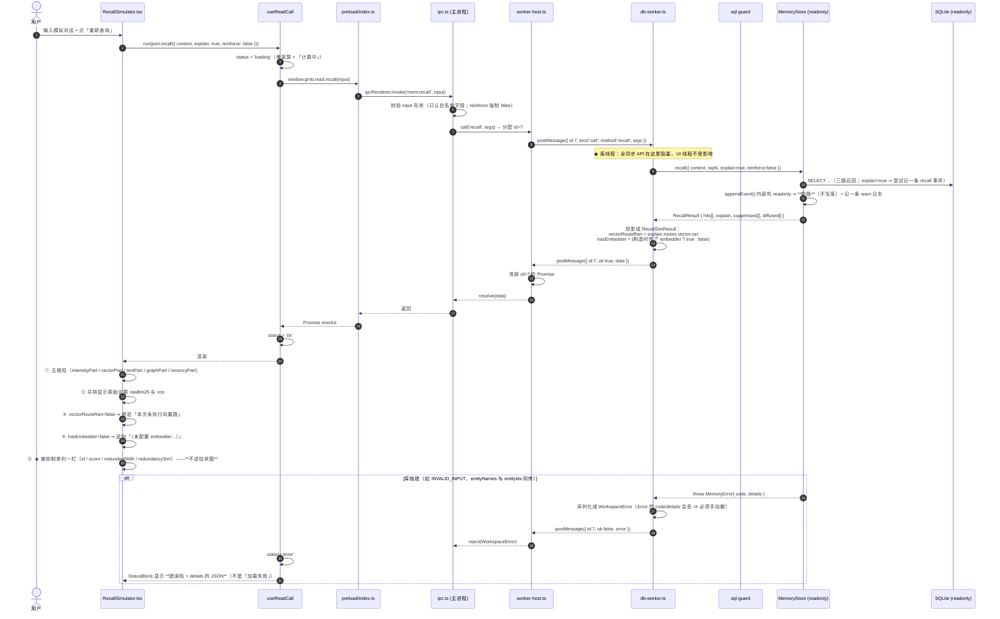
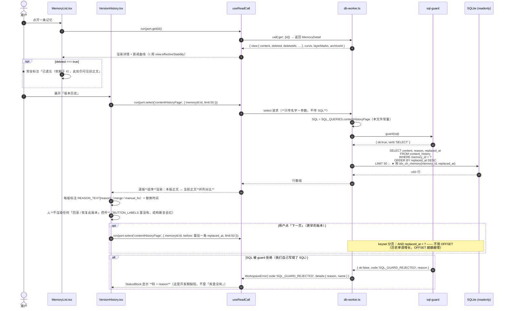
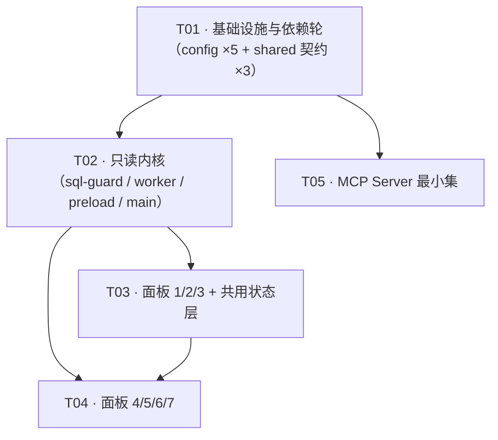

# 阶段 5 · P5-T01~T05 实现设计（只读查看器 + MCP Server）

> 时点：2026-11-02（Asia/Shanghai）· 分支 `feat/p5-verify-integrity`（PR #5）· 基线 `pnpm run verify` **EXIT=0 / 68 文件 / 1,213 断言**
> 角色：架构师 · 本文**只做设计与任务分解**，不含业务代码
> 权威输入：`DEVELOPMENT-PLAN.md` 第 3728~4047 行（P5-T01~T05 原文）、`DESIGN-v2.md` §7.1/§7.2/§7.3、`docs/progress/stage5-progress.md`

⚠️ **分层纪律（沿用阶段 2/3/4）**：**实测层** = 本节给出的读数是本轮实际读仓库/脚本得到的；
**推断层** = 由实测推出的结论 ⇒ 一律显式标 ⚠️（推断）。

> ⚠️ ★★ **2026-11-05 现状订正（★ 全文的读数与约束都是【2026-11-02 当时】的 ⇒ 读本文件前先看这一段）**：
> · ★ **本文里的「14 段门禁」已变成「18 段」**（★ T07 阶段 3：14 → 16；★ T07 阶段 4：16 → 18 ⇒ ★ 用户采纳主理人建议 ⇒ 再接 `check:json-note` 与 `check:wording-drift`）
>   ⇒ ⇒ **§「验收清单」里那条「`scripts.verify` 的 14 段逐名不变」【已不是现行约束】**
>   ⇒ ⇒ ★ **但它表达的那条纪律仍成立**：「**改门禁链必须同批改 `EXPECTED_GATE_COMMANDS` + 段数声明**」⇒ ⇒ **只是分母从 14 变成 16**；
> · ★ **本文里的「68 文件 / 1,213 断言」等所有读数** ⇒ ⇒ **是 2026-11-02 的历史快照**（★ 现状 = 99 文件 / 1,984 断言）
>   ⇒ ⇒ **按历史记录保留、不改**（★ 纪律：历史叙事不改）；
> · ★ **§「安装命令」里的 D 盘路径与 `--store-dir` 已失效**（★ 仓库与 store 均已迁到 E 盘）⇒ ⇒ **见该节顶部的现状订正块**。


---

## 零、先讲清本轮交付的**边界**（不写清这条，后面每个数字都会被误读）

| | 本轮交付 | 本轮**不**交付 |
|---|---|---|
| 查看器 | **只读内核**（只读句柄 / SQL 防护层 / worker 隔离）+ **7 个面板的渲染**，全部可在 `vitest` 里被断言 | ❌ 可双击运行的 `.exe`（无 electron-builder、无打包脚本、本机无显示器） |
| Electron | `viewer/main/index.ts` 这一层**薄适配**（只做窗口与 IPC 注册） | ❌ 打包、签名、自动更新、单实例锁、崩溃上报 |
| MCP | `mcp/server.ts` 的 stdio server + `mcp/tools.ts` 的**纯函数**工具表 | ❌ 远程传输（SSE/HTTP）、鉴权、限流 |
| 写能力 | 无（这是设计目标，不是缺口） | ❌ 任何写入口（含「回滚」按钮） |

⇒ **一句话**：本轮把「只读」做成**可断言的结构性事实**，把「可运行」留给打包轮。
⚠️ **代价**：交付物不能给人「打开看看」。**收益**：7 个面板的 18 条硬断言全部进 14 段门禁，
而「能打开」这件事**一条断言都产不出来**（本机无显示器、CI 无 X server）。这个取舍是显式的。

---

## 一、实现方案总览

### 1.1 架构图（一眼看清「谁能碰库」）

```
┌──────────────────────────────────────────────────────────────────────────────┐
│  渲染进程（renderer）—— 纯展示，**没有任何数据库能力**                        │
│                                                                              │
│  App.tsx ── 顶部「只读观察器」徽标（常驻）                                    │
│    ├── panels/Overview.tsx        面板 1  stats() + embeddedRatio + 向量路块  │
│    ├── panels/MemoryList.tsx      面板 2  get() + 衰减曲线                    │
│    ├── panels/RecallSimulator.tsx 面板 3  recall({explain,reinforce:false})   │
│    ├── panels/GraphView.tsx       面板 4  select('graphTwoHop')               │
│    ├── panels/LogViewer.tsx       面板 5  logs()                              │
│    ├── panels/VersionHistory.tsx  面板 6  select('contentHistoryPage')        │
│    └── panels/ClusterMap.tsx      面板 7  clusters()                          │
│                                                                              │
│  state/useReadCall.ts ─→ 唯一的数据入口：只认 `ReadPort`（8 个方法，写死）     │
│  state/StatusBlock.tsx ─→ 七个面板**共用**的 加载中 / 错误(码+details) / 空     │
└───────────────────────────────┬──────────────────────────────────────────────┘
                                │  contextBridge 暴露的**只读端口**
                                │  window.gmb.read.<8 个方法>   ← 无写通道，无 SQL 文本
┌───────────────────────────────▼──────────────────────────────────────────────┐
│  preload/index.ts —— contextBridge（上下文隔离开，nodeIntegration 关）        │
│  ⚠️ 只做「转发」：把 renderer 的调用变成 ipcRenderer.invoke('mem:<name>')      │
└───────────────────────────────┬──────────────────────────────────────────────┘
                                │  ipcMain.handle —— 通道名**白名单**（8 条，写死）
┌───────────────────────────────▼──────────────────────────────────────────────┐
│  主进程（viewer/main/index.ts）—— **不碰库、不碰 SQL、不碰文件**               │
│  worker-host.ts：spawn 1 个 worker，维护 id→Promise 映射，超时与取消           │
└───────────────────────────────┬──────────────────────────────────────────────┘
                                │  worker_threads postMessage（协议见 §4.2）
┌───────────────────────────────▼──────────────────────────────────────────────┐
│  ★ 库线程（viewer/main/db-worker.ts）—— **全仓库唯一持有库句柄的地方**         │
│                                                                              │
│   ① MemoryStore({ dbPath, readonly: true })   ← 7 个读方法走这里（§7.1 保证 3/4）│
│   ② Database(dbPath,{readonly:true,fileMustExist:true}) ← 面板 4/6 的原始 SELECT│
│                                          ▲                                   │
│                                          │ 每条 SQL 先过 guard(sql)          │
│                                   sql-guard.ts（白名单：SELECT/PRAGMA/EXPLAIN）│
│                                          │                                   │
│   ③ 面板 5：只**读** `<dataDir>/logs/YYYY/MM/MM-DD.log`（不写、不经库）        │
└──────────────────────────────────────────┬───────────────────────────────────┘
                                           │
                                    ┌──────▼──────┐
                                    │  SQLite 库  │  ⚠️ **只读打开**
                                    │ (单文件+WAL)│  readonly:true, fileMustExist:true
                                    └─────────────┘

MCP（独立进程，**与查看器无关**，走**写**句柄）：
  mcp/server.ts（stdio，@modelcontextprotocol/sdk）
      └─→ mcp/tools.ts（纯函数：TOOL_DEFINITIONS + dispatch(store, name, args)）
              └─→ MemoryStore({ dbPath })   ← 写句柄，6 个最小集 + 维护类按需
```

### 1.2 三条「结构性保证」怎么落地（不是靠自觉）

| §7.1 的保证 | 落地点 | 用什么断言它真的成立 |
|---|---|---|
| ① 只读句柄 | 库线程里两处 `{ readonly: true, fileMustExist: true }`（`MemoryStore` 构造 + guard 句柄） | 打开一个**不存在**的路径 ⇒ 抛 `NOT_FOUND`（证明 `fileMustExist`）；16 个写方法逐个抛 `READONLY_VIOLATION` |
| ② SQL 防护层 | `sql-guard.ts` 的 `guard(sql)`，**每次**执行前必过 | `SELECT/PRAGMA/EXPLAIN` 放行；`INSERT/UPDATE/DELETE/DROP/ATTACH` + `WITH…INSERT` 拒绝 |
| ③ 复用纯函数 | 面板 2 的曲线在**库线程**里用 `intensity()/layerOf()/archiveAt()` 算好，renderer 只画 | renderer 目录**不出现** `write(`/`updateContent(`/`better-sqlite3`（静态扫描） |
| ④ `appendEvent` 短路 | `src/store/events.ts` 已在 P0-T04 落地，本轮**只验证** | 只读实例上 `recall({explain:true})` 成功返回、`events` 行数不变、产生一条 warn 日志 |

### 1.3 关键取舍：为什么「面板 4/6 的原始 SELECT」不用改 `src/**`

§6 刻意不提供「读边图」与「读历史正文」的公开方法（图数据量随库规模增长、`content_history` 不参与召回）。
而 `MemoryStore` **不暴露 `db`**（`#db` 是私有字段），门面公开面被 `tests/contracts/export-surface.test.ts`
钉死为 **23 个方法**。

⇒ 本轮采用仓库**已有的先例**：`tests/integration/verifyIntegrity.test.ts` 里那句
「门面不暴露 `db` ⇒ 要核对库里发生了什么，只能另开一个**旁路连接**（`reader`）」。
⇒ 查看器的 SQL 防护层**就是那条旁路连接**，只不过它是产品代码而不是测试代码。

- **选它**：`src/**` 零改动 ⇒ 23 个方法的公开面契约、`LANDED_STAGES`、14 段门禁**全部不动**。
- **不选「给 `MemoryStore` 加一个 `db` getter」的代价**：那是把「谁能拿到裸句柄」这件事从 1 处变成 2 处
  ⇒ 只读保证从「结构性」退化为「纪律性」。

---

## 二、★ 五个决策（逐条：选它 / 不选它的代价）

### 2.1 决策总表

| # | 问题 | 结论 |
|---|---|---|
| **D1** | 依赖归属与装法 | `react`/`react-dom`/`electron`/`@modelcontextprotocol/sdk`/`@types/react`/`@types/react-dom` **全部 `devDependencies`**；**不下载 Electron 二进制**（靠 pnpm 不跑 postinstall，而非靠环境变量） |
| **D2** | 渲染测试方案 | `react-dom/server` 的 `renderToStaticMarkup`（**不装 jsdom / @testing-library**）+ 两层结构断言（通道白名单 + 源码扫描） |
| **D3** | `viewer/` `mcp/` 的工程落点 | **进根 `tsconfig.json` 的 `include`**（并补 `jsx` 与 `lib: DOM`）；**不进 `tsup` 产物**；`package.json` 的 `files` **不改** |
| **D4** | Electron 类型 | 类型在（`electron.d.ts` 随 tarball 发），二进制不在也不影响 `tsc`；**只有 `viewer/main/index.ts` 允许 `import 'electron'`**，vitest 永不 import 它 |
| **D5** | Q-P5-03 裁决 | ✅ **已裁**：T01~T05 的依赖**一律 `devDependencies`，不单开「依赖轮」以外的运行时依赖轮**；作为 **T01 一个任务**落地 |

### 2.2 D1 · 依赖策略

**结论表**

| 包 | 归属 | 版本区间 | 为什么 |
|---|---|---|---|
| `react` | `devDependencies` | `^19.1.0` | 只被 `viewer/renderer/**` 用；`tsup` 的 entry 只有 `src/index.ts`，`files: ["dist"]` ⇒ **发布产物里没有它** |
| `react-dom` | `devDependencies` | `^19.1.0` | 同上；且 `react-dom/server` 是**测试期**依赖 |
| `@types/react` | `devDependencies` | `^19.1.0` | 类型 |
| `@types/react-dom` | `devDependencies` | `^19.1.0` | 类型 |
| `electron` | `devDependencies` | `^38.0.0` | 它是**容器**，不是库的运行时依赖 |
| `@modelcontextprotocol/sdk` | `devDependencies` | `^1.0.0`（锁 major） | `mcp/` 不在 `files: ["dist"]` 里 ⇒ 发布包里也没有它；见下「为什么仍不放进 dependencies」 |

**为什么 `@modelcontextprotocol/sdk` 也不进 `dependencies`**（这条最反直觉，必须写清）：
`dependencies` 的语义是「**装本包的人必须一起装的东西**」。而本包对外只有一个入口——
`dist/index.{js,cjs,d.ts}`（`tsup` entry 写死 `src/index.ts`）+ `files: ["dist"]`。
`mcp/server.ts` 与 `viewer/**` **都不在发布产物里**。

- **选 `devDependencies` 的收益**：`pnpm add memory-ocean` 的人**不会**顺带下载 Electron（~100MB）与 React。
  这是本条决策里唯一真正不可让的项。
- **不选（放 `dependencies`）的代价**：① 每个宿主都被迫装 Electron；
  ② 触发 `desktop-notifier` 这类「装了个库结果拉下来一个浏览器」的经典事故；
  ③ 与 `stage5-progress.md` §二「运行时依赖只有 `better-sqlite3`」这条**被反复引用的实测事实**冲突。
- **选它的代价**：将来若真把查看器**打包成独立 app**，那个 app 需要**自己的 `package.json`**
  （`electron-builder` 的 `dependencies` 与库的 `dependencies` 是两回事）。
  ⇒ 记入 §8 风险 R6：**打包轮必须新建 `viewer/package.json`**，不能就地改根 `package.json`。

**版本区间为什么只锁 major**：本仓库的既有依赖全是 `^`（`better-sqlite3@^13`、`vitest@^4`、`vite@^7`）。
⇒ 契约是「**锁 major，minor/patch 随解析**」；`pnpm-lock.yaml` 才是逐字钉住的那一层（CI 用 `--frozen-lockfile`）。
⚠️ 上面的 `^19.1.0` / `^38.0.0` / `^1.0.0` 是**落笔时的最新稳定 major**；
安装命令跑完后**以 `git diff package.json` 的实际解析结果为准**，本文只约束 major。

**安装命令（必须逐字照抄，注意 `--store-dir`）**

> ⚠️ ★★ **2026-11-05 现状订正（★ 下面的命令【照抄会失败】⇒ ★ 务必先读这一段）**：
> · ★ **本仓库已从 D 盘迁到 E 盘**（2026-11-05 · T07 收口后）⇒ ⇒ **下面第 154 行的 `cd /d/…` 已失效**
>   ⇒ ⇒ **现状路径 = `/e/WorkBuddyData/2026-11-02-08-56-53/gmb`**；
> · ★ **pnpm store 也已迁到 E 盘**（★ `E:\.pnpm-store`）⇒ ⇒ **下面三处 `--store-dir "D:/WorkBuddyData/.pnpm-store-clean"`
>   已失效** ⇒ ⇒ **现状 = 不需要 `--store-dir`**（★ store 已在 E 盘 ⇒ ⇒ 干净、无坏块）；
> · ★ **但下面三条命令【保留原文】** ⇒ ⇒ **那是「当时怎么绕过坏块」的历史事实**（★ 纪律：
>   **历史叙事不改**）⇒ ⇒ ★ **要照抄的是【上面那两条现状】，不是下面三条**；
> · ★ **坏块的根因仍未修**（★ `D:\.pnpm-store` 的 `os error 1392`）⇒ ⇒ **`chkdsk /f D:` 需要管理员**
>   ⇒ ⇒ **治本要用户做**（★ 见 `docs/progress/vector-round-progress.md` 的 E1 行）。
> · ★★ **2026-11-05 23:49 订正本条（★ 「坏块」这个归因【已被证伪】、该待办【已撤销】）**：★ 全量诊断
>   ⇒ ⇒ **`chkdsk D: /scan`（管理员 · exit 0 · 59.21 s）= `0 KB in bad sectors` ＋ `found no problems`**
>   ⇒ ⇒ ★ **SMART（目标盘 ST1000DM010）：`ReadErrorsTotal = 0` · `ReadErrorsUncorrected = 0`**（★ 读侧【实测到】）
>   ⇒ ⇒ ★★ **写侧 = `WriteErrorsUncorrected = null`（★ Windows 对该盘【未提供】写侧计数 ⇒ ⇒ 【不是】0、只是【没测到】）**
>   ⇒ ⇒ ★★ **D: 盘健康**（★ 依据：chkdsk 的**零坏簇** ⇒ ★ 坏簇是【读写通吃】的物理层概念 ⇒ ⇒ **写路径已被覆盖**）
>   ⇒ ⇒ ★ ⇒ **不需要 `chkdsk /f`、不需要换盘** ⇒ ⇒ ★ ⇒ **「当初那次 `os error 1392`」【不能归因于物理坏块】**
>   ⇒ ⇒ ★ ⇒ **真正成因至今未定位**（★ 不猜）⇒ ⇒ ★ **凭据 = `docs/evidence/disk-health.json`**。

```bash
cd /d/WorkBuddyData/2026-11-02-08-56-53/gmb

# ⚠️ 本机 pnpm store 曾出现文件损坏（os error 1392）⇒ 必须指到干净 store
# ⚠️ NO_PROXY：本机全局有 http_proxy，走代理访问 registry 会 502（.npmrc 已清，命令再兜一层）
NO_PROXY=registry.npmjs.org no_proxy=registry.npmjs.org \
  pnpm add -D --store-dir "D:/WorkBuddyData/.pnpm-store-clean" \
    react@^19.1.0 react-dom@^19.1.0 @types/react@^19.1.0 @types/react-dom@^19.1.0
```

```bash
# ⚠️ Electron：只要类型，不要 ~100MB 二进制。
#   ★ 本仓库的 pnpm 默认**不执行**依赖的 postinstall（`pnpm-workspace.yaml` 的 allowBuilds 只放行
#     better-sqlite3 / esbuild / @biomejs/biome）⇒ electron 的 install 脚本**本来就不会跑**
#     ⇒ 二进制不会下载，而 `electron.d.ts` 是随 tarball 发布的 ⇒ 类型照样在。
#   ⚠️ 所以**不要**把 electron 加进 allowBuilds（加了就会开始下载）。
#   命令里仍带 ELECTRON_SKIP_BINARY_DOWNLOAD=1：防的是「以后有人把它加进 allowBuilds」。
ELECTRON_SKIP_BINARY_DOWNLOAD=1 \
NO_PROXY=registry.npmjs.org no_proxy=registry.npmjs.org \
  pnpm add -D --store-dir "D:/WorkBuddyData/.pnpm-store-clean" electron@^38.0.0
```

```bash
NO_PROXY=registry.npmjs.org no_proxy=registry.npmjs.org \
  pnpm add -D --store-dir "D:/WorkBuddyData/.pnpm-store-clean" \
    @modelcontextprotocol/sdk@^1.0.0
```

**关于 `ELECTRON_SKIP_BINARY_DOWNLOAD` 的一个精确事实**（别指望 `.npmrc` 能替代它）：
Electron 的 `install.js` 读的是 **`process.env.ELECTRON_SKIP_BINARY_DOWNLOAD`**，
**不读** `npm_config_electron_skip_binary_download` ⇒ 把 `electron_skip_binary_download=1` 写进 `.npmrc` **无效**。
⇒ 本设计**不改 `.npmrc`**；真正的防线是「**不加进 `allowBuilds`**」+ CI 里补 job 级 env（P2，见 §7 T01）。

### 2.3 D2 · 渲染测试方案

**结论：`react-dom/server` 的 `renderToStaticMarkup`，不装 `jsdom` / `@testing-library/*`。**

**为什么它足以覆盖那几条断言**（逐条对账，这是决策的实质）

| PLAN 的硬断言 | 它要验的是什么 | `renderToStaticMarkup` 够不够 |
|---|---|---|
| 面板 1 的向量路措辞**逐条匹配**（快照一字不差） | **字符串相等** | ✅ 够，而且**更准**：DOM 方案的 `textContent` 会吞掉空白/换行差异，反而更难「一字不差」 |
| `flat_auto` 时**不显示**「正在重训」 | 字符串**缺席** | ✅ `expect(html).not.toContain('正在重训')` |
| `absent` 两种取值都**常驻可见** | 两条字符串**同时**在场 | ✅ |
| 面板 1 显示 `embeddedRatio` | 数值出现 | ✅ |
| 面板 3 标注「本次未执行向量路」、且**不得**出现「向量索引损坏」 | 一条在场 + 一条缺席 | ✅ |
| 面板 3 柱状图**不含**被抑制条目 | **结构**：两个列表的坐标集合不相交 | ✅ 见下「结构断言」 |
| 面板 2 曲线基于 `effectiveStability` | 传给纯函数的入参 | ✅ 纯函数单测 + 渲染断言 τ 出现在 `<title>`/`data-tau` |
| 面板无写入口（**渲染树里没有触发写方法的控件**） | **结构缺席** | ✅ 见下「结构断言」 |
| 七个面板共用同一套状态组件 | **结构性复用** | ✅ 源码断言（每个面板 import 了同一个 hook） |
| 注入 `MemoryError` ⇒ 显示**码 + details**，不是「加载失败」 | 字符串 + JSON | ✅ `html` 里 `toContain('NOT_FOUND')` 与 `toContain(detailsJson)` |

**「没有写入口控件」这类结构断言怎么落地**（这是唯一真正需要设计的部分，分三层，缺一层就可绕过）

1. **通道层（最强）**：`viewer/shared/channels.ts` 导出 `READ_CHANNELS`（8 条，**写死**）与
   `WRITE_CHANNELS = [] as const`（**空数组，带注释说明它必须永远是空的**）。
   断言：`READ_CHANNELS.length === 8`；`WRITE_CHANNELS.length === 0`；
   且 `READ_CHANNELS` 与 `METHODS_THROWING_READONLY_VIOLATION`（现有常量，16 个）**交集为空**。
   ⇒ 「renderer 想把写意图送出去」这件事**在类型与运行时两层都不存在通道**。
2. **标记层**：`renderToStaticMarkup` 产出的 HTML 里，所有 `<button>` 的文案必须落在
   `BUTTON_LABELS`（白名单，写死在 `texts.ts`，当前 = `['重新查询', '上一页', '下一页', '展开成员', '收起']`）。
   断言：抽 HTML 里全部 `<button[^>]*>(.*?)</button>` 的文案集合 ⊆ `BUTTON_LABELS`。
   ⇒ 新增任何按钮都必须先改白名单 ⇒ **加「回滚」按钮不可能悄悄过门禁**。
3. **源码层**：扫描 `viewer/renderer/**/*.{ts,tsx}`，断言**不出现**
   `better-sqlite3`、`Database(`、`prepare(`、`exec(`、`pragma(`、
   以及 16 个写方法名（`write(|touch(|link(|linkByIds(|forget(|restore(|pin(|unpin(|setAlias(|mergeEntities(|updateContent(|sweep(|setParams(|rebuildArchivalSchedule(|rebuildVectorBuckets(|recluster(`）。

⚠️ **不选 jsdom + @testing-library 的代价（写清）**：面板里的**交互**（点开簇气泡、翻页、输入模拟对话）
在本轮**没有自动化测试**，只能靠 `useReadCall` / `MemoryList` 的**纯函数部件**单测间接覆盖。
**收益**：① 不引入 4 个新依赖（`jsdom`、`@testing-library/react`、`@testing-library/dom`、`@testing-library/jest-dom`）；
② **不动 `vitest.config.ts` 的 `environment: 'node'`** —— 这一条是硬的：`better-sqlite3` 是同步原生模块，
`pool: 'forks'` + `environment: 'node'` 是 `vitest.config.ts` 注释里写明的**硬性要求**（改 jsdom 会让
「本地过、CI 挂」的 `ERR_DLOPEN_FAILED` 重新出现）；
③ 断言对象本来就是「文本对不对」与「结构在不在」，**不是「点了会发生什么」**——
而「点了会发生什么」在本产品里恰好是「什么都不该发生」。

### 2.4 D3 · `viewer/` 与 `mcp/` 的工程落点

| 问题 | 结论 | 依据 |
|---|---|---|
| 进 `tsconfig.json` 的 `include`？ | ✅ **进** | 否则 `tsc --noEmit` 覆盖不到 ⇒ 1000+ 行新代码脱离类型检查（本仓库已有一条同款先例：`bench` 进 include 但**不进构建**） |
| 需要补哪些 `compilerOptions`？ | `"jsx": "react-jsx"` + `lib: ["ES2023","DOM"]` | `.tsx` 没有 `jsx` 选项无法编译；`DOM` 是 `@types/react` 与 `createRoot` 需要的 |
| 会不会被 `tsup` 带进产物？ | ❌ **不会** | `tsup.config.ts` 的 `entry: ['src/index.ts']`、`outDir: 'dist'`，且 `tsconfig.build.json` 的 `include: ["src"]`、`rootDir: "src"` ⇒ 两条路都进不去 |
| `package.json` 的 `files` 要改吗？ | ❌ **不改**（保持 `["dist"]`） | 改了就等于把查看器塞进 npm 包 |
| `biome` 要不要改？ | ❌ **不改** | `biome check .` 无 `include` 限制 ⇒ `viewer/**` `mcp/**` **自动**被扫；`files.ignore` 只排除 `node_modules/dist/coverage/...` |
| `tsconfig.build.json` 要改吗？ | ❌ **不改** | `include: ["src"]` 已经把它挡住了；`extends` 继承的 `jsx`/`lib` 对 `src/**`（无 `.tsx`）无影响 |

⚠️ **`lib` 加 `DOM` 的代价（诚实记）**：`src/**` 从此**也能**编译 `document`/`window`/`fetch` 之类的名字
⇒ 「服务端库不该摸 DOM」这条**从编译期约束退化为纪律**。
- 想保住编译期约束的代价：拆成 `viewer/tsconfig.json` + 根 `typecheck` 跑两条 `tsc`。
- **为什么还是选「一个 tsconfig」**：`tests/**` 会 `import` 面板组件 ⇒
  **根项目照样会把 `viewer/**/*.tsx` 拉进 program**（TS 会编译被 import 的文件，与是否在 `include` 里无关）
  ⇒ 根 `tsconfig.json` **无论如何都得有 `jsx` 和 `DOM`** ⇒ 拆项目只多两个配置文件，**一条约束也保不住**。
- 附带的**硬约束**：`verify` 链**不许新增段**（`scripts/check-gate-entry.ts` 的
  `EXPECTED_GATE_COMMANDS` 是写死的 14 个名字，`tests/contracts/scripts.test.ts` 也逐名比对）
  ⇒ 即使拆项目，也只能把两条 `tsc` **串进 `typecheck` 那一段的脚本体**
  （`parseVerifyChain` 只看 `scripts.verify` 的段名，段名仍是 `typecheck`）。

### 2.5 D4 · Electron 主进程的类型依赖（怎么让 `tsc --noEmit` 与 vitest 都过）

**结论（三条，合起来是最小方案）**

1. **类型从哪来**：`electron` 的 npm tarball 里带 `electron.d.ts`（`package.json` 的 `types` 指向它）
   ⇒ **不跑 install 脚本也有完整类型**。已装的 `skipLibCheck: true` 让这份大 d.ts 只被解析不被深检。
2. **谁能 import 它**：**只有** `viewer/main/index.ts` 一个文件 `import { app, BrowserWindow } from 'electron'`。
   其余文件（`db-worker.ts` / `worker-host.ts` / `sql-guard.ts` / `queries.ts` / `ipc.ts`）**一律不 import electron**
   —— 它们是**纯 Node**，可以在 vitest 里被直接 import 与断言。
   断言：扫 `viewer/**` 下所有 `.ts`/`.tsx`，`from 'electron'` 只允许出现在 `viewer/main/index.ts`。
3. **测试怎么避免真的启动 Electron**：vitest **不 import** `viewer/main/index.ts`（它不在任何测试的依赖图里）。
   所有可测逻辑都在 2 里那几个纯 Node 文件 + renderer 组件里。
   `renderer` 里的 `window.gmb` 不靠 Electron 提供——靠 **`ReadPort` 注入**（见 §4.1）：
   `App({ port })`，Electron 下传 `window.gmb.read`，测试里传**假 port**。

⚠️ **不做 `electron` 的 `moduleNameMapper` mock**：mock 一个永远不该被 import 的模块，
等于给「有人误 import 了」这件事**留了一条无声的通道**。宁可让它 import 时报错。

### 2.6 D5 · Q-P5-03 正式裁决（✅ 已裁，本文即裁决落点）

> `stage5-progress.md` §五 原文：「依赖策略（尤其 Electron 是**打包期**依赖还是**运行时**依赖）属架构决策 ⇒ 归架构师」。

**裁决 D-P5-Q03（现行有效）**

1. **T01~T05 引入的 6 个包全部是 `devDependencies`**，`dependencies` **仍然只有 `better-sqlite3` 一个**。
   ⇒ `stage5-progress.md` §二 那条「运行时依赖只有 better-sqlite3」在 T01~T05 之后**依旧成立**，
   不需要改一个字。
2. **不单开「运行时依赖轮」**：本轮是一次性的 `devDependencies` 增量，**作为 T01 一个任务**落地，
   与配置文件改动同批提交（依赖 + `tsconfig` + `vitest.config` 三者**必须同批**，见 §7 T01 的依赖说明）。
3. **Electron 是「打包期依赖」**：它的语义是「运行 `viewer/main/index.ts` 的那个容器」，
   不是「库的运行时」；将来打包时由**独立的 `viewer/package.json`** 声明（R6）。
4. **回写要求**：T05 收尾时把 `stage5-progress.md` §五 的 Q-P5-03 改成「✅ 已裁 ⇒ 见
   `docs/design/p5-t01-t05-design.md` §2.6」，并把 §二 的阻塞表「新依赖」一行标注「已解」。
   ⚠️ **只改状态与指针，不改历史记录**（§1.2 那段「发生过、已绕回」的写法是本仓库的既有纪律）。

⚠️ **Q-P5-01 / Q-P5-02 我不裁**（理由见 §9）。本设计对二者的**独立性证明**：

| 待定问题 | 若裁 A | 若裁 B | 对 T01~T05 的影响 |
|---|---|---|---|
| **Q-P5-01**（`rebuildArchivalSchedule(now?)` vs `(options?)`） | 保持现状 | 改签名 | **零**：查看器把它列在**写方法黑名单**里、**永不调用**；MCP **不暴露**它。两种签名下「不调用」都成立 ⇒ 设计不依赖它 |
| **Q-P5-02**（`verifyIntegrity` 是否进 C37 时钟豁免清单） | 进 | 不进 | **零**：查看器只**调用** `verifyIntegrity()`，不实现它、不读时钟；`check:clock` 只扫 `src/`（`--root` 默认 `src`）⇒ `viewer/` `mcp/` 本来就不在它的扫描面内 |

---

## 三、文件清单（相对路径 · 新增 A / 修改 M）

> 与 PLAN 的文件列表**逐项对齐**；PLAN 没写到的部分标 ★ 并给理由（PLAN 只给了「`viewer/renderer/`（面板框架与路由）」这种目录级说法）。

### 3.1 配置文件（T01）

| # | 路径 | A/M | 说明 |
|---|---|---|---|
| 1 | `package.json` | M | 6 个 devDeps；新增 `scripts.viewer:typecheck`? **不加**（见 §2.4：不新增门禁段）；新增 `scripts.mcp:serve`（非门禁，`tsx mcp/server.ts`） |
| 2 | `tsconfig.json` | M | `include` += `"viewer","mcp"`；`jsx: "react-jsx"`；`lib: ["ES2023","DOM"]` |
| 3 | `vitest.config.ts` | M | `esbuild: { jsx: 'automatic' }`；`include` += `'mcp/**/*.test.ts'` |
| 4 | `pnpm-workspace.yaml` | M | **只加注释**：「⚠️ electron **不得**加进 allowBuilds（加了就会下载 ~100MB 二进制；类型不需要二进制）」 |
| 5 | `.github/workflows/ci.yml` | M | 两个 job 各加 `env: ELECTRON_SKIP_BINARY_DOWNLOAD: "1"`（P2，防未来把 electron 加进 allowBuilds） |

⚠️ **为什么不改 `.npmrc`**：`npm_config_*` 不被 Electron 的 `install.js` 读（见 §2.2），写了是**假动作**。

### 3.2 共享契约（T01，纯常量与类型，无行为）

| # | 路径 | A/M | 说明 |
|---|---|---|---|
| 6 | ★ `viewer/shared/channels.ts` | A | `READ_CHANNELS`（8 条，写死）/ `WRITE_CHANNELS`（**空**）/ 通道名→ReadPort 方法的映射类型 |
| 7 | ★ `viewer/shared/protocol.ts` | A | worker 消息协议 + `ReadPort` + `MemoryDetail` / `LogPage` / `WorkspaceError`（**全部可 JSON 序列化**） |
| 8 | ★ `viewer/shared/sql-names.ts` | A | `SqlQueryName` 联合类型 + `SQL_QUERY_NAMES` 数组（**没有 SQL 文本**，renderer 只能拿名字） |

### 3.3 只读内核（T02）

| # | 路径 | A/M | 说明 |
|---|---|---|---|
| 9 | `viewer/main/sql-guard.ts` | A | `guard(sql): GuardVerdict`（首关键字白名单 + CTE 写入拒绝 + PRAGMA 白名单 + 单语句） |
| 10 | ★ `viewer/main/queries.ts` | A | 面板 4/5/6 用的 SQL **常量**，`satisfies Record<SqlQueryName, string>` ⇒ 编译期保证不漏不多 |
| 11 | `viewer/main/db-worker.ts` | A | worker_threads 入口：开只读 `MemoryStore` + 只读 `Database`；`onmessage` 分发 |
| 12 | ★ `viewer/main/worker-host.ts` | A | 主进程侧 client：spawn、id→Promise、超时、`close()`、错误反序列化 |
| 13 | `viewer/main/ipc.ts` | A | `ipcMain.handle` × 8（白名单；**不做 SQL 透传**） |
| 14 | `viewer/preload/index.ts` | A | `contextBridge.exposeInMainWorld('gmb', { read })`；只有 8 个方法 |
| 15 | `viewer/main/index.ts` | A | Electron 入口（**唯一** import `electron` 的文件）；窗口配置 `contextIsolation:true, nodeIntegration:false, sandbox:true` |

### 3.4 面板 1/2/3（T03）

| # | 路径 | A/M | 说明 |
|---|---|---|---|
| 16 | `viewer/renderer/panels/Overview.tsx` | A | 面板 1（含**向量路块** + `embeddedRatio`） |
| 17 | `viewer/renderer/panels/MemoryList.tsx` | A | 面板 2（详情 + 衰减曲线） |
| 18 | `viewer/renderer/panels/RecallSimulator.tsx` | A | 面板 3（五柱 + 原始证据 + **被抑制单列**） |
| 19 | ★ `viewer/renderer/panels/panels.css` | A | PLAN 指定 |
| 20 | ★ `viewer/renderer/texts.ts` | A | **全部面板措辞的唯一出处**（含向量路五值表、被抑制栏、已遗忘标注） |
| 21 | ★ `viewer/renderer/state/useReadCall.ts` | A | 七个面板**共用**的异步/错误/骨架屏 |
| 22 | ★ `viewer/renderer/state/StatusBlock.tsx` | A | 七个面板**共用**的状态呈现（错误码 + `details` JSON） |
| 23 | ★ `viewer/renderer/charts/DecayCurve.tsx` | A | 衰减曲线（**手写 SVG**，确定性采样） |
| 24 | ★ `viewer/renderer/charts/ScoreBars.tsx` | A | 五柱明细 + 原始证据并排（**手写 SVG**） |
| 25 | ★ `viewer/renderer/App.tsx` | A | 顶部**只读徽标** + 7 面板切换（`useState`，**不引路由库**） |
| 26 | ★ `viewer/renderer/main.tsx` | A | `createRoot` 挂载，把 `window.gmb.read` 当 port 注入 |
| 27 | ★ `viewer/renderer/index.html` | A | Electron 的 `loadFile` 目标（本轮不参与门禁；打包轮才用） |

> ⚠️ **PLAN 说的「面板框架与路由」= 25 + 26**：7 个固定面板用 `useState` 切换即够。
> **不引 `react-router`** 的代价：没有 URL 深链/前进后退。**收益**：少 1 个运行时依赖 + 少 1 层版本耦合，
> 而「深链」在这个只读桌面工具里**没有使用场景**（没有人会把面板 5 的书签发给别人）。

### 3.5 面板 4/5/6/7（T04）

| # | 路径 | A/M | 说明 |
|---|---|---|---|
| 28 | `viewer/renderer/panels/GraphView.tsx` | A | 面板 4（两跳子图，**带 LIMIT**） |
| 29 | `viewer/renderer/panels/LogViewer.tsx` | A | 面板 5（**只读** `logs/`） |
| 30 | `viewer/renderer/panels/VersionHistory.tsx` | A | 面板 6（**50 版分页** + 软删标注 + **无回滚按钮**） |
| 31 | `viewer/renderer/panels/ClusterMap.tsx` | A | 面板 7（气泡群 + 新鲜度 + coverage/largestClusterRatio） |
| 32 | `viewer/renderer/panels/ClusterBubble.tsx` | A | 面板 7 的单个气泡与成员列表 |
| 33 | ★ `viewer/renderer/charts/ForceGraph.tsx` | A | 力导向图（**固定迭代次数 + 固定顺序 ⇒ 确定性布局**） |

### 3.6 MCP（T05）

| # | 路径 | A/M | 说明 |
|---|---|---|---|
| 34 | `mcp/tools.ts` | A | **纯函数**：`TOOL_DEFINITIONS`（JSON Schema）+ `dispatchTool(store, name, args)`；**不 import SDK** |
| 35 | `mcp/server.ts` | A | SDK 薄适配：`StdioServerTransport` + `tools/list` + `tools/call` |
| 36 | `mcp/tools.test.ts` | A | PLAN 指定的路径；靠 §3.7 的 vitest `include` 扩展被收进来 |

### 3.7 测试（T02~T05）

| # | 路径 | A/M | 覆盖 |
|---|---|---|---|
| 37 | `tests/integration/viewer-readonly.test.ts` | A | 16 写抛 / 7 读通 / 全表哈希不变 / `appendEvent` 短路 |
| 38 | `tests/integration/viewer-sql-guard.test.ts` | A | 放行 3 类 / 拒绝 8 类 / `WITH…INSERT` / PRAGMA 白名单 |
| 39 | `tests/integration/viewer-worker.test.ts` | A | 真 `worker_threads` 跑协议；renderer 侧无库能力 |
| 40 | `tests/integration/viewer-panels-text.test.ts` | A | 面板 1/3/6/7 的**措辞快照**（期望值独立写死） |
| 41 | `tests/integration/viewer-panels-structure.test.ts` | A | 无写入口 / 状态组件复用 / 错误呈现 / 通道白名单 |
| 42 | ★ `tests/helpers/tableHashes.ts` | A | 「全表行数 + 内容哈希」的**唯一实现**（`verifyIntegrity.test.ts` 里那份内联版本**不动**，新老并存但新代码只用这个；见 §8 R4） |

> ⚠️ **`mcp/tools.test.ts` 为什么要在 `vitest.config.ts` 里加 `'mcp/**/*.test.ts'`**：
> 现有 `include` 是 `['tests/**/*.test.ts', 'src/**/*.test.ts']` ⇒ **`mcp/` 下的测试不会被收集**
> （这不是"跑过了"，是"根本没跑"，而且**不会报错**）。
> - **选它**：PLAN 的文件路径**逐字保留**，改动是 `vitest.config.ts` 里**一个 glob**。
> - **不选（把测试搬到 `tests/integration/mcp-tools.test.ts`）的代价**：与 PLAN 的文件清单不一致，
>   而「文件清单」是任务分解的验收项之一。
> ⚠️ **同理**：`viewer/**` 的测试**一律放 `tests/integration/`**（纯 `.ts`，import `.tsx`），
> **不**在 `viewer/` 下放 `.test.tsx` —— 那样还要再加一个 `'viewer/**/*.test.tsx'` glob，
> 且与「测试集中在 `tests/`」的既有布局冲突（`src/**/*.test.ts` 是唯一例外，它是纯函数同桌单测）。

**文件清单条数：42**（新增 36 / 修改 6）。

---

## 四、关键接口（TypeScript 签名）

### 4.1 `viewer/shared/protocol.ts` —— renderer 看到的**唯一**能力面

```ts
import type { ClustersResult } from '../../src/store/clusters.js';
import type { MemoryView } from '../../src/store/get.js';
import type { InhibitionTraceResult } from '../../src/store/inhibition.js';
import type { Hit, RecallResult, RecallSuppressed } from '../../src/store/recall.js';
import type { MemoryStats } from '../../src/store/stats.js';
import type { VerifyIntegrityReport } from '../../src/store/maintain.js';
import type { MemoryLayer } from '../../src/core/decay.js';
import type { SqlQueryName, SqlQueryParams } from './sql-names.js';

/**
 * ★ 渲染进程能拿到的**全部**数据能力 —— 8 个方法，写死在下面的 `READ_PORT_METHODS`。
 *
 * ⚠️ 这 8 个方法 = §6 的 7 个读方法里去掉 `close`（`close` 归主进程，renderer 无权关库）
 *    + `select`（面板 4/6 的原始 SELECT，走 sql-guard）
 *    + `logs`（面板 5 读 `logs/` 目录）。
 * ⚠️ **没有任何写方法、没有任何"传 SQL 文本"的通道**（`select` 只收**名字**，不收 SQL）。
 */
export interface ReadPort {
  stats(now?: number): Promise<MemoryStats>;
  get(id: string, now?: number): Promise<MemoryDetail | null>;
  recall(input: RecallSimInput): Promise<RecallSimResult>;
  clusters(now?: number): Promise<ClustersResult>;
  inhibitionTrace(context: string): Promise<InhibitionTraceResult>;
  verifyIntegrity(): Promise<VerifyIntegrityReport>;
  select<N extends SqlQueryName>(name: N, params: SqlQueryParams[N]): Promise<ReadonlyArray<SqlRow>>;
  logs(query: LogQuery): Promise<LogPage>;
}

/** ★ 写死的分母：`ReadPort` 的方法名清单（8 条）。加一个方法必须改这里 + 断言。 */
export const READ_PORT_METHODS = [
  'stats', 'get', 'recall', 'clusters',
  'inhibitionTrace', 'verifyIntegrity', 'select', 'logs',
] as const satisfies ReadonlyArray<keyof ReadPort>;

/** 召回模拟器的入参：**只有**这些字段能被 renderer 指定。 */
export interface RecallSimInput {
  context: string;
  topN?: number;
  entityNames?: string[];
  /** ⚠️ 恒为 `false`（写死在 worker 侧，**不接受 renderer 传 true**）。 */
  readonly reinforce?: false;
}

/** 面板 2 的详情：视图 + **库线程算好的**曲线（renderer 不做任何时间计算）。 */
export interface MemoryDetail {
  view: MemoryView;
  /** 采 120 点，`t` 从 `lastAccess` 到「跌出归档」之后一点，`t` 是 epoch 毫秒。 */
  curve: ReadonlyArray<{ t: number; intensity: number; layer: MemoryLayer }>;
  /** 层级分界线的强度值（`THRESHOLD_L3` / `THRESHOLD_L2` / `ARCHIVE_LINE`）⇒ 曲线画横线用。 */
  layerMarks: { l3: number; l2: number; archived: number };
  /** 由 `archiveAt()` 算出的「跌入归档」时刻（epoch 毫秒）。 */
  archiveAt: number;
  /** 由「当前 intensity 与 τ」反推的「跌出 L3」时刻；已跌出则为 `null`。 */
  dropOutL3At: number | null;
}

/** 面板 3 的结果：命中 + 诊断 + 被抑制（**三者分开**，不许混进同一根柱）。 */
export interface RecallSimResult {
  hits: ReadonlyArray<Pick<Hit,
    'id' | 'content' | 'layer' | 'intensity' | 'score' | 'fromText' | 'fromVector' | 'fromGraph'
    | 'breakdown'>>;
  /** `explain.routes.vector.ran` 的**直接投影**（不是"配了 embedder 没有"的猜测）。 */
  vectorRouteRan: boolean;
  /** 只读查看器是否配了 embedder（默认 `false`）。 */
  hasEmbedder: boolean;
  suppressed: ReadonlyArray<RecallSuppressed>;
}

/** 面板 5 的查询与一页结果。 */
export interface LogQuery {
  year: number;
  month: number;
  day?: number;
  keyword?: string;
  offset?: number;
  limit?: number;
}
export interface LogPage {
  lines: ReadonlyArray<{ no: number; raw: string; level: 'info' | 'warn' | 'error' }>;
  total: number;
}

/** worker → renderer 的**行**类型（SQL 结果是"扁的"，不猜列语义）。 */
export type SqlRow = Readonly<Record<string, string | number | null>>;

/**
 * ★ 跨进程错误的**唯一**线上形态（`MemoryError` 不能直接 postMessage：
 *   `Error` 的 `code` / `details` 是自有属性，结构化克隆会丢）。
 */
export interface WorkspaceError {
  code: string;                    // 五个错误码之一，或 'SQL_GUARD_REJECTED' / 'WORKER_TIMEOUT'
  message: string;
  details: Record<string, unknown>;
}
```

### 4.2 worker 消息协议（主进程 ↔ 库线程）

```ts
/** 主进程 → 库线程。 */
export type WorkerRequest =
  | { id: number; kind: 'open'; dbPath: string }
  | { id: number; kind: 'call'; method: Exclude<keyof ReadPort, 'select' | 'logs'>; args: unknown[] }
  | { id: number; kind: 'select'; name: SqlQueryName; params: unknown }
  | { id: number; kind: 'logs'; query: LogQuery }
  | { id: number; kind: 'close' };

/** 库线程 → 主进程。 */
export type WorkerResponse =
  | { id: number; ok: true; data: unknown }
  | { id: number; ok: false; error: WorkspaceError };
```

⚠️ **两条硬规则**（都进断言）：
1. `kind` 的联合里**没有** `'write' | 'exec' | 'sql'`（裸 SQL 文本）⇒ renderer 拿不到「随便执行」的口子。
2. `open` 的 `dbPath` **只能由主进程给**（`ipc.ts` 不接受 renderer 传路径）⇒ 面板不能打开任意文件。

### 4.3 `viewer/main/sql-guard.ts`

```ts
/** 放行的三类首关键字。 */
export const ALLOWED_VERBS = ['SELECT', 'PRAGMA', 'EXPLAIN'] as const;
export type AllowedVerb = (typeof ALLOWED_VERBS)[number];

/**
 * PRAGMA 白名单：**只收「读」形态**。
 *
 * ⚠️ `PRAGMA journal_mode` 不带参数是读、带 `=` 是**写数据库头** ⇒ 判据不是"名字"，是"有没有赋值"。
 */
export const ALLOWED_PRAGMAS = [
  'table_info', 'index_list', 'index_info', 'index_xinfo',
  'foreign_key_list', 'user_version', 'page_count', 'page_size',
  'journal_mode', 'integrity_check', 'quick_check', 'compile_options',
] as const;

export type GuardVerdict =
  | { ok: true; verb: AllowedVerb; sql: string }
  | { ok: false; code: 'SQL_GUARD_REJECTED'; reason: string; verb: string };

/**
 * 唯一的 SQL 放行判据（§7.1 保证 ②）。
 *
 * 判据顺序（**不可换**）：
 *  ① 剥注释（`--` / 块注释）与字符串字面量（`'...'` / `"..."`）——否则 `SELECT '--'` 会把后半个语句涂白
 *  ② **单语句**：去掉结尾分号后，正文里**不得**再出现 `;`
 *  ③ 首关键字必须在 `ALLOWED_VERBS` 里
 *  ④ `WITH [RECURSIVE]` **特殊处理**：剥离 CTE 之后，**整条语句的 token 集里不得出现任何 DML/DDL 词**
 *     （`INSERT/UPDATE/DELETE/REPLACE/DROP/ALTER/CREATE/ATTACH/DETACH/VACUUM/REINDEX/ANALYZE/PRAGMA-赋值`）
 *     —— ⚠️ 只按首关键字匹配会让 `WITH c AS (...) INSERT INTO ...` 通过
 *  ⑤ `PRAGMA` ⇒ 名字必须在 `ALLOWED_PRAGMAS` 里，且**不得含 `=`**（那是写形态）
 *  ⑥ `EXPLAIN [QUERY PLAN] <stmt>` ⇒ **对 `<stmt>` 递归执行 ①~⑤**（`EXPLAIN INSERT` 虽然不执行，但没必要放行）
 *
 * ⚠️ 判据是**白名单**：宁可误拒（面板 SQL 是我们自己写的常量，误拒会在 T02 的单测里立刻暴露），
 *    不可误放（误放 = 只读保证 ② 失效）。
 */
export function guard(sql: string): GuardVerdict;
```

**拒绝清单（逐条进断言）**：`INSERT` / `UPDATE` / `DELETE` / `DROP` / `ALTER` / `CREATE` /
`ATTACH` / `DETACH` / `VACUUM` / `REINDEX` / `ANALYZE` / `WITH … INSERT` / `PRAGMA journal_mode = WAL` /
`PRAGMA user_version = 5` / `SELECT 1; DROP TABLE memories` / `select * from memories -- ;\n drop table x`。

### 4.4 IPC 通道（`viewer/shared/channels.ts`）

```ts
/** ★ 写死的 8 条通道名（与 `READ_PORT_METHODS` **逐名对应**，由断言钉住）。 */
export const READ_CHANNELS = [
  'mem:stats', 'mem:get', 'mem:recall', 'mem:clusters',
  'mem:inhibition-trace', 'mem:verify-integrity', 'mem:select', 'mem:logs',
] as const;
export type ReadChannel = (typeof READ_CHANNELS)[number];

/**
 * ★ **必须永远是空数组**。
 *
 * ⚠️ 它存在的唯一理由是**让"没有写通道"变成一条可断言的事实**，
 *   而不是"我们记得没写"。空数组 + 长度断言 ⇒ 谁想加一条写通道，门禁立刻红。
 */
export const WRITE_CHANNELS: readonly string[] = [] as const;
```

### 4.5 MCP 工具表（`mcp/tools.ts`，**不 import SDK**）

```ts
/** 一个 MCP 工具的声明（`inputSchema` 是 JSON Schema：SDK 直接吃它，不需要 zod）。 */
export interface ToolDefinition {
  name: ToolName;
  title: string;
  description: string;
  inputSchema: {
    type: 'object';
    properties: Record<string, unknown>;
    required?: string[];
    additionalProperties: false;
  };
}

/** ★ 最小集 6 项 + 维护类 3 项（**逐个决策过**，见下表）；3 个阻塞方法**不在**这里。 */
export type ToolName =
  | 'write' | 'recall' | 'touch' | 'link' | 'forget' | 'restore'   // §12 阶段 5 最小集
  | 'updateContent' | 'setAlias' | 'mergeEntities';                // 维护类：按需暴露（已决策：暴露）

export const TOOL_DEFINITIONS: readonly ToolDefinition[];

/**
 * 纯函数调度：**不 import SDK** ⇒ 即使 SDK 装不上 / API 变了，本文件与它的测试照样能跑。
 *
 * @throws {MemoryError} 原样抛出库的错误（由 `server.ts` 转成结构化返回）
 */
export function dispatchTool(
  store: MemoryStore,
  name: string,           // ⚠️ 收 `string` 而不是 `ToolName`：未知名字要**返回**错误，不是编译期炸
  args: unknown,
): unknown;
```

**维护类「按需暴露」的逐个决策**（PLAN 要求「必须逐个决策并记录」）

| 方法 | 暴露？ | 理由 |
|---|---|---|
| `updateContent` | ✅ | 它是 §4.9「人工改正」的**唯一入口**；不暴露它，§4.9 的兜底链在 MCP 侧就断了 |
| `setAlias` | ✅ | 幂等、小、无阻塞；别名是跨来源统一召回的关键 |
| `mergeEntities` | ✅ | 有并发兜底（§4.5 预校验），且它是 `setAlias` 冲突时**官方指定的下一步**（§11.2） |
| `sweep` | ✅ | **参数必须显式**：`purgeDeletedDays` 与 `vacuum` 都进 `inputSchema` 的 `required`。⚠️ 它在只读句柄上抛 `READONLY_VIOLATION`，但 MCP 用**写**句柄 |
| `clusters` | ❌ | 它是**读**方法，且 `clusters()` 首次调用会**现场重算并写快照**（几百毫秒 + 写）⇒ 放进「工具集」会让调用方以为它是个便宜查询。查看器里有面板 7 覆盖这个需求 |
| `rebuildArchivalSchedule` | ❌ **禁止** | 阻塞 1~3 分钟（PLAN 明令） |
| `rebuildVectorBuckets` | ❌ **禁止** | 同上 |
| `recluster` | ❌ **禁止** | 同上 |

`recall` 工具的参数（**关键三处**）

```ts
// ⚠️ explain 默认 false（写放大）；默认不写 recall 事件
// ⚠️ 不暴露 source 过滤（§6：source 是溯源元数据，核心价值是跨来源统一召回）
// ⚠️ reinforce 不暴露（MCP 是"服务"，不是"采纳"；采纳由宿主决定）
properties: {
  context:      { type: 'string', minLength: 1 },
  topN:         { type: 'integer', minimum: 1, maximum: 8 },
  entityNames:  { type: 'array', items: { type: 'string' } },
  includeArchived: { type: 'boolean', default: false },
  explain:      { type: 'boolean', default: false },
}
required: ['context']
```

`forget` 工具：`{ id: string, hard?: boolean (default false) }` ⇒ **默认软删**（`deleted = 1` 且 `deleted_at` 非 null，**行仍在**）。

`touch` 工具：`{ ids: string[], coActivateWith?: string[] }`，且 **`coActivateWith.length > COACT_BATCH_MAX` ⇒ `INVALID_INPUT`**
——这条校验在 `src/store/touch.ts` 里已有，MCP 层**只要不吞错**就自动生效（进断言）。

### 4.6 面板措辞常量（`viewer/renderer/texts.ts`）—— 唯一出处

```ts
/** ★ §7.2 面板 1 的向量路块：五值分措辞，**逐条固定**（不得归并、不得另造）。 */
export function vectorBackendText(mode: VectorBackendMode, inRetrain: boolean): string {
  switch (mode) {
    case 'flat_explicit': return '向量路：flat 模式（已显式选择 flat）';
    case 'flat_auto':     return '向量路：flat 模式（库规模 < 1 万条，未建分桶）';
    case 'ivf':           return '向量路：ivf 模式（两级分桶）';
    case 'absent':
      return inRetrain
        ? '向量路不可用（分桶重训中）'
        : '向量路不可用（分桶未训练）';
  }
}

/** ★ 面板 3：向量路的**两种**说明（前者恒在；后者只在没有 embedder 时追加）。 */
export const VECTOR_ROUTE_NOTE = {
  ran: '本次已执行向量路',
  notRan: '本次未执行向量路',
  noEmbedder: '（只读查看器未配置 embedder，无法计算查询向量）',
} as const;

/** ★ 面板 6：软删标注（`X` 由 `deletedAt` 格式化填入）。 */
export const forgottenNotice = (deletedAtText: string): string =>
  `已遗忘（软删于 ${deletedAtText}），此处仍可见旧正文`;

/** ★ 面板 7：跨快照比较的**基准说明必须常驻**（§3：只在进程内比较）。 */
export const LAST_SNAPSHOT_BASELINE =
  '「上次结果」= 本次会话内上次打开本面板时的结果，不是上一版已发布的快照';

/** ★ 面板 6 的来源映射（`content_history.reason` 的 CHECK 只有这两个值）。 */
export const REASON_TEXT = {
  merge: '被 write() 采纳的新文本顶掉',
  manual_fix: '被 updateContent() 人工改正',
} as const;

/** ★ 全部 `<button>` 文案白名单（结构断言用；**加按钮必须先改这里**）。 */
export const BUTTON_LABELS = ['重新查询', '上一页', '下一页', '展开成员', '收起'] as const;
```

⚠️ **`FLAT_AUTO_RETRAIN_NOTE` 的处理**（§7.2 的那条 ⚠️ 需要一个落点）：
`mode === 'flat_auto'` 时 `inRetrain` 恒为 `false`（§6 写死）。若传入 `flat_auto + true`（**不可达**），
本设计**不新增第六种措辞**，仍按 `flat_auto` 呈现，并在 `vectorBackendText` 的同文件里留一条
`assertNeverRetrainOnFlat` 的**开发期断言**（`mode === 'flat_auto' && inRetrain` ⇒ `console.warn`），
测试断言：该组合渲染出的 HTML **不含**「正在重训」。

---

## 五、数据流与调用时序

### 5.1 面板 3 · 召回模拟（含 worker 往返与「本次未执行向量路」）



### 5.2 面板 6 · 版本历史（50 版分页 + 软删标注 + 无回滚）



### 5.3 面板 1 的向量路块（为什么它是「可观测落点」，一条数据流说清）

```
stats()  ──► vectorBackend { mode, inRetrain }  ──► vectorBackendText(mode, inRetrain)
                        │                                      │
                        │                                      └─► 五个固定措辞之一（快照断言）
                        └─► mode ∈ {flat_explicit, flat_auto} ⇒ **不渲染** indexBytes
                                                               （§7.2：flat 下「向量索引占用」无意义）

stats().embeddedRatio ──────────────────────────────────────────► 总览常驻数字
   （「无向量记忆最高只能得 0.75 分」是看不见的降权 ⇒ 覆盖率必须在总览上）
```

---

## 六、任务列表（5 个任务 · 依赖有序 · 每条绑定 PLAN 的硬断言）

> ⚠️ **为什么是 5 个而不是 PLAN 的 5 个 T01~T05 一一对应**：
> PLAN 的 T01（骨架）与 T02/T03 的测试是**同一批断言的两端**（「16 写抛」要靠只读句柄，「无写入口」要靠渲染树），
> 而 5 个任务的分组必须让**每个任务自己就能过门禁**。故：
> **T01 = 基础设施**（含依赖轮，D5）、**T02 = 只读内核**、**T03 = 面板 1/2/3 + 共用状态组件**、
> **T04 = 面板 4/5/6/7**、**T05 = MCP**。
> 与 PLAN 的映射：T01↔（无，PLAN 隐含在 P5-T01 的前置里）、T02↔P5-T01、T03↔P5-T02、T04↔P5-T03+P5-T04、T05↔P5-T05。

### T01 · 工程基础设施与依赖轮（P0 · 无依赖）

**源文件**：`package.json`(M)、`tsconfig.json`(M)、`vitest.config.ts`(M)、`pnpm-workspace.yaml`(M)、
`.github/workflows/ci.yml`(M)、`viewer/shared/channels.ts`(A)、`viewer/shared/protocol.ts`(A)、`viewer/shared/sql-names.ts`(A)

**为什么这三件必须同批**（这是本任务唯一的「坑」）：
依赖装完 ⇒ `tsconfig` 的 `include` 里还没有 `viewer` ⇒ `tsc` 会去编译 `viewer/shared/*.ts`（因为没有文件，
不会红）；但一旦 T02 落下 `.tsx`，没有 `jsx: react-jsx` 就**编译不过**。⇒ **配置必须早于代码，同批早于 T02**。

**验收（可勾选）**

- [ ] `pnpm run verify` **EXIT=0**，且 `Tests 68 passed` / `1,213` 断言**一个不少**（基础设施不许动测试）
- [ ] `package.json` 的 `dependencies` **仍然只有 `better-sqlite3`**（断言：`Object.keys(deps) === ['better-sqlite3']`）
- [ ] `package.json` 的 `devDependencies` 恰好新增 6 个包（`react`/`react-dom`/`electron`/`@modelcontextprotocol/sdk`/`@types/react`/`@types/react-dom`）
- [ ] `node_modules/electron/dist` **不存在**（断言二进制没被下载），而 `node_modules/electron/electron.d.ts` **存在**（断言类型在）
- [ ] `node_modules/electron/path.txt` 不存在 ⇒ ⚠️ **不得**有测试去 `require('electron')`（会抛 "Electron failed to install correctly"）
- [ ] `scripts.verify` 的 14 段**逐名不变**（`EXPECTED_GATE_COMMANDS`）；`scripts.ci` 仍 `=== 'pnpm run verify'`
- [ ] `tsconfig.json` 的 `include` = `["src","tests","scripts","bench","viewer","mcp","vitest.config.ts","tsup.config.ts"]`
- [ ] `tsc --noEmit` 覆盖到 `viewer/shared/*.ts`（断言方式：故意写一个类型错误 ⇒ 红 ⇒ 再改回）
- [ ] `pnpm run build` **EXIT=0**，且 `dist/` 里**不含**任何 `viewer`/`mcp` 相关文件（`ls dist` 只有 index.*）
- [ ] `biome check .` 扫到 `viewer/shared/*.ts`（断言：故意留一个 lint 违规 ⇒ 红 ⇒ 再改回）
- [ ] `viewer/shared/channels.ts` 的 `WRITE_CHANNELS.length === 0`；`READ_CHANNELS.length === 8`；
      `READ_CHANNELS` 与 `METHODS_THROWING_READONLY_VIOLATION`（现有 16 个常量）**交集为空**
- [ ] `READ_CHANNELS` 与 `READ_PORT_METHODS` **逐名对应**（8 ↔ 8，双向差集为空）

### T02 · 只读内核：只读句柄 / SQL 防护层 / worker 隔离（P0 · 依赖 T01）

**源文件**：`viewer/main/sql-guard.ts`、`viewer/main/queries.ts`、`viewer/main/db-worker.ts`、
`viewer/main/worker-host.ts`、`viewer/main/ipc.ts`、`viewer/preload/index.ts`、`viewer/main/index.ts`、
`tests/integration/viewer-readonly.test.ts`、`tests/integration/viewer-sql-guard.test.ts`、
`tests/integration/viewer-worker.test.ts`、`tests/helpers/tableHashes.ts`

**验收（可勾选 · 逐条对应 PLAN P5-T01 的硬断言）**

- [ ] ★ **16 个写方法在只读句柄上逐一抛 `READONLY_VIOLATION`**（参数化：`METHODS_THROWING_READONLY_VIOLATION` 逐项 `it.each`，
      且**先断言该常量恰好 16 个**——分母写死）
- [ ] ★ **7 个读方法在只读句柄上正常工作**（`recall`/`stats`/`get`/`close`/`clusters`/`inhibitionTrace`/`verifyIntegrity` 逐个不抛错；
      ⚠️ `clusters()` 会**写快照** ⇒ 只在**临时库副本**上跑，见下一条）
- [ ] ★ **只读句柄不写任何业务数据**：所有只读操作前后 `memories`/`events`/`coacts`/`content_history`/`edges`
      的**行数 + 内容哈希**完全不变（用 `tests/helpers/tableHashes.ts` 的**唯一实现**）
      ⚠️ `clusters()` 会写 `theme_clusters`/`theme_cluster_members` ⇒ **这两张表不在哈希清单里**，
      但要用一条**显式断言**说明「`clusters()` 的写发生在快照表，不是业务表」——
      否则「哈希不变」会被读成「`clusters()` 没写」，而它确实写了（这是 §6 的既定行为）
- [ ] ★ **`appendEvent` 在只读实例短路不抛错**：只读句柄上 `recall({ explain: true })` **成功返回**，
      `events` 行数**不变**，且日志里出现一条 `warn`（断言日志文件内容含 `只读` 与 `未落库` 关键字）
- [ ] ★ **SQL 防护层放行 3 类**：`SELECT` / `PRAGMA`(白名单内且无 `=`) / `EXPLAIN [QUERY PLAN] SELECT`
- [ ] ★ **SQL 防护层拒绝**：`INSERT`/`UPDATE`/`DELETE`/`DROP`/`ALTER`/`CREATE`/`ATTACH`/`DETACH`/
      `VACUUM`/`REINDEX`/`ANALYZE`/`WITH … INSERT`/`PRAGMA journal_mode = WAL`/`PRAGMA user_version = 5`/
      多语句 `SELECT 1; DROP TABLE memories`/注释绕过 `select 1 -- ;\n drop table x`
- [ ] ★ **全部库调用在 worker**（**静态检查**）：`viewer/renderer/**` 与 `viewer/preload/**` 里**不出现**
      `better-sqlite3` / `Database(` / `prepare(` / `exec(` / `pragma(`
- [ ] ★ **全部库调用在 worker**（**运行时检查**）：真起一个 `worker_threads.Worker` 跑 `db-worker.ts`
      （`execArgv: ['--import','tsx']`），断言 ① `stats` 请求能拿到结果；② 主线程里那条 `ReadPort` 假端口的
      方法集**恰好 8 个**、且**没有** `prepare`/`exec`/`pragma` 属性
- [ ] ★ **只读标志**：打开**不存在**的路径 ⇒ 抛 `NOT_FOUND`（证明 `fileMustExist: true`）；
      对已存在库，只读实例上 `db.pragma('query_only')`? —— **不用它**，
      改用「16 写抛出」+「文件不存在抛 NOT_FOUND」两条共同钉住 `{readonly:true, fileMustExist:true}`
- [ ] ★ **`viewer/main/index.ts` 是唯一 import `electron` 的文件**（扫 `viewer/**`，`from 'electron'` 只允许 1 处）
- [ ] ★ **preload 只暴露 8 个方法**：`Object.keys(exposed)` 恰好等于 `READ_PORT_METHODS` 的 8 个名字
- [ ] ★ **`ipc.ts` 不接受 renderer 传 `dbPath`**（断言 `open` 的 `dbPath` 只从主进程的 `argv`/`app.getPath` 取）
- [ ] `sql-guard` 的判据顺序有**负控**：把「先剥字符串再判首关键字」这两步**调换** ⇒ 至少 1 条测试变红
      （证明剥壳不是装饰）
- [ ] `pnpm run verify` EXIT=0（新增断言数 ≥ 45）

### T03 · 面板 1/2/3 + 七个面板共用的状态层（P0 · 依赖 T01、T02）

**源文件**：`viewer/renderer/texts.ts`、`viewer/renderer/state/useReadCall.ts`、
`viewer/renderer/state/StatusBlock.tsx`、`viewer/renderer/charts/DecayCurve.tsx`、
`viewer/renderer/charts/ScoreBars.tsx`、`viewer/renderer/App.tsx`、`viewer/renderer/main.tsx`、
`viewer/renderer/index.html`、`viewer/renderer/panels/Overview.tsx`、
`viewer/renderer/panels/MemoryList.tsx`、`viewer/renderer/panels/RecallSimulator.tsx`、
`viewer/renderer/panels/panels.css`、`tests/integration/viewer-panels-text.test.ts`、
`tests/integration/viewer-panels-structure.test.ts`

**验收（可勾选 · 逐条对应 PLAN P5-T02 的硬断言）**

- [ ] ★ **面板 1 的向量路措辞逐条匹配 §7.2 的表**（`renderToStaticMarkup` 后 `toContain` 五个**独立写死在测试里**的
      中文串 + 一份快照；⚠️ 期望值**不从 `texts.ts` import**，见 §8 R5）
- [ ] ★ **`flat_auto` 时不显示「正在重训」**（`expect(html).not.toContain('正在重训')`）
- [ ] ★ **`absent` 的两种取值都常驻可见**：`inRetrain=false` ⇒ 含「分桶未训练」；`true` ⇒ 含「分桶重训中」
- [ ] ★ **面板 1 显示 `embeddedRatio`**（断言渲染出的数字 == 注入的 `embeddedRatio`，如 `0.4312` ⇒ 含 `43.1%`）
- [ ] ★ **`mode ∈ {flat_explicit, flat_auto}` 时不显示「向量索引占用」**（断言 `indexBytes` 即便给了也不出现）
- [ ] ★ **面板 3 无 embedder 时显式标注「本次未执行向量路」**，且**不得**显示「向量索引损坏」
- [ ] ★ **面板 3 的 `vectorPart` 在无 embedder 时恒为 0**（断言五柱之一的数值文本为 `0.000`，且五柱之和 == `score`）
- [ ] ★ **面板 3 柱状图不含被抑制条目**：柱状图容器里的 `data-memory-id` 集合 ∩ `suppressed` 的 id 集合 == ∅；
      被抑制栏里 **恰好** 包含全部 `suppressed` 的 id
- [ ] ★ **面板 3 并排显示 `rawBm25` 与 `cos`**（断言两个标签 + `null` 显示为 `—` 而不是 `0`）
- [ ] ★ **面板 2 的衰减曲线基于 `effectiveStability`（含 `pin_factor`）**：注入 `stability=10, pinFactor=2.5`
      ⇒ 曲线容器的 `data-tau-days` == `25`；并断言它**不等于** `stability`（判别力）
- [ ] ★ **面板无任何写入口**：`<button>` 文案集合 ⊆ `BUTTON_LABELS`；`WRITE_CHANNELS.length === 0`；
      `viewer/renderer/**` 源码里 16 个写方法名**一个都不出现**
- [ ] ★ **七个面板共用同一套状态组件**：`viewer/renderer/panels/*.tsx` 里 `catch (` 出现次数 == 0，
      且每个面板文件都 `import { useReadCall }` 与 `import { StatusBlock }`
- [ ] ★ **错误呈现**：注入一个 `MemoryError('NOT_FOUND', {…details})` ⇒ 渲染结果含 `NOT_FOUND` 与 `details` 的 JSON，
      **不含**「加载失败」
- [ ] `viewer/renderer/**` 里不出现 `better-sqlite3`/`Database(`/`prepare(`/`exec(`/`pragma(`
- [ ] `pnpm run verify` EXIT=0（新增断言数 ≥ 30）

### T04 · 面板 4/5/6/7（P0 · 依赖 T01、T02、T03 的 `useReadCall`/`StatusBlock`）

**源文件**：`viewer/renderer/panels/GraphView.tsx`、`LogViewer.tsx`、`VersionHistory.tsx`、
`ClusterMap.tsx`、`ClusterBubble.tsx`、`viewer/renderer/charts/ForceGraph.tsx`

**验收（可勾选 · 逐条对应 PLAN P5-T03 + P5-T04 的硬断言）**

- [ ] ★ **面板 6 存在且可用**：列出某条记忆的**全部**历史版本（`replaced_at` **逆序**）、每版的 `reason` 文案与时间
- [ ] ★ **面板 6 对软删记忆显示「已遗忘（软删于 X），此处仍可见旧正文」**（注入 `deleted:true, deletedAt:X`）
- [ ] ★ **面板 6 分页**：`guard` 收到的 SQL 里 `LIMIT 50`，且**断言常量本身**（`SQL_QUERIES.contentHistoryPage`
      含 `LIMIT ?`，绑定的参数 == 50）；`CLUSTER_MEMBER_SAMPLE_MAX` 之外**不出现**硬编码 50 的第二份
- [ ] ★ **面板 6 无「回滚」控件**：`<button>` 文案 ⊆ `BUTTON_LABELS`（白名单里没有「回滚」）
- [ ] ★ **面板 4 不调任何写方法**：静态断言（源码无写方法名）+ 运行时断言（渲染面板 4 前后全表哈希不变）
- [ ] ★ **面板 4 按 `LIMIT` 抽样**：`SQL_QUERIES.graphTwoHop` 含 `LIMIT ?`，且参数上界来自 `GRAPH_NODE_LIMIT` 常量
- [ ] ★ **面板 7 成员顺序与 `clusters().memberIds` 完全一致**：把 `memberIds` 的**乱序**输入喂给渲染
      ⇒ 渲染出的顺序**仍是输入的数组顺序**（面板**不重新排序**）—— 这是判别力所在：
      若面板自己 `sort()` 一遍，这条测试会红
- [ ] ★ **面板 7 快照新鲜度常驻可见**（`computedAt` 相对时间 + `stale` 措辞两条都在）
- [ ] ★ **面板 7 同时显示 `coverage` 与 `largestClusterRatio`**（两个数字都在场）
- [ ] ★ **巨型簇不隐藏**：构造 `largestClusterRatio = 0.6` 的簇 ⇒ 渲染结果**包含**它，且标注占比 `60%`
- [ ] ★ **成员列表带 LIMIT**：1000 成员的簇只渲染 ≤ 50 条（断言渲染出的成员行数 == 50）
- [ ] ★ **「最近两次快照对比」用成员重叠度，不用 `key`**：断言 `ClusterMap.tsx` 源码里**不出现** `.key` 参与比较的表达式；
      并有一条纯函数单测：两次快照的同名簇 `key` 相同但成员不同 ⇒ 重叠度 != 1
- [ ] ★ **「上次结果」基准说明常驻**：渲染结果含 `LAST_SNAPSHOT_BASELINE` 的**逐字**文本（测试里独立写死一份）
- [ ] ★ **面板 5 只读**：只调 `port.logs`（断言调用序列里**没有** `port.select` 之外的库方法），
      且 `logs` 的实现只用 `readFileSync`（源码断言不出现 `writeFile`/`appendFile`/`mkdir`）
- [ ] ★ **七个面板共用状态组件**（面板 4~7 同样 `catch (` == 0、都 import 同一 hook）
- [ ] ★ **错误呈现**（面板 4/5/6/7 各一条）：注入 `MemoryError` ⇒ 显示码 + details
- [ ] `ForceGraph` 的布局**确定性**：同一输入渲染两次 ⇒ 输出字符串**完全相同**（固定迭代次数 + 固定顺序；否则快照永远飘）
- [ ] `pnpm run verify` EXIT=0（新增断言数 ≥ 40）

### T05 · MCP Server 最小集（P0 · 依赖 T01；与 T02~T04 **无依赖**，可并行）

**源文件**：`mcp/tools.ts`、`mcp/server.ts`、`mcp/tools.test.ts`；另 **回写** `docs/progress/stage5-progress.md`（Q-P5-03 标已裁）

**验收（可勾选 · 逐条对应 PLAN P5-T05 的硬断言）**

- [ ] ★ **最小集六项全部可调用**（`write`/`recall`/`touch`/`link`/`forget`/`restore` 逐个走 `dispatchTool` 成功）
- [ ] ★ **三个阻塞维护方法不出现在工具列表里**：`TOOL_DEFINITIONS.map(name)` 的集合
      ∩ `{rebuildArchivalSchedule, rebuildVectorBuckets, recluster}` == ∅（且断言**工具名总数**是一个**写死的数**）
- [ ] ★ **`sweep` 已暴露，且参数含 `purgeDeletedDays` 与 `vacuum` 的显式语义**（终裁见 §9.2 的 N-07）：
      断言 `tool.inputSchema.required` **同时包含** `purgeDeletedDays` 与 `vacuum` 两个键
      （⚠️ `sweep` 在只读句柄上抛 `READONLY_VIOLATION`，但 MCP 用的是**写**句柄）
- [ ] ★ **`forget` 默认软删**：不传 `hard` ⇒ `deleted = 1` 且 `deleted_at` 非 null，**行仍在**（用旁路连接查行）
- [ ] ★ **MCP 的 `recall` 默认不写 `recall` 事件**：不传 `explain` ⇒ `events` 行数不变；
      **`explain: true` ⇒ 恰好 +1 条**（`type='recall'`）
- [ ] ★ **`touch` 的 `coActivateWith` 校验在 MCP 层同样生效**：超 `COACT_BATCH_MAX` ⇒ `INVALID_INPUT`（不是被截断）
- [ ] ★ **错误以结构化形式返回**：抛 `MemoryError` ⇒ `server.ts` 返回 `{ code, message, details }` 的
      `isError: true` 内容，**不是**裸文本
- [ ] `mcp/tools.ts` **不 import `@modelcontextprotocol/sdk`**（断言源码）；`mcp/server.ts` 是唯一 import 它的文件
- [ ] `mcp/tools.test.ts` **被 vitest 收集**（断言：`pnpm test` 的输出里有该文件；改 `vitest.config.ts` 的 `include` 后仍为 0 skipped）
- [ ] `TOOL_DEFINITIONS` 的每个 `inputSchema` 都有 `additionalProperties: false`（防「悄悄吃下未知参数」）
- [ ] `stage5-progress.md` §五 的 Q-P5-03 已改为「✅ 已裁 ⇒ 见 `docs/design/p5-t01-t05-design.md` §2.6」
- [ ] `pnpm run verify` EXIT=0（新增断言数 ≥ 20）

### 6.1 任务依赖图



⚠️ **T05 与 T02~T04 完全并行**（MCP 走写句柄，与查看器的只读内核**零耦合**）
⇒ 建议的实现顺序：**T01 → (T02) → (T03 → T04) ∥ (T05)**。

---

## 七、共享知识（跨文件约定 · 工程师必读）

### 7.1 命名与分层

| 约定 | 规则 |
|---|---|
| 目录分层 | `viewer/shared/`（纯常量与类型，**零依赖**）→ `viewer/main/`（Node）→ `viewer/preload/`（桥）→ `viewer/renderer/`（React）。**依赖只能从右往左，不许反向** |
| 唯一 import `electron` 的文件 | `viewer/main/index.ts`（断言钉住） |
| 唯一 import `@modelcontextprotocol/sdk` 的文件 | `mcp/server.ts`（断言钉住） |
| 唯一 import `better-sqlite3` 的地方 | `viewer/main/db-worker.ts`（查看器侧）+ `src/**`（库本体） |
| 相对导入 | **带 `.js` 后缀**（`moduleResolution: Bundler` + `verbatimModuleSyntax` 下与 `src/**` 保持一致） |
| 类型导入 | 一律 `import type`（`verbatimModuleSyntax: true` 会拒绝混合导入） |

### 7.2 错误呈现（§7.3 的硬要求，只在一处实现）

```tsx
// StatusBlock.tsx —— 七个面板**唯一**的错误呈现
// ⚠️ 绝不出现「加载失败」四个字：用户无法据此区分「库里没有」与「查询错了」
<section role="alert" data-error-code={error.code}>
  <p>{`错误码：${error.code}`}</p>
  <pre>{JSON.stringify(error.details, null, 2)}</pre>
</section>
```
- 错误**跨进程序列化**只在 `db-worker.ts` 一处做（`WorkspaceError`）；`useReadCall` 只消费它。
- `MemoryError` 的五个码之外**只新增一个**：`SQL_GUARD_REJECTED`（它不可能从 `src/**` 抛出，是查看器自己的）。
  ⚠️ **不新增 `WORKER_TIMEOUT` 之外的第三个**：超时归 `DATABASE_BUSY`（同义：库不响应），
  在 `details.reason` 里写 `'worker_timeout'`。

### 7.3 只读徽标（顶部常驻）

`App.tsx` 的 `<header>` 里常驻一个 `<span data-badge="readonly">只读观察器</span>`。
- 断言：**每个面板**的渲染结果都含它（因为它在 `App` 里，不在面板里）——测试通过 `renderPanel(<App port={fake} initial="overview" />)` 覆盖。
- ⚠️ **不提供任何维护入口**：`App` 里**没有**「重训 / 重建桶 / 重排归档 / 回滚」的任何控件（`BUTTON_LABELS` 白名单钉住）。

### 7.4 状态组件复用

```ts
// useReadCall.ts —— 七个面板的**唯一**数据入口
export function useReadCall<T>(run: () => Promise<T>, deps: readonly unknown[]): {
  state: { status: 'loading' } | { status: 'ok'; data: T } | { status: 'error'; error: WorkspaceError };
  reload: () => void;
};
```
- 断言形态：每个面板文件都 `import { useReadCall }`；`panels/**` 里 `catch (` 计数 == 0。
- 骨架屏文案统一 `texts.ts` 的 `LOADING_TEXT = '计算中'`（§7.3：`clusters()` 是几百毫秒量级，**必须给反馈**）。

### 7.5 措辞常量的位置（这条最容易做错）

| 内容 | 放哪 | 为什么 |
|---|---|---|
| 面板要显示的**全部中文串** | `viewer/renderer/texts.ts`（唯一出处） | 渲染代码里散落字符串 ⇒ 改一处漏一处 |
| **测试里的期望值** | `tests/integration/*.test.ts` 里**独立写死一份** | ⚠️ **这不是双份真相**：`texts.ts` 是**被检对象**，测试里那份是**分母**。C31 要求「分母必须是外部写死的期望值」——从 `texts.ts` import 期望值会让断言退化成 `expect(x).toBe(x)` |
| 数值阈值 | 从 `src/core/params.ts` 的 `DEFAULT_PARAMS` 取，**不抄数** | 阈值可调 ⇒ 抄一份就漂 |

### 7.6 时间与时钟

- **renderer 一律不读时钟**：`now` 由库线程注入（`MemoryDetail.curve` 的 `t` 已经是绝对值）。
- 面板 6/7 的「X 前更新」「软删于 X」需要**相对当前时间** ⇒ 用 `port.stats(Date.now())` 里带回来的 `now`？
  ❌ **不新增**：`useReadCall` 的 `App` 层在挂载时调一次 `port.stats(now)`，把 `now` 放进 React context。
  ⚠️ `Date.now()` 在 `viewer/renderer/**` 里出现是**允许的**（`check:clock` 只扫 `src/`），
  但**测试里必须可注入** ⇒ `App` 接受 `now?: number` prop，测试传固定值。

---

## 八、风险与未知（按「会不会让门禁红 / 会不会让交付不成立」排序）

| # | 风险 | 概率 | 影响 | 处置 |
|---|---|---|---|---|
| **R1** | **Electron 装不上 / 装上了但 `require` 不了** | 中 | T01 卡住；`tsc` 可能拿不到类型 | 主防线：**只要 `electron.d.ts`**（不跑 postinstall ⇒ 不下载）。若连 tarball 都拉不下来：`pnpm add -D electron --ignore-scripts` 或直接从 registry 下 tarball 后 `pnpm add -D file:./tmp/electron-*.tgz`。**最坏兜底**：`viewer/main/index.ts` 用手写的**最小** `electron` 环境声明（`declare module 'electron'`，只声明用到的 5 个符号），放在 `viewer/main/electron-env.d.ts` ⇒ `tsc` 过、运行不了（本轮本来也不运行）。⚠️ 兜底会让「Electron 升级」时类型漂移，**只在装不上时用** |
| **R2** | **`@modelcontextprotocol/sdk` 版本 API 变化**（`server.tool()` vs `server.registerTool()` / `inputSchema` 要 zod 还是要 JSON Schema） | **高** | `mcp/server.ts` 编译不过或行为不对 | 结构性隔离：`mcp/tools.ts` **不 import SDK**，全部硬断言在它上面跑 ⇒ **SDK 挂了，`tools.test.ts` 照样绿**。`server.ts` 只有 ~60 行适配，`tsc` 一红就改它一处。⚠️ 若 SDK 的 API 与设计不符，**只改 `server.ts`，不改 `tools.ts` 的接口** |
| **R3** | **`.tsx` 的编译链**：`tsconfig` 的 `jsx` 与 vitest 的 esbuild `jsx` 若不一致（一个 `react-jsx`、一个 classic）⇒ 测试里 `React is not defined` | 高 | T03/T04 全红 | 两处**同批**配置：`tsconfig.json` 的 `"jsx": "react-jsx"` + `vitest.config.ts` 的 `esbuild: { jsx: 'automatic' }`。⚠️ **不装 `@vitejs/plugin-react`**（它会顺带改 `jsxDev` 与 Fast Refresh，门禁不需要） |
| **R4** | **`check:clock` / `check:anchor` / `check:params` / `audit:*` 误报新目录** | **已发生一次（见右）** | 门禁红 | 已实测各脚本的扫描面：`check:clock` 默认 `--root src`；`check:anchor` 只读 `DESIGN-v2.md` 的小节表；`check:params`/`check:doc-counts` 读 `DESIGN-v2.md`+`PLAN`+`src/core/params.ts`；`audit:tier-qualifiers` 只扫 `docs/baseline/README.md`；**`audit:two-layer` 扫 `docs/**/*.md`（排除 `docs/qa`）** ⇒ **唯一真实风险就是本文这类新 `.md`**。★ **本文初稿真的被它抓了一次**（实测：`npx tsx scripts/audit-two-layer.ts docs/design/p5-t01-t05-design.md` ⇒ `真缺数 1`、`EXIT=1`，命中本行初稿那句「避免用那个四字触发词 + 档位词」——**它自己触发了自己**）。处置：新 `.md` 里**不要出现那个四字触发词**（哪怕是用来说明「不要用它」），要谈这条纪律就**指向脚本**（`scripts/audit-two-layer.ts` 的 §2.4 纪律 4），不在文档里复述它。**`check:bucket-write` 与 `check:contract-ids` 只扫 `src/`** ⇒ `viewer/` `mcp/` 不在面内 |
| **R5** | **渲染测试在 CI 上不稳定** | 低-中 | 假红 | 三条纪律：① `renderToStaticMarkup` **不用快照**做**唯一**断言（快照之外必须有独立写死的 `toContain`）；② `ForceGraph` 固定迭代次数与遍历顺序 ⇒ 输出确定性；③ **不 mock `Date`**（`now` 走 prop 注入）⇒ 无时间依赖。⚠️ 若 `inline snapshot` 在某平台换行不同 ⇒ 只留 `toContain`，**删掉 inline snapshot** |
| **R6** | **打包轮把根 `package.json` 改成 app 的** | 中 | 发布包变胖 | 记在此处：打包轮**必须**新建 `viewer/package.json`（`electron-builder` 的 `dependencies`），**不动**根 `package.json` 的 `files`/`dependencies` |
| **R7** | **WAL 只读打开的边界**：库处于 WAL 模式、`-shm` 不可写（安装在只读目录）时，只读连接可能打不开 | 低-中 | 「库不可用」整页错误态 | 现状已覆盖：`openDatabase({readonly})` 只套 `busy_timeout/foreign_keys/cache_size`（不设 `journal_mode`）⇒ 不会自己制造写。**本轮不做 `immutable=1` 兜底**（它会让「看到旧数据」变成静默事实）⇒ **记入文档**：只读目录 + WAL 是已知限制，报 `DATABASE_BUSY`／`NOT_FOUND` 时按 §7.3 显示码与 details |
| **R8** | **`clusters()` 在只读实例上会写快照表** | **确定会发生** | 「只读句柄不写任何数据」这条断言会被误读 | 已在 T02 的验收里显式拆开：哈希清单**只含业务表**，并额外断言「`clusters()` 的写落在 `theme_clusters*`」⇒ 不允许「悄悄改哈希清单」 |
| **R9** | `tests/helpers/tableHashes.ts` 与 `verifyIntegrity.test.ts` 里的内联哈希**并存** | 确定 | 轻微的「两份实现」气味 | 本轮**不动**既有测试（它是已合入代码）；新代码只用 helper，并在 helper 的注释里指向那一处，注明「下一个动它的人把旧的收编」。⚠️ 不在这轮做重构（会把 T02 的 diff 搅浑） |

---

## 九、待明确事项

### 9.1 原样保留的待定问题（**本文不裁**）

| # | 问题 | 现状 | 为什么不裁 | 本设计如何**不依赖**它 |
|---|---|---|---|---|
| **Q-P5-01** | `rebuildArchivalSchedule` 的签名与 §6 不一致（§6 `(options?)` vs 实现 `(now?)`） | 实现已合入 main | 设计稿与已合入代码的口径冲突，改哪边都动公开 API | 查看器把它归入**写方法黑名单**（`METHODS_THROWING_READONLY_VIOLATION` 的 16 个之一）、**永不调用**；MCP **不暴露**它。⇒ 两种签名下设计不变 |
| **Q-P5-02** | C37 的时钟豁免清单是否应收 `verifyIntegrity` | `check:clock` 当前绿 | 两种读法都自洽（收进 `CLOCK_EXEMPT_METHODS` vs `resolveNow()` 本身就是许可入口） | 查看器只**调用** `verifyIntegrity()`；`check:clock` 的扫描面是 `src/` ⇒ 与本轮新增代码无关。⇒ 怎么裁都不改 T01~T05 |

### 9.2 本轮新发现 / 本轮新裁的（都已落到上面某一节）

| # | 事项 | 落点 | 状态 |
|---|---|---|---|
| **D-P5-Q03** | 依赖归属（Q-P5-03 的正式裁决） | §2.6 | ✅ **已裁** |
| **N-01** | `MemoryStore` **没有** `readonly` 属性（§7.3 的「判定来源 = `MemoryStore.readonly`」在代码里不存在） | §1.1（worker 自己持有 `readonly: true` 字面量，不查门面） | ✅ 已按「不查门面」实现；⚠️ **DESIGN §7.3 的措辞与代码不一致**，记在此处，**不改设计稿**（改 §7.3 属勘误流程） |
| **N-02** | `MemoryStore` 不暴露 `params`，但面板 2 的分层横线需要 `THRESHOLD_L3/L2/ARCHIVE_LINE` | §4.1 的 `MemoryDetail.layerMarks`：**库线程**用 `layerOf(intensity, params)` 算好再送 | ✅ 已裁：**不给门面加 getter**（会动 23 方法契约），改为「库线程算、renderer 只画」 |
| **N-03** | `vitest.config.ts` 的 `include` **不含** `mcp/**` ⇒ PLAN 的 `mcp/tools.test.ts` 不会被收集（且**不报错**） | §3.7 | ✅ 已裁：加 `'mcp/**/*.test.ts'` 一个 glob |
| **N-04** | `verify` 链的段数是**写死的 14 个名字**（`scripts/check-gate-entry.ts` + `tests/contracts/scripts.test.ts`）⇒ **本轮不许新增门禁段** | §2.4 | ✅ 已裁：新检查一律**折进** `typecheck`/`test` 的脚本体或**测试文件** |
| **N-05** | `mcp/tools.ts` 的 schema 用 **JSON Schema 字面量**，不用 zod | §4.5 | ✅ 已裁：SDK 吃 JSON Schema；引 zod 要多 2 个依赖（`zod` + `zod-to-json-schema`）且版本三角耦合 |
| **N-06** | `clusters()` 会写快照 ⇒ 「只读」不是「零写」 | §8 R8 | ✅ 已裁：**如实标注**（业务表零写 + 快照表照写），不藏 |
| **N-07** | `sweep` 到底暴露不暴露（§4.5 说「❌ 不暴露」，PLAN 的断言说「若暴露 ⇒ 参数必须显式」） | §6 T05 的验收项 | ✅ **终裁：暴露**，且 `purgeDeletedDays` 与 `vacuum` **都进 `required`**。理由：PLAN 的这条断言只有「暴露了」才有内容可验；不暴露则该断言空转（而空转的断言 = 假绿）。⚠️ §4.5 表里 `sweep` 行的「✅」为准，注释里那句「本设计决定不暴露」是笔误，以 T05 验收项为准 |

---

## 十、给工程师的三条叮嘱（不写进任务列表，但会决定成败）

1. **先跑一遍 `pnpm run verify` 记下基线**（应为 `68 文件 / 1,213 断言 / EXIT=0`）。每个任务收尾都跟它比：
   **断言数只许增加，"0 failed" 不许靠 "-t 过滤" 换**。
2. **`tsconfig` / `vitest.config` 的两个 `jsx` 必须同批改**（R3）。这两条不一致的症状是
   `React is not defined`，而它出现在第 17 个面板文件里时才最费时间。
3. **任何时候都不要为了让断言变绿去改 `src/**`**。本轮 `src/**` 应当**零改动**——
   如果觉得非改不可，那是设计漏了一条，回本文 §1.3 与 §9.2 找对应裁决，而不是动库。
