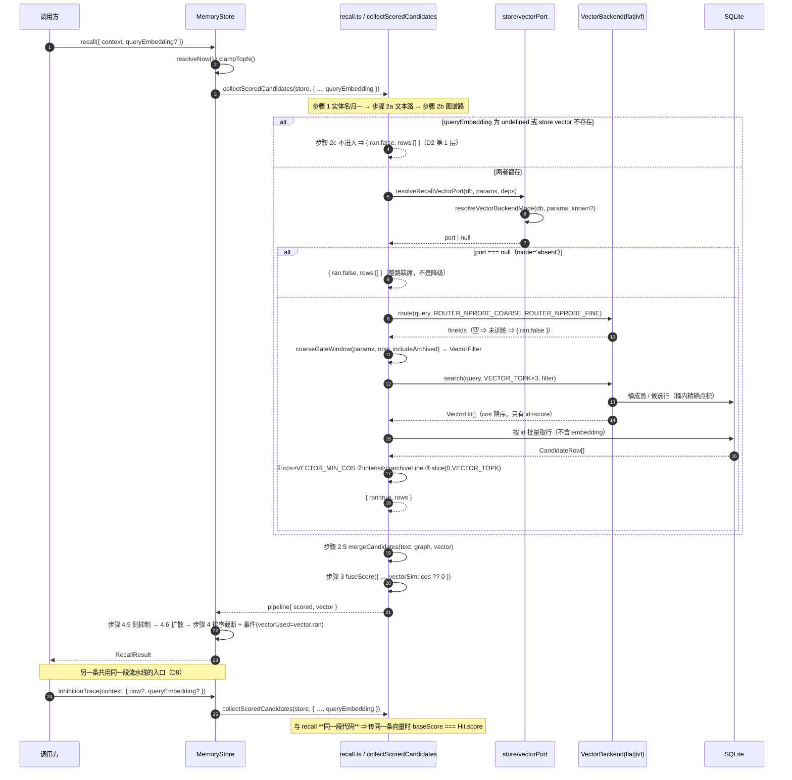
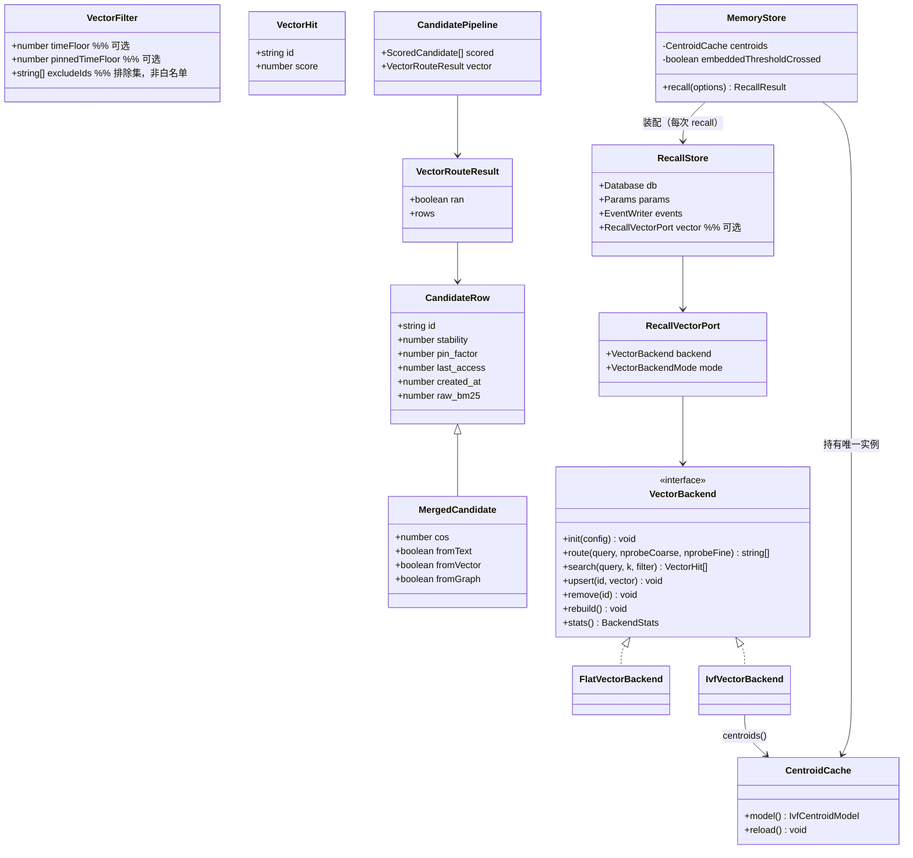
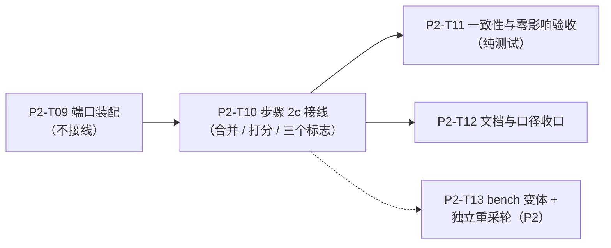

# 阶段 5 收口 · 把向量路真正接进 `recall()`（§4.6 步骤 0 / 2c / 2.5 / 3 / 4）

> **本文件是设计稿，不含实现代码。** 实现按 §7 的 T01~T04 顺序落地。
> 基线：`perf/ivf-single-pass` @ `7390b66`（`pnpm run verify` EXIT=0 · 83 文件 / 1,757 断言）。
>
> **本文件解决的一件事**：`src/store/recall.ts` 里那条「向量路整路缺席」的状态结束 ——
> `queryEmbedding` 从「装了没接线」变成真的产出候选、真的进 `0.25 × vectorSim`。
>
> **本文件不解解决的问题**（见 §10）：`MemoryConfig.embedder` 现算查询向量、
> 带向量路的 recall 性能基线（重采轮单列 T05）。
> ⚠️ **`inhibitionTrace` 已经不在「不做」里**：它改为**做**（D8），因为它与 `recall` 共用同一条流水线。
>
> ⚠️ ★ **口径更新（2026-11-05 · T06 · 字节口径）—— 本文件是【历史设计稿】**：
> 本文件的 **H1 / H2 按「行」口径**记录（Q8 / RK-6 / RK-10 / D3-c 等结论均按当时的行数判据推导，**正文一个字不改** —— 那是当时的事实）；
> **自 T06 起判据已改为「字节」口径**（**唯一判据 = H1′ = `bytesRead.max ≤ 6,144,000 B`**），旧行数口径**降级为并列观测**（不再判红绿，常量 `candidateReadRowsMax` / `candidateReadRowsRatioMax` 保留不删）。
> ⇒ **凡本文件出现「H1 的门槛 = 2,000 行」「H1 仍然红」等陈述，一律按「2026-11-03 行数口径下的历史读数」读**，不是现行判据。
> ⇒ **现行口径唯一权威** = `docs/design/perf-c2-t06-byte-metering.md`（字节算法 / 落盘结构 / 断言 / 判据处置）。

---

## 0. 为什么这件事现在是「欠账」而不是「新功能」

| 事实 | 出处 |
|---|---|
| 阶段 2 把向量层造完了：`FlatVectorBackend` / `IvfVectorBackend` / 训练 / 分桶 / 对账全在 | `src/vector/*`（`flat.ts:125`、`ivf.ts:557`、`centroids.ts:280`） |
| 但**召回路径从未调用过它们**：`RecallStore` 只有 `db` / `params` / `events` 三个字段 | `recall.ts:140-147` |
| 于是 `explain.routes.vector.ran` 恒 `false`、事件 `vectorUsed` 恒 `false`、`breakdown.cos` 恒 `null`、`vectorPart` 恒 `0` | `recall.ts:1205`、`1234`、`1136`、`1141` |
| `queryEmbedding?: number[]` 存在，但注释自己写着「**当前不产生任何效果**」 | `recall.ts:163-168` |
| 有一条 `TODO(P2)` 悬着：候选去重本该三路共用，向量路接上后同一 id 会被三路各捞一次 | `recall.ts:760-761` |

⇒ 后果：`vectorSim` 这一项（权重 **0.25**，五项里第二重）在**所有**真实召回里都缺项，
一条记忆的理论最高分因此只有 **0.75**（§4.6 步骤 3 明写这笔代价）；
而「语义相近」这个卖点在召回链路上**根本没有生效过**。

---

## 1. 事实基线（读代码得到的、本设计必须贴着的形状）

| # | 事实 | 位置 |
|---|---|---|
| F1 | `VectorBackend`：`init` / **`route(query, nprobeCoarse, nprobeFine)`** / **`search(query, k, filter?)`** / `upsert` / `remove` / `rebuild` / `stats` | `vector/backend.ts:55-93` |
| F2 | `route()` 与 `search()` **刻意拆成两个方法**（原话：合成一个会让调用方无法在两者之间插入处理） | `vector/backend.ts:60-70` |
| F3 | `VectorFilter` 只有三个字段：`timeFloor` / `pinnedTimeFloor` / `excludeIds`；`excludeIds` 的语义是**排除集**，注释明写「不是白名单，方向相反」 | `vector/backend.ts:42-47` |
| F4 | **IVF 的 `search()` 内部会再 `route()` 一次**，用的是**构造时**的探针数（`this.nprobeCoarse/Fine`） | `ivf.ts:652-676` |
| F5 | `routeFineBuckets()`：中心模型为空（未训练）⇒ **返回 `[]`** | `ivf.ts:347-356` |
| F6 | flat 的 `route()` 恒返回 `['__flat_all__']`（哨兵，非真实桶 id） | `flat.ts:185-189` |
| F7 | `VectorHit` **只有 `{ id, score }`** —— 没有 `stability` / `pin_factor` / `last_access` | `vector/backend.ts:50-53` |
| F8 | 两个后端的分数都是**原始余弦**，只做一次 `clampCos`（`min(1,max(0,·))`）；同分按 id 升序 | `flat.ts:243-247`、`scoring.ts:595` |
| F9 | 候选宇宙口径（`deleted = 0` 且 `embedding IS NOT NULL`）由**取行的一方**保证，后端不重算 | `flat.ts:83-101`、`ivf.ts:814-826` |
| F10 | `resolveVectorBackendMode(db, params)` 是**四态判定的唯一函数**：`flat_explicit` / `flat_auto` / `ivf` / `absent` | `store/stats.ts:29`、`92-110` |
| F11 | `MemoryStore` 已持有 `#centroids: CentroidCache`，且 `CentroidCache` **不自动失效**（重训后必须 `reload()`） | `MemoryStore.ts:237/312`、`centroids.ts:274-308` |
| F12 | `satisfies`/`exactOptionalPropertyTypes: true`、`noUncheckedIndexedAccess: true` | `tsconfig.json` |
| F13 | `recall.ts` 的源文本被静态断言**不得出现三个分桶表名** | `tests/unit/recall.test.ts:1281-1285` |
| F14 | 写入路径的向量归一化走 `normalizeNumbers(raw: number[])`（**double 域归一化后再截断成 float32**），并明写「换成 float32 口径会**逐位改变落库值**」 | `write.ts:303-314`、`dot.ts:183` |
| F15 | `inhibitionTrace(store, context, options?)` 也调 `collectScoredCandidates()`，且**没有** `queryEmbedding` 入参 | `inhibition.ts:99-118` |
| F16 | 门禁是**写死的 14 段链**，不许新增段；新检查只能写成测试文件 | `scripts/check-gate-entry.ts:59-75` —— ⚠️ ★ **已被打破（2026-11-05 · T07 阶段 3）**：★ 此前阶段 3 就把门禁从 **11 → 14 段**（★ `docs/progress/stage3-progress.md:2012`「门禁形状：11 → 14 段」⇒ ⇒ **本条早已不是现行约束**）；★ **2026-11-05 再 14 → 16 段**（★ 用户授权改 CI 行为 ⇒ 新增 `check:benchmark-numbers` + `check:mermaid-copies`）⇒ ⇒ ★ **⇒ 「不许新增段」这条约束【作废】** ⇒ ⇒ ⇒ **现行口径 = 「分母写死、同步改齐」**（★ `scripts/check-gate-entry.ts` 自己的注释就写着：「加一条门禁就必须同步改这个数组 ⇒ 这是 C31「分母写死」的必然代价，**不是本模块在阻碍变化**」）⇒ ⇒ ⇒ ★ **但「新检查优先写成测试文件」这半句仍成立**（★ 链上每加一条 ⇒ 都要同步 4 处段数声明 ⇒ ⇒ 成本不低 ⇒ ⇒ **能写成测试的就别动链**） |
| F17 | ★ **全仓库没有任何地方传 `queryEmbedding`**（`src/` 两处注释 + `tests/` 一处都没有，实测 `grep -rn queryEmbedding src/ tests/ --include=*.ts` 只有三处：`recall.ts:168` 类型声明 + `MemoryStore.ts:123/126` 注释） | 实测 |
| F18 | 等价基线**硬断言**「每条 hit 的 `fromVector === false`」与「`vectorPart === 0`」；另有 stage3 一条「`flat` ⇒ 不产出 `fromVector`，`cos` 恒 `null`」 | `tests/baseline/v1-equivalence.test.ts:1420-1428`、`v1-equivalence-stage3.test.ts:677-690` |
| F19 | ★ **bench 里有两段不同的数**：① 走 `recall()` 的循环**不传** `queryEmbedding`（`perf.ts:425/437`、`baseline-flat.ts:114/124`）且两处注释写着「因为本仓库当前的 `recall()` 尚未接线向量路」；② **另有一段直接调后端**，用**召回探针 20/50**（`perf.ts:364-365` 构造、`457-463` 调用、`471` 取 H1 判据量）⇒ **H1 的实测值出自②，不是写入路径的 8/20**（写入探针在 `dedupCandidates.ts:307-308`） | `bench/perf.ts`、`bench/baseline-flat.ts`、`src/store/dedupCandidates.ts` |
| F20 | H1 的取数装置**已存在**：库句柄上的行读计数器，分列 `memories`（判 H1）与 `vector_cell_members`（附加信息） | `bench/lib/harness.ts:792-860` |
| F21 | `bench` **在 `tsconfig.json` 的 `include` 里**（一等代码，进 `tsc --noEmit` 但不进产物） | `tsconfig.json:38-42`、`include` 列表 |
| F22 | `InhibitionTraceOptions` **是公开面**（从 `src/index.ts:248` 导出），但公开**方法**只有 `inhibitionTrace(context, options?)` 一个 | `src/index.ts:245-250`、`MemoryStore.ts:549` |

---

## 2. 九个必须裁决的点

> D1~D6 是初版就有的；**D7~D9 是主理人补三条硬事实后新增的裁决**（每条都可能推翻初版结论）：
> D7（`flat` 到底产不产出 `fromVector`）、D8（`inhibitionTrace` 的分数一致性）、D9（bench 的变体与重采轮）。

### D1 · 后端从哪来

**结论：给 `RecallStore` 加一个**可选**字段 `vector?: RecallVectorPort`，由 `MemoryStore` 在**每次 recall 时**调 `resolveRecallVectorPort(db, params, deps)` **现场装配**（O(1) 对象构造），中心模型仍由既有的 `#centroids` 缓存提供。**

三条路各自的代价：

| 方案 | 代价 |
|---|---|
| ① **加可选字段 + 每次现场装配**（选它） | 代价：每次带 `queryEmbedding` 的 recall 新建一个后端对象（纯分配，无 I/O）；`RecallStore` 与 `GraphStore` / `TouchStore` 的「结构完全相同」这条便利消失（它们原本共用一个对象）。 |
| ② `recall()` 内部按 `db + params` 现场构造**并自带中心模型加载** | **否决**：`CentroidCache` 的价值就是「30MB 中心常驻内存」，每次 recall 重读 `vector_coarse_cells` / `vector_fine_cells`（200 + 10,000 行 × 3KB ≈ 30MB）⇒ 单这一项就把 §12 的 P99 预算烧光。**且绕过了 `reload()` 这个唯一的失效点**：重训后到底用新中心还是旧中心，从此没人说得清。 |
| ③ 由 `MemoryStore` 塞进 `RecallOptions` | **否决**：`RecallOptions` 是**公开契约**（§6），塞一个内部后端进去等于公开承诺「你也能传后端」；而 `VectorBackend` 不在 `src/index.ts` 的导出面上（实测 `grep vector/ src/index.ts` 为空）⇒ 会造出一个公共入口上拿不到的类型。 |

**为什么「每次现场装配」而不是「每个实例缓存一个 port」**（这一条是本裁决的实质）：

- 探针数来自 `store.params`，而 `setParams()` 是**就地更新**同一个 params 容器的
  （`setParams.ts` 的 `applyInPlace`）。缓存一个 port 就等于缓存了构造时的探针数；
  一旦 `setParams({ ROUTER_NPROBE_FINE })` 之后**路由用新值、`search()` 内部用旧值**
  （F4：IVF 的 `search` 用 `this.nprobeFine`）⇒ 桶集分叉，**不报错，只是召回悄悄变差**。
- 每次现场装配 ⇒ 探针数与模式**必然**是本次调用读到的 params，**没有失效点可忘**。
- `overlay`（`upsert` 增量）随之丢弃 —— 这是**想要**的：召回只该看见已提交的库状态，
  不带未提交的索引侧增量。

**谁负责构造 / 谁负责 `reload()`**：`MemoryStore` 拥有 `#centroids` 与 `resolveVectorBackendPort` 的调用权；
`reload()` 仍**只**由既有的 `MemoryMaintainer.reloadCentroids` 在重训后触发（`MemoryStore.ts:347`）
⇒ **本设计不新增任何缓存，因此不新增任何失效点**。

### D2 · `queryEmbedding` 是**唯一开关** ⇒ 「缺失时零影响」是本设计的**最硬验收前提**

**★ 前提（F17）：`queryEmbedding` 现在是全死的** —— 全仓库没有任何一处传它。
⇒ 「不传 ⇒ 行为一位都不变」这一条一旦成立，本次接线对所有现有宿主就是**零影响**，
83 文件 / 1,757 断言可以**原封不动**保持绿。这是整个设计的**前置条件**，不是附带结论。

**结论：`queryEmbedding === undefined` 时，`collectVectorCandidates()` 在**第一行**返回 `{ran:false, rows:[]}`，`mergeCandidates` 收到的向量源是空数组，`scoreCandidates` 收到 `vectorSim: 0`，`vectorPart` 仍算 `0`。**

**「逻辑上不会走那条分支」不是证明。证明由三层组成**（T02 / T03 的验收项直接对应这三层）：

**第 1 层 · 结构层（代码形状）**
- 步骤 2c 的入口条件是 `queryEmbedding !== undefined && store.vector !== undefined` **同时成立**；
  两个条件都为假时**不进入**该函数（不是「进去之后返回空」）。
- 下游唯一被改动的三处都是**取值来源替换**，而不是逻辑分支：
  `cos: candidate.cos`（原来是字面量 `null`）、`vectorPart: W × (candidate.cos ?? 0)`（原来 `W × 0`）、
  `routes.vector: { ran: vector.ran, candidates: vector.rows.length }`（原来 `{false, 0}`）。
  ⇒ `cos` 为 `null` 时三式退化成原字面量，**且这一点由类型保证**（`cos: number | null`）。

**第 2 层 · 行为层（冻结期望值 + 判别力负控）**
1. 取一个**库里有向量、也有实体、也有文本可命中**的世界（即「如果向量路跑起来，结果一定会变」的世界），
   调 `recall({context, explain:true})`（**不传 `queryEmbedding`**），
   把 `hits` 的 `id` 序列、`score`、五柱、`fromText/fromVector/fromGraph`、`suppressed`、`diffused`
   **冻结成测试里的字面量期望值**（不是与另一个实现比，而是与「此刻的真实输出」比）。
2. **判别力负控**：同一个世界、同一次测试里**再传一次 `queryEmbedding`**，
   断言「至少一条 hit 的 `score` 或 `id` 序列与上一步不同」。
   ⇒ 若第 1 步的期望值是空的（等价于「向量路在两种情况下都跑不动」），这条负控**必红**。
   ⇒ 没有这条负控，第 1 层与第 3 层都无法排除「接线接错了、两种情况下都没生效」这种假绿。

**第 3 层 · 整体层（等价基线本身就是证据 —— 以及**为什么**它构成证据）**

`tests/baseline/v1-equivalence*.test.ts` 这两条硬断言（F18）：
`hits.every(h => h.fromVector === false)` 与 `h.breakdown.vectorPart === 0`。

它构成「零影响」证据的**理由有三条，缺一条就不成立**：

1. **它断言的是「行为产物」，不是「代码路径」**：`fromVector` 与 `vectorPart` 是
   向量路**跑没跑**留下的痕迹（一个来源标记 + 一个加权分项）。
   ⇒ 若接线把向量路接到了缺省路径上，这两条**必然**变红（不是「可能」）。
2. **它的覆盖面足够宽**：它跑的是**完整流水线**（三路 → 合并 → 打分 → 抑制 → 扩散 → 截断），
   且 `realRecalls` 是多步、多上下文的世界（不是单点快照）。
3. **它现在**必须**绿，接线后**仍然**必须绿 —— 而它之所以仍绿，唯一的原因是
   「没有任何调用传 `queryEmbedding`」（F17）。
   ⚠️ **这正是它作为证据的充分性边界**：它证明的是「缺省路径没变」，
   **不证明**「传入路径是对的」。后者由 T11 的正控（D5 表格 D 行）负责。
   ⇒ 两条证据互补，缺一不可。

⚠️ **代价（诚实记）**：第 3 层是「既有测试**恰好**覆盖到了」，
它**不是**为本设计写的。所以 T11 仍必须补第 2 层 —— 否则一旦将来有人给基线加一个
「带 `queryEmbedding`」的场景，第 3 层就不再能证明任何东西，而**没有人会注意到**。

### D3 · 闸门插在哪：三段的确切先后

流水线顺序（**不可换**，逐条给理由）：

```
①  queryEmbedding → normalizeQueryEmbedding()           （double 域归一化，与写入路径同一入口）
②  port = resolveRecallVectorPort(db, params, deps)     （四态判定；null = 整路缺席）
③  fineIds = backend.route(query, ROUTER_NPROBE_COARSE, ROUTER_NPROBE_FINE)
        fineIds 为空 ⇒ 整路缺席（ran = false），不调 search
④  filter = coarseGateWindow(params, now, includeArchived)
        enabled ⇒ { timeFloor, pinnedTimeFloor }；否则 {}（一个键都不传）
⑤  hits = backend.search(query, VECTOR_TOPK × VECTOR_OVERFETCH_FACTOR, filter)
        后端在此**应用**时间窗（两档），**不**做强度精筛、**不**做 cos 阈值
⑥  应用层三道过滤，顺序写死：
        ① cos ≥ VECTOR_MIN_COS          （低于它**不进候选**，不是得 0 分）
        ② intensity(row) > archiveLine  （archiveLine === null ⇒ 整段不执行）
        ③ slice(0, VECTOR_TOPK)
⑦  mergeCandidates(text, graph, vector)
```

**为什么这三段必须在这个位置**：

- **时间窗在 ④，即 `search()` 之前**：它由 `coarseGateWindow()` 独家计算（`scoring.ts:783`，
  注释自称「三路共用的唯一计算处」）⇒ 向量路的窗口与文本路 SQL 里绑的 `@coarseCutoff` /
  `@coarseCutoffPinned` **是同一对数**。若向量路另算一份、且算宽了，
  一条早已淡忘的记忆就会从向量路溜回来 —— 正是铁律①要防的「用相似度废掉遗忘曲线」，而且**不报错**。
- **强度精筛在 ⑥②，即 `search()` 之后**：`intensity` 不是存储列，`VectorFilter` 里也没有它
  （F3）；而且**必须先有 `cos` 才能排序**，强度判定与 cos 无关，但截断（⑥③）必须在两者之后。
- **顺序 ①→②→③ 不能换**（§4.6 步骤 2c 原话）：先按 cos 滤掉弱相关，再按强度滤掉归档，
  最后截断；若先按强度截断，会把 cos 更高但已归档的候选切掉，**挤掉本该保留的次优项**。
  ⇒ 这是一条**可测**的性质（T02 的验收项「顺序不可换」）。
- **为什么 `route()` 与 `search()` 拆成两步正好容纳这套**（F2 的原话正是为这件事写的）：
  `route()` 只回答「去哪找」（返回细桶 id，**不含行**），`search()` 才回答「找到谁 + 多像」。
  ⇒ 「闸门」有两种时序：一种必须在取行**之前**生效（时间窗，跟着 `filter` 进 `search`），
  一种必须在取行**之后**生效（强度精筛、cos 阈值、截断）。
  两者分开 ⇒ 各自落在它唯一能落的位置；合成一个方法就必然有一半闸门**无处安放**。

**⚠️ ⑥ 之前必须先做一次「按 id 批量取行」**（F7）：`VectorHit` 只有 `{id, score}`，
而 ⑥② 需要 `stability` / `pin_factor` / `last_access`，⑦ 的合并也需要 `created_at`。
⇒ `SELECT id, stability, pin_factor, last_access, created_at FROM memories WHERE id IN (…) AND deleted = 0`
（≤ `VECTOR_TOPK × 3 = 60` 个 id ⇒ 一次查询，参数个数远低于 SQLite 上限，无需分块）。
⚠️ **这条 SQL 不得 SELECT `embedding`**（60 × 3KB = 180KB/次的纯搬运，与 `recall.ts:461` 的既有纪律同源）。

**⚠️ 遍历顺序必须是 `hits` 的顺序，不是 SQL 返回的顺序**：`IN (…)` 的返回顺序**未定义**，
若按它遍历再 `slice(0, 20)`，截断结果会依赖 SQLite 的返回次序 ⇒ **同一查询两次结果不同**。
⇒ 把 enrich 结果装进 `Map<id, row>`，再**按 `hits`（已按 cos 降序、同分按 id 升序）的顺序**取。

#### D3-b · 闸门的落点：「SQL 里过」还是「JS 里过」—— 结论是**都不用在 enrich 上**

回表补齐的 SQL 有两条可能的口径，代价不同：

| 口径 | 读行数 | 可观测性 |
|---|---|---|
| **(i) 在 SQL 里过滤**（`WHERE last_access >= ? AND pinned… AND deleted = 0`） | 只物化「过闸之后」的行 ⇒ 偏小 | **看不见**向量路给了几条、闸门砍了几条 |
| **(ii) 全取再在 JS 里过闸** | 物化「过闸之前」的行 ⇒ 偏大 | 诚实、可分列报告 |

**裁决：两者都不选 —— 因为时间窗在步骤 ⑤ 就已经是**唯一一份**实现了。**

- `search(query, k, filter)` 的 `filter` 里已经带着 `timeFloor` / `pinnedTimeFloor`
  （由 `coarseGateWindow()` 算出，F3 + `scoring.ts:783`）⇒ 返回的 `hits` **已经是过完时间窗的**。
- ⇒ 在 enrich SQL 里**再写一次** `last_access >= ?` 就是**同一个闸门的第二份实现**
  ⇒ 两份口径一旦有一个改了而另一个没改，向量路与文本路/图谱路的窗口就会**悄悄不同宽**
  ⇒ 正是铁律①要防的事（而且两份都是「正确代码」，代码审查看不出来）。
- ⇒ **裁决：enrich SQL 只带 `id IN (…) AND deleted = 0`**，**不带**时间窗、**不带**强度
  （强度根本无法用 SQL 算 —— 它要对每行自己的 `stability × pin_factor` 做 `exp`）。
- ⇒ 于是 (i)/(ii) 的取舍**消失**：时间窗只有一处（`filter`），强度精筛只有一处（JS），
  enrich 只做「按 id 取行」这一件事。

**`explain.routes.vector` 要不要分列「命中数 / 过闸后保留数」：不加。**
理由（与 Q6 同一个裁决）：`RecallRouteInfo.candidates` 的既有定义是**单一权威**
（精筛 + slice 之后、去重之前）；再开一个「原始命中数」等于让同一件事有两个数，
而两个数之间的解释责任（「差的那部分是 cos 砍的还是强度砍的」）只能靠人去推。
**代价（诚实记）**：`candidates === 0` 时读的人分不出「跑到 60 条但被闸门砍光」与
「桶里本来就没东西」。**这条代价可接受**，因为「事后复盘」要问的第一个问题
（「向量路到底跑没跑」）已由 `ran` 回答，而**第二个**问题（「跑了为什么没留下」）
的正确动作是**看 `stats().vectorBackend.mode` 与 `VECTOR_MIN_COS`**，不是看一个新字段。

#### D3-c · 接线后的候选读取行数量级（H1 的真相：**取数与门槛不是同一个配置**）

单次带向量路的召回，`memories` 表被物化的候选行 ≈
**文本路 ≤100 + 图谱路 ≤100 + 向量桶内扫描 ≈4,500（实测均值）/ 12,782（实测 max）+ 回表补齐 ≤60**。

★ **那两个实测数字是怎么来的（这条以前被我写错过，此处更正）**：
`bench/perf.ts` 在 **:364-365** 构造后端时用的是
`ROUTER_NPROBE_COARSE(20)` / `ROUTER_NPROBE_FINE(50)` —— 也就是**召回的探针数**；
随后 **:457-463** 用它 `route()` + `search()`，H1 的判据量取自 **:471**
（`after.candidateRows - before.candidateRows`，计数窗口只包住 `search()`）。
⇒ **H1 的实测取数，用的就是召回探针 20/50，而不是写入路径的 8/20。**
（写入去重路径的探针在 `src/store/dedupCandidates.ts:307-308`，是另一条代码路径。）

⇒ 由此得到两条**必须同时成立**的结论，缺一条就会误导：

1. **接线不改变 H1 的读数** —— 因为 bench 的 H1 取样**直接调 `backend.search()`**，绕过 `recall()`；
2. ★ **但 H1 的读数本来就代表「接线后召回会产生的那个量」** ——
   它与召回路径**是同一个量**（同一个后端、同一对探针、同一段桶内扫描）。
   ⇒ ⚠️ **绝不能说「H1 与召回路径无关」**：那会让人以为接线不必管 H1，从而**不去处理它**
   —— 这是本设计里最危险的误导方向。

★ **错位的真正位置（本节的结论）**：H1 的**门槛值 2,000** 出自 §4.9 步骤 3a2 的
**写入路径预算**（8/20 探针，原文「候选面 ≤ 召回路径」）；而 H1 的**实测取数**用的是
**召回探针 20/50** ⇒ **门槛与取数不是同一个配置**。
**12,782 / 2,000 = 6.39 倍**这个差距，一部分来自桶倾斜，一部分就来自这个错位。
⇒ ★ **2026-11-03 归口**（原「未决项」已裁）：**H1/H2 的考核主体 = 写入去重路径**（写入探针 8/20）；
**召回路径的同名量另立 R6（`RECALL_VEC_ROWS`），本轮只观测、不设门槛、不判红绿**
⇒ 见 `DEVELOPMENT-PLAN.md` 的 P2 门槛表 + `DESIGN-v2-errata.md` **§11.8 勘误 ⑫**。

⇒ 所以：**接线不会让 H1 变绿**，它只会让 H1 的读数**第一次有明确的语义归属**
（「这是召回路径的向量扫描量」）。详见 RK-6 / RK-10 与 §10 第 2 条 ——
别让下一个人重采 26 分钟之后才发现门槛过不了。

### D4 · 三路合并的分数口径与去重

**结论：**
1. **`cos` 不取 max、不平均、不合成**。同一个 id 在向量候选集里**至多一条**
   （后端返回的 `id` 唯一）⇒ 「取 max」是个不存在的选择。三路各留各的证据：
   `rawBm25`（词法）、`cos`（语义）**并存**，合并时**只补不覆盖**。
2. **`score` 的合成只有一处**：`fuseScore({ …, vectorSim: cos ?? 0, … })`。
   缺项记 0、**不重算分母**（权重和恒为 1.0）⇒ 没有向量的候选理论最高分 0.75，这是 §4.6 明写的代价。
3. **那条 `TODO(P2)` 现在做，收敛到 `recall.ts` 内部一处，不搬进 `scoring.ts`。**

**为什么去重**要现在做**：向量路一接上，同一 id 被三路各捞一次**就是常态**
（一段讲张三的正文，既命中 FTS、又有张三实体、又与查询语义相近）。现有签名是
`mergeCandidates(textRows, graphRows)` 两参数 ⇒ 加第三路**必然**要改这个函数，
不改就得写第二个合并函数 ⇒ 两份合并逻辑（C36 明令禁止）。

**为什么收敛到 `recall.ts` 而**不是**`scoring.ts`**：
`scoring.ts` 的自述边界是「**分数公式的唯一出处**」（文件头第 1 段）——
它认识的概念只有「因子」「权重」「bm25 候选」「图谱打标」。
把「候选 id 集合合并 + 来源标记保留」搬进去，等于让它同时承担「打分」与「候选构造」两件事，
而这次的合并**一个分数都不产生**（它只保证「同一条记忆不占两个 topN 名额、
不重复喂给 `medianBm25` 样本」）。
代价（诚实记）：`recall.ts` 会再长 ~15 行；换来的是「`scoring.ts` 只管算分」这条边界不破。

**插入顺序：`text → graph → vector`**（向量路排在最后，而不是中间）：
合并用 `Map` 的首次出现顺序 ⇒ 把新来源**追加在尾部**，现有两路候选的相对次序**完全不变**
（零影响负控因此更容易写、也更容易读）。

### D5 · 三个标志的真实语义（四种处境逐格表）

**结论（一句话一条）：**
- `explain.routes.vector.ran` = **本次这一路有没有真的执行**（call 级）。
  判据写死为「有 port ∧ 有 queryEmbedding ∧ `route()` 返回非空桶集」。
  `route()` 返回空 ⇒ **整路缺席**（F5：未训练 / 空库），不是「跑了但没命中」。
- `fromVector` = **这一条**是不是从向量候选集里来的（per-hit），与 `ran` **分属两个层级**。
- 事件里的 `vectorUsed` = **`ran` 的同一个事实**，不另立判据（C36：同一件事不得有两套词）。
  ⇒ 实现上是 `vectorUsed: pipeline.vector.ran`，**不是**重新计算一遍。

| 处境 | `routes.vector.ran` | `routes.vector.candidates` | `vectorUsed` | 每条 hit 的 `fromVector` | 每条 hit 的 `breakdown.cos` |
|---|---|---|---|---|---|
| **A** 不传 `queryEmbedding`（现有全部宿主） | `false` | `0` | `false` | 全 `false` | 全 `null` |
| **B** 传了，但向量路整路缺席（`mode='absent'` / 分桶未训练 / `route()` 空） | `false` | `0` | `false` | 全 `false` | 全 `null` |
| **C** 传了、库里有向量、跑了但**一条都没进候选**（全部 `cos < VECTOR_MIN_COS` 或被强度精筛剔光） | `true` | `0` | `true` | 全 `false` | 全 `null` |
| **D** 传了、命中 N 条（N > 0） | `true` | `N` | `true` | 命中那几条 `true`，其余 `false` | 命中那几条 = `cos`，其余 `null` |

⚠️ **`candidates` 的口径沿用 `RecallRouteInfo` 的既有定义**（`recall.ts:299-304`：**精筛 + slice 之后、
去重之前**）⇒ D 行的 N 就是 `slice(0, VECTOR_TOPK)` 之后的条数，与文本路的 `rows.length` 同口径。

⚠️ **A 行是本设计的「零影响」前提，不是四种处境里的一档**（它承担 D2 的整个论证）：
`ran=false` / `candidates=0` / `vectorUsed=false` / 每条 `fromVector=false` / 每条 `cos=null`。
⇒ A 行的每条取值都必须**与接线前逐字段相同**，这是 T10/T11 的**第一组断言**，
其余三行（B/C/D）都是「传了之后才可能发生的事」，**它们无论怎么错都不该影响 A 行**。

⚠️ **`mode==='flat_explicit'` 与 `mode==='flat_auto'` 都算「能跑」，不属于 B 行**：
`flat` 是向量路的**正常实现**（§5：「低于 `ROUTER_MIN_TRAINING` ⇒ 向量路走 flat」，
原文标注「设计内行为，不是故障」）⇒ 它应当产出 `fromVector`
（裁决见 **D7**）。只有 `mode==='absent'` 与「分桶未训练（`route()` 返回空）」才是 B 行。

⚠️ **A/B/C 三行的「全 `false` / 全 `null`」不等于「向量分是 0 分」**：
A/B 是**缺项**，C 是**真的跑了、真的没有候选**。区分它们的唯一手段是
`ran`（call 级）+ `fromVector`（per-hit），**不是 `cos`** —— 因为 `cos` 只有「有值 / null」两种取值，
而「没跑」与「跑了但这条没被向量路选中」在 `cos` 上**都表现为 `null`**（`recall.ts:44-47` 的既有裁决）。

### D6 · IVF 与 flat 的对照口径（以及怎么不 flaky）

**一致到什么粒度**：比 **`search()` 的命中集合 + 每条 `cos`**（`id` 级）。
比 `score` 是冗余的（`score` 是 `cos` 的确定性函数），比 `route()` 的桶集是**错的**
（flat 只有哨兵 `'__flat_all__'`，F6 ⇒ 两边桶集永远不可比）。

**吻合率定义**：

```
agree = |ids_ivf ∩ ids_flat| / |ids_flat|      —— 两侧都先截到 min(len, VECTOR_TOPK)
门槛：agree ≥ 0.98（§12 阶段 2 的验收线）
```

**分母取 flat**（参照系）⇒ 「ivf 多给了几条」不抬高分数，「ivf 漏了几条」直接扣分 ⇒ 方向正确。

**探针边界效应在测试里怎么处理**（这是本条的关键，分两条断言）：

1. **硬断言（零 flaky，红必是实现差）**：把探针数吃到**满**
   （`nprobeCoarse = ROUTER_COARSE_CENTERS`、`nprobeFine = ROUTER_FINE_CENTERS`）
   ⇒ 全部桶都命中 ⇒ **ivf 与 flat 的向量候选集合与每条 `cos` 完全一致**（一条不漏）。
   这一条把「实现之差」与「探针之差」彻底分开：**若这条红了，问题一定在分桶，不在边界**。
2. **门限断言（≥ 0.98）**：只有在**默认探针数 + 固定的确定性语料与查询**下才断言 0.98。
   语料与查询向量由**固定种子的确定性 PRNG** 生成（不用随机、不用时间、不用 `Math.random`），
   且断言写成「**这一组数据下**吻合率 ≥ 0.98」，不写成「任意数据下 ≥ 0.98」。
   ⇒ 若将来某次数据变化让这条红了，正确动作是**换一组数据或调探针数**，而不是把门槛调低。

**另加一条「只漏不错」的硬性质**：对 `ids_ivf ∩ ids_flat` 里的每个 id，
**两边的 `cos` 值必须相等**（同一个 `dot` + 同一个 `clampCos` + 同一份 `passesTimeWindow`，F8）
⇒ ivf 的差异只可能是「少给了几条」，不可能是「给了个不一样的相似度」。

### D7 · `VECTOR_ROUTER='flat'` **且传了** `queryEmbedding` 时，flat 必须产出 `fromVector`

**这条必须现在裁决，因为它与一条既有硬断言正面相撞（F18）。**

**结论：flat 产出 `fromVector` / `cos` / `vectorPart` 三者照常生效。
stage3 那条断言的**口径**要改（**不是删断言**）：从「`flat` ⇒ 不产出」改成
「`flat` **且不传** `queryEmbedding` ⇒ 不产出」，并**新增**一条正控「`flat` **且传** ⇒ 产出」。**

**为什么是 flat 产出、而不是「flat 保持不产出」**：

1. **§4.6 步骤 0 明文说 flat 是向量路的实现**：判定顺序 ①「未命中 `ROUTER_MIN_TRAINING`
   ⇒ `'auto'` / `'flat'` ⇒ **走 flat**」；§5 对 `VECTOR_ROUTER='flat'` 的原文是
   「**强制全表精确扫描，v1.0 做法**」，对 `ROUTER_MIN_TRAINING` 的原文是
   「低于它不建分桶，**向量路走 flat**」并标注「**设计内行为，不是故障**」。
   ⇒ 若 flat 不产出，则「**1 万条以下的库永远拿不到那 0.25 权重**」，
   而「库小所以没有语义能力」这件事**在设计稿里根本不存在**（小库只是慢，不是瞎）。
2. **否则 10,000 条会变成一个语义台阶**：库长到 10,001 条时，同一个查询突然多出 0.25 的分量
   ⇒ 「同一库不同规模下打分口径不同」—— 这是比性能更坏的不一致，且**无法测**（要造两条库）。
3. **原断言的操作对象不变**：它断言的是 `realRecalls` 里每条 hit 的 `fromVector === false`；
   接线后**它仍然成立**，因为那条基线**没有传 `queryEmbedding`**（F17）。
   ⇒ 变的只是**理由**：不再是「flat 模式禁止向量路」，而是「**没人给查询向量**」。

**为什么这不算「为让测试过而改测试」**（三条判别标准，逐条对照）：

| 判别标准 | 本改动的实际情况 |
|---|---|
| 断言的操作对象（被比较的量）变了没有？ | **没变**。仍是「这些 hit 的 `fromVector` 是否全为 false」 |
| 断言的覆盖范围变小了没有？ | **没变小，反而变大**：新增一条正控（`flat` + 传 ⇒ 必须产出） |
| 改动的依据是**测试**还是**设计稿**？ | **设计稿**：§4.6 步骤 0 与 §5 明文（见上）。是**断言的口径落后于设计稿**，不是设计迁就断言 |

⚠️ **原断言的标题把两个独立变量混成了一个因果**：`flat`（用哪个后端）与
「有没有查询向量」（跑不跑）是**两件事**。接线后的正确口径是
「**`queryEmbedding` 是开关，`mode` 只决定用哪个后端**」—— 这条正是 D2 的前提，两者必须一致。

⚠️ **`tests/baseline/v1-equivalence.test.ts:1420-1428` 那两条不用改一个字**：
它跑在基线组（含 `VECTOR_ROUTER='flat'`）且**不传 `queryEmbedding`** ⇒ 接线后仍绿。
⇒ 「不改它」本身就是「缺省路径零影响」的第 3 层证据（D2）。

### D8 · `inhibitionTrace` 与 `recall` 的分数一致性：给 `options` 加可选 `queryEmbedding`

**问题（F15/F22）**：`inhibitionTrace(context, options?)` 的 `options` **只有 `now`** ⇒
它**永远拿不到查询向量** ⇒ 接线后 `recall(context,{queryEmbedding})` 的 `Hit.score`
含 `0.25 × vectorSim`，而 `baseScore` **永远不含** ⇒ §6 那条
「`baseScore` 与 `Hit.score` **逐位一致**」的承诺**在传了向量的调用下就破了**，
而且**没有任何测试会红**（现有测试都不传向量）。

**裁决：方案 (a) —— 给 `InhibitionTraceOptions` 加可选 `queryEmbedding?: number[]`，原样透传给 `collectScoredCandidates`。**

- **它不破坏公开契约**：公开面的承诺是「**23 个方法**」（§6 / `export-surface.test.ts` 断言的是**方法名集合**），
  加一个**可选**字段既不改方法名、也不改方法数；`recall` 与 `inhibitionTrace` 仍共用**同一段**打分代码。
- **它让「诊断」可以真的诊断「召回」**：调用方能拿同一条向量去问「这次为什么这么排」——
  而不是被要求「把向量去掉再问一次」（那个答案对不上任何一次真实召回）。
- **代价（诚实记）**：多一个公开可选字段，多一行文档；若调用方**忘了**传，
  症状是「trace 的分数普遍低于 recall 的分数」（差额恰好 ≤0.25），
  ⇒ 必须在 §6 的字段注释里写死这条前提（T12 的文档项）。

**不选 (b)（把「逐位一致」的适用范围缩到「两边都不传向量」）的理由**：
那等于把「诊断工具在最有用的场景下**故意**给出与生产不一致的数」写成文档条款——
而 §6 引入 `inhibitionTrace` 的**唯一理由**就是「否则『trace 看到的』和『recall 实际发生的』会漂移」。
把漂移合法化，比多一个字段贵得多。

**必须同时钉住的测试**（T11）：
① 两边都**不传** ⇒ `baseScore` 与 `Hit.score` 逐位相等（现状恒真，接线后才有意义）；
② 两边传**同一条**向量 ⇒ 仍逐位相等；
③ 只有 recall 传 ⇒ **允许不等**，且差额 ∈ `[0, 0.25]`
（这条是**负控**：它证明①②不是因为「向量路根本没生效」才相等的）。

### D9 · `bench` 的两个召回场景：加 `queryEmbedding` 变体，**另立一档**，独立一轮

**问题（F19 + D3-c 的更正）**：`bench/perf.ts` 与 `bench/baseline-flat.ts` 里
**走 `recall()` 的那条循环**不传 `queryEmbedding`，而两者的注释**都写着
「因为本仓库当前的 `recall()` 尚未接线向量路」**。

⚠️ **准确的说法（我第一版写偏了，此处更正）**：`perf.ts` **并不是「没测向量路」** ——
它在 **:453-480** 另有一段，用**召回探针（20/50）** 直接调 `backend.route()` + `backend.search()`，
H1 的 12,782 行就是从那里来的（D3-c）。
⇒ **缺的不是「向量路的数」，缺的是「接进 `recall()` 之后整条召回的数」**
（三路候选 + 时间窗/强度闸门 + 回表补齐 + 三路合并 + 融合打分 + 抑制 + 扩散）。
⇒ 接线后**这两段数会变成两个不同的量**：「向量扫描本身」（现有，不变）与
「带向量路的整条召回」（新增，必然更大）。**两个都要留。**

**裁决三条**：

1. **要加变体**（材料齐备：`bench/corpus.ts:321/335` 已有 `embedding: Float32Array`，
   `bench/embedder.ts` 有 `embedText`；H1 的取数装置也**不需要新造** —— F20 的行读计数器
   `bench/lib/harness.ts:792-860` 已经在数 `memories` 行数）。
2. **另立一档，保留 old-path 场景**（不替换）。理由有两层：
   ① `old-path`（走 `recall()` 不传向量）与 `new-path`（走 `recall()` 传向量）并列，
   才是「接线前后整条召回」的对照；
   ② **现有的「向量扫描本身」那段也必须留着** —— 它是唯一能把
   「新增的行数来自向量路还是来自别的」拆开的基准。替换掉任何一段都**永久丢失**一个对照。
3. **不进代码接线任务，单列一轮「重采轮」**（本文件 T05 / `P2-T13`）：bench 改动**不影响** `verify`
   的任何断言（bench 不被 `verify` 执行），但重采是 26 分钟 + ≥5GB 内存的长任务，**必须独立一轮**，
   且不得与接线混在同一次提交里（否则「读数变了」无法归因）。

⚠️ **`bench` 在 `tsconfig.json` 的 `include` 里（F21）** ⇒ bench 改动**会直接进 `tsc --noEmit`**
⇒ 签名（`RecallOptions` 的字段、`collectScoredCandidates` 的入参）写错**就是门禁红**。
⚠️ 这两处 bench 注释**现在是真话、接线后变成假话**（「尚未接线向量路」）⇒ **必须同批改掉**
（否则文档说谎，而说谎的注释比缺注释更坏）。

**⚠️ 顺带一个反向收益**：`bench/baseline-flat.ts` 现在自己说「『改造前』在当前代码里**不是一个可运行的模式**」
（它是**手工组装**的 flat 候选口径）。接线后 `VECTOR_ROUTER='flat'` + 传向量
⇒ **「改造前」第一次成为一个真能跑的模式** ⇒ 那个脚本可以从「手工模拟」升级成「真的跑一遍」，
可信度提升一个量级。**这是接线的一个附带好处，值得写进报告。**

---

## 3. 关键接口签名

```ts
// ─────────────────────────── src/vector/query.ts（新增）───────────────────────────
/**
 * 调用方给的 `queryEmbedding: number[]` → 后端要的、已 L2 归一化的 `Float32Array`。
 *
 * ⚠️ **必须走 `normalizeNumbers`（number[] 入口）**，与写入路径同一个入口（F14）：
 *   `normalize`（Float32Array 入口）会先把 double 截成 float32 再归一化 ⇒
 *   查询向量与库内向量**不在同一个浮点口径**上（dot.ts 实测：768 维样例里 196/768 个分量不同）。
 *   后果不是崩溃，是「cos 的最后几位与写入路径不同源」，且**没有任何东西能发现**。
 */
export function normalizeQueryEmbedding(
  raw: readonly number[],
  dimensions: number,
): Float32Array;
// 抛 INVALID_INPUT：长度 ≠ dimensions（reason='dim'）/ 含 NaN·Inf（'nan'）/ 零向量（'zero'）

// ────────────────────── src/store/vectorPort.ts（新增）──────────────────────
import type { VectorBackend } from '../vector/backend.js';
import type { VectorBackendMode } from './stats.js';

/** 召回路径拿到的向量端口：「一个后端 + 它的四态模式」（`absent` 不构造成员）。 */
export interface RecallVectorPort {
  readonly backend: VectorBackend;
  readonly mode: Exclude<VectorBackendMode, 'absent'>;
}

/** 装配端口需要的外部依赖（都由 `MemoryStore` 提供，本模块不 new 缓存）。 */
export interface VectorPortDeps {
  /** 中心模型提供者（= `() => this.#centroids.model()`）。 */
  readonly centroids: () => IvfCentroidModel;
  /** 「本实例已确认过建桶门槛」的记忆（见下方 sticky 说明）。 */
  readonly embeddedAtLeastThreshold: () => boolean;
  /** 本次判定为「已过门槛」时回报，供 `MemoryStore` 置位。 */
  readonly markEmbeddedAtLeastThreshold: () => void;
}

/**
 * 解析召回用的向量端口。**每次调用都新造一个后端对象**（无跨调用状态 ⇒ 无失效点）。
 * @returns `null` = 本次向量路整路缺席（`mode === 'absent'`）
 */
export function resolveRecallVectorPort(
  db: Database.Database,
  params: Params,
  deps: VectorPortDeps,
): RecallVectorPort | null;

/** flat 后端的候选来源（F9 的口径：`deleted = 0` 且 `embedding IS NOT NULL`，每次调用重读）。 */
export function createFlatRowSource(db: Database.Database): FlatVectorRowSource;

// ──────────────── src/store/stats.ts（修改 · 只加可选参数，行为不变）────────────────
/**
 * @param known 可选：调用方**已确认**「已删且有向量的行数 ≥ ROUTER_MIN_TRAINING」
 *              ⇒ 跳过那次 COUNT。不传 ⇒ 与现在的行为完全一致。
 *              ⚠️ 只允许「已过门槛」这一个方向的记忆：反向（记住「没过」）会让
 *                 一个长大后的库**永远**留在 flat ⇒ 每次召回全表点积 ⇒ 延迟门槛被静默击穿。
 */
export function resolveVectorBackendMode(
  db: Database.Database,
  params: Params,
  known?: { readonly embeddedAtLeastThreshold?: boolean },
): VectorBackendMode;

// ──────────────────── src/store/recall.ts（修改 · 内部接口）────────────────────
export interface RecallStore {
  db: Database.Database;
  params: Params;
  events: EventWriter;
  /**
   * 向量端口（可选）。
   * ⚠️ **不传 = 向量路整路缺席**（与现在的行为一致）⇒ 手工构造 `RecallStore` 的测试不受影响。
   * ⚠️ `exactOptionalPropertyTypes: true` ⇒ 装配时必须用条件展开，
   *    不许写 `{ vector: undefined }`（那与「没有这个属性」是两件事）。
   */
  vector?: RecallVectorPort;
}

/** 共用流水线的入参（新增一项）。 */
export interface CandidatePipelineInput {
  context: string;
  entityIds: string[] | undefined;
  entityNames: string[] | undefined;
  includeArchived: boolean;
  now: number;
  /** 查询向量原文（**未归一化**）；`undefined` ⇒ 步骤 2c 整段不执行。 */
  queryEmbedding?: number[];
}

/** 共用流水线的产物（新增一项）。 */
export interface CandidatePipeline {
  scored: ScoredCandidate[];
  contextEntityIds: string[];
  text: TextRouteResult;
  graphCount: number;
  /** 步骤 2c 的战果（`explain` 与事件的唯一判据来源）。 */
  vector: VectorRouteResult;
}

/** 步骤 2c 的产物。 */
export interface VectorRouteResult {
  /** 本次这一路**跑没跑**（D5 的判据：有 port ∧ 有 queryEmbedding ∧ `route()` 非空）。 */
  ran: boolean;
  /** 精筛 + slice 之后、**去重之前**的候选（顺序 = `search()` 的 cos 降序）。 */
  rows: Array<CandidateRow & { cos: number }>;
}

/** 步骤 2.5：三路合并（签名从两参数扩到三路，向量路排最后）。 */
function mergeCandidates(
  textRows: readonly CandidateRow[],
  graphRows: readonly CandidateRow[],
  vectorRows: readonly (CandidateRow & { cos: number })[],
): MergedCandidate[];

// ─────────────────── src/store/inhibition.ts（修改 · 公开可选字段）───────────────────
export interface InhibitionTraceOptions {
  /** 注入时钟（C37）。 */
  now?: number;
  /**
   * 查询向量（**未归一化**，与 `RecallOptions.queryEmbedding` **同一个口径**）。
   *
   * ⚠️ ★ **必须与那一次 `recall` 传同一条**，否则 §6 的
   *   「`baseScore` 与 `Hit.score` 逐位一致」**不成立**：
   *   trace 不含 `0.25 × vectorSim`，recall 含 ⇒ 差额 ∈ `[0, 0.25]`。
   *   ⇒ 忘记传的症状是「trace 的分数普遍略低于 recall」，**不报错**。
   * ⚠️ 不传 ⇒ 行为与本设计之前**完全一致**（向量路整路缺席）。
   */
  queryEmbedding?: number[];
}

// ───────────────── 回表补齐的 SQL（recall.ts 内的新常量）─────────────────
/**
 * ⚠️ **只带 `deleted = 0`，不带时间窗**（D3-b：时间窗的唯一实现是 `search()` 的 `filter`）；
 * ⚠️ **不 SELECT `embedding`**（≤60 行 × 3KB 的纯搬运，与既有纪律同源）。
 */
const VECTOR_ENRICH_SQL =
  'SELECT id, stability, pin_factor, last_access, created_at FROM memories ' +
  'WHERE id IN (…) AND deleted = 0';
```

---

## 4. 主流程（时序）



---

## 5. 数据结构（类图）



---

## 6. 文件清单

**新增（5）**

| 文件 | 职责 |
|---|---|
| `src/vector/query.ts` | `normalizeQueryEmbedding`（查询向量的唯一入口，与写入路径共用 `normalizeNumbers`） |
| `src/store/vectorPort.ts` | `RecallVectorPort` / `resolveRecallVectorPort` / `createFlatRowSource`（四态 → 后端对象的唯一装配点） |
| `tests/unit/vector-port.test.ts` | 装配与 flat 行源的口径 |
| `tests/unit/vector-query.test.ts` | 查询向量归一化口径（含与写入路径同源的字节比对） |
| `tests/integration/recall-vector-path.test.ts` | 步骤 2c 的闸门顺序 / 三路合并 / 三个标志 |

**修改（7）**

| 文件 | 改什么 |
|---|---|
| `src/store/recall.ts` | `RecallStore.vector?`、`CandidatePipelineInput.queryEmbedding?`、步骤 2c、`mergeCandidates` 三路化、`vectorSim`/`vectorPart`/`routes.vector`/`vectorUsed` 四处取值来源 |
| `src/store/MemoryStore.ts` | 构造期建端口依赖（`centroids` 闭包 + 门槛 sticky 位），`recall` 时装配并塞进上下文（条件展开）；`inhibitionTrace` 把 `queryEmbedding` 原样转交（D8） |
| **`src/store/inhibition.ts`** | `InhibitionTraceOptions` 加可选 `queryEmbedding?: number[]` 并透传给 `collectScoredCandidates`（D8） |
| `src/store/stats.ts` | `resolveVectorBackendMode` 加可选 `known` 参数（跳过 COUNT），行为不变 |
| `tests/unit/recall.test.ts` | 只改注释口径（「向量路缺席」→「不传 queryEmbedding 时缺席」）；**断言一条都不删** |
| `tests/integration/recall-vector-absent.test.ts` | 补「B 行（整路缺席）与 A 行（不传）逐字段相同」的断言；原有两条断言保留 |
| `tests/baseline/v1-equivalence-stage3.test.ts` | 按 **D7** 改**口径**不加不减断言：标题与理由从「`flat` ⇒ 不产出」改成「`flat` **且不传** ⇒ 不产出」，并**新增一条正控**「`flat` + 传 ⇒ 必须产出」 |

**另需新增的测试文件（T03，3 个）**
`tests/integration/recall-vector-flat-vs-ivf.test.ts`、
`tests/integration/recall-vector-four-states.test.ts`、
`tests/integration/recall-vector-nonregression.test.ts`

**bench（T05 独立轮，不进接线任务；⚠️ 它在 `tsconfig` 的 `include` 里 ⇒ 签名写错直接 `tsc` 红，F21）**

| 文件 | 改什么 |
|---|---|
| `bench/perf.ts` | 召回场景**另加一档**带 `queryEmbedding`（old-path 场景保留）；⚠️ 第 20-25 行那句「本仓库当前的 `recall()` 尚未接线向量路」**接线后变成假话，必须同批改掉** |
| `bench/baseline-flat.ts` | 同上；且它现在自述「『改造前』在当前代码里**不是一个可运行的模式**」（手工组装）⇒ 接线后 `VECTOR_ROUTER='flat'` + 传向量**第一次成为真能跑的模式**，可升级为真跑（附带收益，D9） |
| `docs/baseline/README.md` | 重采后更新读数；⚠️ **该文件被 `audit:tier-qualifiers` 扫** ⇒ 新数必须带**强档位词**（`冷盘档` / `热盘档` 等），且必须**并列** old-path / new-path 两栏 |

---

## 7. 任务分解（5 个 · 前 4 个自己就能过门禁；第 5 个是独立重采轮）

> **编号说明**：沿用阶段 2 的 `P2-T09…` 前缀 —— 它清偿的是**阶段 2 的 §4.6 步骤 2c 欠账**。
> 若主理人希望换前缀，只改这几行字面量，依赖与内容不变。

### T01 · P2-T09 · 向量端口的装配与查询向量入口（**不接线**） · P0

- **依赖**：无
- **文件**：`src/store/vectorPort.ts`（新）、`src/vector/query.ts`（新）、`src/store/stats.ts`、
  `tests/unit/vector-port.test.ts`（新）、`tests/unit/vector-query.test.ts`（新）
- **为什么先做它**：它是纯新增 + 一处不改行为的签名扩展 ⇒ 落地后**召回路径一个字节都没变**，
  门禁与 1,757 条断言天然全绿，可以独立验收。
- **验收项**
  - [ ] `VECTOR_ROUTER='flat'` ⇒ 返回 flat 后端且 `mode==='flat_explicit'`
  - [ ] `'auto'` + 库内 0 条向量 ⇒ 返回 flat 后端且 `mode==='flat_auto'`（**不是** `null`：小库走 flat 是设计内行为）
  - [ ] 过门槛 + `vector_fine_cells` 为空 ⇒ 返回 `null`（`mode==='absent'`）
  - [ ] 过门槛 + 细桶非空 ⇒ 返回 ivf 后端；`route()` 的细桶数 == `min(ROUTER_NPROBE_FINE, 命中的细中心数)`
  - [ ] **两次连续调用返回两个独立实例**：第一次 `upsert()` 的增量在第二次的 `search()` 里不出现
  - [ ] flat 行源：`deleted=1` 的行与 `embedding IS NULL` 的行**都不出现**
  - [ ] flat 行源是**活数据**：`touch()` 之后同一行源的 `lastAccess` 立刻变（不是快照）
  - [ ] `resolveVectorBackendMode` 带 `known:{embeddedAtLeastThreshold:true}` 与不带，在「已过门槛」的库上返回**同一个字面量**
  - [ ] `normalizeQueryEmbedding`：长度 ≠ `EMBED_DIM` / 含 NaN / 含 Inf / 零向量 ⇒ 各自抛 `INVALID_INPUT`
  - [ ] `normalizeQueryEmbedding` 的输出与写入路径 `normalizeNumbers(同一数组)` 的**每个 float32 分量相同**（字节级）

### T02 · P2-T10 · 把步骤 2c 接进共用流水线（含三路合并与三个标志） · P0

- **依赖**：T01
- **文件**：`src/store/recall.ts`、`src/store/MemoryStore.ts`、`src/store/inhibition.ts`、
  `tests/integration/recall-vector-path.test.ts`（新）、`tests/integration/recall-vector-absent.test.ts`（补断言）
- **验收项**
  - [ ] 不传 `queryEmbedding` ⇒ `ran===false` · `candidates===0` · `vectorUsed===false` ·
        每条 hit `fromVector===false` · `breakdown.cos===null` · `vectorPart===0`
  - [ ] 传了且命中 ⇒ `ran===true` · `vectorUsed===true` · 命中者 `fromVector===true` ·
        `breakdown.cos` == 该候选的余弦 · `vectorPart === SCORE_WEIGHTS.vectorSim * cos`
  - [ ] 向量路命中时，五柱之和 == `score`（误差 ≤ 1e-9）
  - [ ] 传了但一条没命中（全库 `cos < VECTOR_MIN_COS`）⇒ `ran===true` · `candidates===0` ·
        `vectorUsed===true` · 所有 hit `fromVector===false` · `cos===null`（D5 的 C 行）
  - [ ] 传了但分桶未训练 ⇒ `ran===false`；且 `hits` / `suppressed` / `diffused` 与**同一次调用不传** `queryEmbedding` 时**逐字段相同**
  - [ ] `cos < VECTOR_MIN_COS` 的候选**不出现在候选集里**（不是「得 0 分」——断言它连 `explain.routes.vector.candidates` 都不计）
  - [ ] **顺序不可换**：构造「cos 高但 `intensity ≤ ARCHIVE_LINE`」+「cos 次高且活着」两条，
        断言后者被保留、前者被剔除（若先截断再精筛，后者会被切掉 ⇒ 本条变红）
  - [ ] 同一条 id 被三路各命中一次 ⇒ 候选集里只有一条，三个 `from*` 全 `true`，`rawBm25` 与 `cos` 都在
  - [ ] `includeArchived:true` ⇒ 向量路的粗筛取消（归档记忆进得了向量候选），且强度精筛不执行
  - [ ] 静态：`recall.ts` 源文本仍**不含**三个分桶表名（`tests/unit/recall.test.ts:1281` 保持绿）
  - [ ] **D7**：`VECTOR_ROUTER='flat'` + 传 `queryEmbedding` ⇒ `ran===true` 且**产出** `fromVector`/`cos`/`vectorPart`
  - [ ] **D8**：`inhibitionTrace(context,{queryEmbedding})` 的 `baseScore` 与 `recall(context,{queryEmbedding:同一条})` 的 `Hit.score` 逐位相等
  - [ ] **D8 负控**：只有 recall 传向量时 `baseScore ≠ Hit.score`，且差额 ∈ `[0, SCORE_WEIGHTS.vectorSim]`
  - [ ] **D8 零影响**：`inhibitionTrace(context)`（**不传向量**）的 `baseScore` 与接线前逐位相等（既有口径不变）
  - [ ] enrich SQL **不含**时间窗（`last_access` 不在 `VECTOR_ENRICH_SQL` 里）且**不含** `embedding`（D3-b，静态断言）

### T03 · P2-T11 · 一致性与零影响验收（**纯测试**） · P0

- **依赖**：T02
- **文件**：`tests/integration/recall-vector-flat-vs-ivf.test.ts`（新）、
  `tests/integration/recall-vector-four-states.test.ts`（新）、
  `tests/integration/recall-vector-nonregression.test.ts`（新）
- **验收项**
  - [ ] 探针吃满（`nprobeCoarse=ROUTER_COARSE_CENTERS`、`nprobeFine=ROUTER_FINE_CENTERS`）
        ⇒ ivf 与 flat 的向量候选**集合与每条 `cos` 完全一致**（D6 第 1 条：零 flaky）
  - [ ] 默认探针数下的吻合率 `|ivf ∩ flat| / |flat| ≥ 0.98`（固定种子语料 + 固定查询，D6 第 2 条）
  - [ ] 「只漏不错」：交集内每个 id 的两侧 `cos` **相等**
  - [ ] 四种处境的标志矩阵逐格断言（D5 表格 4 行 × 5 列，一格一条；**A 行单独一组**，作为零影响的前提）
  - [ ] **零影响**：不传 `queryEmbedding` 的 `recall` 与冻结的期望值字面量
        （`id` 序列 + `score` + 五柱 + 三个 `from*`）相等
  - [ ] **判别力负控**：同一世界**带** `queryEmbedding` 时，同一批断言**必须变**（否则上一条是空洞的）
  - [ ] `pnpm run verify` 全绿（83 → 88 文件，断言数只增不减）

### T04 · P2-T12 · 文档与口径收口 · P1

- **依赖**：T02（不需要等 T03）
- **文件**：`docs/design/DECISIONS.md`（追加一条 ADR：D1~D9 的九个裁决）、
  `docs/design/p5-vector-path-design.md`（追加「实现后读数」小节：任务清单勾选状态 + 实测数字）、
  `docs/design/DESIGN-v2-errata.md`（追加三条勘误：`vectorUsed ≡ routes.vector.ran` 的等价口径；
  **`VECTOR_ROUTER='flat'` 与「跑不跑」是两个独立变量（D7）**；
  `inhibitionTrace` 必须与 recall 传同一条 `queryEmbedding`，否则 `baseScore ≠ Hit.score`（D8））
- **验收项**
  - [ ] 九个裁决在 `DECISIONS.md` 里各有一条记录，**每条都写了「不这么选的代价」**
  - [ ] 勘误三条：`vectorUsed`/`ran` 的等价关系；`flat` 与「跑不跑」解耦（D7）；`inhibitionTrace` 的前提（D8）
  - [ ] §6 的 `InhibitionTraceOptions` 字段注释写明「必须与那一次 recall 传同一条向量」
  - [ ] 本文件的「实现后读数」小节填的是**实测**（不是计划值），并注明测量命令
  - [ ] `pnpm run verify` 仍 EXIT=0（`audit:two-layer` 会扫 `docs/**/*.md`）

### T05 · P2-T13 · bench 加 `queryEmbedding` 变体 + **独立重采轮** · P2（不进接线关键路径）

- **依赖**：T02（不需要等 T03/T04）
- **为什么独立一轮**（D9）：bench 改动**不影响** `verify` 的任何断言（bench 不被 `verify` 执行），
  但重采是 **26 分钟 + ≥5GB 内存**的长任务，且**不得与接线混在同一次提交里** ——
  否则「读数为什么变了」无法归因。
- **文件**：`bench/perf.ts`、`bench/baseline-flat.ts`、`docs/baseline/README.md`
- **验收项**
  - [ ] `bench/perf.ts` 的召回场景**另加一档**传 `queryEmbedding`，**old-path 场景一行不删**（对照组必须留着）
  - [ ] 两处 bench 注释里「本仓库当前的 `recall()` 尚未接线向量路」**已改掉**（接线后它是假话）
  - [ ] `bench/baseline-flat.ts` 的「改造前」从**手工组装**升级为**真跑**（`VECTOR_ROUTER='flat'` + 传向量）
  - [ ] `pnpm run typecheck` 绿（bench 在 `tsconfig` 的 `include` 里，F21）
  - [ ] 重采后 `docs/baseline/README.md` 里 **old-path / new-path 两栏并列**，新数带**强档位词**（`audit:tier-qualifiers` 扫这个文件）
  - [ ] 重采结论如实写：**H1 仍然红，且这次是真数**（见 RK-10），不写「接线后 H1 转绿」

**依赖图**



**裁决 ↔ 任务 承接对照表**（★ 每个裁决都必须有任务承接，反之每个验收项都能指回一条裁决）

| 裁决 | 承接任务 | 承接的验收项（摘要） |
|---|---|---|
| D1 后端从哪来（每次现场装配 / 不加缓存） | T01 + T02 | T01「两次调用是独立实例」；T02「`MemoryStore` 装配 + 条件展开」 |
| D2 缺省零影响（最硬前提） | T02 + T03 | T02「不传向量 ⇒ 五个标志全为缺项值」；T03「冻结期望值 + 判别力负控 + `verify` 全绿」 |
| D3 闸门三段顺序 | T02 | T02「顺序不可换」「`cos<MIN` 不进候选」「`includeArchived` 两件事」 |
| D3-b enrich 不带时间窗 / 不带 embedding | T02 | T02「enrich SQL 静态断言（不含 `last_access`、不含 `embedding`）」 |
| D3-c / RK-10 H1 量级（不预期达标） | T05 | T05「禁止写『接线后 H1 转绿』」「重采结论如实写」 |
| D4 三路合并 + 去重收敛 | T02 | T02「同一 id 三路命中 ⇒ 只有一条、三个 `from*` 全 true」 |
| D5 三个标志 / 四种处境 | T02 + T03 | T02 四条处境断言；T03「4 行 × 5 列逐格」 |
| D6 IVF vs flat 对照 | T03 | T03「探针吃满 ⇒ 完全一致」「≥ 0.98」「只漏不错」 |
| D7 `flat` + 传向量 ⇒ 产出 | T02 + T03 | T02「`flat` + 传 ⇒ 产出」；T03 四处境矩阵里的 `flat_explicit`/`flat_auto` 两行 |
| D8 `inhibitionTrace` 加 `queryEmbedding` | T02 | T02 三条（同传 ⇒ 相等 / 只有 recall 传 ⇒ 差额 ∈ [0,0.25] / 不传 ⇒ 与现状一致） |
| D9 bench 另立一档 + 独立轮 | T05 | T05「old-path 一行不删」「两处注释已改」「`baseline-flat` 升级为真跑」 |
| Q1~Q7（默认假设） | T01~T05 | 各自沉淀在对应验收项里（如 Q1 归一化 ⇒ T01 的字节级断言） |
| **Q8（H1 门槛归属）** | **无**（明确不承接） | ⚠️ 它**故意**没有任务：本设计不拍板，留给用户裁决；T05 只负责「把真数测出来且不误读」 ⇒ ★ **2026-11-03 已裁**：**H1/H2 = 写入去重路径的硬门槛**，召回那条另立 **R6（观测值 · 本轮不设门槛）** ⇒ 见 `DESIGN-v2-errata.md` **§11.8** |

---

## 8. 风险登记

| # | 风险 | 一旦错了会**静默**发生什么 | 缓解 |
|---|---|---|---|
| **RK-1** 高 | **探针数两处不同源**（`route()` 用本次 params、`search()` 用后端构造时的值，F4） | 桶集分叉 ⇒ 召回悄悄少一批候选，**不报错**；表现为「某些查询莫名其妙召不回」且无法复现 | D1 裁决：**每次现场装配**端口，探针数只有「本次 params」一个来源；T01 验收项要求两次调用是独立实例 |
| **RK-2** 高 | **遍历顺序取自 SQL**（`IN (…)` 返回次序未定义）再 `slice(0, VECTOR_TOPK)` | 同一查询两次结果不同 ⇒ 「可复现」这条地基塌掉，而**测试通常只跑一次** | D3 的「遍历顺序必须是 hits 的顺序」；T03 的零影响断言里有 `id` 序列 |
| **RK-3** 高 | **查询向量没归一化**（宿主直接传模型原始输出）或 **用了 `normalize`(float32 入口)** | cos 整体偏小 ⇒ 全部低于 `VECTOR_MIN_COS` ⇒ **向量路恒空**，而 `ran=true`、`vectorUsed=true`、`candidates=0`（看起来「跑了但没内容」）；或 cos 与库内不同源 ⇒ 排序与写入路径不一致 | `normalizeQueryEmbedding` 是唯一入口，强制 `normalizeNumbers`（F14），T01 有字节级断言 |
| **RK-4** 中 | **`excludeIds` 方向被误用**（F3：它是排除集，不是白名单也不是「文本路已命中的黑名单」） | 若把文本路命中 id 塞进去：三路合并的前提被破坏（同一 id 永远进不了向量路）⇒ 融合打分退化成「每条只带一个证据」，**分数全部偏低且看起来都正常** | D3 的 ④ 写死：召回步骤 2c **只传 `timeFloor`/`pinnedTimeFloor`**，`excludeIds` 一个都不传（扩散路的语义留白） |
| **RK-5** 中 | **`reload()` 时机**：重训后仍用旧中心 | 路由用旧中心 ⇒ 探针命中错桶 ⇒ 召回悄悄变差（与 §4.15.5 的既有风险同型） | D1：本设计**不新增缓存** ⇒ 失效点仍是唯一的 `CentroidCache.reload()`（由 `MemoryMaintainer` 在重训后调用），不新增可忘的地方 |
| **RK-6** 中 | **H1 的「取数」与「门槛」不是同一个配置**（见 D3-c）：门槛 2,000 出自 §4.9 步骤 3a2 的**写入预算**（8/20 探针）；而 H1 的实测取数是 `ROUTER_NPROBE_COARSE(20)` / `ROUTER_NPROBE_FINE(50)` + 直接调 `backend.search()`（`bench/perf.ts:364-365/457-463/471`）。每行都带 3KB `embedding` ⇒ 均值级 ≈ 13.5MB / 次；flat 模式则是**全表**（设计内行为，仅 `N < 10,000` 时启用） | ★ **把 H1 误读成「与召回路径无关」** ⇒ 以为接线不必管它，结果真实门槛被击穿而没人处理；或反过来把它当成「接线引入的回归」去优化 | D3-c 写死两条并行结论：①接线**不改变** H1 读数（bench 绕过 `recall()`）；②**但 H1 读数就是召回路径的量**。门槛归属要不要拆是 **Q8**，本设计不拍板 |
| **RK-10** 高 | **接线后 H1 / H2 仍然过不了**（D3-c）：单次带向量路的召回候选行数 ≈ 100 + 100 + 4,500~12,782 + 60 ⇒ **远超门槛（2,000）** | 最坏的情况不是红，而是**被当成「接线引入的回归」去优化**（或者相反：拿旧口径数据宣布「H1 已达标」）⇒ 方向错了，26 分钟重采白烧。另一个更隐蔽的：以为「H1 与召回路径无关」⇒ 压根不看 | ★ **在设计阶段就把结论写死**：接线**不会**让 H1 变绿。要进 2,000 行只能动 `ROUTER_NPROBE_FINE`（唯一旋钮）或改「桶内不设 LIMIT」（§4.15.3 的设计裁决 ⇒ 要走 ADR），或者按 **Q8** 把门槛口径拆开。T05 的验收项**禁止**写「接线后 H1 转绿」 |
| **RK-11** 中 | **bench 注释变成假话**（F19）：两处写着「本仓库当前的 `recall()` 尚未接线向量路」 | 下一个人读注释后拿旧 bench 的读数当「带向量路的性能」⇒ 又一个纸面指标 | D9：bench 改动与接线**同批提交**（T05 允许晚一轮，但注释修正不能拖）；`bench` 在 `tsconfig` 的 `include` 里（F21）⇒ 签名错也会被 `tsc` 抓到 |
| **RK-7** 中 | **门禁副作用**：`docs/**/*.md` 被 `audit:two-layer` 扫；`check-gate-entry` 的 14 段链写死 | 文档里出现触发词 ⇒ 门禁红；或有人为了加一条检查去动 `verify` 链 ⇒ `check:contract-ids` 红 | 新检查**一律写成 vitest 测试文件**（F16），本文件与 T01~T04 的验收项都是在既有 `test` 段内 |
| **RK-8** 中 | **`inhibitionTrace` 与 `recall` 的分数静默分叉**（F15/F22） | `recall` 传了向量、trace 没传 ⇒ trace 的 `baseScore` 普遍低于 `Hit.score`（差额 ≤ 0.25）⇒ 「诊断工具在最有用的场景下给出与生产不一致的数」，而**没有任何测试会红**（现有测试都不传向量） | D8 裁决 (a)：给 `InhibitionTraceOptions` 加可选 `queryEmbedding`；T02 三条验收项锁住「两边同传 ⇒ 相等 / 只有 recall 传 ⇒ 差额 ∈ [0, 0.25]」 |
| **RK-9** 低 | **`exactOptionalPropertyTypes`**（F12）：装配时写 `{ vector: undefined }` | 编译期就红（不会静默），但会让人误以为是类型系统在「找麻烦」而改成 `as any` 绕过 | 设计里写死「用条件展开」（`...(port === null ? {} : { vector: port })`） |
| **RK-12** 低 | **D7 的断言口径修改被后人误读成「为让测试过而改测试」** | 下一个人看到 stage3 那条标题改了，可能「顺便」把正控也删掉 ⇒ 覆盖退回更窄的状态，而**测试仍全绿** | D7 里给了三条判断标准（操作对象未变 / 覆盖反而变大 / 依据是设计稿）；T04 的勘误把这三条写进文档 |

---

## 9. 待明确事项（**需要裁决，本设计不猜**）

| # | 事项 | 为什么必须裁决 | 本设计的**默认假设**（若无人裁决则按此实现） |
|---|---|---|---|
| Q1 | 宿主传的 `queryEmbedding` **是否要求已归一化**？ | §6 的 `RecallOptions` 字段说明没写；而 §4.15.2 的契约说「query 已 L2 归一化 —— 由调用方归一化，后端不代劳」⇒ 两句一合，等于把归一化责任推给宿主，而宿主**无从知道**这件事 | **库内归一化**（`normalizeQueryEmbedding`）。理由：不这么做，一次「忘了归一化」就是**静默零召回**，且症状（`candidates=0`）与「库里没有相关内容」**无法区分** |
| Q2 | 维度不等于 `EMBED_DIM` 的 `queryEmbedding`：**抛错**还是**静默不走向量路**？ | 「不静默取舍」支持抛错；但抛错会让「换了个 embedding 模型的宿主」每次召回都失败 | **抛 `INVALID_INPUT`**。理由：维度不符意味着两侧不在同一个向量空间，算出来的 cos 是无意义的合法数字（`dot()` 的既有裁决同源） |
| Q3 | `mode === 'absent'` 时（过门槛、未训练）传了合法 `queryEmbedding`：**要不要记一条 warn 日志**？ | §4.6 步骤 0 的第三分支要求「记一条 warn（跨过建桶门槛，尚未训练）」，但那是**训练触发路径**的措辞；召回路每次记一条 warn = 写放大 | **不记**（`routes.vector.ran=false` + `stats().vectorBackend.mode==='absent'` 已足够可观测）。⚠️ 若运维要求「召回路也要留痕」，需要单独裁决日志级别与去重策略 |
| Q4 | `VECTOR_MIN_COS` 与 `ARCHIVE_LINE` 的**严格性**：`cos ≥ MIN`（§5 写「低于此余弦的条目不进候选」）与 `intensity > ARCHIVE_LINE`（严格大于）不一致 | 一个是 `≥`、一个是 `>`；边界上行为不同，而两个参数都可调 | 按各自原文实现：`cos ≥ VECTOR_MIN_COS`（含等于）、`intensity > archiveLine`（不含等于） |
| Q5 | 三路合并的**插入顺序**（text→graph→vector）是否被任何断言依赖？ | 它只影响 `Map` 首次出现顺序，理论上不可观测；但若某条既有断言隐式依赖了顺序，追加第三路会红 | 追加在**尾部**（保持现有两路次序不变）；若 T02 发现既有断言依赖了它 ⇒ 停下来报告，**不自行改断言** |
| Q6 | 是否要在 `explain.routes.vector` 上再暴露 `mode` / 命中桶数？ | 会增加公共契约字段（`RecallExplain` 是公开导出面） | **不加**。四态已由 `stats().vectorBackend.mode` 独家提供（C36），加第二份就是两份词；D3-b 已把「原始命中数」的代价写清 |
| Q7 | §5 的 `ROUTER_MIN_TRAINING` 是库规模门槛，而向量路本身 **flat 就能跑** ⇒ 10,000 条会不会变成「语义能力突然出现」的台阶？ | 台阶在语义上不可接受，但它由**参数默认值**决定（`ROUTER_MIN_TRAINING=10000`），不是接线引入的 | **按设计稿现状实现**：小库走 `flat_auto`（同样产出 `fromVector`，只是慢）⇒ **没有台阶**。若实测小库的 flat 延迟不可接受，才需要重新讨论，而那是另一次设计变更 |
| **Q8** ★ | **H1 / H2 的 2,000 门槛该不该适用于「召回探针（20/50）」下的扫描？** | 门槛 2,000 的文字出处是 §4.9 步骤 3a2（**写入**路径，8/20 探针，原文「候选面 ≤ 召回路径」）；而实测取数是 20/50 探针（`bench/perf.ts:364-365/457-463`）⇒ **门槛与取数不是同一个配置**。一个数被两个配置共用，意味着它无法判定任何一方到底达不达标 | **维持现状不动门槛**（本设计不拍板，主理人将带去问用户）：接线本轮只负责「功能接通 + 语义正确」；H1/H2 的**归口与重采留给独立的性能轮**（T05）。⚠️ 但**必须记住三个事实**：① 接线不改变 H1 读数；② H1 读数**就是**召回路径的向量扫描量；③ 6.39 倍差距里有一部分来自这个错位，**不是全部来自桶倾斜**。⇒ 候选拆法（若日后要拆）：用 `ROUTER_NPROBE_WRITE_*` 量写入、用 `ROUTER_NPROBE_*` 量召回 ⇒ **两个读数、两个门槛** |

---

## 10. 本次明确**不做**的两件事（各自理由与代价）

1. **`MemoryConfig.embedder` 现算查询向量**（§4.6 输入行提到「缺省时由 embedder 现算」）。
   - 为什么不做：它与「不传 `queryEmbedding` 时零影响」（D2，本设计最硬的一条）**直接冲突**——
     一旦门面代算，配了 embedder 的宿主会**突然**开始走向量路。而那是一次**行为变更**，
     必须与向量路接线**分开验收**（否则「零影响」这条证明会被自己破坏）。
   - 代价：宿主必须自己算向量。`MemoryStore.ts:125-126` 的既有注释已经写明这个立场（「门面不代劳」）。
   - ⚠️ **由此推出一条必须写进文档的后果**：接线后**普通宿主仍然不会走向量路**（因为它们不传向量）
     ⇒ **H1 / H2 的实测必须显式传 `queryEmbedding` 才有效**；否则重采出来的仍是「没走矢量路」的数，
     而读数看起来照样是合法数字。⇒ 这条写进 `docs/baseline/README.md` 的口径声明（T05）。
2. **带向量路的「整条召回」性能基线**（真正的集成数字，而非测量装置）。
   - 为什么不做：测量装置已存在（F20 的行读计数器），但**重采是 26 分钟 + ≥5GB 内存**的长任务，
     且必须与接线**分轮**（否则读数变化无法归因）⇒ 单列为 T05。
   - ⚠️ **措辞更正（第一版写偏了）**：不能说「perf.ts 测的仍然是无向量路的召回 ⇒ 所以要新增一项来测向量路」。
     准确说法是 —— **现有那段已经在用召回探针（20/50）测「向量扫描本身」**（`:453-480`），
     H1 的 12,782 就是从那里来的；**缺的是「接进 `recall()` 之后整条召回」这个集成后的量**
     （三路 + 闸门 + 回表 + 合并 + 打分 + 抑制 + 扩散）。⇒ 两段数**都留着**，它们是不同的量（D9）。
   - 代价：**本轮**交付的是「功能接通 + 语义正确」，**不是**「带向量路的延迟已达标」。
     ⚠️ 别把现有的 recall P99 读数当成「接线后的读数」—— 那是同一个假绿陷阱的翻版。
   - ⚠️ **并且不要预期它一定达标**：见 RK-10，且 H1 的**门槛归属本身还是未决项**（Q8）
     ⇒ ★ **2026-11-03 已裁**：H1/H2 归**写入去重路径**、召回那条归 **R6（观测值）** ⇒ 别拿 R6 的读数去判 H1（`DESIGN-v2-errata.md` §11.8）。

### 10.1 已从「不做」改成「做」的一项（裁决变更记录）

**`inhibitionTrace` 接向量**：初版设计写的是「不做，因为它没有 `queryEmbedding` 入参」。
**现改为做**（D8）—— 因为不做就等于把 §6 的「`baseScore` 与 `Hit.score` 逐位一致」
在**最有用的场景**下变成一句假话，而那条承诺正是 `inhibitionTrace` 存在的**唯一理由**。
代价是 `InhibitionTraceOptions` 多一个**可选**字段（不改方法数、不改方法名）。

---

## 11. 实现后读数（**实测**，2026-11-03）

> 本节是**交付侧**的账：设计里承诺的东西最终落在哪、被验证到什么程度。
> 全部读数来自本轮实跑，不转抄计划值。

### 11.1 落地提交

| 任务 | 提交 | 内容 |
|---|---|---|
| **T01 · P2-T09** | `77b1e2d` | `src/vector/query.ts`（`normalizeQueryEmbedding`）· `src/store/vectorPort.ts`（`resolveRecallVectorPort` / `RecallVectorPort`）· `src/store/stats.ts` 加可选 `known` |
| **T02 · P2-T10** | `96568eb` | `src/store/recall.ts` 步骤 2c + 三路合并 + 四处取值来源 · `MemoryStore.ts` 装配 · `inhibition.ts` 加可选 `queryEmbedding` |
| **T03 · P2-T11** | `399d1ee` | 五个验收测试文件（flat-vs-ivf / 四态矩阵 / 零影响回归 / **ivf 端到端**）＋ `tests/fixtures/qaVectorWorld.ts` |
| **T04 · P2-T12** | 本次提交 | `DECISIONS.md` 的 ADR-P5-VEC · `DESIGN-v2-errata.md` §11（六条勘误）· 本文件本节 |
| **T05 · P2-T13** | — | ⬜ **未做**（bench 变体 + 独立重采轮） |

### 11.2 门禁与规模

| 项 | 读数 |
|---|---|
| `pnpm run verify` | **EXIT=0** · **90 文件 / 1,832 断言** |
| 相对基线（83 / 1,757） | **+7 文件 / +75 断言**，零删除、零放宽 |
| `pnpm run build` | 待最终确认（`tsup` entry 仍只 `src/index.ts`） |
| 两条文档审计 | 真缺 0 |

### 11.3 关键实测数字

| 项 | 实测 |
|---|---|
| **零影响的成本维度** | 不传 `queryEmbedding`：**3 条 SQL，`embedding IS NOT NULL` 的全表 COUNT 0 次**；传了：6 条，COUNT 1 次（原文 `SELECT count(*) AS n FROM memories WHERE deleted = 0 AND embedding IS NOT NULL`） |
| **ivf 端到端**（门面级，40 条带向量记忆） | `mode==='ivf'` · `coarseCells=20` · `fineCells=26` · `members=40` · `ran=true` · `candidates=20` · 每条 `fromVector=true` · `cos` 与自算点积逐位一致 · `vectorPart === 0.25 × cos` |
| **`reload()` 失效可观测** | 库外重训且不 `reload()` ⇒ 同一查询 `cos=0.8740`（不是最像那条）；新实例（缓存为空）⇒ `cos=0.8821`（正是最像那条）⇒ **静默变差被观测到，不是报错** |
| **ivf ≡ flat（探针吃满）** | id 序列、每条 `cos`、`score` **逐位相同**；反向对照：探 1/1 时两者**必须不同**（证明前一条不是「ivf 压根没分桶」） |
| **吻合率 vs 探针** | 一次实测（3,200 条簇状语料 · 16 簇×200 · 粗 16/细 64 · 6 条查询，每档 120 点）：满探针 16/64 = 120/120；2/8 = 120/120；2/4 = **0.958**；1/2 = 0.725 |
| **时间窗可观测性** | 只有「>60 条窗内但已归档的旧记忆 + 1 条窗外的新记忆」这个形状能把它与强度精筛分开：正确实现 `candidates=1`，绕过时间窗则 `candidates=0` |

⚠️ **两条必须这么读**（细节见 `DESIGN-v2-errata.md` §11.4 / §11.5）：
- 「吻合率 ≥ 0.98」是**数据 + 探针配置**的特定值；能当实现性质断言的是**探针吃满 ⇒ 必须 1.0**。
- **时间窗与 `ARCHIVE_LINE` 在当前默认参数下是同一个边界**（窗口宽 = `MAX_STABILITY × ln(1/ARCHIVE_LINE)`）⇒ 它单独**不可观测**，是个索引友好的预筛而非独立语义闸门。

### 11.4 与设计的偏差（三条，全部已在 errata 或注释里留痕）

1. **端口只在传了 `queryEmbedding` 时才装配**（D1 的字面是「每次 recall 时」）。理由：无条件装配会给每个既有宿主每次召回加一次全表 COUNT，直接违反 D2 的**成本**维度。已由 COUNT 计数断言钉住，并记为 `DECISIONS.md` 的 **D1-a**。
2. **`VECTOR_ENRICH_SQL` 的「不含 `last_access`」按「WHERE 段不含时间窗判定」实现**：`SELECT` 列表必须有 `last_access`（强度精筛要用），字面理解做不到。
3. **`src/vector/flat.ts` 的 `assertBackendConfig` 硬比 `DEFAULT_PARAMS.EMBED_DIM`**（而非 `params.EMBED_DIM`）⇒ 覆盖 `EMBED_DIM` 的宿主传向量会**响亮抛错**。既有问题，未修，已登记 errata §11.6。

### 11.5 本轮**明确没做**的

- **T05**：`bench/perf.ts` / `bench/baseline-flat.ts` 的 `queryEmbedding` 变体、以及**百万级重采**（26 分钟 + ≥5GB 内存）。⇒ **H1 / H2 的读数本轮未重采**，且按 RK-10 的结论：**接线不会让它转绿**。
- `MemoryConfig.embedder` 现算查询向量（§10 第 1 条）。
- `stats()` / `flags` 两套 mode 词的收敛（errata §11.6(a)）。
