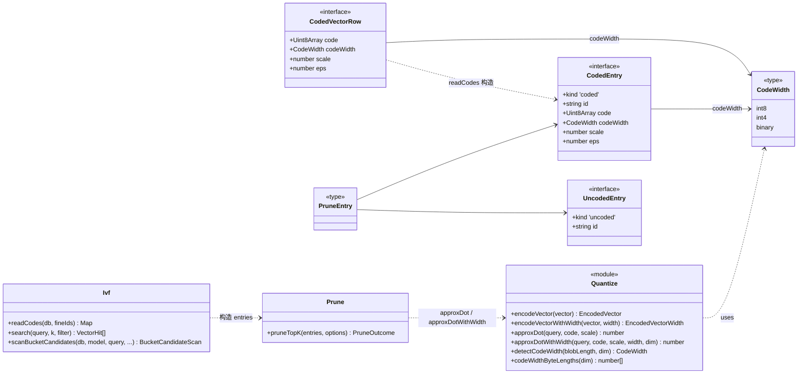
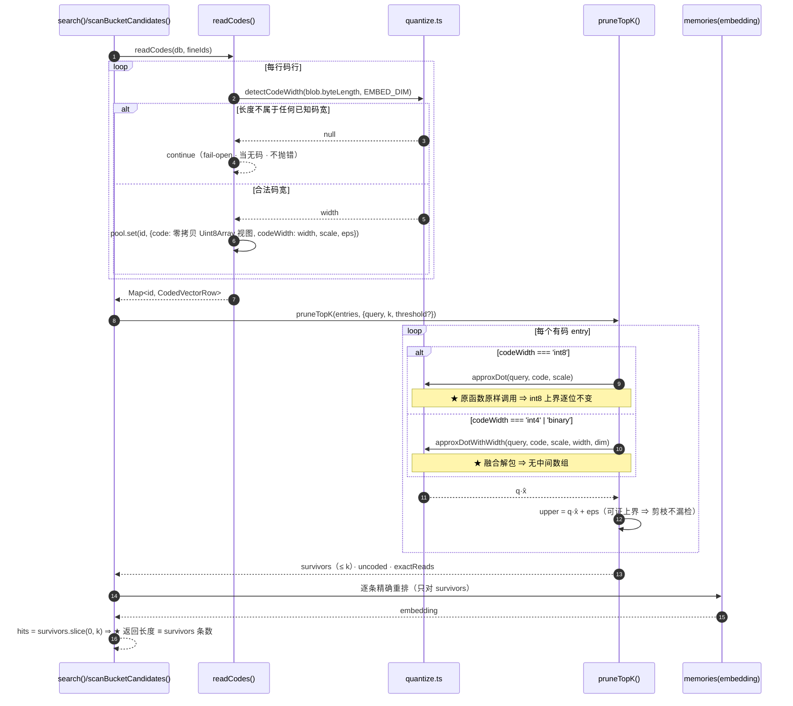
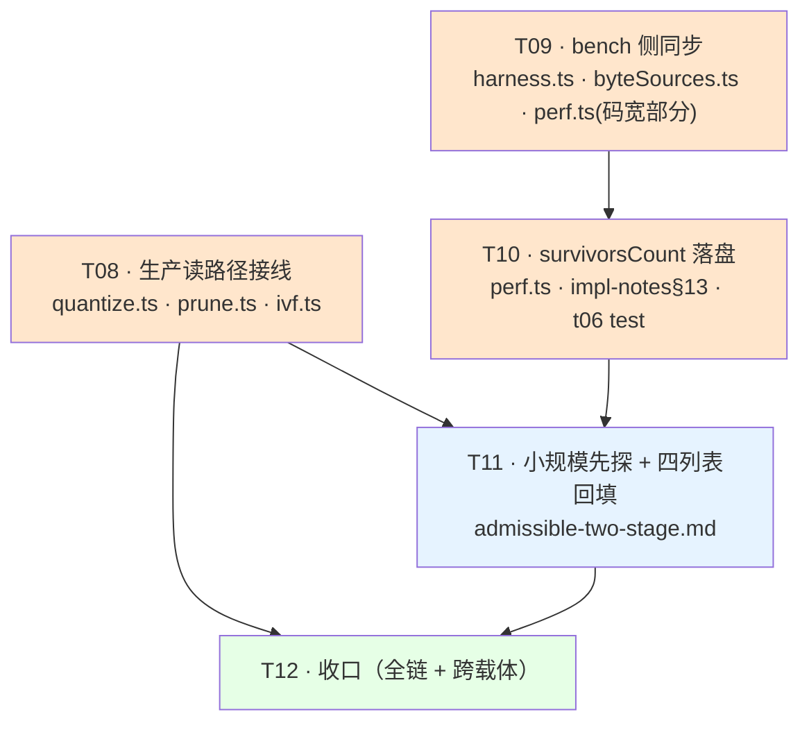

# C′ 档增量设计 · 候选码宽（int4）读路径接线 + bench 侧同步 + 读路径 survivors 落盘字段

> ★ **本文是施工依据**（不是状态登记处）。
> ⇒ 出关条件项的达标状态**只**登记在 `docs/design/perf-c2-admissible-two-stage.md` 的 **§7 出关条件状态表 + 对应 R 行**（唯一权威出处）。
> ⇒ 本文的「待明确事项」若最终有人拍板，落点也在那里，**不在本文**。
>
> ★ **本文档的每个数字都标了「实测来源」** ⇒ 未标来源的**结论**一律是「推导」⇒ 推导要标推导。

---

## §0 一句话结论（先看这里）

**本批要做三件事，缺一不可；其中「bench 侧同步」的真身与任务书给的说法不同（见 §1.2 的事实订正）。**

| # | 事 | 落在哪 | 一句话 |
|---|---|---|---|
| ① | **读路径接线**：让 `readCodes()` 按 BLOB 长度**自识别码宽**，让 `prune.ts` 按码宽算上界 | `src/vector/{ivf,prune}.ts` | ★ **int8 走原路逐位不变**（机器断言背书）· int4/二值走新分支 |
| ② | **bench 侧同步**：让 bench 能**对 int4 库采集**并如实计量 | `bench/{perf.ts,lib/*}.ts` | ★ **不是「bench 自己编码」**（事实订正）⇒ 是「bench 必须能认 int4 的码 + 落盘码宽标签」 |
| ③ | **读路径 survivors 落盘字段** | `bench/perf.ts` + `docs/design/perf-c2-t06-byte-metering-impl-notes.md` §13 | 字段名 `survivorsCount` · 类型 `CountSummary` · 两路都填 · **k 口径写进 `note`** |

★ **本批不改 `params`（恒 60 项）· 不改门禁链（恒 18 段）· 不改 `src/store/**` · 不改生产写路径。**

---

## §1 事实核对（先核实，再下结论）

> ★ **本节是本文档的地基** ⇒ 后面每个决策都引用这里的编号。
> ★ 凡与任务书描述不一致的地方，**以本节实测为准**（并在下文显式标注「★ 订正」）。

### 1.1 已核实为真（照任务书）

| # | 事实 | 核实方式 |
|---|---|---|
| F1 | `src/vector/quantize.ts` 的候选码宽能力**只增不改**（既有 6 个导出逐字未动） | 读文件 + `git show 860e9ec` 对照 |
| F2 | `approxDotWithWidth` 的 int8 分支与既有 `approxDot` **逐位相同** | ★ **实测 2000 组随机向量 + 穷举 256 个字节值 ⇒ 0 处不一致**（`Object.is` 判据）；`upperBound` 同样 0/2000 |
| F3 | `encodeVectorWithWidth(v,'int8')` 与 `encodeVector(v)` 的**字节 / scale / eps 逐位相同** | 实测 500 组 ⇒ 0 处不一致（既有 `tests/unit/quantize.test.ts:241` 已在断言） |
| F4 | 二值档 ε 的 min = 1.277795 > 1 ⇒ 剪枝率恒 100% ⇒ **不必接线** | 既有实测（`docs/design/perf-c2-admissible-two-stage.md` R3 行） |
| F5 | int4 的 ε = int8 的 ≈ 18.1 倍（p50 比值 18.14×） | 既有实测 + 理论互证（127÷7） |
| F6 | `params` 恒 60 项 · `EMBED_DIM` 是**只读参数**（`src/core/params.ts:92`） | 读文件 |
| F7 | `src/vector/prune.ts` 是纯函数库（只 import `../core/errors.js` / `./backend.js` / `./flat.js` / `./quantize.js`） | 读文件 ⇒ ★ **不 import better-sqlite3、不写 SQL** ⇒ 本批改动**必须**继续保持这个性质 |
| F8 | `src/store/**` 不出现 `vector_codes` 字样（契约测试守着） | `tests/contracts/table-name-boundary.test.ts` |
| F9 | `bench/perf.ts:452` 是 `VectorByteReads` 接口；`bench/perf.ts:1197` 调 `backend.search(...)` 并丢弃返回值 | 读文件 |
| F10 | `src/vector/prune.ts:466` 的 `assertCodedEntry` 断言 `entry.code.length === queryLength` | 读文件 |
| F11 | 门禁链 18 段（`scripts/check-gate-entry.ts` 的 `EXPECTED_GATE_COMMANDS`） | 读文件 |
| F12 | 生产写路径的码由 `src/vector/bucketAssign.ts:128` 的 `writeCodeRow()` 写 ⇒ **恒为 int8** | 读文件 |

### 1.2 ★ 订正 ①：bench 的两处 `encodeVector` **不是码编码器**

> ★ **任务书说**：「`bench/lib/db.ts:95` 与 `bench/lib/harness.ts:1395` **各有各的 `encodeVector`** ⇒ 换码宽时必须与生产侧**同批**改 ⇒ ⇒ 否则测的是「bench 自己编的码」、是假数。」

**核实结果：这两处编的是 `memories.embedding`（float32 BLOB），不是 `vector_codes.code`。**

```
bench/lib/harness.ts:1395   export function encodeVector(vector: Float32Array): Buffer { return vectorToBlob(vector); }
                             └─ vectorToBlob 是 src/vector/centroids.ts 的 float32 小端编码器（embedding 的存储格式）
bench/lib/db.ts:95          embedding: encodeVector(row.embedding)      ← 写的是 memories.embedding 列
```

**bench 库里的 `vector_codes` 行从哪来？** ⇒ **生产代码**：

```
bench/lib/db.ts → prepareBench() → trainBenchBuckets() → rebuildBuckets()（src/vector/rebuild.ts）
                → assignBucket()（src/vector/bucketAssign.ts:235）→ writeCodeRow()（:128）
                → encodeVector()（src/vector/quantize.ts，★ 生产 int8）+ codeToBlob()
```

★ **实测复核**（我实跑了一个 200 行的 `prepareBench` 探针）：
```
codes by blob length: [{"len":768,"n":200}]   ← 全部 int8 · 768 B
memories: {"n":200}  members: {"n":200}
```
⇒ **bench 从来没有自己的码编码器** ⇒ **「bench 编自己的码、是假数」这个担心在本仓库不成立**。

⇒ **★ 订正后的 bench 侧真身（三件事，全都不是「加一个 encodeVector」）**：

| # | bench 侧真正缺什么 | 为什么 | 落点 |
|---|---|---|---|
| **B-1** | **bench 的码行口径认不出 int4** | `bench/lib/harness.ts:1028` 的 `expectedCodeBytes` 缺省 = `DEFAULT_PARAMS.EMBED_DIM` = 768 ⇒ ★ **int4 库的 384 B 码行会被 bench 全部当成「坏码行」**（`bench/lib/byteSources.ts:341` 的 `length !== expectedCodeBytes` ⇒ `badCode`）⇒ ★ **落盘会报 `badCodeRows` 巨大 ⇒ `checkPerf` 判红**（`bench/perf.ts:2036`） | `bench/lib/harness.ts` + `bench/lib/byteSources.ts` |
| **B-2** | **bench 不知道「这轮测的是哪一档码宽」** | 四列表的每一行必须能自证是哪一档 ⇒ 落盘 JSON 里必须带**码宽标签** | `bench/perf.ts`（落盘 + `note`） |
| **B-3** | **bench 的 `expectedCodeBytes` 是「单一期望长度」** | int4 库 = 384 B ⇒ 单值判定必然误报 ⇒ 必须改成「**该维度下任一已知码宽的长度**」 | `bench/lib/harness.ts`（`expectedCodeBytes` 语义） |

⇒ ★ **因此 bench 侧【不需要 `--code-width` 参数】**：
★ **bench 只是「读一个库 + 如实计量」** ⇒ **码宽由「库里的码行长什么样」决定** ⇒ **零配置**（与 §4.1 的零配置纪律一致）。
★ **换档的操作是「离线重编码那个库」**（`pnpm codes:backfill --db=... --force --code-width=int4`）⇒ 那是**脚本侧**的事（已落地，F1）。

### 1.3 ★ 订正 ②：`approxDotWithWidth` 的 int8 分支**比 `approxDot` 慢 4.6 倍**

> ★ **这是本批最重要的性能事实**，且**未被任何既有文档记录**。

实测（5000 行 × 768 维，中位数，各 5~7 轮）：

| 实现 | 耗时 | 相对 int8 基线 |
|---|---|---|
| ★ **`approxDot`（`Int8Array`，既有生产路径）** | **4.10 ms** | **1.00×**（基线） |
| `approxDotWithWidth` int8（`Uint8Array` + **三元** `b > 127 ? b-256 : b`） | **18.99 ms** | **4.63×** ⚠️ |
| `Uint8Array` + **位运算** `(b ^ 128) - 128` | 3.95 ms | 0.96× |
| `Uint8Array` + `b - 256 * (b > 127 ? 1 : 0)` | 19.19 ms | 4.68× |

⇒ ★ **根因**：`Uint8Array` 元素读出来是 `0..255` ⇒ 需要「转有符号」这一步 ⇒ **三元表达式的分支在数据上不可预测**（符号位随机）⇒ V8 只能逐个分支 ⇒ 4.6×。
⇒ ★ **位运算版（`(b ^ 128) - 128`）是 branchless** ⇒ 与 `Int8Array` 直读**同速**。
⇒ ★ **biome 不禁位运算**（我实跑 `biome lint` 于仓库根：**通过，零告警** ⇒ 现有 `quantize.ts` 里的 `& 0xff` / `& 0x0f` / `| nibble` 就是证据）。

⇒ ★ **对本批的直接后果**（**这是设计的关键分叉点**）：

| 若这样接线 | int8 生产路径的 CPU | 判定 |
|---|---|---|
| ❌ `prune.ts` 无条件走 `approxDotWithWidth` | **4.63×**（剪枝内循环） | ★ **不可接受** ⇒ 违反「生产路径逐位不变」的**实质**（逐位不变只管「值」，但 4.6× 的 CPU 回归会让「延迟」这一列整个失真 ⇒ ⇒ 四列表的 int8 基线就不可信了） |
| ✅ **int8 走原路 `approxDot`（一字不改）· int4/二值走新分支** | **1.00×** | ★ **采纳** |

⇒ ⇒ **§2 的核心决策由此定型：不是「统一走一个新函数」，而是「按码宽分派，int8 分支逐字复用既有 `approxDot`」。**

### 1.4 ★ 订正 ③：int4 的「解包方式」也有性能分叉

实测（5000 行 × 768 维）：

| 方式 | 耗时 | 说明 |
|---|---|---|
| int4 **融合解包**（`approxDotWithWidth` 的 int4 分支：读字节 ⇒ 取 nibble ⇒ 累加） | **18.84 ms** | 一趟 |
| int4 **先解包成 `Int8Array(dim)` 再 `approxDot`** | **27.12 ms** | 两趟 + 多一次 768 B 分配 |
| int8 `approxDot`（基线） | 4.10 ms | — |

⇒ ★ **采纳「融合解包」**（`approxDotWithWidth` 的 int4 分支）⇒ **不引入中间 `Int8Array`** ⇒ 顺带满足「int4 的内存占用只有一半 ⇒ 省 IO 的收益不被解包抵消」（任务书的核心诉求）。

### 1.5 其他已核实事实

| # | 事实 | 核实方式 |
|---|---|---|
| F13 | `codeWidthFromBlobLength(blobLength, dim)` **对三个码宽返回互不相同的长度**（768 维 ⇒ 768/384/96）⇒ **自识别无歧义** | 读 `quantize.ts:522` + `tests/unit/quantize.test.ts:320` |
| F14 | `codeWidthFromBlobLength` 对**不属于任何已知码宽**的长度**抛错**（`MemoryError.invalidInput`）⇒ ★ **读路径不能直接用它**（要的是 fail-open「跳过」） | 读 `quantize.ts:528` |
| F15 | `EMBED_DIM` 是**只读参数** ⇒ 运行期恒 768 ⇒ ★ **三档长度恒定 ⇒ 自识别无歧义这个性质在运行期恒成立** | `src/core/params.ts:92` + `:161` |
| F16 | `blobToCode(blob)` 返回 `Int8Array` **视图**（零拷贝）⇒ int4 需要一个**对应的 `Uint8Array` 视图**（同样零拷贝） | 读 `quantize.ts:205` |
| F17 | `readCodes()` 现在是「码长 ≠ `EMBED_DIM` ⇒ `continue`（跳过 ⇒ 当无码 ⇒ fail-open ⇒ 精确兜底）」 | 读 `src/vector/ivf.ts:580` |
| F18 | `CodedEntry` 在 `src/vector/ivf.ts:805`（写路径）与 `:1205`（读路径）两处构造 | 读文件 |
| F19 | `bench/perf.ts:1197` 调的是 `backend.search(query.embedding, DEFAULT_PARAMS.VECTOR_TOPK)` ⇒ ★ **bench 读路径的 k = 20**；★ **生产召回的 k = 60**（`src/store/recall.ts:1000` = `VECTOR_TOPK × VECTOR_OVERFETCH_FACTOR`）⇒ ★ **两口径条数不可比** | 读文件 |
| F20 | `bench/perf.ts:1197` 的 `backend.search(...)` 返回值被丢弃 ⇒ ★ 接住即可得读路径 survivors 数（`src/vector/ivf.ts:1230` 的 `hits.slice(0, k)`，其中 `hits = [...out.survivors]`；`src/vector/prune.ts` 的 `WorstHeap` 容量 = k ⇒ ★ **`slice(0,k)` 永不截断 ⇒ 返回长度 ≡ survivors 条数**） | 读文件 + `prune.ts` 的 `WorstHeap(k)` |
| F21 | `bench/lib/harness.ts` 的 `ByteReadSnapshot.bySource` 是 `Record<string, ByteSourceSnapshot>` ⇒ ★ **写路径的 survivors 数可从 `bySource.survivorRow.rows` 的差值取** ⇒ ★ **`harness.ts` 不用改** | 读文件 |
| F22 | `docs/design/perf-c2-t06-byte-metering-impl-notes.md` §13 有**两段** `note` 的逐字副本 ⇒ 改 `bench/perf.ts` 的 `note` 必须**同批**改它 ⇒ 链上 `check:json-note` 逐字节相等 | 读 `scripts/check-json-note-fidelity.ts:104`（`EXPECTED_NOTE_BLOCKS = 2`） |
| F23 | `tests/bench/t06-byte-metering.test.ts:1388` 的落盘结构断言用的是 `expect.arrayContaining([...])` ⇒ ★ **加新字段它不会红** ⇒ 必须**主动**把新字段写进那条断言 | 读文件 |
| F24 | `src/vector/ivf.ts:1230` 的 `search()` 返回 `hits.slice(0, k)` ⇒ ★ **bench 侧能拿到的就是 `hits.length`** | 读文件 |
| F25 | `bench/lib/byteSources.ts` 的 `bytesOfRow(row, shape, expectedCodeBytes)` 用 `length !== expectedCodeBytes` 判「坏码行」 | 读文件 |
| F26 | `src/store/**` 里 `vector_codes` 字样 = 0（契约测试守着） | 读文件 |

---

## §2 实现方案（逐个核心问题的明确决策 + 理由）

### 2.1 【类型怎么改】`CodedEntry.code` 的形状

**决策：★ `code: Uint8Array`（打包后的原始字节）+ ★ `codeWidth: CodeWidth`（判别式字段）—— 不是联合类型。**

```ts
// src/vector/prune.ts（改后）
export interface CodedEntry {
  readonly kind: 'coded';
  readonly id: string;
  /** ★ 打包后的码字节（int8 = 768 B · int4 = 384 B · 二值 = 96 B）· ★ **零拷贝视图**。 */
  readonly code: Uint8Array;
  /** ★ 这一行的码宽（★ 决定怎么解包 · ★ 由 BLOB 长度自识别）。 */
  readonly codeWidth: CodeWidth;
  readonly scale: number;
  readonly eps: number;
}
```

**为什么不是 `Int8Array | Uint8Array` 联合类型**（逐条理由）：

| # | 理由 | 证据 |
|---|---|---|
| 1 | ★ **联合类型在 TS 里不可判别** | ★ 实测 `tsc --strict`：`Int8Array` **不可**赋给 `Uint8Array`（TS2322 · `Symbol.toStringTag` 不兼容），反向亦然 ⇒ ⇒ 联合类型在**每个使用点**都要 `instanceof` 判定 ⇒ ⇒ **类型系统给不了任何保证** |
| 2 | ★ **联合类型会把「分支」推到每一个消费点** | `prune.ts` 的 `approxDot` 调用、`assertCodedEntry` 的长度校验、`tests/unit/prune.test.ts` 的 12 处夹具 ⇒ ⇒ **分支散落 ⇒ 漂移风险** |
| 3 | ★ **int8 分支会因此变慢** | 若 int8 也走 `Uint8Array` 路径 ⇒ 必须过 `toSignedInt8` ⇒ ★ **4.63×**（§1.3 实测） |
| 4 | ★ **`Int8Array` 直读是 V8 的最快路径** | `approxDot` 4.10 ms vs `Uint8Array`+三元 18.99 ms（§1.3） |

**为什么 `codeWidth` 必须是「必填字段」而不是「可选 + 缺省 int8」**：
★ **可选字段 ⇒ 「忘了传」会静默走 int8 路径** ⇒ 对 int4 的码行 ⇒ **上界按 int8 口径算 ⇒ eps 被低估 ⇒ 上界不再是上界 ⇒ 静默漏检** ⇒ ⇒ **零漏检是本档的硬要求** ⇒ ⇒ **必填**。
★ **「缺省 = int8」在本设计里是错的缺省**：库里的码宽是**数据属性**（由 BLOB 长度决定），不是**调用方选择** ⇒ ⇒ **它必须由 `readCodes()` 算出来，不允许由调用方编**。

**★ 附带收益**：`code` 改成 `Uint8Array` ⇒ **int4 的内存占用真的只有一半**（384 B vs 768 B）⇒ 任务书的核心诉求达成 ⇒ ⇒ **且不需要任何「解包后再算」的中间数组**（融合解包，§1.4）。

### 2.2 【int8 逐位不变怎么被机器保证】

**决策：★ 三道机器断言（不是「注释里说它不变」）。**

> ★ **注意**：任务书假设「`approxDotWithWidth` 的 int8 分支被接进生产路径」。★ **本设计不接**（§1.3 的 4.63×）⇒ ⇒ **int8 生产路径走的是 `approxDot` 这个既有函数本身** ⇒ ⇒ **「逐位不变」不是「两个新函数逐位相同」，而是「**原函数原样调用**」** ⇒ ⇒ 这比任务书的假设**更强**。

**第 1 道 · 「原函数原样调用」是结构性的（不靠断言，靠代码形状）**：

```ts
// src/vector/prune.ts（改后）· 剪枝内循环
const upper =
  entry.codeWidth === 'int8'
    ? approxDot(query, entry.code, entry.scale) + entry.eps      // ★ 既有函数 · 一字未改
    : approxDotWithWidth(query, entry.code, entry.scale, entry.codeWidth, query.length) + entry.eps;
```

★ **int8 分支里 `approxDot` 的三个实参（`query` / `entry.code` / `entry.scale`）与改前逐字相同** ⇒ ⇒ **「int8 的上界值」不可能变**（同一个函数 + 同一批字节 + 同一个 scale + 同一个求和顺序）⇒ ⇒ **零漏检的代数前提在 int8 上是恒等式**。

**第 2 道 · 字节层断言（新增测试，防「有人把 int8 也改成打包路径」）**：

★ **加在 `tests/unit/quantize.test.ts`**（既有文件已有「候选码宽」describe 块，`:230`）：

```ts
it('★ int8 的上界与既有 `approxDot` **逐位相同**（★ 2000 组随机向量 + 穷举 256 个字节值）', () => {
  // ① 随机向量：同一批字节 ⇒ 两种算法 ⇒ `Object.is` 逐位相等
  for (const base of bases) {                       // 既有夹具：200 个单位向量
    const legacy = encodeVector(base);              // Int8Array
    const fresh = encodeVectorWithWidth(base, 'int8');  // Uint8Array（同一批字节）
    const bytes = new Uint8Array(fresh.code.buffer, fresh.code.byteOffset, fresh.code.byteLength);
    expect(approxDotWithWidth(query, bytes, fresh.scale, 'int8', DIM))
      .toBe(approxDot(query, legacy.code, legacy.scale));   // ★ `toBe` = Object.is = 逐位
  }
  // ② ★ **穷举 256 个字节值**（★ 覆盖「有符号转换」的每一个分支 ⇒ 抓「三元/位运算写错」）
  for (let byte = 0; byte < 256; byte += 1) {
    const bytes = new Uint8Array(DIM).fill(byte);
    const signed = new Int8Array(DIM).fill(byte);
    expect(approxDotWithWidth(query, bytes, 0.5, 'int8', DIM))
      .toBe(approxDot(query, signed, 0.5));
  }
});
```

★ **判据用 `toBe`（= `Object.is`）而不是 `toBeCloseTo`** ⇒ **逐位**（`toBeCloseTo` 会放过 1 ulp 的漂移 ⇒ ⇒ **那正是「静默漏检」的入口**）。
★ **穷举 256 个字节值是必需的**（我实测过：只跑随机向量时三元与位运算两种实现都能过；但穷举才能抓住「某一类字节值上错位」的 bug）。

**第 3 道 · 「生产路径真的走原路」的断言（防止有人后来把 int8 也改走新分支）**：

★ **加在 `tests/unit/prune.test.ts`**（既有文件 · `pruneTopK` 的单测）：

```ts
it('★ int8 的 `CodedEntry` 走的是 `approxDot` 原路 ⇒ 上界与「手算参照」逐位相同', () => {
  // ★ 造一条 int8 码的 entry ⇒ 手工按 `approxDot` 的公式算上界 ⇒ 与 pruneTopK 的结果逐位比
  // ★ 判据：`pruneTopK` 的早停决策（`exactReads` + survivors 的 id 序）逐位相同
});
```

★ **理由**：第 2 道只证明「两个函数逐位相同」⇒ ★ **若有人把 int8 也切到 `approxDotWithWidth`，第 2 道仍绿**（两个函数确实相同）⇒ ⇒ **必须有一道「生产走的是哪条路」的断言** ⇒ ★ **它的判据是「早停决策逐位相同」**（`exactReads` + `survivors` 的 id 序列）—— ★ **这是最灵的判据**：★ **只要上界的值变了哪怕 1 ulp，早停的「剩余上界 < 第 K 名」比较就可能翻转 ⇒ `exactReads` 或 survivors 顺序变 ⇒ 红**。

**第 4 道（可选但推荐）· 端到端的「int8 库行为逐位不变」**：
★ **`tests/unit/ivf.test.ts` 的 A1/A2/A7/A8 已经是这个**（既有 4 条 · §5.1 的「逐位相同」定义）⇒ ⇒ **接线后这 4 条必须**原样绿 ⇒ ★ **它们本身就是第 4 道断言**（无需新增）。

### 2.3 【坏码行的 fail-open 语义不能破】

**决策：★ 「坏码行」的判据从「码长 ≠ `EMBED_DIM`」改成「**码长不属于该维度下任何已知码宽**」⇒ ★ 判据落在 `readCodes()` 里，`continue` 跳过 ⇒ ★ **不抛错**。**

**实现位置：`src/vector/ivf.ts` 的 `readCodes()`（现 `:562`（判定在 `:580`））**：

```ts
// ★ 判据：码长必须落在「该维度下任一已知码宽的长度」里 ⇒ 否则是坏码行 ⇒ fail-open 跳过
const width = codeWidthOf(blobLength, dimensions);   // ★ 见下面的「纯函数」小节
if (width === null) {
  continue;    // ★ 不抛错 · 一条坏码行不能让整条召回不可用
}
if (!Number.isFinite(row.scale)) continue;
if (!Number.isFinite(row.eps) || row.eps < 0) continue;
pool.set(row.id, { code: <零拷贝 Uint8Array 视图>, codeWidth: width, scale: row.scale, eps: row.eps });
```

**★ 为什么用「新增一个纯函数」而不是直接调 `codeWidthFromBlobLength`**：
★ `codeWidthFromBlobLength`（`quantize.ts:522`）对未知长度**抛 `MemoryError`**（F14）⇒ ★ **读路径不能抛** ⇒ ★ 必须有一个**不抛**的变体。
★ **而 `quantize.ts` 的既有导出是「只增不改」的承诺（F1）⇒ ⇒ 不许改它的语义** ⇒ ⇒ **新增一个导出**。

**⇒ 新增到 `src/vector/quantize.ts`（★ 只增，不改既有导出）**：

```ts
/**
 * 码宽自识别（★ **不抛错**的变体 · ★ 读路径专用）。
 * @returns 该 blob 长度对应的码宽；**不属于任何已知码宽 ⇒ `null`**（★ 调用方 fail-open 跳过）。
 */
export function detectCodeWidth(blobLength: number, dim: number): CodeWidth | null;

/**
 * 该维度下 **所有**已知码宽的码长（★ 供 bench 侧判定「坏码行」用 · ★ 零配置）。
 */
export function codeWidthByteLengths(dim: number): readonly number[];
```

★ **`detectCodeWidth` 与既有 `codeWidthFromBlobLength` 的关系**：★ **实现共用**（`detectCodeWidth` 是「不抛版」，`codeWidthFromBlobLength` 是「抛错版」）⇒ ⇒ **既有导出的行为一字不变**（F1 的承诺不破）⇒ ⇒ **两处判定逻辑只有一份**（C36）。

**★ 「坏码行」在混档库里的语义**：
★ 判据是「**这一行的 blob 长度**」⇒ ⇒ **每行独立判定** ⇒ ⇒ **混档库里 int8 行与 int4 行各自被正确识别** ⇒ ⇒ **没有任何一行会被误判成坏码行**（只要它的长度是三档之一）。

### 2.4 【混档库的性质在设计上成立吗】

**决策：★ 成立。★ 前提三条，逐条列出并给出「若前提破了会怎样」。**

| # | 前提 | 为什么成立 | 若破了会怎样 |
|---|---|---|---|
| **P1** | **运行期 `EMBED_DIM` 恒定** | `EMBED_DIM` 是**只读参数**（F6/F15）⇒ 运行期不可变 ⇒ 三档长度恒为 768/384/96 | ★ 若 `EMBED_DIM` 可变 ⇒ **同一张库里同一个 blob 长度会指向不同码宽** ⇒ ⇒ **自识别失效** ⇒ ⇒ **但这被只读参数挡住了** ⇒ ⇒ **零配置方案的根基** |
| **P2** | **三档长度互不相同** | 768 维 ⇒ 768 / 384 / 96 ⇒ 互不相同（F13）⇒ ⇒ **无歧义** | ★ 若两档长度相同 ⇒ **某些 blob 长度会被二义解释** ⇒ ⇒ **必然漏检** ⇒ ⇒ **必须在 `detectCodeWidth` 里加一条断言**：★ **三档长度必须两两不等，否则抛错**（★ 这是「零漏检」的底线检查） |
| **P3** | **每行的码行与它的 `scale`/`eps` 同宽** | ★ **由写入方保证**：`writeCodeRow()`（生产写路径）恒写 int8 三件套；`backfill-codes.ts` 的 `--code-width` 档**同一次编码同时产出 code/scale/eps** ⇒ ⇒ **三者恒同宽** | ★ 若某行的 `code` 是 int4 而 `scale`/`eps` 是 int8 的 ⇒ **上界失效** ⇒ ⇒ **静默漏检** ⇒ ⇒ **这是「库被手工改坏」的情形** ⇒ ⇒ **与 R8 同款**（已有裁决：不建触发器，靠 `codes:backfill --force` 自愈）⇒ ⇒ **本批不新增防护，但要在 `note` 里写明** |

★ **P3 是本设计里最需要写清楚的一条**（★ 因为它是「上界成立」的前提，而不是「类型对不对」的问题）。

**★ 混档库怎么产生？**（回答「为什么设计上要支持它」）：
★ **不是假想** —— 任务书自己说了「离线重编码可能只改了一部分」⇒ ⇒ **混档是现实** ⇒ ⇒ **读路径必须能分辨** ⇒ ⇒ **本设计正是按「每行独立自识别」做的** ⇒ ⇒ **一个整库 int4 库与一个混档库，读路径的行为完全一样**（★ 每行只看自己的长度）。

### 2.5 【`prune.ts` 的硬约束】

**决策：★ 本批对 `src/vector/prune.ts` 的改动**：
★ **只 import `src/vector/quantize.ts`**（已有依赖，F7）⇒ ★ **不引入 better-sqlite3** ⇒ ★ **不写 SQL** ⇒ ★ **F7 的性质保持**。

```ts
// src/vector/prune.ts（改后）· import 段
import { type CodeWidth, approxDot, approxDotWithWidth } from './quantize.js';
```

★ **`approxDotWithWidth` 是纯函数**（无 IO、无 SQL）⇒ ⇒ **可以安全地进 `prune.ts`**。

### 2.6 【生产写路径零改动】

**决策：★ `src/vector/bucketAssign.ts` 的 `writeCodeRow()` **一个字都不改** ⇒ ★ 生产写路径**恒写 int8** ⇒ ★ 新码宽**只**经由离线 `scripts/backfill-codes.ts --code-width=int4 --force` 落库。**

⇒ ★ **因此「写路径」与「读路径」的码宽可以不同** ⇒ ★ **这正是「混档库」的现实来源** ⇒ ⇒ §2.4 的 P3 前提成立（每行自洽）⇒ ⇒ **读路径的自识别是必需的，不是可选的**。

★ **「生产写路径仍逐位不变」的机械保证**：
★ `writeCodeRow()` 的三行（`encodeVector` → `codeToBlob` → `INSERT`）**一字不改** ⇒ ⇒ **写入的 blob 字节与改前逐位相同** ⇒ ⇒ **既有 1984 个用例继续背书** ⇒ ⇒ **不需要新增「写路径逐位不变」的断言**（★ 既有 `tests/unit/bucketAssign.test.ts` + `tests/unit/ivf.test.ts` 的 A6/A8 已覆盖）。

---

## §3 数据结构与接口变更（前 → 后）

### 3.1 `src/vector/prune.ts` · `CodedEntry`

```ts
// ── 前 ──
export interface CodedEntry {
  readonly kind: 'coded';
  readonly id: string;
  readonly code: Int8Array;      // 维度个 int8
  readonly scale: number;
  readonly eps: number;
}

// ── 后 ──
export interface CodedEntry {
  readonly kind: 'coded';
  readonly id: string;
  readonly code: Uint8Array;     // ★ 打包字节（768/384/96 B）· 零拷贝视图
  readonly codeWidth: CodeWidth; // ★ 必填 · int8 | int4 | binary
  readonly scale: number;
  readonly eps: number;
}
```

### 3.2 `src/vector/ivf.ts` · `CodedVectorRow`

```ts
// ── 前 ──
export interface CodedVectorRow {
  readonly code: Int8Array;
  readonly scale: number;
  readonly eps: number;
}

// ── 后 ──
export interface CodedVectorRow {
  readonly code: Uint8Array;     // ★ 打包字节 · 零拷贝视图
  readonly codeWidth: CodeWidth; // ★ 必填
  readonly scale: number;
  readonly eps: number;
}
```

### 3.3 `src/vector/ivf.ts` · `readCodes()` 的判据

```ts
// ── 前 ──
if (row.code.byteLength !== dimensions) continue;   // 只认「1 字节/维」
pool.set(row.id, { code: blobToCode(row.code), scale: row.scale, eps: row.eps });

// ── 后 ──
const width = detectCodeWidth(row.code.byteLength, dimensions);  // ★ null = 坏码行
if (width === null) continue;                                  // ★ fail-open · 不抛错
if (!Number.isFinite(row.scale)) continue;
if (!Number.isFinite(row.eps) || row.eps < 0) continue;
pool.set(row.id, {
  code: codeBytesOf(row.code),   // ★ 零拷贝 Uint8Array 视图
  codeWidth: width,
  scale: row.scale,
  eps: row.eps,
});
```

★ **零拷贝视图的做法**：`row.code` 是 better-sqlite3 给的 `Buffer` ⇒ `new Uint8Array(row.code.buffer, row.code.byteOffset, row.code.byteLength)` ⇒ ★ **不复制**（★ 与既有 `blobToCode()` 同样的手法，F16）⇒ ⇒ **零额外内存**。
★ ★ **⚠️ 但注意**：`Buffer` 的 `byteOffset` **不一定为 0** ⇒ ★ **必须用 `byteOffset + byteLength` 三元组** ⇒ ⇒ **不许写 `new Uint8Array(row.code)`**（那会按「元素值」转换 ⇒ ★ 是 `codeToBlob` 注释里警告过的那个坑）。

### 3.4 `src/vector/ivf.ts` · 两处 `CodedEntry` 构造

```ts
// ── 前（:805 写路径 / :1205 读路径，两处同形）──
entries.push({ kind: 'coded', id, code: coded.code, scale: coded.scale, eps: coded.eps });

// ── 后 ──
entries.push({
  kind: 'coded',
  id,
  code: coded.code,           // ★ Uint8Array
  codeWidth: coded.codeWidth, // ★ 新增
  scale: coded.scale,
  eps: coded.eps,
});
```

### 3.5 `src/vector/prune.ts` · `assertCodedEntry` 的长度校验

```ts
// ── 前 ──
if (entry.code.length !== queryLength) { throw ... '码的长度必须与查询向量一致' ... }

// ── 后 ──
if (entry.code.length !== codeWidthByteLengths(queryLength)[widthIndexOf(entry.codeWidth)]) { ... }
```

★ **★ 关键设计点（任务书明确问的）**：「按码宽反推维度后，如何保证 int8 仍是 `code.length === dim`」？

**答：★ 用「长度表」而不是「反推维度」⇒ ⇒ int8 的那一条**恒等于** `code.length === dim`。**

理由：★ 三档的码长是 **dim 的固定比例**（8/4/1 bit 每维 ⇒ 长度 = dim / dim/2 / dim/8）⇒ ⇒ **「该码宽下的期望长度」就是一张 3 项的表** ⇒ ⇒ **int8 那一项 = `dim`** ⇒ ⇒ **int8 的校验与改前逐字相同** ⇒ ⇒ **不需要任何「特判」** ⇒ ⇒ **不会漂**。

★ **实现建议**：在 `quantize.ts` 导出
```ts
export function codeWidthByteLengths(dim: number): readonly number[];  // ★ [dim, dim/2, dim/8]（按 CODE_WIDTHS 序）
```
⇒ ★ **`prune.ts` 与 `bench/lib/harness.ts` 共用同一张表** ⇒ ⇒ **「库侧判坏码行」与「bench 侧判坏码行」是同一份口径**（★ C36：同一件事不得有两套实现）。

★ **`assertCodedEntry` 的错误信息也要跟着改**：★ 从「码的长度必须与查询向量一致」改成含码宽的措辞（★ 因为同一个 `code.length` 在不同码宽下含义不同 ⇒ ★ 错误信息必须能区分 ⇒ ⇒ **否则排障时会看到「长度 384 ≠ 768」这种看不懂的报错**）。

### 3.6 `bench/perf.ts` · `VectorByteReads`

```ts
// ── 前 ──
export interface VectorByteReads {
  readonly memoryRowsRead: CountSummary;
  readonly codeRowsRead: CountSummary;
  readonly bytesRead: CountSummary;
  readonly candidateUniverse: CountSummary;
  readonly breakdown: VectorByteReadsBreakdown;
  readonly note: string;
}

// ── 后 ──
export interface VectorByteReads {
  readonly memoryRowsRead: CountSummary;
  readonly codeRowsRead: CountSummary;
  readonly bytesRead: CountSummary;
  readonly candidateUniverse: CountSummary;
  // ★★★ 新增：survivors 条数的分布（★ 出关条件④ 的口径缺口 · ★ 写读两路都填）
  readonly survivorsCount: CountSummary;
  readonly breakdown: VectorByteReadsBreakdown;
  readonly note: string;
}
```

★ **`survivorsCount` 为什么放在 `VectorByteReads` 而不是 `breakdown`**：
★ 任务书说「加在 `VectorByteReads` ⇒ 写读两路共用该结构 ⇒ 两路都填」⇒ ★ **顶层字段**（不是 breakdown 的一项）⇒ ★ **理由**：`breakdown` 的 13 项是**「字节来源分解」**（代码行数/字节数/剪枝率…）⇒ ⇒ `survivorsCount` 是**「条数」**不是「字节来源」⇒ ⇒ **语义上属于顶层读数**（与 `candidateUniverse` 同级）⇒ ⇒ **且 `breakdown` 的 13 项断言（F23）就不用动** ⇒ ⇒ **改动面最小**。

★ **为什么两路都能填、且 `harness.ts` 不用改**（F21）：
★ **写路径**：`bySource.survivorRow.rows` 的**差值**（★ `survivorRow` 是「整行 survivors 读」的来源名 ⇒ 写路径 Q4 读的正是 survivors ⇒ 差值 = 本样本的 survivors 条数）。
★ **读路径**：★ `bySource.survivorRow` 在读路径**恒为 0**（读路径不发 Q4/Q5，F21 + `docs/design/perf-c2-admissible-two-stage.md` R7 行）⇒ ⇒ **读路径的 survivors 数要从 `backend.search()` 的返回值拿**（F20/F24）⇒ ⇒ **接住 `bench/perf.ts:1197` 的返回值即可**（★ 任务书已指明）。
★ ⇒ **两路来源不同，但都落进同一个 `CountSummary`** ⇒ ⇒ **`buildVectorByteReads()` 只需要多收一个「逐样本 survivors 数」数组**。

★ **逐样本怎么带进来**：
★ `VectorByteSample`（`bench/perf.ts:320`）要加一个 `readonly survivorsCount: number` ⇒ ⇒ `buildByteSample()` 加一个参数 ⇒ ⇒ **写路径**传 `bySource.survivorRow.rows` 的差值，**读路径**传 `search()` 返回的长度。

### 3.7 `bench/perf.ts` · 落盘的码宽标签

**决策：★ 落盘 JSON 加一个顶层字段 `codeWidth`（本轮采集所测的库里的码宽）★ + ★ `note` 里写明 k 口径。**

```ts
// 落盘 JSON 顶层（writeJsonFile 的入参）
{
  // ★★★ 新增
  codeWidth: 'int8' | 'int4' | 'binary',
  ...
}
```

★ **怎么知道这轮测的是哪一档**（★ 不许让跑的人「记得」）：
★ **从库里读**（★ 只读一次，在计时窗口之外）⇒ ★ `SELECT length(code) AS len, count(*) FROM vector_codes GROUP BY len` ⇒ ⇒ **三档长度互不相同 ⇒ 每个长度唯一对应一档** ⇒ ⇒ **库里的码宽是「可自证」的** ⇒ ⇒ **不需要任何参数、不需要人声明**（★ 与 §2.1 的零配置纪律一致）。
★ **混档库怎么办** ⇒ ★ 落盘 `codeWidth` 记**主导档**（行数最多的那档）+ ★ **同时落一个 `codeWidthMixed: boolean`**（★ 混档时为 true）⇒ ⇒ **混档不会被藏起来**（★ 任务书要求的「如实」）。

### 3.8 `bench/lib/harness.ts` · `expectedCodeBytes` 的语义

**决策：★ 从「单一期望长度」改成「该维度下任一已知码宽的长度都算合法」。**

```ts
// ── 前 ──
readonly expectedCodeBytes?: number;    // 缺省 = DEFAULT_PARAMS.EMBED_DIM
const expectedCodeBytes = options.expectedCodeBytes ?? DEFAULT_PARAMS.EMBED_DIM;

// ── 后 ──
/** ★ 期望的码长集合（★ 缺省 = 该维度下【所有已知码宽】的长度 ⇒ ★ int4 库不会被误判成坏码行）。 */
readonly expectedCodeBytes?: readonly number[];
const expectedCodeBytes = options.expectedCodeBytes ?? codeWidthByteLengths(DEFAULT_PARAMS.EMBED_DIM);
```

★ **⚠️ 兼容性**：★ `expectedCodeBytes` 是 `RowReadCounterOptions` 的**可选**字段 ⇒ ★ **既有调用点（`bench/perf.ts:1039` / `:1319` / `tests/**`）都不传它** ⇒ ⇒ **零迁移面** ⇒ ⇒ **只有类型从 `number` 变成 `readonly number[]`** ⇒ ⇒ **既有传 `number` 的调用点会 typecheck 报错**（★ 迁移面见 §5）。

★ **为什么必须改**（★ 这是 B-1 的根因，★ 不改 ⇒ ★ **int4 库采集直接判红**）：
★ `bench/lib/byteSources.ts:341` 的 `length !== expectedCodeBytes` ⇒ ⇒ **int4 库的 384 B 码行全部被标成 `badCode`** ⇒ ⇒ `badCodeRows` = 码行总数 ⇒ ⇒ `bench/perf.ts:2036` 判红 ⇒ ⇒ **「int4 档采集」根本跑不出来**。

★ **顺带**：`bench/perf.ts:2038` 的错误文案「坏码行（码长 ≠ 768）」也必须改（★ 硬编码了 768 ⇒ int4 语境下是错的 ⇒ ⇒ **那是「注释不许说谎」的同类问题**）。

---

## §4 文件清单

> ★ **改动量**列：`S` ≈ ≤10 行 · `M` ≈ 10~60 行 · `L` > 60 行。

| # | 相对路径 | 改什么 | 改动量 |
|---|---|---|---|
| **F1** | `src/vector/quantize.ts` | ★ **只增 2 个导出**：`detectCodeWidth(blobLength, dim): CodeWidth \| null`（不抛版）· `codeWidthByteLengths(dim): readonly number[]`（三档长度表）。★ **既有导出全部一字不改**（F1 的承诺不破）⇒ ⇒ **★ `approxDotWithWidth` 的 int8 分支【不改】**（★ 它不进生产路径，§1.3） | **S**（~35 行，含注释） |
| **F2** | `src/vector/prune.ts` | ① `CodedEntry.code`: `Int8Array` → `Uint8Array`；② **新增必填** `codeWidth: CodeWidth`；③ `assertCodedEntry` 的长度校验 → 按码宽查表（★ int8 那条恒等于 `code.length === dim`）；④ 剪枝内循环 → **按 `codeWidth` 分派**（★ int8 走既有 `approxDot` 一字不改）；⑤ import 加 `approxDotWithWidth` / `CodeWidth` / `codeWidthByteLengths`（★ **仍不 import better-sqlite3**） | **M**（~40 行） |
| **F3** | `src/vector/ivf.ts` | ① `CodedVectorRow.code`: `Int8Array` → `Uint8Array`；② **新增必填** `codeWidth: CodeWidth`；③ `readCodes()` 的判据 → `detectCodeWidth(...) === null ⇒ continue`（★ fail-open · 不抛错）；④ 两处 `CodedEntry` 构造（`:805` / `:1205`）加 `codeWidth`；⑤ `blobToCode` → 零拷贝 `Uint8Array` 视图（★ 注意 `byteOffset`） | **M**（~30 行） |
| **F4** | `bench/lib/harness.ts` | ① `RowReadCounterOptions.expectedCodeBytes`: `number` → `readonly number[]`；② 缺省值 → `codeWidthByteLengths(DEFAULT_PARAMS.EMBED_DIM)`；③ 相应注释（★ 「768 = 768 个 int8」的说法要改成「该维度下所有已知码宽的长度」） | **S**（~15 行） |
| **F5** | `bench/lib/byteSources.ts` | `bytesOfRow()` 的坏码行判据：★ 「不在集合里」而不是「≠ 单值」；注释同步 | **S**（~10 行） |
| **F6** | `bench/perf.ts` | ① `VectorByteReads` 加 `survivorsCount: CountSummary`；② `VectorByteSample` 加 `survivorsCount: number`；③ `buildByteSample()` 加参数 + 两路分别填；④ `buildVectorByteReads()` 汇总 `survivorsCount`；⑤ **接住** `backend.search(...)` 的返回值（读路径 survivors 数）；⑥ 落盘加 `codeWidth` / `codeWidthMixed`；⑦ **★ `note` 改**（★ 加 survivorsCount 的 k 口径 + 码宽口径）；⑧ 坏码行的错误文案（「码长 ≠ 768」→ 集合口径） | **L**（~90 行，含超长 `note` 串） |
| **F7** | `docs/design/perf-c2-t06-byte-metering-impl-notes.md` | ★ **§13 的两段 `note` 逐字副本**（F22）⇒ ★ **必须与 F6 的 `note` 同批改** ⇒ ⇒ **链上 `check:json-note` 逐字节相等** | **M**（两段长字符串） |
| **F8** | `tests/unit/quantize.test.ts` | ★ 新增 §2.2 的「第 2 道」断言（2000 组随机 + 穷举 256 字节值 · `Object.is`） | **S**（~25 行） |
| **F9** | `tests/unit/prune.test.ts` | ★ 新增 §2.2 的「第 3 道」断言（int8 走原路 ⇒ 早停决策逐位相同）；★ **既有 12 处 `CodedEntry` 夹具**加 `codeWidth: 'int8'`（★ 见 §5 迁移面） | **M**（~40 行） |
| **F10** | `tests/unit/ivf.test.ts` | ★ 新增：int4 码行的读路径用例（★ 候选宇宙非空 · 结果与精确路径一致）；★ 坏码行（长度不属于任何档）⇒ fail-open（不抛错 · 该行进 survivors） | **M**（~60 行） |
| **F11** | `tests/bench/t06-byte-metering.test.ts` | ★ **落盘结构断言里主动加 `'survivorsCount'`**（F23：★ `arrayContaining` 不会自动红 ⇒ 必须主动写进去） | **S**（~3 行） |

### 4.1 ★ **不改**的文件（明确列出，避免误伤）

| 路径 | 为什么不改 |
|---|---|
| `src/vector/bucketAssign.ts` | ★ 生产写路径恒写 int8（§2.6）⇒ **一字不改** |
| `src/core/params.ts` | ★ `params` 恒 60 项（F6）⇒ ★ **码宽绝不做成运行时参数** ⇒ ⇒ **零配置方案的落点** |
| `src/store/**` | ★ F8 的契约边界 ⇒ ★ 本批不碰 |
| `scripts/backfill-codes.ts` | ★ `--code-width` **已落地**（F1）⇒ ★ 本批**不改** |
| `scripts/check-gate-entry.ts` / `README.md` / `scripts/README.md` / `ci.yml` | ★ **门禁链不变**（18 段，F11）⇒ ⇒ **无连带清单**（★ 任务书要求「若要改请列出连带清单」⇒ ★ **本批不改 ⇒ 连带清单为空**） |
| `schema/*.sql` / `src/db/schema.sql.ts` / `src/core/schema.ts` | ★ **零 schema 改动**（★ 自识别方案的核心卖点） |
| `docs/design/perf-c2-admissible-two-stage.md` | ★ **出关条件状态只在那里登记**（本文档开头）⇒ ★ 本批**不写状态** ⇒ ⇒ **★ 待实测出数后才由主理人/工程师在那里登记** |

---

## §5 迁移面清单（★ 谁会 typecheck 报错）

> ★ **判据**：`pnpm run typecheck`（★ `tsc --noEmit`）⇒ ★ **只报类型错**，不报行为错。

| # | 文件 | 会报什么错 | 怎么改 | 量 |
|---|---|---|---|---|
| **M1** | `tests/unit/prune.test.ts` | ★ **`CodedEntry` 多了必填字段 `codeWidth`** ⇒ ★ **12 处 `CodedEntry` 字面量**（`:38` `exactEntry()` · `:105` · `:119` · `:187` · `:196` · `:254` · `:263` · `:340` · `:416` · `:423` · `:448` · `:492` · `:501`）⇒ ★ **「缺少属性 `codeWidth`」** | 每处加 `codeWidth: 'int8'` | ★ **13 处** |
| **M2** | `tests/unit/prune.test.ts` | ★ **`code: Int8Array` → `Uint8Array`** ⇒ ★ 同上 13 处字面量里 `Int8Array.from([...])` ⇒ ★ **「类型 `Int8Array` 不可赋给 `Uint8Array`」（TS2322 · 实测确认）** | ★ **改成 `Uint8Array.from([...])`** ⇒ ★ ⚠️ **注意语义**：★ `Int8Array.from([0.5, 0, 0, 0])`（`:423` 的 `below` 夹具）⇒ ★ `Int8Array.from` 会 **截断** 0.5 → 0（★ 该文件 `:34` 的注释已明写这个坑）⇒ ⇒ `Uint8Array.from([0.5, ...])` **同样截断** ⇒ ⇒ **值不变** ⇒ ⇒ **但 `exactOf()` 辅助函数（`:45`）的语义会变**（见 M3） | ★ **13 处** |
| **M3** | `tests/unit/prune.test.ts` | ★ **`exactOf(entry)`（`:45`）读 `entry.code[index]`** ⇒ ★ **它算的是「精确分」参照** ⇒ ★ 若 `code` 变成 `Uint8Array` ⇒ ★ **负值会变成大正数** ⇒ ★ **参照值会错** ⇒ ★ **⚠️ 这是本批最隐蔽的一个迁移点** | ★ **改 `exactOf()`：按 `codeWidth` 决定读法** ⇒ ★ int8 用 `toSignedInt8(code[i])`（★ **`quantize.ts` 里那个私有函数不可用 ⇒ 要么在测试里本地写一个，要么用 `unpackCode(code, 'int8', dim)`**）⇒ ⇒ ★ **建议：用 `unpackCode`**（★ 它已是导出的、int8 分支正好返回 `Int8Array`）⇒ ★ ⇒ **★ 建议：`exactOf()` 改成 `unpackCode(entry.code, entry.codeWidth, entry.code.length)`**（★ int4/二值也顺带能用） | ★ **1 处**（但**必改**） |
| **M4** | `tests/unit/prune.test.ts` | ★ **`exactEntry()`（`:38`）的返回类型** | 随 M1/M2 一起改 | ★ 1 处 |
| **M5** | `tests/unit/ivf.test.ts` | ★ **`insertCode` 辅助（`:829`）写 `codeToBlob(encoded.code)`** ⇒ ★ `encoded.code` 仍是 `Int8Array`（`encodeVector` 未改）⇒ ★ **不报错** ⇒ ★ **但**：★ 若要加 int4 用例 ⇒ **需要 `codeToBlobWithWidth`**（★ 已存在，F1） | 无（int8 用例）；int4 用例需改 | ★ **0 ~ 2 处** |
| **M6** | `bench/lib/harness.ts` 的**调用方** | ★ `expectedCodeBytes` 类型 `number` → `readonly number[]` ⇒ ★ **`bench/perf.ts:1039` / `:1319` 不传该参数** ⇒ ★ **不报错** ⇒ ★ ★ **但 `tests/**` 里若有传 `expectedCodeBytes: 768` 的地方 ⇒ 报错** | ★ **实测：`grep expectedCodeBytes` 全仓只有 `harness.ts` 与 `byteSources.ts` 两处 ⇒ ⇒ `tests/**` 无调用 ⇒ ⇒ 迁移面 = 0**（★ 已核实） | ★ **0 处** |
| **M7** | `src/vector/ivf.ts` 内部 | ★ `blobToCode` 的 import 可能变成未使用 ⇒ ★ **biome 会报未用 import** | 删掉 import（★ 改成 `Uint8Array` 视图构造） | ★ 1 处 |
| **M8** | `src/vector/ivf.ts` 导出面 | ★ `CodedVectorRow` 是**导出**接口 ⇒ ★ 改形状 ⇒ ★ **外部消费方会报错** ⇒ ★ **实测：全仓只有 `ivf.ts` 内部消费**（`grep CodedVectorRow` ⇒ 只有定义 + `readCodes` 的返回类型）⇒ ⇒ **迁移面 = 0** | — | ★ **0 处** |

★ **总迁移面小结**：★ **只有 1 个文件会 typecheck 报错** —— `tests/unit/prune.test.ts`（★ **13 处字面量 + 1 处 `exactOf()`**）⇒ ⇒ **其余全部是「新增字段」而非「改类型」的零报错改动**（★ `bench/lib/harness.ts` 的 `expectedCodeBytes` 因为没有外部调用点 ⇒ 也不报错）。

★ **⚠️ 行为面（typecheck 抓不到）**：★ **M3 的 `exactOf()` 语义** —— ★ 若工程师只改了类型（M2）而没改 `exactOf()`（M3）⇒ ⇒ **typecheck 是绿的，但参照值算错** ⇒ ⇒ **部分用例会「假绿」** ⇒ ⇒ **★ 所以 M3 必须配一条专门的断言**（★ 任务列表里单列）。

---

## §6 任务列表（有序 · 含依赖 · 按实现顺序）

> ★ **任务 ID 沿用 T0x**（★ 与既有 T01~T07 同一命名空间）。
> ★ **每个任务写清「改哪个文件 / 验收判据是什么」**。
> ★ **依赖图见 §9**。

### T08 · 生产读路径接线（int8 逐位不变 · int4 可用 · fail-open 不破）

**改**：`src/vector/quantize.ts`（只增 2 导出）· `src/vector/prune.ts` · `src/vector/ivf.ts`
**依赖**：★ **无**（可与 T09 并行）
**优先级**：**P0**

**验收判据（逐条可机器核）**：

| # | 判据 | 怎么核 |
|---|---|---|
| A1 | ★ **int8 的上界逐位不变** | `tests/unit/quantize.test.ts` 新增断言：★ **2000 组随机向量 + 穷举 256 个字节值** ⇒ `approxDotWithWidth(...,'int8',...)` 与 `approxDot(...)` **逐位相等**（`Object.is`）⇒ ★ **0 处不一致** |
| A2 | ★ **int8 生产路径走原路**（不是「两个相同的新函数」） | `tests/unit/prune.test.ts` 新增断言：★ **早停决策（`exactReads` + `survivors` 的 id 序）逐位相同** ⇒ ★ **这是唯一能抓住「有人把 int8 切到新分支」的断言** |
| A3 | ★ **int8 库的端到端行为逐位不变** | ★ `tests/unit/ivf.test.ts` 的 **A1/A2/A7/A8 四条原样绿**（★ 既有 · 零改动） |
| A4 | ★ **int4 库能跑读路径**（候选宇宙非空） | `tests/unit/ivf.test.ts` 新增：★ 造 int4 码行 ⇒ ★ **`search()` 返回的 `{id, score}` 数组（含顺序）逐位相同**（★ 那是指**结果集的 id 序列与每个 score** 逐位相同；★ **`scanned`（候选宇宙大小）与 `exactReads`（进精排行数）会变** —— 剪枝路径与精确路径的 IO 行为本就不同）⇒ ★ **因为上界是「可证上界」⇒ 剪枝不改变结果集** |
| A5 | ★ **坏码行 fail-open 且不抛错** | `tests/unit/ivf.test.ts` 新增：★ 造一个长度**不属于三档**的码行（如 100 B）⇒ ★ **`readCodes()` 不抛错** · ★ **该行不进码池** ⇒ ⇒ **该行按「无码」处理 ⇒ 进 survivors（精确兜底）** ⇒ ★ **其余行不受影响** |
| A6 | ★ **三档长度必须两两不等**（零漏检的底线） | `detectCodeWidth` 内部的自检：★ 若某维度下两档长度相同 ⇒ **抛错**（★ 「静默二义」= 静默漏检） |
| A7 | ★ **`prune.ts` 仍是纯函数库** | ★ `grep -n "better-sqlite3\|SELECT\|INSERT\|UPDATE\|DELETE" src/vector/prune.ts` ⇒ ★ **零命中** |
| A8 | ★ **`src/store/**` 不出现 `vector_codes`** | ★ `grep -rn "vector_codes" src/store/` ⇒ ★ **零命中**（★ 契约测试也守着） |
| A9 | ★ **`params` 仍 60 项** | ★ `pnpm run check:params` ⇒ 绿 |
| A10 | ★ **既有 1984 个用例全绿** | ★ `pnpm run test` ⇒ 绿 |
| A11 | ★ **int4 的上界仍是可证上界**（零漏检） | ★ `tests/unit/quantize.test.ts` 已有 int4 的 10 万对零破界用例（★ `:277`）⇒ ★ **保持绿** ⇒ ★ **★ 这是「int4 不漏检」的机器背书**（★ 不许因为接线而放宽） |

★ **⚠️ 实现要点（写给工程师）**：
1. ★ **`readCodes()` 的零拷贝视图**：`new Uint8Array(row.code.buffer, row.code.byteOffset, row.code.byteLength)` ⇒ ★ **必须带 `byteOffset`**（★ `Buffer` 的 `byteOffset` 不保证为 0）⇒ ★ **不许写 `new Uint8Array(row.code)`**。
2. ★ **`prune.ts` 的分派写法**：★ **`entry.codeWidth === 'int8' ? approxDot(...) : approxDotWithWidth(...)`** ⇒ ★ **int8 分支里 `approxDot` 的实参逐字不变** ⇒ ★ **不要「统一改成 `approxDotWithWidth`」**（★ 那是 4.63× 的 CPU 回归，§1.3）。
3. ★ **`approxDotWithWidth` 需要 `dim` 参数** ⇒ ★ 传 `query.length`（★ 与 `assertCodedEntry` 的 `queryLength` 同一个来源 ⇒ ★ 免得两处不一致）。

### T09 · bench 侧同步（认 int4 的码 · 如实计量 · 落盘码宽标签）

**改**：`bench/lib/harness.ts` · `bench/lib/byteSources.ts` · `bench/perf.ts`（**只做码宽相关的那部分**；★ `survivorsCount` 在 T10）
**依赖**：★ **无**（可与 T08 并行）
**优先级**：**P0**

**验收判据**：

| # | 判据 | 怎么核 |
|---|---|---|
| B1 | ★ **int4 库不被误判成坏码行** | ★ 用 `.tmp/bench/perf-cw-int4.db`（★ **已存在 · 1,000,220 行 · 384 B · ε min 0.0807 · max 0.1269**）跑一次 bench ⇒ ★ **`badCodeRows` = 0**（★ 改前会是 1,000,220）⇒ ★ **`checkPerf` 不因坏码行判红** |
| B2 | ★ **int8 库的坏码行判定不变** | ★ 用 `.tmp/bench/perf-1000000.db` 跑 ⇒ ★ `badCodeRows` 仍为 **0**（★ 改前也是 0）⇒ ★ **int8 零行为变更** |
| B3 | ★ **落盘自带码宽标签** | ★ 落盘 JSON 的 `codeWidth` 字段 = **从库里读出的**码宽（★ int4 库 ⇒ `"int4"`）⇒ ★ **不许由参数传入**（★ 零配置） |
| B4 | ★ **混档库不被藏起来** | ★ `codeWidthMixed` 在混档库上为 `true` ⇒ ★ **主导档仍要报** |
| B5 | ★ **码宽探测在计时窗口之外** | ★ 探测 SQL **不进**任何计时窗口（★ 与既有的 `countDistinctMembers` 同一纪律：`bench/perf.ts:1215` 的注释「在计时窗口之外执行」）⇒ ★ **不影响毫秒读数** |
| B6 | ★ **bench 侧不需要新参数** | ★ `bench/perf.ts` 的 `parseArgs` **不加** `--code-width` ⇒ ★ **零配置**（§1.2） |

★ **⚠️ 实现要点**：
1. ★ **`expectedCodeBytes` 的类型变更**（`number` → `readonly number[]`）★ **实测无外部调用点** ⇒ ⇒ **零迁移面**（M6）。
2. ★ **坏码行的文案**：`bench/perf.ts:2038` 的「码长 ≠ 768」必须改成集合口径（★ 那是「注释不许说谎」的同类问题）。
3. ★ ★ **⚠️ 一个容易漏的连带**：`bench/lib/harness.ts:933` 的注释「★ **坏码行数**（码长 ≠ 768 ⇒ …）」与 `bench/perf.ts:380` 的同款注释 ⇒ ★ **也要改**（★ 「注释不许说谎」）。

### T10 · 读路径 survivors 落盘字段（`survivorsCount`）

**改**：`bench/perf.ts` · `docs/design/perf-c2-t06-byte-metering-impl-notes.md` §13 · `tests/bench/t06-byte-metering.test.ts`
**依赖**：★ **T09**（★ 同文件 ⇒ 同批改 ⇒ 避免两批都改 `bench/perf.ts` 的 `note` ⇒ 冲突）
**优先级**：**P0**

**验收判据**：

| # | 判据 | 怎么核 |
|---|---|---|
| C1 | ★ **字段名是 `survivorsCount`**（**不是** `survivorRow`） | ★ 落盘 JSON 的键 = `survivorsCount` ⇒ ★ **不与 `byteSources.ts` 的来源名 `survivorRow` 撞车** |
| C2 | ★ **类型是 `CountSummary`**（与既有读数同形） | ★ `Object.keys(summary).sort()` = `['count','max','mean','min','p50','p99']`（★ 与既有四读数同形） |
| C3 | ★ **写读两路都填** | ★ 落盘 JSON 的 `writeSegments.vectorByteReads.survivorsCount` 与 `vectorRouteByteReads.survivorsCount` **都存在且非空**（★ `count > 0`） |
| C4 | ★ **写路径的 survivors 数 = `bySource.survivorRow.rows` 的差值** | ★ 与 `prune.ts` 的 `out.survivors.length` 一致（★ 可用既有 `exactRescoreBudget` 用例交叉核） |
| C5 | ★ **读路径的 survivors 数 = `backend.search()` 的返回长度** | ★ 与 `src/vector/ivf.ts:1230` 的 `hits.slice(0,k)` 一致 ⇒ ★ **★ 必须核「`slice(0,k)` 永不截断」这个前提**（F20：`WorstHeap` 容量 = k ⇒ `survivors.length ≤ k`）⇒ ★ **⇒ 返回长度 ≡ survivors 条数** |
| C6 | ★ **★ k 口径写进 `note`** | ★ `note` 里必须出现：★ **bench 读路径 k = 20**（`VECTOR_TOPK`）· ★ **生产召回 k = 60**（`VECTOR_TOPK × VECTOR_OVERFETCH_FACTOR`）⇒ ⇒ ★ **两口径条数不可比** |
| C7 | ★ **`note` 的逐字副本同批改** | ★ `pnpm run check:json-note` ⇒ 绿（★ **链上 · 18 段之一** ⇒ ⇒ **不改副本 ⇒ 立刻红**） |
| C8 | ★ **★ 落盘结构断言主动加新字段** | ★ `tests/bench/t06-byte-metering.test.ts:1388` 的 `arrayContaining([...])` 里 **必须含 `'survivorsCount'`**（★ F23：★ **`arrayContaining` 不会因为多了一个键而红** ⇒ ⇒ **不加 ⇒ 那条断言悄悄变弱**） |
| C9 | ★ **不提前改 ⇒ 不制造无守卫的漂移** | ★ 本任务与**重新采集**同批做（★ 依据 `docs/handover/T07-ordered-backlog.md` 的「读路径 survivors 落盘字段」行的第 ③ 条：★ **改 bench 侧必须与重新采集同批** ⇒ ⇒ **落盘凭据的 `note` 才不会与源码脱钩**）⇒ ⇒ ★ **★ 本任务的收尾条件包含「跑一次采集并落盘」**（★ 小规模即可 · ★ 2000 行库 · ★ 分钟级） |

★ **⚠️ 实现要点**：
1. ★ **`buildByteSample()` 加参数** ⇒ ★ **写路径**传 `bySource.survivorRow.rows` 差值 · ★ **读路径**传 `search()` 返回长度 ⇒ ⇒ **`harness.ts` 不用改**（F21）。
2. ★ **`VectorByteSample` 加 `survivorsCount: number`** ⇒ ⇒ `buildVectorByteReads()` 汇总成 `CountSummary` ⇒ ⇒ **两路共用同一结构**（任务书要求）。
3. ★ **`note` 是一整段超长字符串** ⇒ ★ **改它 ⇒ 必须同步改 `impl-notes` §13 的逐字副本**（F22）⇒ ⇒ ★ **⚠️ emoji 陷阱**（`scripts/check-json-note-fidelity.ts:16`）：★ `⚠️` 是 **U+26A0 + U+FE0F** 两码位 ⇒ ⇒ ★ **复制粘贴时别丢 VS16**。

### T11 · 小规模先探（int4 档 · 分钟级）+ 四列表回填

**改**：`docs/design/perf-c2-admissible-two-stage.md`（★ **R3 行 + §7 状态表 · 唯一权威出处**）· `docs/evidence/`（新增证据 JSON）
**依赖**：★ **T08 + T09 + T10**（★ 三件缺一不可 ⇒ ⇒ **候选宇宙会空 / 码宽认不出 / survivors 落不了盘**）
**优先级**：**P1**

**验收判据**：

| # | 判据 | 怎么核 |
|---|---|---|
| D1 | ★ **int4 档的剪枝率拿到实测值** | ★ 2000 行库（★ `.tmp/bench/perf-2000.db` 的副本）· ★ 重编码成 int4（`pnpm codes:backfill --db=<副本> --force --code-width=int4`）⇒ ⇒ ★ 采集 ⇒ ⇒ **落盘 `pruneRate.max`** ⇒ ★ **与 int8 的 3.70% 对比** |
| D2 | ★ **int4 的剪枝率不超标 ⇒ 或超标 ⇒ 两种都如实登记** | ★ 字节侧上限 **12.5236%**（R3 行「表二」· ★ 662 行）⇒ ⇒ ★ 实测超了 ⇒ ★ **如实写「超标」**（★ 任务书明确说「这是推断、不许当结论」）⇒ ⇒ ★ **但方向要写对：ε 涨 18× ⇒ 上界变松 ⇒ 进精排行数上涨 ⇒ 剪枝率【上升】是预期方向**（★ 「超标」的判据是 12.5236%） |
| D3 | ★ **延迟列也拿到 int4 的值** | ★ 采集的 `vectorRouteP99Ms` / 写路径 P99（★ **按「介质 × 页缓存」分档记**，R3 行第 ④ 条的纪律） |
| D4 | ★ **★ 只在唯一权威出处登记状态** | ★ `docs/design/perf-c2-admissible-two-stage.md` 的 **R3 行**（四列表的 int4 行）+ **§7 出关条件状态表的第 ② 行** ⇒ ⇒ ★ **别处不写状态** |
| D5 | ★ **★ 门禁链不因本批变长** | ★ `pnpm run check:gate-entry` ⇒ 绿（★ **18 段不变** ⇒ ⇒ **§4.1 的「无连带清单」成立**） |
| D6 | ★ **四列表的 int8 行不动** | ★ R3 行「表一」的 int8 行（ε 四分位 + 剪枝率 3.70% + 延迟）**逐字不变** ⇒ ⇒ ★ **本批只填 int4 行** |

★ **⚠️ 实现要点**：
1. ★ **回填必须在采集前**（`docs/handover/T07-ordered-backlog.md` 的「回填顺序」条：★ **灌完 + 训练完 ⇒ 查 `vector_codes` ⇒ 若 0 ⇒ 回填 ⇒ 再采**）⇒ ⇒ ★ **int4 档也一样**：★ **重编码 ⇒ 再采集**。
2. ★ **⚠️ 采集库别用原库**：★ 重编码会**写** `vector_codes` ⇒ ⇒ **用副本**（★ 既有 `.tmp/bench/perf-cw-int4.db` 就是这么来的）⇒ ⇒ **原库只读**。
3. ★ **⚠️ int4 档的 `store.write()` 路径会写回 int8 码**（★ 生产写路径恒 int8 · §2.6）⇒ ⇒ ★ **bench 的写路径采样期间库里会出现混档** ⇒ ⇒ ★ **★ 这正是「混档库」的现实来源** ⇒ ⇒ ★ **读路径的自识别是必需的**（§2.4）⇒ ⇒ ★ **⇒ T11 的判读要注意：读路径的候选宇宙里可能混着 int8 码行**（★ 影响 ε 分布 ⇒ ⇒ ★ 判读表里要注明）。

### T12 · 收口（全链 + 跨载体一致性）

**改**：★ **不改代码**（★ 只跑门禁）
**依赖**：★ **T08 + T09 + T10 + T11**
**优先级**：**P1**

**验收判据**：

| # | 判据 | 怎么核 |
|---|---|---|
| E1 | ★ **18 段门禁全绿** | ★ `pnpm run verify` ⇒ exit 0 |
| E2 | ★ **链外脚本也绿** | ★ `pnpm run check:json-note` · `pnpm run check:benchmark-numbers` · `pnpm run check:wording-drift` · `pnpm run check:mermaid-copies` ⇒ 全绿 |
| E3 | ★ **文档审计不红** | ★ `pnpm run audit:two-layer`（★ 扫 `docs/` 全部 `.md` ⇒ **本文档也在扫描范围内** ⇒ ★ **本文档里若出现「逐位相同」而没点名量 ⇒ 会红** ⇒ ⇒ ★ **写本文档时已按此纪律措辞**）· `pnpm run audit:tier-qualifiers`（★ 只扫 `docs/baseline/README.md`） |
| E4 | ★ **同一批数不许各说各话** | ★ `pnpm run check:benchmark-numbers` ⇒ 绿（★ **跨载体逐位一致**）⇒ ⇒ ★ **★ 若 T11 在 R3 行填了 int4 的数 ⇒ ⇒ **那些数若也出现在别处 ⇒ 必须逐位一致**） |
| E5 | ★ **措辞不漂** | ★ `pnpm run check:wording-drift` ⇒ 绿（★ 扫全仓 `.md` + `.ts` ⇒ **本文档也在范围内**） |

---

## §7 门禁链与纪律的连带清单（★ 逐条核对）

| # | 纪律 | 本批的影响 | 连带清单 |
|---|---|---|---|
| 1 | `params` 恒 60 项 | ★ **零影响** ⇒ 码宽**不做成参数** ⇒ 零配置（F6 + §1.2） | ★ **无** |
| 2 | `src/store/**` 不许有 `vector_codes` | ★ **零影响**（本批不碰 `src/store/**`） | ★ **无** |
| 3 | `prune.ts` 不许 import better-sqlite3 / 写 SQL | ★ **零影响**（§2.5） | ★ **无** |
| 4 | 改落盘 `note` 必须同批改 `impl-notes` §13 逐字副本 | ★ **★ 有影响**（T10 的 F7） | ★ **`bench/perf.ts` 的两段 `note` + `docs/design/perf-c2-t06-byte-metering-impl-notes.md` §13 的两段副本** ⇒ ★ **必须同批** ⇒ ⇒ 链上 `check:json-note` 逐字节相等 |
| 5 | 门禁链 18 段（4 处声明 + 2 处测试硬断言） | ★ **零影响**（本批不加门禁） | ★ **无**（★ 任务书要求「若要改请列出连带清单」⇒ ★ **本批不改 ⇒ 清单为空**） |
| 6 | 同一批数不许各说各话 | ★ **有影响**（T11 的 E4） | ★ **若 int4 的数在 R3 行与证据 JSON 两处出现 ⇒ 必须逐位一致** |
| 7 | 出关条件状态只登记在 §7 + 对应 R 行 | ★ **本文档不写状态** ⇒ T11 才写 | ★ **唯一登记处 = `docs/design/perf-c2-admissible-two-stage.md`** |
| 8 | bench 侧只读观测，尽量不改 `src/**` | ★ **例外是本批的核心目的**（★ 读路径接线**必须**改 `src/vector/**`）⇒ ⇒ ★ **但 `src/store/**` 仍然零改动**（纪律 2） | ★ **无** |
| 9 | 改文件用 Edit/Write | ★ 工程纪律 | — |
| 10 | 历史坑（PS 5.1 的 JSON 缩进 / BOM / CRLF） | ★ **T11 落盘证据 JSON 时要注意**（★ `.json` 无 BOM · Node 的 `JSON.parse` 要能读） | ★ **证据 JSON 一律用 Node 脚本产出 ⇒ 不用 PS 的 `ConvertTo-Json`** |

---

## §8 类图 / 时序图（接口层）

> ★ **⚠️ 纪律**：★ **`docs/class-diagram.mermaid` 与 `docs/sequence-diagram.mermaid` 是 `docs/design/perf-c2-t06-byte-metering-spec.md` §12 的逐字抽取副本**（★ `scripts/check-mermaid-copies.ts` 守着）⇒ ⇒ **★ 本批【不许】改那两个文件**（★ 改了 ⇒ 链上 `check:mermaid-copies` 立刻红）⇒ ⇒ **★ 本文档的图是【新增的、独立的一份】⇒ ⇒ 放在本文档内（★ 不进那两个副本）**。
> ★ **本图只画「接口层」**（★ 画实现细节会漂 ⇒ ⇒ 仓库的既有做法就是接口层）。





---

## §9 任务依赖图



★ **依赖说明**：
★ **T08 与 T09 可并行**（★ 不同文件 · T08 碰 `src/**` · T09 碰 `bench/**`）⇒ ⇒ **★ 但 T09 与 T10 不可并行**（★ **同改 `bench/perf.ts` 的 `note`** ⇒ ⇒ **冲突** ⇒ ⇒ **必须串行**）。
★ **T11 依赖全部三件**（★ 缺任一件 ⇒ ★ **候选宇宙会空**（缺 T08）/ **坏码行误判**（缺 T09）/ **survivors 落不了盘**（缺 T10））。

---

## §10 待明确事项（★ 只列真需要人拍板的）

> ★ **能自己定的不列**（★ 已在 §2/§3 定了并给了理由）。

> ★★★ **2026-11-06 主理人已裁决 Q1 / Q2 / Q3（三条【全部采纳】下表的「建议」列）** ⇒ ★ **裁决的落点是 `docs/design/perf-c2-admissible-two-stage.md` 的 R3 行 ④**（★ 唯一权威出处 · ★ 本文档只留决策留痕 · ★ 见该文 R3 行 ④ 末尾的「2026-11-06 主理人裁决」段）⇒ ⇒ ★ **下表的「建议」列即裁决内容** ⇒ ★ **工程师按它施工即可 · 不再需要人拍板**。

| # | 事项 | 为什么需要人拍板 | 建议 |
|---|---|---|---|
| **Q1** | ★ **int4 档的采集规模**：2000 行小规模先探（分钟级）还是直接上 1M 档（3.5~4 h）？ | ★ 这是**机时 vs 结论可靠性**的取舍 ⇒ ★ 属资源决策 | ★ **先 2000 行**（★ R3 行第 ③ 条已经这么建议）⇒ ★ 拿到剪枝率再决定要不要投 4 h ⇒ ★ **★ 理由：int4 的剪枝率是【推断】不是实测**（ε 涨 18× ⇒ 上界变松 ⇒ 进精排行数上涨）⇒ ⇒ **小规模就能回答「涨了多少」** ⇒ ⇒ ★ **大档只在小规模「接近上限」时才需要** |
| **Q2** | ★ **二值档要不要在读路径「识别但不支持」**？ | ★ 二值档已被【可证】证伪（ε min > 1 ⇒ 剪枝率恒 100% ⇒ F4）⇒ ★ **不接线**是显然的 ⇒ ★ **但**：`detectCodeWidth` 会把 96 B 识别成 `binary` ⇒ ★ **那这些行怎么办**？ | ★ **建议：识别成 binary ⇒ 但 `prune.ts` 对 binary 走 `approxDotWithWidth`（它支持）⇒ ★ **不报错、不特殊处理** ⇒ ★ **零额外代码** ⇒ ★ **「不接线」指的是「不专门为它做任何优化、不为它采集」** ⇒ ★ **而不是「读到 binary 码就崩」**。★ **⇒ 请主理人确认这个解读**（★ 若要求「binary 码行一律当坏码行 fail-open」，则需在 `detectCodeWidth` 处特判 ⇒ **多一处分支**） |
| **Q3** | ★ **`survivorsCount` 的落盘位置**：顶层字段（§3.6 的建议）还是放进 `breakdown`？ | ★ 任务书说「加在 `VectorByteReads`」⇒ **顶层** ⇒ ★ **但 `breakdown` 的 13 项断言（F23）就不用动** ⇒ ★ **改动面最小** ⇒ ★ **我按顶层做** ⇒ ★ **只需确认「顶层」这个读法与任务书一致** | ★ **顶层**（★ 理由见 §3.6） |

---

## §11 附：★ 本批**不做**的事（明确划界，防止范围蔓延）

| # | 不做 | 为什么 |
|---|---|---|
| N1 | ★ **不做 PQ** | ★ PQ 的配置（子空间数 × 码本大小）**还没定** ⇒ ⇒ **连「每行多少字节」都算不出** ⇒ ⇒ **接线无从谈起**（★ R3 行「表二」的 PQ 行三列全空） |
| N2 | ★ **不为二值档做专门优化** | ★ 已被【可证】证伪（F4）⇒ ★ **机时省一整档**（★ 任务书已确认） |
| N3 | ★ **不改生产写路径** | ★ §2.6 ⇒ ★ **新码宽只经离线回填** ⇒ ★ **生产写路径恒 int8 ⇒ 逐位不变** |
| N4 | ★ **不加运行时参数** | ★ `params` 恒 60 项（纪律 1）⇒ ★ **码宽由 BLOB 长度自识别** ⇒ ★ **零配置** |
| N5 | ★ **不改 schema** | ★ 自识别方案的核心卖点 ⇒ ★ **零迁移风险** |
| N6 | ★ **不重跑 1M 采集**（本批） | ★ 本批只做接线 + 小规模先探 ⇒ ★ **1M 档是「小规模结论出来之后」的下一轮** |
| N7 | ★ **不在本文档登记任何出关条件状态** | ★ 纪律 7 ⇒ ★ 唯一登记处 = `docs/design/perf-c2-admissible-two-stage.md` 的 §7 + R 行 |
| N8 | ★ **不改那两个 `.mermaid` 副本** | ★ `scripts/check-mermaid-copies.ts` 守着 ⇒ ★ 改了 ⇒ 链上立刻红 ⇒ ★ 本文档的图是独立的一份 |

---

## §12 附：★ 复算命令（★ 让人能独立验算本设计的每个数）

```bash
# ── ① int8 的上界逐位不变（2000 组随机 + 穷举 256 字节值）──
pnpm exec tsx .tmp/verify-int8-bitidentical.ts   # ★ 本批由工程师产出（判据见 §2.2）

# ── ② int4 / 二值 的 ε 分布（既有凭据）──
pnpm exec tsx scripts/report-codewidth-table.ts --json
#   ⇒ 凭据 = docs/evidence/codewidth-eps.json（★ 已入库）

# ── ③ 重编码出一个 int4 副本（★ 只读原库）──
pnpm codes:backfill --db=.tmp/bench/perf-2000-int4.db --force --code-width=int4

# ── ④ 对 int4 副本采集（★ 回填必须在采集前）──
pnpm exec tsx bench/perf.ts --db=.tmp/bench/perf-2000-int4.db --reuse=true \
  --out=.tmp/bench/perf-2000-int4.json

# ── ⑤ 门禁（★ 18 段）──
pnpm run verify
pnpm run check:json-note
pnpm run check:benchmark-numbers
```

★ **⚠️ ③ 的前置**：`perf-2000.db` 的副本要先存在（★ **原库只读**）⇒ ★ **重编码会写 `vector_codes`**。

---

## §13 附：★ 本设计的事实来源（可复核）

| 断言 | 来源 |
|---|---|
| int8 的上界逐位不变（0/2000 + 0/256） | ★ **我实跑的探针**（`.tmp/probe-bitident.ts`）⇒ ★ **设计文档落地为 §2.2 的断言** |
| `approxDotWithWidth` int8 慢 4.63× | ★ **我实跑的基准**（`.tmp/probe-perf.ts` / `probe-perf2.ts`）⇒ ★ **5000 行 × 768 维 · 中位数** |
| int4 融合解包 18.84 ms vs 两趟 27.12 ms | ★ 同上 |
| `Int8Array` 与 `Uint8Array` 在 TS 里互不可赋值（TS2322） | ★ **我实跑的 `tsc --strict` 探针** |
| biome 不禁位运算 | ★ **我实跑的 `biome lint`**（仓库根 · 通过 · 零告警） |
| bench 的码行来自生产 `writeCodeRow` | ★ **我实跑的 `prepareBench` 探针**（200 行 ⇒ 200 条 768 B 码行） |
| `bench` 的 `encodeVector` 编的是 embedding | ★ 读 `bench/lib/harness.ts:1395` + `bench/lib/db.ts:95` |
| int4 库实测（1,000,220 行 / 384 B / ε 0.0807~0.1269） | ★ **我实跑的 SQL**（`.tmp/bench/perf-cw-int4.db`） |
| 二值库实测（1,000,220 行 / 96 B / ε 1.2778~2.2640） | ★ 同上 |
| 1M 库实测（1,000,220 行 / 768 B） | ★ 同上（`.tmp/bench/perf-1000000.db`） |
| `search()` 返回 `hits.slice(0,k)` · `WorstHeap` 容量 = k | ★ 读 `src/vector/ivf.ts:1230` + `src/vector/prune.ts` |
| bench 读路径 k=20 / 生产召回 k=60 | ★ 读 `bench/perf.ts:1197` + `src/store/recall.ts:1000` |
| 门禁链 18 段 | ★ 读 `scripts/check-gate-entry.ts` |
| `note` 逐字副本 · 2 段 | ★ 读 `scripts/check-json-note-fidelity.ts:104` |

---

> ★ **文档结束**。
> ★ **本文档只出设计与任务分解** ⇒ ★ **不写业务代码** ⇒ ★ **不改 `src/**`**（★ 那是工程师的活）。
> ★ **交接给工程师时，先读 §1（事实核对）· 再读 §2（决策）· 再读 §5（迁移面）· 最后按 §6 的顺序做。**
