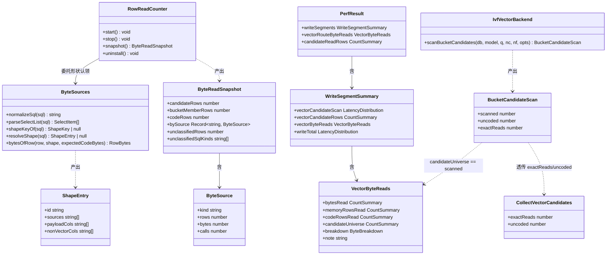
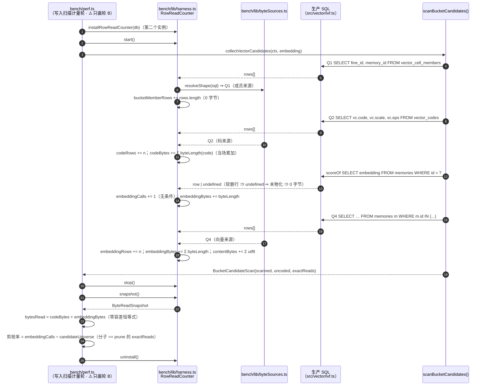

# T06 · 施工规格（字节计量的落地清单）—— **口径在 ①**

> **⚠️ T06 口径的唯一权威版本在 ① —— `docs/design/perf-c2-t06-byte-metering.md`（字节口径决策备忘）。**
> 本文件是 **① 的【施工规格】部分**（主理人 2026-11-05 裁决「拆分」⇒ **只搬位置、不删任何内容**）⇒ **⚠️ 两处冲突时一律以 ① 为准**；本文件**不许**维护任何口径（口径一律回 ① 改）。
> **① ↔ ② 对应关系**：① §1 字节算法 ⇒ ② §10.2 分类器契约 · ① §2 断言 ⇒ ② §10.3 断言写法 · ① §4 落盘结构 ⇒ ② §10.1 字段命名表 · ① §5 判据处置 ⇒ ② §8 的 T06-4 · ① §6 风险清单 ⇒ ② §8 的验收标准 · ① §11 / §13 / §14 ⇒ ② §8 的验收标准与待办。
> **章节索引**：§7 文件列表 · §8 任务列表（T06-1 ~ T06-5）· §9 依赖包 · §10 共享知识（§10.1 字段命名表 / §10.2 分类器契约 / §10.3 断言写法 / §10.4 门禁命令）· §12 类图与时序图。
> **旁文件（不是口径来源）**：`docs/design/perf-c2-t06-byte-metering-impl-notes.md` = 工程师的施工记录。
## 7. 文件列表（相对路径 · 谁改什么）

| 文件 | 动作 | 改什么 | 归属 |
|---|---|---|---|
| `bench/lib/harness.ts` | 改 | ① `classifyReadKind()` **两个结论**：legacy（逐位复现）+ 字节来源（**形状登记制**）；② 快照加 `calls`（`get()` **调用次数**）、各来源的 `rows` / `bytes`；③ 字节**当场累加标量**（O(1) 内存） | T06-1 |
| `bench/lib/byteSources.ts` | **新增** | **纯函数**：SQL 归一化 + SELECT 列表解析 + **形状登记表** + 逐行字节模型（**可单测、无 db 依赖**） | T06-1 |
| `bench/perf.ts` | 改 | ① 写入扫描循环**另装一个计数器实例**（逐次 `start`/`stop`；⚠️ **不要移动召回那个的 `uninstall()`**）；② `WriteSegmentSummary` 加 `vectorByteReads`、顶层加 `vectorRouteByteReads`；③ `THRESHOLDS` 加三个常量；④ `checkPerf()` 换判据；⑤ 落盘 JSON + stdout 打印 | T06-2 / T06-3 / T06-4 |
| `tests/unit/prune.test.ts` | 改 | ★ **断言 1c**：`pruneTopK()` 的 `exactReads` === `scoreOf` 的**调用次数**（**零 src 改动的等价性守卫**） | T06-1 |
| `tests/bench/t06-byte-metering.test.ts` | **新增/扩写** | 形状登记表自测（7 个登记形状 + 1 个未登记）+ 字节模型单测 + 断言 1/1a/1b/1c/1c-bench/1d/2/**3** + 落盘结构断言 | T06-1 → T06-3 |
| `tests/bench/h1-measurement.test.ts` | 改 | ⚠️ **旧过滤串 `（H1）`/`（H2）` 必须同批改**（⇒ 否则旧断言**恒绿 = 没牙**）；新增 H1′/H2′/剪枝率的伪造输入断言 | T06-4 |
| `tests/bench/bench-smoke.test.ts` | 改（可能） | 若它断言了 `failures` 条数或 `thresholds` 键集合 ⇒ 同步 | T06-4 |
| `docs/design/perf-c2-admissible-two-stage.md` | 改 | §5.1.2 的 **Q5 行加注**（生产读路径不用）✅ **已由 architect-2 落盘**；§5 任务表 T06 行 + §7 出关条件① 的口径说明 | T06-5 |
| `docs/decisions/adr-perf-recall-vs-h1.md` | 改（**已由 architect-2 落盘**） | §8.6 表后的「T06 施工期核实」订正段（**正文数字一个字未改**）✅ | T06-5（已完成） |
| `docs/design/perf-c2-t06-byte-metering.md` | 改 | 本文件：回填 **1M 实测数字**（T07 重采后） | T06-5 |
| `docs/design/perf-c2-t06-byte-metering-impl-notes.md` | 改 | **工程师的施工记录**（第一段已完成 ✅；第二段框架由架构师落盘 ⇒ 工程师往里填） | T06-2 ~ T06-5 |
| `docs/design/perf-c2-t06-byte-metering-spec.md` | 改（**只留指针**） | 内容已并入本文件 ⇒ **只保留指针存根**，**不许在那里维护口径** | T06-5 |
| `docs/progress/vector-round-progress.md` | 改 | **A5** 行（验收断言台账）更新 | T06-5 |
| `docs/baseline/README.md` | 改 | 门槛表加一行「H1′ 字节口径」+ **口径更正说明**（⚠️ 该文件被 `audit:tier-qualifiers` 审计 ⇒ 措辞须合规） | T06-3 |
| `docs/design/DECISIONS.md` | 改（**只加一行指针**） | 指向本文件（**正文不许堆进索引**） | T06-5 |
| `docs/class-diagram.mermaid` / `docs/sequence-diagram.mermaid` | **新增（已落盘）** | §12 的两张图（单文件版）⇒ **归属 = T06 的产物** | T06-1 |
| ~~`src/store/dedupCandidates.ts`~~ | **不改** | ⚠️ **裁决 ②：本轮零 `src/**` 改动** ⇒ 原计划的「透传 `exactReads` / `uncoded`」**取消**（剪枝率分子改由 bench 侧「调用次数」等价取得，§1.7） | — |
| ~~`src/vector/ivf.ts`~~ | **不改** | ⚠️ **裁决 ②：连注释订正也不做** ⇒ 转 §13 待办第 8 条（T06 之后单独一轮） | — |

## 8. 任务列表（有序 · 含依赖 · 含验收标准）

> ⚠️ 依赖顺序：**T06-1 是唯一的根**；T06-2 依赖它；T06-3 依赖 1+2；T06-4 依赖 3；T06-5 依赖 4。

### T06-1 · 字节计量装置（双结论分类器 + 当场累加标量 + 调用次数）

* **源文件**：`bench/lib/harness.ts`（改）、`bench/lib/byteSources.ts`（**新**）、`tests/unit/prune.test.ts`（改）、`tests/bench/t06-byte-metering.test.ts`（**新**）
* **依赖**：无
* **验收标准**：
  1. **legacy 结论逐位不变**：旧 `classifyReadKind()` 的四条判定规则行为不变 ⇒ `docs/baseline/*.json` 的 R6 `candidateReadRows` **不断档**；
  2. **形状登记表**：7 个登记形状（Q1/Q2/Q3/Q4/Q5/`scoreOf`/**`bucketCandidate`**）各被正确认领 ⇒ 载荷列与非向量字节列按 §3.2 表（★ `bucketCandidate` = **仅 `prune = false` 对照分支** ⇒ 两段式写路径不发 ⇒ 本轮 bench 不触发；登记它是为了防御）；
  3. **未登记 ⇒ 零来源**：`SELECT id FROM memories` ⇒ 落进 `unclassified`（**断言 3**）；
  4. **恒等式零容差**：`bytesRead === codeBytes + embeddingBytes`；
  5. **健康库检查**：`badCodeRows === 0`；此时 `codeBytes === codeRowsRead × 768`；
  6. ★ **调用次数单独计数**：**无条件** `calls += 1`（**返回 `undefined` 也计**）⇒ `embeddingCalls ≥ embeddingExactRows`（断言 1c-bench；`embeddingExactRows` = `scoreOf` **返回了行**的次数）⇒ ⚠️ **现有实现只在 `row !== undefined` 时计数 ⇒ 必须改**；
  7. ★ **断言 1c（等价性）**：在 `tests/unit/prune.test.ts` 断言 `pruneTopK()` 的 `exactReads` === `scoreOf` 的调用次数 ⇒ **零 src 改动**下剪枝率分子合法；
  8. **聚合查询仍不计**（`COUNT(` / `SUM(` / `AVG(` / `TOTAL(`）；
  9. **O(1) 内存**：字节**当场累加**、**不缓存行数组**（⇒ 500 轮不 `stop()` 也不涨内存）；
  10. **无 db 依赖**：`byteSources.ts` 的解析函数是纯函数 ⇒ 可单测。

### T06-2 · 写路径接线（把字节账挂到写入扫描循环）

* **源文件**：`bench/perf.ts`（改）、`bench/lib/harness.ts`（改：计数器实例的串行安装 / 卸载契约）、`tests/bench/t06-byte-metering.test.ts`（改：端到端断言）
* **依赖**：**T06-1**
* **验收标准**：
  1. **写入扫描循环另装一个计数器实例**（**不移动** `rowCounter.uninstall()`）⇒ 写入循环 `store.write()` 内部的向量扫描**不被计量**（断言「写入循环内计数增量 = 0」）；
  2. **两个实例串行安装** ⇒ 第二个 `uninstall()` 不会把 `db.prepare` 还原成「第一个的包装」；
  3. **断言 1b**：`bytesRead === codeRows × 768 + candidateRows × 3,072`（写路径，零容差）；
  4. **断言 1c-bench**：`embeddingCalls ≥ embeddingExactRows`（`embeddingExactRows` = `scoreOf` **返回了行**的次数；软删行存在时**严格大于**）⇒ ⚠️ **不许用 `embeddingRowsRead` 当比较对象**（它是字节账分子、含 Q4/Q5 的 survivors 整行 ⇒ 写路径下必然大于 `embeddingCalls` ⇒ 用它比对**恒红** ⇒ 口径会写出一条在自己实现上就不成立的断言）；
  5. **`candidateUniverse` ≡ `scan.scanned`**（生产返回值对拍）⇒ 落盘值就是生产给的那个数；
  6. **`uninstall()` 逐位还原** `db.prepare`（既有纪律，回归）；
  7. **计时污染为零**：两轮制 ⇒ 计时轮**完全不装计数器** ⇒ `vectorCandidateScan` 的毫秒数与历史基线**逐位可比**；
  8. ⚠️ **零 `src/**` 改动**：本任务**不许**动 `src/**`（含注释）；
  9. ★ **断言 1e（窗口没开大）**：写路径 `bucketMemberRows === candidateUniverse`（零容差）⇒ 窗口一旦罩住召回探针或写入循环内部那次扫描 ⇒ 这个数就变大 ⇒ 红。⇒ ★ **它成立的原因 = 【同源】**（两者量**同一个扫描的同一批桶**：计数器实测的 Q1 成员行 vs 生产返回值 `scan.scanned`）⇒ ⇒ **零容差可判红** ⇒ ⚠️ **只对写路径成立**（读路径的 `candidateUniverse` 来自外层 `route()` 侧 ⇒ **异源** ⇒ **禁止互比** ⇒ 见 ① §2 断言 1d 理由③）。

### T06-3 · 落盘结构 + 打印（四读数并列）

* **源文件**：`bench/perf.ts`（改）、`docs/baseline/README.md`（改）、`tests/bench/t06-byte-metering.test.ts`（改）
* **依赖**：**T06-1、T06-2**
* **验收标准**：
  1. **四个读数**（`memoryRowsRead` / `codeRowsRead` / `bytesRead` / `candidateUniverse`）**用 ADR §8.5 的原名**、**`CountSummary` 分布形态**；
  2. **两个分段容器**：`writeSegments.vectorByteReads` + 顶层 `vectorRouteByteReads`（**不进 `recallVectorPath`**）；
  3. **`breakdown` 含 `contentBytes`**（Q4 正文）⇒ 「下界差多少」可见；且含 `codeBytes` / `embeddingBytes` / `embeddingRowsRead` / **`embeddingExactRows`（★ **第 13 项**（= 使清单达到 **13** 项的那一项；⚠️ **在 ① §4 的 JSON 清单里排在第 5 位** ⇒ ⇒ 按【位置】读会读错）· `scoreOf` 返回了行的次数）** / `embeddingCalls` / `narrowRowsRead` / `bucketMemberRows` / `badCodeRows` / `unclassifiedRows` / `unclassifiedSqlKinds` / `pruneRate` / `samplesAligned`；
  4. **旧键一个都没改名 / 挪位 / 删除**；
  5. **stdout 四读数并列打印**（旧行数**只许**说「观测值 = … 行」）；
  6. **口径 note 落盘**（含：只计向量载荷 / 是真实搬运量的**下界** / ADR §8.6 的 4.44 MB 是**下界** / H1′ 判的是哪一笔 / 剪枝率分子与 `exactReads` 的等价性前提）。
  7. ★ **落盘 `note` 的【逐字副本】在 `docs/design/perf-c2-t06-byte-metering-impl-notes.md` §13**（两段 `note`）⇒ ⇒ 由 `.tmp/bench/check-json-note-fidelity.ts` **逐字**守着（⚠️ **该脚本只在 `.tmp/` 里（gitignored ⇒ 仓库里没有）** ⇒ ⚠️ **`bench/perf.ts` 把「机器凭据」写成 `handover/bench/…`（已提交 · 但那个路径不存在）** ⇒ ⇒ **提交态这道守卫是断的** ⇒ ⇒ ⇒ **待搬进 `scripts/` 并挂进 `verify` 链** ⇒ 当前报 true / true）⇒ ⇒ ⚠️ **① §4 那段 JSON 是【结构示意】、不是逐字副本**（带 `{ /* … */ }` 占位符、条目被压缩）⇒ ⇒ ⚠️★ **不许拿 ① §4 去替换 `bench/perf.ts` 的真实 `note` 字符串**（⇒ 会丢掉真实 note 的多项 ⇒ **净损失**；⇒ 且 impl-notes §13 的逐字副本会立刻失配 ⇒ ⇒ **自检脚本立刻报 false**）⇒ ⇒ ★ **改 `note` 字符串 = 改【落盘产物】⇒ 必须同批改 impl-notes §13** ⇒ ⇒ ⚠️ **这条机制已获实战验证**：曾一度报 false（读路径那段在中间失配）⇒ ⇒ **同批更新 impl-notes §13 的读路径 `note` 后即回绿**（⇒ 当前 true / true）⇒ ⇒ ★ **以后任何人改 `note` 字符串，都必须同批改 impl-notes §13**。

### T06-4 · H1′ / H2′ / 剪枝率 判据改造

* **源文件**：`bench/perf.ts`（改）、`tests/bench/h1-measurement.test.ts`（改）、`tests/bench/bench-smoke.test.ts`（改，可能）
* **依赖**：**T06-3**
* **验收标准**：
  1. **H1′**：`bytesRead.max > 6,144,000 B` ⇒ 判红（标签 **`（H1′）`**）；判定取 `max`；
  2. **H2′**：`bytesRead.max ÷ (库规模 × 3,072 B) > 0.2%` ⇒ 判红（标签 **`（H2′）`**）；
  3. **剪枝率**：`（PRUNE_RATE）`、阈值 0.15、分子 = **`embeddingCalls`（`get()` 调用次数）**；
  4. **旧行数判据不再进 `failures`**，但 **`candidateReadRowsMax` / `candidateReadRowsRatioMax` 两个常量键名与数值一个都不许删**；
  5. **真空通过 / 不可判定守卫**（全部判红）：`bytesRead.count === 0` / `bytesRead.max === 0` / `unclassifiedRows > 0` / `badCodeRows > 0` / `samplesAligned === false`；
  6. ⚠️ **断言 5（过滤串失效守卫 · 有牙）** —— **旧的过滤串 `（H1）` / `（H2）` 必须一个都匹配不上任何违规行** ⇒ 若它们仍能匹配 ⇒ 判「**过滤串失效**」⇒ **判红**。⇒ **写法（两头锁死）**：① **故意造一条**带**旧标签** `（H1）` 的违规行 ⇒ 断言它**不**进 `failures`；② 再造一条带**新标签** `（H1′）` 的违规行 ⇒ 断言它**确实**进 `failures` ⇒ ⇒ 改名这件事**有牙**（旧串**全部**换成 `（H1′）` / `（H2′）` / `（PRUNE_RATE）`，旧串**不许**留着当「宽松匹配」）；且用**伪造 `bytesRead.max`** 验证「判定真的读了字节那个字段」；
  7. **`formatRecallVecRowsObservation()` 的措辞**同步改（「2,000 行」已是历史口径 ⇒ 不许再叫它「门槛」）。

### T06-5 · 文档同步 + 收尾（**零 `src/**` 改动**）

* **源文件**：`docs/design/perf-c2-admissible-two-stage.md`（改）、`docs/design/perf-c2-t06-byte-metering.md`（改）、`docs/design/perf-c2-t06-byte-metering-impl-notes.md`（改：工程师填第二段）、`docs/design/perf-c2-t06-byte-metering-spec.md`（改：只留指针）、`docs/progress/vector-round-progress.md`（改）、`docs/design/DECISIONS.md`（改）
* **依赖**：**T06-4**（文档订正部分可提前做）
* **验收标准**：
  1. 设计稿 §5 任务表 **T06 行**与 §7 出关条件① 的口径与本文件一致（Q5 行的加注 ✅ 已由 architect-2 落盘）；
  2. **★ 断言 4（本轮硬边界）**：`git diff --stat src/` **为空** ⇒ 本轮**零 `src/**` 改动**（含注释）⇒ ⚠️ `src/vector/ivf.ts:1387` 的过期 JSDoc **本轮不改** ⇒ 已登记进 §13 待办第 8 条；
  3. `docs/progress/vector-round-progress.md` 的 **A5** 行更新；
  4. `docs/design/DECISIONS.md` **只加一行指针**；
  5. **`pnpm run verify` 全绿**（含 `audit:two-layer` 零真缺、`audit:tier-qualifiers` 绿、`check:params` 绿 ⇒ **Params 仍 60 项**、`table-name-boundary` 绿 ⇒ **`src/store/**` 无 `vector_codes`**）。

## 9. 依赖包

* **T06 不新增任何第三方依赖**（**硬约束**）。
  * 字节计量 = 纯 JS + Node 内建 `Buffer.byteLength` ⇒ 无需新包；
  * SQL 解析 = 手写归一化 + SELECT 列表切分（**不引入 SQL 解析库** ⇒ 避免为一个 7 形状的登记表引入依赖面）。
* 沿用既有：`better-sqlite3@^13.0.3`（生产与 bench 共用）、`vitest@^4.1.12`、`tsx@^4.19.2`、`typescript@^5.7.2`、`@biomejs/biome@^1.9.4`。
* ⚠️ **不许加 `Params` 键**（恒 60 项，三处副本 + `pnpm check:params` 守着）⇒ 本设计的开关一律是**构造参数**（如 `installRowReadCounter` 的选项）或**函数参数**。

## 10. 共享知识（跨文件约定 · 工程师照抄即可）

### 10.1 字段命名表（**四处必须一致**：ADR §8.5 / 本文件 §4 / `bench/perf.ts` 落盘 / 测试断言）

| 名字 | 层级 | 类型 | 含义（**逐字**） |
|---|---|---|---|
| `bytesRead` | `writeSegments.vectorByteReads` / `vectorRouteByteReads` | `CountSummary` | **向量载荷字节**：Σ `code.byteLength` + Σ `embedding.byteLength`（**不含**正文 / 词串 / id / 标量 / SQLite 页开销）⇒ **真实搬运量的下界** |
| `memoryRowsRead` | 同上 | `CountSummary` | **物化的 `memories` 行数**（窄读 + 向量）＝ ADR §8.5 的「原口径」 |
| `codeRowsRead` | 同上 | `CountSummary` | **物化的 `vector_codes` 行数**（Q2 返回行数） |
| `candidateUniverse` | 同上 | `CountSummary` | **命中桶内的候选总数**（＝ `scan.scanned` ＝ `PruneOutcome.candidates`） |
| `embeddingRowsRead` | `….breakdown` | `CountSummary` | 其中**带 `embedding`** 的物化行数（字节账的分子） |
| `embeddingExactRows` | `….breakdown` | `CountSummary` | ★ **`scoreOf` 返回了行的次数**（= `embeddingCalls` 减去「白调用」）⇒ **断言 1c-bench 的比较对象**（⚠️ **不是** `embeddingRowsRead`） |
| `embeddingCalls` | `….breakdown` | `CountSummary` | bench 侧 `get()` **调用次数**（⇒ **剪枝率的分子**；定义上 == `prune` 的 `exactReads`，§1.7） |
| `codeBytes` / `embeddingBytes` | `….breakdown` | `CountSummary` | 两项字节分量 ⇒ **`bytesRead === codeBytes + embeddingBytes`（零容差）** |
| `contentBytes` | `….breakdown` | `CountSummary` | Q4 的 `content` + `content_tokens`（UTF-8）⇒ **不在 `bytesRead` 里** ⇒ 让「下界差多少」可见 |
| `narrowRowsRead` | `….breakdown` | `CountSummary` | Q3 窄读行数（**0 字节**） |
| `bucketMemberRows` | `….breakdown` | `CountSummary` | Q1 成员行数（**0 字节**进判据） |
| `badCodeRows` | `….breakdown` | number | 码长 ≠ 768 的行数（**健康库恒 0**；非 0 ⇒ **白读** ⇒ 前提违例） |
| `unclassifiedRows` | `….breakdown` | number | **必须 0**；> 0 ⇒ 判「口径不完整」（红） |
| `unclassifiedSqlKinds` | `….breakdown` | string[] | 未登记语句的指纹集合（**打印 + 落盘**） |
| `pruneRate` | `….breakdown` | `CountSummary` | 每样本 `embeddingCalls ÷ candidateUniverse`（判定取 `max`） |
| `samplesAligned` | `….breakdown` | boolean | ★ **两种语义、键名与类型都不动**：**写路径** = 两轮（轮 A 计时 / 轮 B 计量）的 `candidateUniverse` 逐样本相等；**读路径** = （逐样本）计数器实测桶成员行 === `route()` 命中桶推算的成员数之和（`bucketMemberRows` === `bucketMemberRowsDerived`）⇒ ⚠️ 读路径**不许**用 `bucketMemberRows === candidateUniverse`（★ **原因 = 【来源不同】**：计数器 `search()` 侧实测 vs 外层 `route()` 侧的 `COUNT(DISTINCT memory_id)` ⇒ 互比会掩盖真正的失配 ⇒ 详见 ① §2 断言 1d 理由③）⇒ ⇒ ★★ **这条禁令的【可验证形态】= 【接线层】按【来源】验**（★ **不是**判定层的数值比较 ⇒ 判定层按数值验**恒假** ⇒ **必红** ⇒ **不许**那样写） |
| `basis` / `note` | `…` | string | **口径说明（必须落盘）** |

### 10.2 分类器契约（`bench/lib/byteSources.ts`）

```
归一化 = 折叠空白 → trim → 把 IN (?, ?, …) 折叠成 IN (…) → 小写关键字
聚合判定（COUNT(/SUM(/AVG(/TOTAL( ⇒ 一律不计行读、不计字节）—— 必须第一个判
  ★ 字节侧的【聚合豁免】（裁决 3）：聚合查询命中零来源、但【不计入】unclassified ⇒ 与 legacy 侧对称
    （否则 countUncodedCandidates（ivf.ts:687）/ bucketAssign.ts:525 的诊断 SQL ⇒ 未登记 ⇒ 误判红）

【结论一 · legacy 行读】（逐位复现旧行为）
  含 FROM|JOIN memories            ⇒ candidate       ⚠️ 必须在 vector_codes 之前
  含 FROM|JOIN vector_cell_members ⇒ bucketMember
  含 FROM|JOIN vector_codes         ⇒ vectorCode（新增，旧行为是 null ⇒ 不改既有读数）
  其余                             ⇒ null
  ⚠️ memories_fts 不匹配 memories（\b 在 _ 前不成立）⇒ 文本路 FTS 不计入任何读数

【结论二 · 字节来源】（形状登记制 ⇒ 未登记 ⇒ 命中零来源 ⇒ unclassified）
  形状键 = (归一化的 FROM/JOIN 表集合, 归一化的 SELECT 源列名集合)
  源列名 = SELECT 项 AS 之前的部分、去掉表限定符（m.embedding ⇒ embedding）
  SELECT 列表 = 第一个 SELECT 之后、第一个 FROM 之前（不许扫全文）
  登记表见 §3.2（7 个形状）
  命中零来源 ⇒ unclassifiedRows += 行数；unclassifiedSqlKinds += 指纹

【计数纪律】
  rows  = 物化出来的行数（.all 返回长度 / .get 返回非 undefined）
  calls = 【调用次数】（.get 被调用就计，返回 undefined 也计）★ 剪枝率分子用它
  bytes = 当场累加标量（Σ BLOB.byteLength）⇒ 绝不缓存行数组
```

### 10.3 断言写法（**每条都要能指认「什么变异会让它红」**）

| 断言 | 写法 | 打什么变异 |
|---|---|---|
| 字节恒等式 | `expect(bytesRead.max).toBe(codeBytes.max + embeddingBytes.max)`（**零容差**） | 把 `bytesRead` 换成「行数」 |
| 健康库检查 | `expect(badCodeRows).toBe(0)`；`expect(codeBytes.max).toBe(codeRowsRead.max * 768)` | 把码字节写成 `× 784` |
| **交叉校验 1b** | `expect(bytesRead.max).toBe(codeRows.max * 768 + candidateRows.max * 3072)`（**写路径**） | 分类漏了 Q4 / 漏了 `scoreOf` |
| **等价性 1c** | `expect(out.exactReads).toBe(scoreOfCalls)`（**tests/unit/prune.test.ts**，直接调 `pruneTopK`） | prune.ts 改了 `exactReads` 的计数口径 |
| **口径纪律 1c-bench** | `expect(embeddingCalls.max).toBeGreaterThanOrEqual(embeddingExactRows.max)`（⚠️ **不许用 `embeddingRowsRead`**：它是**字节账分子**、含 Q4/Q5 的 survivors 整行 ⇒ 写路径下必然大于 `embeddingCalls` ⇒ 用它比对**恒红**） | 把剪枝率分子换成「返回行数」⇒ **假绿** |
| **两轮对齐 1d（写路径形态）** | `expect(samplesAligned).toBe(true)` | 两轮看到的不是同一批数据 |
| **读路径对账 1d（读路径形态）** | 读路径 `samplesAligned` = **（逐样本）计数器实测桶成员行 === `route()` 命中桶推算的成员数之和**（`bucketMemberRows` === `bucketMemberRowsDerived`；⚠️ `bucketMemberRowsDerived` 的类型是 `number | null` ⇒ `null` = 没算 ⇒ **不可判定 ⇒ 判红**，方向纪律：**宁可误红不可假绿**）⇒ 不等即红 | ⚠️ **旧写法恒真**（字节样本数 == 召回毫秒样本数 ⇒ 同一循环体内无条件 `push` ⇒ **永远打不红**）；⚠️ **不许用 `bucketMemberRows === candidateUniverse`**（★ **原因 = 【来源不同】**：计数器 `search()` 侧实测 vs 外层 `route()` 侧的 `COUNT(DISTINCT memory_id)` ⇒ 互比会掩盖「`search()` 内部路由 ≠ 外层 `route()` 路由」这个真正的失配 ⇒ ⇒ **守卫失明**（两批桶成员行数**恰好相等**时 ⇒ **假绿**）⇒ 详见 ① §2 断言 1d 理由③）<br>⚠️ ★★ **可验证形态 = 【接线层】按【来源】验**（★ **不是**判定层按【数值】验 ⇒ 判定层的「数值不等」断言**恒假** ⇒ **必红** ⇒ **不许**那样写）⇒ ⇒ **变异（接线层）**：把 `measured` 与 `derived` 接成**同一列** ⇒ ⇒ 判定层**打不红**（两数组逐位相等 ⇒ 判定仍给 `true`）⇒ ⇒ ⇒ **只有接线层能抓它** ⇒ ⇒ ⇒ **守卫落点**：`tests/bench/t06-prune-rate-wiring.test.ts` 的 **§D**（接线 · 按来源验）+ **§E**（负控 · 把两列人为改不同）⇒ ⇒ ⚠️ **引用只写章节 / 用例名，不许写行号** |
| **窗口没开大 1e** | `expect(bucketMemberRows).toBe(candidateUniverse)`（**写路径**，零容差；★ **成立原因 = 【同源】** ⇒ 两者量同一个扫描的同一批桶） | 计数窗口罩住了召回探针 / 写入循环内部那次扫描 |
| **未解析有牙（断言 3）** | 喂 `SELECT id FROM memories` ⇒ `expect(unclassifiedRows).toBeGreaterThan(0)` | 形状登记表漏登记 ⇒ 静默按 0 计 |
| 剪枝率方向 | 断言 `embeddingCalls ≥ embeddingExactRows`（**调用次数 ≥ `scoreOf` 返回行数**） | 把剪枝率分子换成「返回行数」⇒ **假绿** |
| 真空通过 | `bytesRead.count === 0` / `max === 0` ⇒ 判红 | 把「没测到」读成「达标」 |
| 旧判据已废 | `checkPerf()` 的 failures 里**不出现** `（H1）`/`（H2）`（旧标签） | 把旧行数判据偷偷留着 |
| **零 src 改动（断言 4）** | `git diff --stat src/` 为空 | 顺手改了 `src/**`（含注释） |
| ★ **过滤串失效守卫（断言 5）** | 造一条**旧标签**（`（H1）`）的违规行 ⇒ `expect(failures).not.toContain(...)`；造一条**新标签**（`（H1′）`）的违规行 ⇒ `expect(failures).toContain(...)` | 过滤串没改 ⇒ 旧断言**恒绿 = 没牙** |

### 10.4 门禁命令（工程师自跑）

```bash
pnpm run typecheck && pnpm run lint
pnpm exec vitest run tests/bench/t06-byte-metering.test.ts tests/bench/h1-measurement.test.ts tests/unit/prune.test.ts
pnpm run check:params          # ★ Params 仍 60 项
pnpm exec vitest run tests/contracts/table-name-boundary.test.ts   # ★ src/store/** 无 vector_codes
git diff --stat src/           # ★ 必须为空（断言 4 · 裁决 ②）
pnpm run verify
```


## 12. 类图与时序图

> **归属**：**本节是这两张图的权威版**。`docs/class-diagram.mermaid` 与 `docs/sequence-diagram.mermaid` 是**本节的抽取副本**（便于独立预览）⇒ ⇒ **两者不一致时一律以本节为准** ⇒ ⇒ **不要在副本里改内容**（要改改本节，然后重新抽取）⇒ ⇒ 副本与本节**无冲突**、也不构成第二份口径。



> ⚠️ **本图只画【写路径 · 计量轮（轮 B）】** ⇒ 完整限定语见**图内首部的 `%%` 注释行**（注释随块走 ⇒ 副本也带着 ⇒ 副本仍是「② §12 的逐字抽取」⇒ `diff` 仍可证）⇒ **两轮制只限写路径** · **读路径本轮单轮**。



